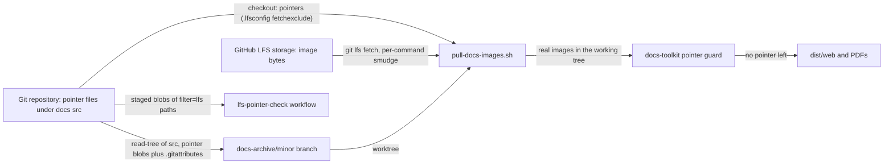

# 0029 — User manual images in Git LFS

## Summary

> Unfamiliar terms are collected in the [Glossary](#glossary) at the end.

- The user manual's images (`png`, `jpg`, `jpeg`, `gif`, `webp` at any depth under `packages/backend.ai-webui-docs/src/`) are stored in Git LFS. `packages/backend.ai-webui-docs/assets/` and every other file stay normal Git files.
- A clone holds pointer files for those images by default, even when git-lfs is installed: the root `.lfsconfig` sets `lfs.fetchexclude = packages/backend.ai-webui-docs/src/**`.
- Every consumer that needs the image bytes runs `.github/scripts/lfs/pull-docs-images.sh` on its checkout first. The script does nothing while no pointer file exists and needs no git-lfs then.
- The docs toolkit refuses to build from pointer files: `build:web`, `pdf`, document-mode previews and `diff:web` stop with the offending paths and the pull command.
- A `docs-archive/<minor>` branch keeps each image blob exactly as its source ref stores it. When the source stores pointers, the archive root also carries a `.gitattributes` that marks those paths `filter=lfs`. This extends the branch content ADR 0023 §2 lists.

## Context

- **Repository size**: The manual's screenshots are about 1,600 PNG files, 187 MiB at HEAD and 546 MiB across `main`'s history, and automated docs updates add 50–160 MiB a month. A default clone is about 1.26 GiB, and only the docs builds need the image bytes.
- **Silent failure**: The toolkit reads images with existence checks only (`getImageDimensions`, `image-meta.ts`) and `copyImagesDir` copies files verbatim. A pointer file of about 130 bytes passes both, so a checkout without its LFS objects would ship a site and PDFs full of broken images with no error.
- **Builders without git-lfs**: The AWS Amplify build image and the Playwright container of `package.yml` `build_docs` have no git-lfs. The Amplify build renders `main` plus every archive worktree (ADR 0023 §2).

## Diagram

## Decision

### 1. Which files are in Git LFS

- **Rule**: The root `.gitattributes` holds `packages/backend.ai-webui-docs/src/**/*.<ext> filter=lfs diff=lfs merge=lfs -text` for `<ext>` in `png`, `jpg`, `jpeg`, `gif`, `webp`. Nothing outside `packages/backend.ai-webui-docs/src/` is LFS-tracked.
- **Landing**: The rule lands together with the commit that converts the existing images (#11040). Before it, nothing is LFS-tracked, and the check, the pull script and the guard below find nothing to do.
- **Default checkout**: `.lfsconfig` sets `lfs.fetchexclude = packages/backend.ai-webui-docs/src/**`, so `git clone`, `git checkout` and a plain `git lfs pull` leave pointer files there.
- **Commit check**: The workflow `.github/workflows/lfs-pointer-check.yml` runs `.github/scripts/lfs/check-lfs-pointers.sh` on pull requests and on pushes to `main` (#11065), so a raw file that reaches `main` is reported by the push that landed it. Every tracked file whose `filter` attribute is `lfs` must be staged as a valid pointer; a raw file there fails the check.

### 2. Consumers materialize images with one script

- **Script**: `.github/scripts/lfs/pull-docs-images.sh [--ref <rev>] [--remote <name|url>]... [--fallback-remote <url>]... [<worktree>...]` handles both layouts, `packages/backend.ai-webui-docs/src/` and an archive worktree's `src/`.
- **No-op**: It looks for tracked working-tree files under those roots whose content is pointer text. With none it exits 0 and does not need git-lfs.
- **Otherwise**: It installs git-lfs with `.github/scripts/lfs/install-git-lfs.sh` when missing (release 3.8.1 for Linux x86_64, pinned with its sha256 in that script), hashes the objects the staged pointers name that are already in local LFS storage (deleting a corrupted one), fetches the objects of `--ref` (default `HEAD`) with the `.lfsconfig` exclusion overridden unless every one is already local, and restores the pointer files from the index through an LFS filter. The filter and a temporary attributes file naming those paths are passed per command, so the restore works whether or not `.gitattributes` marks them and no git config file is written. It fails if a pointer remains or a written file does not hash to its pointer's oid, and prints how many objects were needed, already local and downloaded.
- **Callers**: `amplify.yml` (the docs app, for `main` and every archive worktree), `package.yml` `build_docs`, and `.github/scripts/pr-preview/build-docs-preview.sh` (for the head, and again after it checks out the merge base's `src`, fetching that commit's objects with `--ref`). For a fork PR, `pr-preview.yml` passes the head repository's clone URL as `--head-lfs-remote`, which the head pull uses as `--fallback-remote`: it is fetched without the base repository's credentials, only for objects `origin` lacks. Images that come only from the fork are built, but the job then fails with the `git lfs push origin` command a maintainer runs before merging, because builds of `main` fetch from `origin` alone. Contributors run `pnpm --filter backend.ai-webui-docs run images:pull`.

### 3. The toolkit refuses pointer files

- **Guard**: `packages/backend.ai-docs-toolkit/src/lfs-pointer.ts` exports `assertNoLfsPointers`, `findLfsPointerFiles`, `isLfsPointerFile` and `LfsPointerError`. A pointer is a file of at most 1024 bytes whose first line is `version https://git-lfs.github.com/spec/v1`.
- **Where it runs**: `generateWebsite` (`website-generator.ts`) checks every source root it renders (the workspace `src/` and each archive worktree's), `generatePdf` (`generate-pdf.ts`) checks its `src/`, the document modes of `preview-server.ts` and `preview-server-web.ts` check theirs, and `generateWebDiff` (`web-diff.ts`) checks both build trees. Each throws `LfsPointerError` before writing output, and `cli.ts` prints its message and exits 1.
- **`--no-strict`**: The flag relaxes link diagnostics only; it does not relax this guard.

### 4. Archive branches keep the source's blobs

- **Content**: `docs-archive-orphan-branch.yml` builds the archive commit with `git read-tree --prefix=src/` from the source commit's `packages/backend.ai-webui-docs/src` tree, so every blob is the source's own: pointers stay pointers and raw images stay raw.
- **Attributes**: When that tree holds pointer blobs, the archive root gets a `.gitattributes` that lists exactly those paths with `filter=lfs diff=lfs merge=lfs -text`. A source with raw images gets no `.gitattributes`, and its `src/` tree is the same as before this decision. A pointer path containing whitespace fails the workflow, because `.gitattributes` cannot express it.
- **Scope**: This adds `.gitattributes` to the files ADR 0023 §2 "Branch content" lists; the rest of ADR 0023 is unchanged.

## Rejected alternatives

- **Images in a separate repository or bucket**: Moving the screenshots out of the repository removes them from every clone. It is rejected because the manual's Markdown and its images change together in one PR, and the docs-update automation writes both.
- **Fetch every LFS object by default**: Leaving `.lfsconfig` out makes a clone with git-lfs installed download all images. It is rejected because most contributors never build the manual.
- **`actions/checkout` with `lfs: true`**: It covers GitHub-hosted jobs only. It is rejected because Amplify and the archive worktrees are checked out by plain `git`, and the Playwright container has no git-lfs.
- **Re-staging the archive from a working-tree copy**: The previous workflow copied the checkout and ran `git add`. It is rejected because the runner's git-lfs smudge and clean filters could turn pointers into binaries or binaries into new pointers.

## Consequences

- A default clone and every non-docs CI job skip the image bytes; only docs builds and screenshot work download them.
- Contributors who change screenshots need git-lfs, set up with `git lfs install --skip-repo` (Husky owns the hooks, so `.husky/pre-push` runs `git lfs pre-push`); images committed without it are raw bytes, which the pre-push hook refuses and the pointer check fails.
- A docs build fails loudly when its images were not fetched, instead of publishing broken images.
- PR previews cache the LFS object store (#11070): `docs-lfs-cache.yml` keeps `main`'s cache current, and `pr-preview.yml` restores it (or the PR's own), then saves a PR-scoped one pruned to what the build used (`prune-lfs-store.sh`). The key is `.github/scripts/lfs/docs-lfs-cache-key.sh`, so a build downloads only the images missing from the cache it restored. GitHub scopes caches by ref, so a PR's cache is never read by `main`. A fork PR's run saves no cache: objects that only the fork has must still reach `origin` before merging, and a cached copy would skip that check. `package.yml` `build_docs` holds a write token and restores no cache. `pull-docs-images.sh` hashes every object it takes from local storage, because git-lfs does not. Release and Amplify builds still download every image on each run.
- `main`'s history keeps the raw PNGs until a separate history rewrite, so a full clone shrinks only after it.

## Sources

- GitHub issue #11040, decided 2026-11-10. The pinned git-lfs download and `git lfs pull` were verified in the default AWS Amplify build image, for the main checkout and for an archive worktree.
- Related: ADR 0023 (the multi-version docs site and its archive branches).

## Glossary

| Term | Meaning |
|---|---|
| Git LFS | Git Large File Storage: an extension that stores a file's bytes on a separate server and commits a small pointer file in its place |
| pointer file | The text Git LFS commits instead of the file: `version https://git-lfs.github.com/spec/v1`, an `oid sha256:` line and a `size` line |
| smudge / clean filter | The Git filters that turn a pointer into the real file on checkout, and the real file into a pointer when it is staged |
| `fetchexclude` | The git-lfs setting naming paths whose objects are not downloaded by default |
