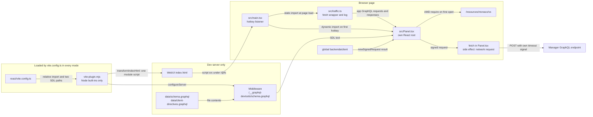

# 0030 — Dev-only tools as Vite plugin packages

## Summary

> Unfamiliar terms are collected in the [Glossary](#glossary) at the end.

- A tool that only developers use lives in its own private workspace package under `packages/`. It is not a dependency of `react/`, and `react/src` does not import it. The tool keeps its imports inside its own package, and logic it shares with the app is copied into the package.
- A [Vite plugin](#glossary) with [`apply: 'serve'`](#glossary) attaches the tool to the dev server. The plugin injects one module script into the WebUI `index.html` and serves the tool's dev-only assets through a dev-server middleware. A production build has no path to the tool's code.
- The plugin file may use only Node built-ins, because `react/vite.config.ts` loads it during production builds too.
- At page load the tool loads only a hotkey listener, plus, for the GraphQL devtools, a `fetch` wrapper that records the app's GraphQL traffic. Everything else loads the first time it opens.
- `packages/backend.ai-graphql-devtools` is the first tool under this rule. It builds a [signed request](#glossary) with the app's global `backendaiclient` and sends it with its own `fetch`. Its panel is React and uses the app's Monaco runtime at `/resources/monaco/vs`.
- Sections 1 to 4 of the Decision bind every dev-only tool. Sections 5 to 7 record how the GraphQL devtools panel uses the app.
- **Out of scope**: the review overlay in `react/vite-plugins/review-overlay/` stays there, because it also has a build-time injection and a host component in `react/src`.

## Context

- **What the tool is**: The GraphQL devtools panel runs queries against the logged-in session from inside the WebUI dev server (#10963).
- **Why the placement needs a rule**: Every line under `react/src` is a candidate for the production bundle, and a guard around dev code keeps that code in the source tree that reviewers and the bundler read. A tool placed outside that tree leaves the WebUI source unchanged.
- **Client request path**: `Client._wrapWithPromise` in `packages/backend.ai-client/src/client.ts` does more than send. It dispatches the events that `NetworkStatusBanner` listens to, and it appends to the `backendaiwebui.logs` entry in local storage.

## Diagram

## Decision

### 1. A developer-only tool is a separate private package

- **Location**: A tool lives in `packages/<name>/` with `"private": true`. `pnpm-workspace.yaml` already includes `packages/*`.
- **No link from the app**: The package does not appear in `react/package.json`, and no file under `react/src` imports it.
- **Own dependencies**: The package declares what it uses. `backend.ai-graphql-devtools` declares `react`, `react-dom`, `graphql`, and `graphql-language-service`, and takes `monaco-editor` as a dev dependency for types only.
- **Imports stay inside the package**: A tool imports only its own files and the dependencies it declares, never `react/src` or another package's source. Logic it shares with the app is copied into the package. In this tool, `src/graphql-transformer.ts` is a copy of `react/src/helper/graphql-transformer.ts`, the client-directive transform.
- **Own styling**: The panel renders plain elements styled by `src/Panel.css`, and `@lablup/ui-common` is not a dependency of the package. The stylesheet applies to the whole page, so its selectors carry the `bai-gql-devtools` prefix.

### 2. A Vite plugin with `apply: 'serve'` attaches the tool

- **Call site**: `react/vite.config.ts` imports the plugin by relative path and calls it. For this tool the call passes `schemaPath` and `clientDirectivesPath`, which resolve `data/schema.graphql` and `data/client-directives.graphql` from `projectRoot`.
- **Injection**: `transformIndexHtml` adds one `<script type="module">` at the start of the head, with its `src` under `/@fs` pointing at `src/main.tsx`. Module scripts run in document order, so it runs before the app entry. `server.fs.allow` in `react/vite.config.ts` includes the repository root, which lets the dev server serve that file.
- **Dev assets**: `configureServer` adds a middleware for assets only the tool needs. This tool has one, `/__graphql-devtools/schema.graphql`, which serves the two SDL files concatenated. A missing file is an error.
- **Hook order**: `transformIndexHtml` stays a plain function, so Vite runs it after the `order: 'pre'` handler of `projectRootStaticPlugin`, which replaces the HTML with the project-root template.
- **Prebundling**: The plugin's `config` hook adds the panel to `optimizeDeps.entries`, so Vite prebundles the panel's dependencies when the dev server starts.

### 3. The plugin file uses only Node built-ins

- **Rule**: `vite-plugin.mjs` imports only `node:*` modules.
- **Reason**: The static import in `react/vite.config.ts` evaluates this file during `vite build`. `apply: 'serve'` keeps the plugin's hooks from running there, but it does not keep the file from loading.
- **Referencing source**: The plugin names `src/` files only through `new URL(..., import.meta.url)`, so loading the plugin does not load the tool.

### 4. Only the hotkey listener and the fetch wrapper load at page load

- **Page load cost**: `src/main.tsx` registers one capture-phase `keydown` listener. Its only static import is `src/traffic.ts`, which has no dependencies and installs the `fetch` wrapper of section 7.
- **First open**: The hotkey (Cmd+Shift+G on macOS, Ctrl+Shift+G elsewhere) dynamically imports `src/Panel.tsx`, and the panel then loads Monaco and the schema.
- **Own root**: `togglePanel` appends one container to `document.body` and mounts a separate React root there. The panel does not enter the app's React tree.

### 5. The tool signs with the client and sends with its own `fetch`

- **Signing**: `Panel.tsx` calls `backendaiclient.newSignedRequest('POST', '/admin/gql', ...)` on the global client, so the request carries the logged-in session's credentials and no token is copied.
- **Client directives**: Before signing, `Panel.tsx` applies its copy of the client-directive transform, with the version check from `client.isManagerVersionCompatibleWith` as in `react/src/RelayEnvironment.ts`. The request carries the transformed query. The operation guards and the history entry use the typed query.
- **Sending**: `Panel.tsx` calls the unwrapped `fetch` (`panelFetch` from `src/traffic.ts`) with `AbortSignal.timeout(client.requestTimeout)`, so the wrapper does not record the request a second time. In `SESSION` mode it sets `credentials: 'include'` and `mode: 'cors'`, as `_wrapWithPromise` does.
- **Reason**: `_wrapWithPromise` raises the app's soft-timeout banner, can dismiss that banner on success, and writes the app log. A developer's test query must change none of these.

### 6. The panel reuses the app's Monaco runtime

- **Runtime**: `loadMonaco` in `Panel.tsx` uses the AMD loader at `/resources/monaco/vs`, which `monacoStaticPlugin` in `react/vite.config.ts` serves during development. If the app has already loaded Monaco, `loadMonaco` uses `globalThis.monaco`.
- **GraphQL support**: The panel sets markers on its own editor model. It also registers a completion provider for the `graphql` language, and that provider returns nothing for any model but the panel's. `graphql-language-service` computes the results.

### 7. A `fetch` wrapper records the app's GraphQL traffic

- **Scope**: `installCapture` in `src/traffic.ts` replaces `globalThis.fetch` before the app's modules run. It records only requests whose path ends in `/admin/gql` (`/func/admin/gql` in session mode, `<endpoint>/admin/gql` with an API key), which carries Relay queries and mutations and the `graphql-sse` subscriptions. `graphql-sse` keeps the `fetch` it sees when its client is created, which is why the wrapper must be in place first.
- **No change to the app**: the wrapper returns the app's own response promise. It reads the body from `response.clone()`, and a `text/event-stream` body through the clone's tee. Every recording error is caught and dropped.
- **Log**: the panel shows one log of `App` rows and its own `Panel` rows. The log keeps at most 200 `App` rows and 50 `Panel` rows, dropping the oldest of each, cuts an `App` row's body at 100,000 characters, and lives in memory, so a reload starts it empty. A "Preserve log" switch, off by default and remembered in `localStorage`, keeps it in `sessionStorage` across reloads instead; the stored copy cuts every body at 100,000 characters and drops the oldest rows to stay under 1,000,000 characters of JSON.

## Rejected alternatives

- **GraphiQL**: GraphiQL is a complete GraphQL IDE. It is rejected because it brings a second Monaco copy at a different version from the app's and needs worker setup.
- **Altair**: Altair is a feature-rich GraphQL client. It is rejected because it is an Angular app embedded as HTML, so the app's client function cannot be passed in.
- **Apollo Sandbox**: Apollo Sandbox needs no local editor code. It is rejected because it loads an iframe from an external Apollo host.
- **CodeMirror with `cm6-graphql`**: This pair provides ready GraphQL editing. It is rejected because it adds a second editor while the app already ships Monaco.
- **`import.meta.env.DEV` gate inside `react/src`**: This gate needs no separate package. It is rejected because it edits WebUI source and relies on dead-code removal to keep the tool out of the bundle.
- **No-framework iframe app**: This form was implemented and isolates the tool fully from the page. It is rejected because it needs `postMessage`, token copying, and a second Monaco load, and the owner found that cost not worth the isolation.

## Consequences

- **Production output**: With the plugin in place, a production build's 1,648 files are identical except `sw.js.map`. That file also differs between two builds without the plugin.
- **Page state after opening**: Opening the panel leaves Monaco's classes on `body` and a global `monaco`. A comparison of 2,947 elements on the users page found no computed-style change after opening and closing the panel.
- **Word suggestions in app editors**: After the Schema tab opens, an app editor with language `graphql` gets Monaco word-based suggestions taken from the open schema document. Before that tab opens there are none, and the panel's own provider and markers do not reach app editors.
- **App modals**: The panel is a plain element in `body`, so an open app modal makes the panel inert until the modal closes.
- **Copied transform**: `src/graphql-transformer.ts` can drift from `react/src/helper/graphql-transformer.ts`, and nothing checks it.
- **Undocumented client fields**: The tool depends on `ready`, `newSignedRequest` and the `uri` it returns, `requestTimeout`, `_config.connectionMode`, and `isManagerVersionCompatibleWith`. `Panel.tsx` declares their types by hand, so type-checking does not catch a change in `backend.ai-client`.
- **Every dev page load runs the wrapper**: on the dev server every app `fetch` passes through it, whether or not the panel is ever opened. A production build is unchanged.
- **Credentials in the tab's storage**: the log keeps request headers, including the signed `Authorization` header in API-key mode, and response bodies in `sessionStorage` for the tab's lifetime while "Preserve log" is on.
- **Verification gap**: `scripts/verify.sh` does not cover this package, and no lint rule enforces sections 1 and 3. The tool's authors check it by hand.

## Sources

- GitHub issues: #10963, and #11072 for the `fetch` wrapper.
- `packages/backend.ai-graphql-devtools/vite-plugin.mjs`, `src/main.tsx`, `src/traffic.ts`, `src/Panel.tsx`, and `src/graphql-transformer.ts`.
- `react/src/helper/graphql-transformer.ts` and `react/src/RelayEnvironment.ts`.
- `Client._wrapWithPromise` in `packages/backend.ai-client/src/client.ts`, and `react/src/components/NetworkStatusBanner.tsx`.
- Decided: 2026-11-09. Section 7 added: 2026-11-10.
- Related: [ADR 0008](0008-host-agnostic-review-overlay-client.md) decides the review overlay client, the other tool attached to the dev server.

## Glossary

| Term | Meaning |
|---|---|
| Vite plugin | A Vite plugin is an object whose hooks extend what the Vite dev server and `vite build` do. |
| `apply: 'serve'` | `apply: 'serve'` is a Vite plugin option that makes Vite run the plugin's hooks only on the dev server. |
| signed request | A signed request is the object `newSignedRequest` returns: the URI, method, headers, and body of a Backend.AI API call, authenticated for the current client. |
| AMD runtime | The AMD runtime is the build of Monaco under `min/vs`, which a page loads with a `require` loader instead of through a bundler. |
| inert | An inert element takes no clicks, focus, or keyboard input from the user. |
