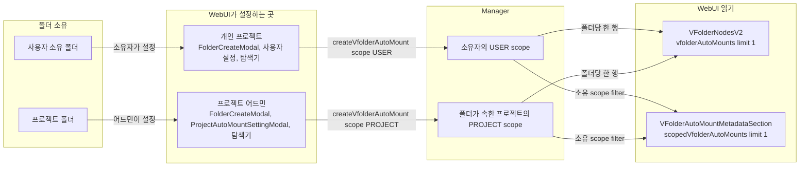

# 0031 — One auto-mount per folder

## Summary

> 낯선 용어는 문서 맨 아래 [용어](#용어)에 모아 두었다.

- manager는 [auto-mount](#용어)를 한 [scope](#용어), 즉 사용자나 프로젝트 하나에 붙는 설정으로 저장한다. manager는 같은 scope에 같은 폴더의 살아 있는 auto-mount를 두 번째로 만드는 것을 거부하지만, 같은 폴더를 여러 scope에 거는 것은 받아들인다.
- WebUI는 폴더를 소유한 scope에만 auto-mount를 설정한다. 사용자 소유 폴더는 개인 프로젝트에서 그 소유자에게 auto-mount된다. 프로젝트 폴더는 프로젝트 어드민이 그 프로젝트에 auto-mount한다.
- 이 규칙 때문에 WebUI는 폴더 하나에 auto-mount가 최대 하나라고 보고, 폴더의 auto-mount를 읽는 모든 곳은 행 하나만 요청한다.
- **Out of scope**: 다른 client가 폴더를 소유하지 않은 scope에 설정한 auto-mount. WebUI는 이를 보여주거나 관리하지 않는다.

## Context

- **Manager model**: 26.10부터 manager는 auto-mount를 `vfolder_auto_mounts` 테이블에 scope와 폴더당 한 행으로 저장한다. unique index `uq_vfolder_auto_mounts_live_vfolder`는 삭제되지 않은 행의 `scope_type`, `scope_id`, `vfolder_id`를 묶고, `uq_vfolder_auto_mounts_live_destination`은 `scope_type`, `scope_id`, `mount_destination`을 묶는다.
- **No owner check in the manager**: `createVfolderAutoMount`는 어떤 scope와 폴더든 받는다. manager의 어떤 코드도 scope가 그 폴더를 소유하는지 검사하지 않는다.
- **Two read paths**: 폴더 목록은 행마다 `VFolder.vfolderAutoMounts`를 읽는다. 폴더 탐색기는 폴더를 소유한 scope에 대해 `scopedVfolderAutoMounts`를 읽는다. 한 폴더가 여러 scope에 걸려 있으면 두 경로 모두 여러 행을 돌려줄 수 있다.

## 설계도

## Decision

### 1. 소유 scope만이 유일한 scope다

- **Scope choice**: auto-mount를 만드는 WebUI의 모든 경로는 폴더 소유자로부터 scope를 정한다. `accessControl.ownershipType`이 `USER`인 폴더는 `ownership.userId`의 `USER` scope를 받는다. 그 밖의 폴더는 `ownership.projectId`의 `PROJECT` scope를 받는다.
- **Creation paths**: `FolderCreateModal`은 개인 프로젝트에서 만든 폴더를 사용자 소유 폴더로 만들고 그 사용자에게 auto-mount한다. 다른 프로젝트에서는 폴더를 그 프로젝트에 auto-mount한다.
- **Folder pickers**: `VFolderAutoMountSettingModal`은 같은 scope를 넘긴 `BAIScopedVFolderSelect`로, 편집하는 scope의 폴더만 보여준다. 그래서 사용자 설정 목록은 사용자가 소유한 폴더만, 프로젝트 목록은 그 프로젝트의 폴더만 고른다.

### 2. 읽을 때는 폴더당 한 행

| Component                         | Query                                                         | Limit      |
| --------------------------------- | ------------------------------------------------------------- | ---------- |
| `VFolderNodesV2`                  | 각 `VFolder` 행의 `vfolderAutoMounts`                         | `limit: 1` |
| `VFolderAutoMountMetadataSection` | 소유 scope와 `vfolderId`로 filter한 `scopedVfolderAutoMounts` | `limit: 1` |

- **Single value**: 폴더 목록 셀과 탐색기 섹션은 첫 행을 그 폴더의 auto-mount 설정으로 그린다.
- **Explorer actions**: 탐색기 섹션은 행이 없으면 추가를, 있으면 수정이나 삭제를 보여준다. 같은 폴더에 두 번째 추가는 보여주지 않는다.

## 대안과 기각 사유

- **Several auto-mounts per folder**: WebUI가 폴더가 걸린 모든 scope를 나열하고 더 추가하게 할 수 있다. manager 상태를 전부 보여준다는 장점이 있지만, WebUI는 그런 폴더를 만들지 않고 그 목록은 다른 client만 만들 수 있는 상태를 위한 UI가 되므로 기각한다.
- **Manager-side uniqueness per folder**: `vfolder_id` 하나에 unique index를 두면 모든 client에서 규칙이 지켜진다. index는 manager의 몫이므로 WebUI에서는 기각한다. WebUI는 manager의 scope별 모델을 따르고, 자기 생성 경로에서 규칙을 지킨다.

## Consequences

- **Fewer rows**: 폴더 목록은 connection 전체 대신 행마다 auto-mount 하나만 manager에 요청한다.
- **Hidden extra rows**: 다른 client가 두 번째 scope에 건 폴더는 폴더 목록에서 auto-mount 하나만 보이고, 탐색기는 소유 scope의 행만 보여준다.
- **Rule location**: 이 규칙은 WebUI의 모든 생성 경로가 소유자로부터 scope를 정할 때만 성립한다. 사용자가 scope를 고르게 하는 새 경로는 이 ADR을 다시 검토해야 한다.

## 출처

- #10529 — auto-mount 폴더 표시와 설정.
- Manager migration `456a338e7c3a_add_vfolder_auto_mounts.py` (lablup/backend.ai, 26.10.0a9) — 두 unique index.
- Manager change BA-8682 (lablup/backend.ai#16212) — `VFolder.vfolderAutoMounts`.
- 2026-11-16 결정.

## 용어

| 용어       | 뜻                                                                                                                  |
| ---------- | ------------------------------------------------------------------------------------------------------------------- |
| auto-mount | manager가 한 scope가 만드는 모든 세션에 폴더를 정해진 위치와 권한으로 마운트하게 하는 설정이다.                     |
| scope      | auto-mount가 걸리는 사용자나 프로젝트이며, GraphQL API에서는 `scopeType`(`USER` 또는 `PROJECT`)과 `scopeId`로 쓴다. |
