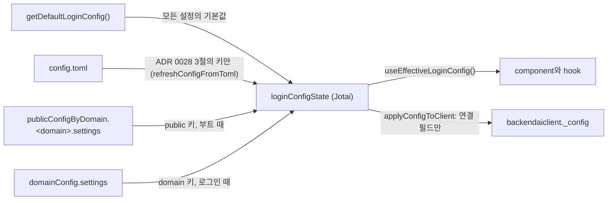
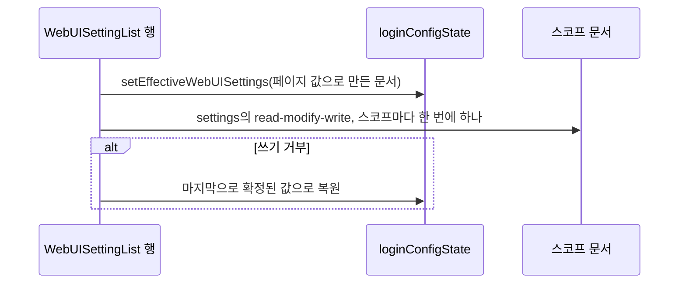

# 0031 — System Settings changes applied without a reload

> ADR 0028의 네 부분을 대체한다. "값이 정해지는 순서" 설계도의 `applyConfigToClient` 간선, "저장" 설계도, 4절의 `_config` 복사와 "Apply and Reset" 문구, Consequences의 "Reload to apply"다. ADR 0028의 나머지는 그대로 유효하다.

## Summary

> 낯선 용어는 문서 맨 아래 [용어](#용어)에 모아 두었다.

- 실행 중인 앱에서 WebUI 설정은 Jotai atom `loginConfigState`에 있다. `applyConfigToClient`는 설정을 더 이상 `backendaiclient._config`에 복사하지 않고, `_config`에는 연결 필드만 남는다.
- 설정이 필요한 코드는 `useEffectiveLoginConfig()`로, React 밖에서는 `jotaiStore.get(loginConfigState)`로 읽는다. 그래서 설정이 바뀌면 component가 다시 렌더된다.
- System Settings에는 Apply 버튼이 없다. 행은 바뀔 때 저장되고, 저장은 [낙관적](#용어)이다. 행과 `loginConfigState`가 즉시 바뀌고, 스코프 문서 쓰기는 그 뒤에 돌며, 거부된 쓰기는 행을 되돌린다.
- 변경 뒤 페이지는 `setEffectiveWebUISettings`로 `loginConfigState`를 다시 만든다. 새로고침은 없다.

## Context

- **What existed**: ADR 0028은 부트와 로그인 때 설정을 `loginConfigState`에 병합했고, `applyConfigToClient`가 그 값을 하나씩 `backendaiclient._config`에 복사했다. 약 45개 파일이 렌더 중에 이 사본을 읽었다. 사본은 React에 변경을 알리지 않으므로, Apply 단계가 페이지를 새로고침해서 저장한 값을 보여 줬다.
- **What `backendaiclient._config` is**: Backend.AI client library(`packages/backend.ai-client`)의 설정 객체다. library는 이 객체에서 연결 필드(`endpoint`, `connectionMode`, `accessKey`, `apiVersion`, …)만 읽는다.
- **Why a decision is needed**: 새로고침이 없으면 모든 reader가 스스로 새 값을 봐야 한다. 값을 어디에 두고, 어떻게 읽고, 저장이 어떻게 그 값에 닿는지가 설정을 읽는 모든 component를 정한다.

## 설계도

### 값을 읽는 곳

### 행 하나 저장

## Decision

### 1. 설정은 `loginConfigState`에 있고 `_config`에는 없다

- **Client config**: `applyConfigToClient`(`react/src/helper/loginConfig.ts`)는 `backendaiclient._config`에 `_proxyURL`, `_proxyToken`, `domainName`, `domainId`, `enableWebMCP`만 넣고 client를 ready로 표시한다.
- **Type guard**: host의 `BackendAIConfig` 타입(`react/src/hooks/index.tsx`)은 설정 필드를 선언하지 않으므로, `tsc`가 `useSuspendedBackendaiClient()._config.<setting>`을 거부한다. `globalThis`를 거친 타입 없는 읽기는 검사되지 않는다.
- **Reading in React**: `useEffectiveLoginConfig()`(`react/src/hooks/useWebUIConfig.ts`)는 `loginConfigState`를, 로드되기 전에는 코드 기본값을 돌려준다. `null`을 돌려주지 않는다.
- **Reading outside React**: `jotaiStore.get(loginConfigState)`로 읽는다. config가 로드되기 전에는 `null`이므로 호출자가 `getDefaultLoginConfig()`로 대신하거나 optional chaining을 쓴다. 설정에서 값을 얻는 Jotai atom은 `get(loginConfigState)`로 읽는다.
- **Atoms beside it**: `autoLogoutState`는 `autoLogout`을 따라가며, `loginConfigState`를 설정하는 곳마다 함께 설정된다. `loginPluginState`는 부트 때 한 번 설정되고 저장 뒤에 다시 만들어지지 않는다.
- **BUI components**: `backend.ai-ui` component는 host atom을 읽지 않고 설정을 prop으로 받는다. `BAIFileExplorer`는 `isDirectorySizeVisible`을 받는다.
- **Adding a setting**: 새 설정은 `getDefaultLoginConfig`에 기본값을 둔 `LoginConfigState` 필드, `WEBUI_SETTING_DEFINITIONS`(`react/src/helper/webuiSettings.ts`) 항목 하나, `WebUISettingLabels.ts`의 문구를 더한다. `applyConfigToClient`에는 아무것도 더하지 않는다.

### 2. 유효 설정을 다시 만드는 함수는 하나다

- **Helper**: `withWebUISettings(state, publicDoc, domainDoc)`(`react/src/helper/webuiSettings.ts`)는 모든 정의의 필드를 코드 기본값으로 되돌린 뒤 PUBLIC 문서, 이어서 DOMAIN 문서를 적용한다. 어떤 정의도 갖지 않는 필드는 `state`의 값을 유지한다.
- **Pre-sign-in callers**: 부트(`initializeConfigOnce`)와 다른 webserver 합류(`loadConfigFromWebServer`)가 이 함수로 로그인 전 상태를 만든다.
- **Sign-in**: `connectViaGQL`은 로그인 전 상태 위에 DOMAIN 문서만 적용한다(`applyWebUISettings`). 그 상태에 PUBLIC 문서가 이미 들어 있기 때문이다.
- **System Settings**: `setEffectiveWebUISettings(store, publicDoc, domainDoc)`(`react/src/hooks/useWebUIConfig.ts`)가 현재 상태에 `withWebUISettings`를 적용하고 `loginConfigState`와 `autoLogoutState`를 설정한다.
- **Why a rebuild**: 행 리셋은 키를 지운다. 이전 상태 위에 문서를 적용하면 지운 값이 남고, 기본값부터 다시 만들면 기본값으로 돌아간다.

### 3. 바뀔 때 낙관적으로 저장한다

- **When a row saves**: checkbox, selector, 목록, plugin 경로 컨트롤은 바뀔 때 저장한다. 숫자 입력은 blur, Enter, stepper 클릭 때 저장한다(`NumberInput`이 그때만 값을 확정한다). 텍스트 입력은 확정할 때(`BAIUncontrolledInput`의 `onCommit`) 저장한다. 행 리셋은 즉시 저장한다.
- **Order of effects**: `WebUISettingList`는 행의 값을 바꾸고 페이지 값으로 만든 문서(`buildWebUISettingsDocument`)로 `setEffectiveWebUISettings`를 부른 뒤, 바뀐 스코프마다 `useUpdateDomainAppConfig` / `useUpdatePublicDomainAppConfig`로 쓴다. 두 hook은 `settings` 서브키의 [read-modify-write](#용어)를 그대로 하고, 표 밖의 키를 그대로 옮긴다(`withForeignWebUISettings`).
- **Where the state lives**: `WebUISettingList`는 화면에 보이는 값을 `valuesRef`에, 서버가 마지막으로 받아들인 값을 `confirmedRef`(페이지가 mount될 때 읽은 문서로 시작한다)에, 스코프마다 `{ running, rerun }` 항목 하나를 `writesRef`에 둔다.
- **One write per scope at a time**: 한 스코프의 쓰기가 도는 동안 그 스코프가 또 바뀌면 `rerun`을 세우고, 다음 쓰기가 최신 값을 저장한다. 페이지에서 빠르게 두 번 고쳐도 서로의 read-modify-write를 덮어쓰지 않는다.
- **Several keys at once**: JSON Config 가져오기와 툴바 Reset은 바뀐 스코프마다 한 번만 쓴다. Reset은 입력 확인(`BAIDeleteConfirmModal`)을 유지한다.
- **Refused write**: 페이지는 거부된 쓰기가 담았던 키마다 확정된 값을 되돌린다. 그사이 행이 다시 바뀌었으면 되돌리지 않는다. 스코프가 아직 확정된 값과 다르면 쓰기를 한 번 더 예약하고, 해당 설정을 나열한 오류 modal(`webuiSettings.NotSaved`, `webuiSettings.NotSavedItems`)을 연다.
- **Leaving the page**: `beforeunload` 확인은 쓰기가 진행 중일 때만 뜬다.
- **Refetch**: DOMAIN 쓰기가 이미 `domainConfig`를 다시 조회하듯, PUBLIC 쓰기는 병합된 `publicConfigByDomain` view를 다시 조회한다. 그래서 `usePublicDomainAppConfig` reader가 갱신된다.

### 4. 누가 언제 변경을 보는가

- **The admin who saves**: `useEffectiveLoginConfig()`를 읽는 모든 component가 즉시 다시 렌더된다.
- **Other signed-in users**: 이들의 앱은 부트와 로그인 때만 문서를 읽으므로, 페이지를 새로고침한 뒤에 변경을 본다. System Settings 상단의 info alert(`webuiSettings.SaveNotice`, `webuiSettings.SaveNoticeDesc`)가 관리자에게 이 사실과, 일부 설정은 새로고침한 뒤에 적용된다는 점을 알린다.
- **Settings read once per page load**: `pluginPage`(`PluginLoader`가 부트 때 plugin을 불러온다)와 `pluginLogin`(`loginPluginState`)은 관리자 본인에게도 새로고침한 뒤에 적용된다. 페이지 alert가 이를 다루고, 행마다 따로 안내하지 않는다.

## 대안과 기각 사유

- **Keep the copy and re-run `applyConfigToClient` after a save**: reader 코드를 그대로 둘 수 있다. 기각: `_config`는 React에 변경을 알리지 않으므로, 사이드바 메뉴처럼 이미 화면에 있는 component는 다른 이유로 다시 렌더될 때까지 옛 값을 보여 준다.
- **Keep Apply and drop only the reload**: 여러 수정을 한 번에 확인한다. 기각: 초안, dirty 상태, 이탈 가드는 저장이 새로고침으로 끝났기 때문에 있었고, 새로고침이 없으면 변경을 늦출 뿐이다.
- **Wait for the write before showing the change**: 롤백이 필요 없다. 기각: 토글할 때마다 행이 움직이기 전에 GraphQL 왕복 두 번(raw 읽기와 upsert)을 기다린다.
- **A `globalThis` copy of the atom for non-React code**: 모든 호출자가 읽을 수 있는 한 곳이 생긴다. 기각: 이 결정이 없애는, 관찰할 수 없는 전역이다. ADR 0028은 이미 React 밖의 읽기를 `jotaiStore.get`으로 보낸다.

## Consequences

- **No reload**: 저장한 설정이 관리자 본인 화면을 즉시 바꾸고, 관리자는 페이지에서 보던 위치를 잃지 않는다.
- **Optimistic until it lands**: 쓰기가 도는 동안 화면은 서버가 아직 갖지 않은 값을 보여 준다. 페이지는 거부된 쓰기를 되돌리고 저장하지 못한 설정을 알린다.
- **Last page wins**: 각 쓰기는 그 스코프의 표 키 전부를 이 페이지의 값으로 저장한다. 그래서 이 페이지가 로드된 뒤 다른 관리자가 같은 스코프에서 바꾼 값은 덮어쓴다. ADR 0028의 Apply 흐름도 같은 한계가 있었다.
- **Mocks move**: mock한 `useSuspendedBackendaiClient()._config`로 설정을 넣던 테스트는 대신 `useEffectiveLoginConfig`를 mock한다. e2e helper는 `backendaiclient._config`가 아니라 저장된 문서에서 설정을 읽는다.

## 출처

- #10941 — System Settings를 새로고침 없이 바뀔 때 저장하는 이슈다. 낙관적 저장, `backendaiclient._config`에서 설정 제거, 페이지 alert는 2026-11-10 코멘트에서 정했다.

관련: [ADR 0028](0028-webui-settings-in-the-app-config-settings-key.ko.md).

## 용어

| 용어              | 뜻                                                                                                  |
| ----------------- | --------------------------------------------------------------------------------------------------- |
| 낙관적            | 서버가 저장하기 전에 변경을 화면에 먼저 보여 주고, 서버가 거부하면 화면에서 되돌리는 방식이다.      |
| read-modify-write | raw 문서를 다시 읽어 한 부분만 바꾸고 문서 전체를 저장해서, 문서의 다른 서브키를 유지하는 방식이다. |
