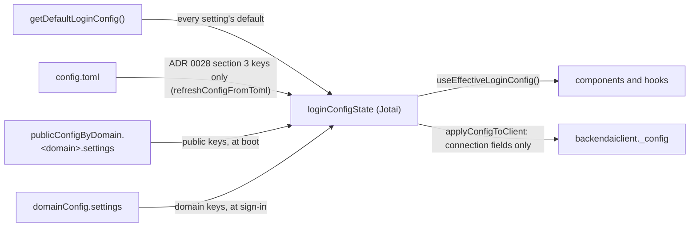
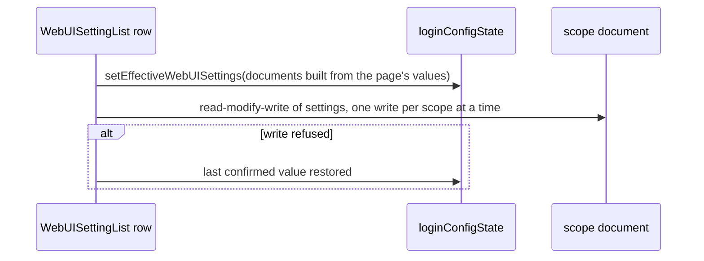

# 0031 — System Settings changes applied without a reload

> Replaces four parts of ADR 0028: the `applyConfigToClient` edge of the "Order in which a value is decided" diagram, the "Saving" diagram, the `_config` copy and the "Apply and Reset" wording of section 4, and the "Reload to apply" consequence. The rest of ADR 0028 stays in force.

## Summary

> Unfamiliar terms are collected in the [Glossary](#glossary) at the end.

- In the running app the WebUI settings live in the Jotai atom `loginConfigState`. `applyConfigToClient` no longer copies them onto `backendaiclient._config`, which keeps only connection fields.
- Code that needs a setting reads it with `useEffectiveLoginConfig()`, or with `jotaiStore.get(loginConfigState)` outside React, so a component re-renders when a setting changes.
- System Settings has no Apply button. A row saves when it changes, and the save is [optimistic](#glossary): the row and `loginConfigState` change at once, the write to the scope document runs after, and a refused write puts the row back.
- After a change the page rebuilds `loginConfigState` with `setEffectiveWebUISettings`; nothing reloads.

## Context

- **What existed**: ADR 0028 merged the settings into `loginConfigState` at boot and at sign-in, and `applyConfigToClient` then copied each one onto `backendaiclient._config`. About 45 files read the copy during render. The copy does not notify React, so the Apply step reloaded the page to show a saved value.
- **What `backendaiclient._config` is**: the configuration object of the Backend.AI client library (`packages/backend.ai-client`). The library reads only connection fields from it (`endpoint`, `connectionMode`, `accessKey`, `apiVersion`, …).
- **Why a decision is needed**: without the reload, every reader must see a new value on its own. Where the value lives, how it is read, and how a save reaches it decide every component that reads a setting.

## Diagram

### Where a value is read

### Saving one row

## Decision

### 1. `loginConfigState` holds the settings; `_config` does not

- **Client config**: `applyConfigToClient` (`react/src/helper/loginConfig.ts`) sets only `_proxyURL`, `_proxyToken`, `domainName`, `domainId` and `enableWebMCP` on `backendaiclient._config`, then marks the client ready.
- **Type guard**: the host `BackendAIConfig` type (`react/src/hooks/index.tsx`) declares no setting field, so `tsc` rejects `useSuspendedBackendaiClient()._config.<setting>`. An untyped read through `globalThis`, and a read through `useConnectedBAIClient()` (the BUI `BackendAIConfig` keeps `[key: string]: any`), are not checked.
- **Reading in React**: `useEffectiveLoginConfig()` (`react/src/hooks/useWebUIConfig.ts`) returns `loginConfigState`, or the code defaults until it loads. It never returns `null`.
- **Reading outside React**: `jotaiStore.get(loginConfigState)`, which is `null` before config loads, so the caller falls back to `getDefaultLoginConfig()` or uses optional chaining. A Jotai atom that derives from a setting reads it with `get(loginConfigState)`.
- **Atoms beside it**: `autoLogoutState` mirrors `autoLogout` and is set wherever `loginConfigState` is. `loginPluginState` is set once at boot and is not rebuilt after a save.
- **BUI components**: a `backend.ai-ui` component does not read the host atom; it takes the setting as a prop. `BAIFileExplorer` takes `isDirectorySizeVisible`.
- **Adding a setting**: a new setting adds a `LoginConfigState` field with its default in `getDefaultLoginConfig`, one `WEBUI_SETTING_DEFINITIONS` entry (`react/src/helper/webuiSettings.ts`) and its copy in `WebUISettingLabels.ts`. It adds nothing to `applyConfigToClient`.

### 2. One rebuild of the effective settings

- **Helper**: `withWebUISettings(state, publicDoc, domainDoc)` (`react/src/helper/webuiSettings.ts`) sets every definition's field back to its code default, then applies the PUBLIC document, then the DOMAIN document. Fields that no definition owns keep the value `state` holds.
- **Pre-sign-in callers**: boot (`initializeConfigOnce`) and joining another webserver (`loadConfigFromWebServer`) build the pre-sign-in state with it.
- **Sign-in**: `connectViaGQL` applies only the DOMAIN document over the pre-sign-in state (`applyWebUISettings`), because that state already holds the PUBLIC document.
- **System Settings**: `setEffectiveWebUISettings(store, publicDoc, domainDoc)` (`react/src/hooks/useWebUIConfig.ts`) runs `withWebUISettings` over the current state and sets `loginConfigState` and `autoLogoutState`.
- **Why a rebuild**: a row reset removes a key. Applying the documents over the previous state would keep the removed value; rebuilding from the defaults returns it to the default.

### 3. Save on change, optimistically

- **When a row saves**: a checkbox, selector, list or plugin path control saves on change; a number input on blur, Enter or a stepper click (`NumberInput` commits only then); a text input on commit (`BAIUncontrolledInput`'s `onCommit`). A row reset saves at once.
- **Order of effects**: `WebUISettingList` sets the row's value and calls `setEffectiveWebUISettings` with documents built from the page's values (`buildWebUISettingsDocument`), then writes each changed scope through `useUpdateDomainAppConfig` / `useUpdatePublicDomainAppConfig`, which keep their [read-modify-write](#glossary) of the `settings` sub-key and carry over keys outside the table (`withForeignWebUISettings`).
- **Where the state lives**: one settings session per Jotai store (a module `WeakMap` in `WebUISettingList.tsx`) holds the last values the server accepted (`confirmed`, seeded from the documents when the session starts) and one `{ running, rerun, force }` entry per scope; the shown values live in `sessionValuesAtom`. A remount while a write runs joins the same session, so there is one writer and one rollback target. The session ends once no write runs and every write refetched; the rows then follow the saved documents again.
- **One write per scope at a time**: while a write to a scope runs, a further change to that scope sets `rerun`, and the next write stores the latest values. `useAppConfig` also queues every write to one document (`serializeWrite`), so the announcement modal and a settings row cannot overwrite each other's read-modify-write.
- **Several keys at once**: the JSON Config import and the toolbar Reset write each changed scope once. Reset keeps its typed confirmation (`BAIDeleteConfirmModal`).
- **Refused write**: the page puts back the confirmed value of each key the refused write carried, unless the row changed again since, queues another write if the scope still differs from the confirmed values, and opens an error modal (`webuiSettings.NotSaved`, `webuiSettings.NotSavedItems`) naming those settings.
- **Leaving the page**: a `beforeunload` prompt runs only while a write is in flight.
- **Refetch**: a PUBLIC write refetches the merged `publicConfigByDomain` view, as a DOMAIN write already refetches `domainConfig`, so `usePublicDomainAppConfig` readers update. A setter resolves to `false` when only the refetch failed; the write counts as saved, and the session stays open so the rows do not fall back to the stale cache.

### 4. Who sees a change, and when

- **The admin who saves**: every component reading `useEffectiveLoginConfig()` re-renders at once.
- **Other signed-in users**: their app reads the documents only at boot and sign-in, so they see a change after a page reload. An info alert at the top of System Settings (`webuiSettings.SaveNotice`, `webuiSettings.SaveNoticeDesc`) tells the admin that a change applies to every user and that signed-in users see it after a reload.
- **Settings read once per page load**: `pluginPage` (`PluginLoader` loads plugins at boot) and `pluginLogin` (`loginPluginState`) take effect after a reload, for the admin as well. Neither the alert nor the row says so.

## Rejected alternatives

- **Keep the copy and re-run `applyConfigToClient` after a save**: the readers would keep their code. Rejected: `_config` does not notify React, so components already on screen, such as the sidebar menu, would keep the old value until something else re-rendered them.
- **Keep Apply and drop only the reload**: one confirmation per batch of edits. Rejected: the draft, the dirty state and the leave guards existed only because a save ended in a reload; without it they only delay a change.
- **Wait for the write before showing the change**: no rollback is needed. Rejected: every toggle would wait for two GraphQL round trips (the raw read and the upsert) before the row moves.
- **A `globalThis` copy of the atom for non-React code**: one place every caller can read. Rejected: it is the unobservable global this decision removes, and ADR 0028 already sends non-React reads to `jotaiStore.get`.

## Consequences

- **No reload**: a saved setting changes the admin's own screen at once, and the admin keeps their place on the page.
- **Optimistic until it lands**: while a write runs, the screen shows a value the server does not hold yet. The page rolls a refused write back and says which settings it did not save.
- **Last page wins**: each write stores every table key of its scope from this page's values, so a change another admin made to the same scope after this page loaded is overwritten. The Apply flow of ADR 0028 had the same limit.
- **Mocks move**: a test that set a setting through a mocked `useSuspendedBackendaiClient()._config` mocks `useEffectiveLoginConfig` instead, and the e2e helpers read settings from the stored documents rather than from `backendaiclient._config`.

## Sources

- #10941 — the issue for saving System Settings on change without a reload; the optimistic save, the removal of the settings from `backendaiclient._config` and the page alert were decided in its comment of 2026-11-10.

Related: [ADR 0028](0028-webui-settings-in-the-app-config-settings-key.md).

## Glossary

| Term              | Meaning                                                                                                                   |
| ----------------- | ------------------------------------------------------------------------------------------------------------------------- |
| optimistic        | Showing a change on screen before the server has stored it, and undoing it on screen if the server refuses.               |
| read-modify-write | Re-reading the raw document, changing one part, and saving the whole document, so the document's other sub-keys are kept. |
