# 0031 — User manual Markdown served by the WebUI

## Summary

> 낯선 용어는 문서 맨 아래 [용어](#용어)에 모아 두었다.

- WebUI는 사용자 매뉴얼의 Markdown 원문을 `resources/manual/<lang>/` 아래 정적 파일로 제공한다. `scripts/copy-manual.mjs`가 `packages/backend.ai-webui-docs/src/book.config.yaml`이 게시하는 모든 페이지를 그곳에 `<slug>.md`로 복사하고, 페이지 목록을 담은 `index.json`을 쓴다.
- 이 복사본은 [build artifact](#용어)다. `.gitignore`가 이를 제외하고, 루트 `copyresource` script가 `resources/`를 `build/web`으로 복사하기 전에 `copy-manual.mjs`를 실행하며, `scripts/dev.mjs`가 dev 서버를 시작할 때 실행한다.
- 브라우저 코드는 Markdown을 그대로 읽고 직접 해석한다. WebUI Assistant는 각 페이지를 제목 단위 section으로 나누고, 질문과 맞는 section을 참고 자료로 보낸다. 나중에 WebUI에 추가되는 매뉴얼 뷰어는 별도 복사본이 아니라 이 파일을 렌더링한다.
- 호스팅 문서 사이트(`https://webui.docs.backend.ai`)는 매뉴얼의 게시본으로 남고, WebUI의 도움말 링크는 계속 그곳을 가리킨다.

## Context

- **Where the manual lives**: `packages/backend.ai-webui-docs/src/`에는 네 언어(`en`, `ko`, `ja`, `th`)의 매뉴얼이 있다. docs toolkit(`packages/backend.ai-docs-toolkit`)은 `book.config.yaml`의 `navigation` 아래 나열된 페이지로 호스팅 사이트와 PDF를 만든다.
- **What the WebUI had**: WebUI 빌드에는 매뉴얼 텍스트가 없었다. `useHelpURL`(`react/src/hooks/useHelpURL.ts`)이 호스팅 사이트 링크를 만들고, 도움말 버튼이 새 탭에서 연다.
- **What needs the text**: WebUI Assistant는 매뉴얼을 근거로 질문에 답한다. 영어 매뉴얼이 약 440 KB, 약 110,000 token으로 한 프롬프트에 넣기에는 너무 크기 때문에, Assistant는 질문과 맞는 section을 브라우저에서 고른다.

## 설계도

```mermaid
flowchart LR
  src["packages/backend.ai-webui-docs/src/<br/>book.config.yaml + &lt;lang&gt;/**/*.md"]
  copy["scripts/copy-manual.mjs<br/>copyresource와 dev.mjs가 실행"]
  out["resources/manual/&lt;lang&gt;/<br/>&lt;slug&gt;.md + index.json<br/>gitignore 대상"]
  build["build/web/resources/manual/"]
  assistant["WebUIAssistantChat<br/>loadManual, splitManualMarkdown"]
  site["docs toolkit<br/>webui.docs.backend.ai"]
  src -- "navigation 경로와 Markdown 파일" --> copy
  copy -- "파일을 쓴다 (side effect)" --> out
  out -- "cp -Rp resources build/web" --> build
  build -- "index.json을 받고 이어서 모든 페이지를 받는다" --> assistant
  build -. 빌드에 복사본이 없으면 요청이 실패한다 .-> assistant
  src -- "Markdown 파일" --> site
  assistant -- "slug.html#anchor로 가는 참고 링크" --> site
```

## Decision

### 1. Markdown 원문은 그대로 복사한다

- **No conversion**: `copy-manual.mjs`는 각 파일을 HTML로 렌더링하거나, front matter를 지우거나, section으로 나누지 않고 복사한다.
- **Which pages**: `copy-manual.mjs`는 `book.config.yaml`의 `navigation.<lang>` 아래 `path` 항목, 즉 docs toolkit이 게시하는 목록을 읽는다. `index.md`처럼 navigation에 없는 Markdown 파일은 복사하지 않는다.
- **Page names**: `copy-manual.mjs`는 원본 폴더를 버리고 페이지를 `resources/manual/<lang>/<slug>.md`로 쓴다. `<slug>`는 `copy-manual.mjs`의 `slugFromNavPath`가 만든다. 이 함수는 docs toolkit의 `slugFromNavPath`(`packages/backend.ai-docs-toolkit/src/markdown-processor.ts`)를 옮긴 것이라, 같은 slug가 호스팅 페이지 `<slug>.html`의 이름이 된다.
- **Slug collisions**: 한 언어의 두 navigation 경로가 같은 slug를 만들면 `copy-manual.mjs`가 오류를 던지고 빌드가 멈춘다.
- **Images**: `copy-manual.mjs`는 Git LFS에 있는 `images/` 폴더(ADR 0029)를 복사하지 않는다. Markdown은 상대 이미지 경로를 그대로 두고, WebUI는 그 경로에 파일을 제공하지 않는다.

### 2. 페이지 목록은 정해진 형태를 따른다

| Field | Type | Meaning |
| --- | --- | --- |
| `lang` | `string` | `en` 같은 언어 폴더다. |
| `pages[].page` | `string` | 페이지 slug이며 호스팅 페이지 이름이기도 하다. |
| `pages[].file` | `string` | 항상 `<page>.md`이며, `resources/manual/<lang>/` 기준 상대 경로다. |

- **Type**: `react/src/components/WebUIAssistant/manualSearch.ts`의 `ManualPageIndex`가 브라우저 코드용으로 이 형태를 선언한다.
- **Base path**: 브라우저 코드는 상대 경로 `resources/manual/`(`webUIAssistantPrompt.ts`의 `MANUAL_RESOURCE_BASE`)에서 받고, 이 경로는 앱의 `<base href="/">` 기준으로 해석된다.
- **Languages**: `copy-manual.mjs`는 `navigation` 아래 언어 키마다 폴더 하나를 쓴다. `useHelpURL.ts`의 `DOCS_LANGUAGES`가 WebUI가 요청하는 언어를 나열하고 나머지는 `en`으로 대체하므로, 매뉴얼에 언어를 추가하면 그곳에도 항목이 필요하다.

### 3. 복사본은 빌드 때 만들고 커밋하지 않는다

| Entry point | `copy-manual.mjs`를 실행하는 것 |
| --- | --- |
| `pnpm run build` | `cp -Rp resources build/web` 전에 `copyresource` |
| `pnpm run dev` | watcher를 시작하기 전에 한 번 `scripts/dev.mjs` |
| By hand | `pnpm run manual` |

- **Not committed**: `.gitignore`가 `resources/manual/`을 나열한다. 다음 `pnpm run build`가 재생성 커밋 없이 매뉴얼 수정을 반영한다.
- **Fresh copy**: `copy-manual.mjs`는 쓰기 전에 `resources/manual/`을 지우므로, navigation에서 빠진 페이지는 빌드에서도 사라진다.

### 4. 각 소비자가 Markdown을 직접 해석한다

- **Section split**: `manualSearch.ts`의 `splitManualMarkdown`은 페이지를 `#`, `##`, `###` 제목에서 나누고, code fence 안의 제목은 무시한다. 매뉴얼이 제목 앞에 두는 `` 줄이 그 section의 anchor가 된다.
- **Loading**: `loadManual`은 `index.json`을 받은 뒤 한 언어의 모든 페이지를 받는다. `WebUIAssistantChat`은 component가 mount될 때 실행되는 query로 이를 호출하고, `WebUIAssistant`는 사용자가 연결을 저장한 상태로 패널을 연 뒤에만 그 component를 mount한다.
- **Failures**: `index.json` 요청이 실패하거나 JSON이 아니면 `loadManual`이 오류를 던지고, Assistant는 `webuiAssistant.ManualUnavailable` 경고를 보여준 뒤 참고 자료 없이 답한다. 페이지 하나를 받지 못하면 그 페이지는 빈 페이지가 되어 section을 만들지 않는다.

## 대안과 기각 사유

- **Bundle a pre-split JSON index**: 언어마다 요청 한 번으로 미리 나눈 section을 받을 수 있다. 매뉴얼에서 파생된 두 번째 형식이 생기고 뷰어가 이를 렌더링할 수 없어서 기각했다.
- **Bundle rendered HTML**: docs toolkit이 이미 HTML을 만든다. WebUI는 자체 component로 Markdown을 렌더링하고, HTML에는 Assistant가 다시 걷어내야 할 레이아웃 마크업이 있어서 기각했다.
- **Fetch from the hosted docs site at runtime**: 번들이 커지지 않는다. 폐쇄망 설치는 사이트에 접근할 수 없고, 사이트가 WebUI origin에 CORS를 허용해야 하며, WebUI 빌드가 사이트가 제공하는 아무 매뉴얼 버전이나 읽게 되어 기각했다.

## Consequences

- **Bundle size**: 모든 빌드의 `resources/manual/` 아래가 네 언어 합쳐 약 2.7 MB 늘어난다. 브라우저는 Assistant 패널이 열리기 전에는 아무것도 받지 않는다.
- **Builds without `copyresource`**: `pnpm run build:react-only`는 복사본을 만들지 않는다. 이때 `loadManual`이 오류를 던지고 패널이 경고를 보여주므로, Assistant는 참고 자료 없이 답한다.
- **Electron app**: Electron 패키지는 `build/web`을 그대로 담으므로 복사본도 함께 들어간다.

## 출처

- PR #11208, `copy-manual.mjs`와 첫 소비자를 추가한 WebUI Assistant.
- 2026-11-16 팀 결정: 매뉴얼의 Markdown을 WebUI 서버에서 제공하고, 프론트엔드에서 렌더링하며, Assistant가 같은 원문을 읽는다.
- 관련: [ADR 0003](0003-committed-search-index-artifact.ko.md), [ADR 0029](0029-user-manual-images-in-git-lfs.ko.md).

## 용어

| 용어 | 뜻 |
| --- | --- |
| build artifact | 빌드 단계가 원본 파일로부터 쓰는 파일이다. Git이 추적하지 않고, 빌드할 때마다 다시 쓴다. |
