# 0031 — User manual Markdown served by the WebUI

## Summary

> Unfamiliar terms are collected in the [Glossary](#glossary) at the end.

- The WebUI serves the user manual's Markdown source as static files under `resources/manual/<lang>/`. `scripts/copy-manual.mjs` copies every page that `packages/backend.ai-webui-docs/src/book.config.yaml` publishes there as `<slug>.md` and writes an `index.json` that lists the pages.
- The copy is a [build artifact](#glossary). `.gitignore` excludes it, the root `copyresource` script runs `copy-manual.mjs` before it copies `resources/` into `build/web`, and `scripts/dev.mjs` runs it when the dev server starts.
- Browser code reads the Markdown as it is and parses it itself. The WebUI Assistant splits each page into heading sections and sends the sections that match a question as references. A manual viewer added to the WebUI later renders these files, not a separate copy.
- The hosted docs site (`https://webui.docs.backend.ai`) stays the manual's published form, and the WebUI's help links keep pointing at it.

## Context

- **Where the manual lives**: `packages/backend.ai-webui-docs/src/` holds the manual in four languages (`en`, `ko`, `ja`, `th`). The docs toolkit (`packages/backend.ai-docs-toolkit`) builds the hosted site and a PDF from the pages that `book.config.yaml` lists under `navigation`.
- **What the WebUI had**: The WebUI build contained no manual text. `useHelpURL` (`react/src/hooks/useHelpURL.ts`) builds a link to the hosted site, and the help button opens it in a new tab.
- **What needs the text**: The WebUI Assistant answers questions from the manual. It picks the sections that match a question in the browser, because the English manual is about 440 KB, roughly 110,000 tokens, too large for one prompt.

## Diagram

```mermaid
flowchart LR
  src["packages/backend.ai-webui-docs/src/<br/>book.config.yaml + &lt;lang&gt;/**/*.md"]
  copy["scripts/copy-manual.mjs<br/>run by copyresource and dev.mjs"]
  out["resources/manual/&lt;lang&gt;/<br/>&lt;slug&gt;.md + index.json<br/>gitignored"]
  build["build/web/resources/manual/"]
  assistant["WebUIAssistantChat<br/>loadManual, splitManualMarkdown"]
  site["docs toolkit<br/>webui.docs.backend.ai"]
  src -- "navigation paths and Markdown files" --> copy
  copy -- "writes files (side effect)" --> out
  out -- "cp -Rp resources build/web" --> build
  build -- "fetch index.json, then every page" --> assistant
  build -. fetch fails when the build has no copy .-> assistant
  src -- "Markdown files" --> site
  assistant -- "reference links to slug.html#anchor" --> site
```

## Decision

### 1. The Markdown source is copied as it is

- **No conversion**: `copy-manual.mjs` copies each file without rendering HTML, stripping front matter, or splitting sections.
- **Which pages**: `copy-manual.mjs` reads the `path` entries under `navigation.<lang>` in `book.config.yaml`, the same list the docs toolkit publishes. A Markdown file that the navigation does not list, such as `index.md`, is not copied.
- **Page names**: `copy-manual.mjs` writes a page to `resources/manual/<lang>/<slug>.md`, dropping the source folder. `<slug>` comes from `slugFromNavPath` in `copy-manual.mjs`, a port of the docs toolkit's `slugFromNavPath` (`packages/backend.ai-docs-toolkit/src/markdown-processor.ts`), so the same slug names the hosted page `<slug>.html`.
- **Slug collisions**: `copy-manual.mjs` throws when two navigation paths of one language produce the same slug, and the build stops.
- **Images**: `copy-manual.mjs` does not copy the `images/` folders, which live in Git LFS (ADR 0029). The Markdown keeps its relative image paths, and the WebUI serves no file at those paths.

### 2. The page list has a fixed shape

| Field | Type | Meaning |
| --- | --- | --- |
| `lang` | `string` | The language folder, such as `en`. |
| `pages[].page` | `string` | The page slug, also the hosted page name. |
| `pages[].file` | `string` | Always `<page>.md`, relative to `resources/manual/<lang>/`. |

- **Type**: `ManualPageIndex` in `react/src/components/WebUIAssistant/manualSearch.ts` declares this shape for browser code.
- **Base path**: Browser code fetches from the relative path `resources/manual/` (`MANUAL_RESOURCE_BASE` in `webUIAssistantPrompt.ts`), which resolves against the app's `<base href="/">`.
- **Languages**: `copy-manual.mjs` writes one folder per language key under `navigation`. `DOCS_LANGUAGES` in `useHelpURL.ts` lists the languages the WebUI asks for and falls back to `en`, so a language added to the manual also needs an entry there.

### 3. The copy is generated at build time and never committed

| Entry point | What runs `copy-manual.mjs` |
| --- | --- |
| `pnpm run build` | `copyresource`, before `cp -Rp resources build/web` |
| `pnpm run dev` | `scripts/dev.mjs`, once before the watchers start |
| By hand | `pnpm run manual` |

- **Not committed**: `.gitignore` lists `resources/manual/`. The next `pnpm run build` picks up a manual edit without a regeneration commit.
- **Fresh copy**: `copy-manual.mjs` deletes `resources/manual/` before writing, so a page removed from the navigation disappears from the build.

### 4. Each consumer parses the Markdown itself

- **Section split**: `splitManualMarkdown` in `manualSearch.ts` splits a page at `#`, `##` and `###` headings and ignores headings inside code fences. The `` line the manual puts before a heading becomes that section's anchor.
- **Loading**: `loadManual` fetches `index.json` and then every page of one language. `WebUIAssistantChat` calls it through a query that runs when the component mounts, and `WebUIAssistant` mounts that component only after the user opens the panel with a saved connection.
- **Failures**: `loadManual` throws when `index.json` fails or is not JSON, and the Assistant then shows the `webuiAssistant.ManualUnavailable` warning and answers without references. A single page that fails to load becomes an empty page and contributes no section.

## Rejected alternatives

- **Bundle a pre-split JSON index**: One request per language would load ready-made sections. It is rejected because it adds a second format derived from the manual, and a viewer could not render it.
- **Bundle rendered HTML**: The docs toolkit already produces HTML. It is rejected because the WebUI renders Markdown with its own components, and HTML carries layout markup the Assistant would have to strip again.
- **Fetch from the hosted docs site at runtime**: The bundle would not grow. It is rejected because an air-gapped installation cannot reach the site, the site needs CORS for the WebUI's origin, and a WebUI build would read whichever manual version the site serves.

## Consequences

- **Bundle size**: Every build gains about 2.7 MB under `resources/manual/` across the four languages. The browser downloads none of it until the Assistant panel opens.
- **Builds without `copyresource`**: `pnpm run build:react-only` produces no copy. The Assistant then answers without references, because `loadManual` throws and the panel shows its warning instead.
- **Electron app**: The Electron package ships `build/web`, so it carries the copy too.

## Sources

- PR #11208, the WebUI Assistant, which adds `copy-manual.mjs` and its first consumer.
- Team decision of 2026-11-16 to serve the manual's Markdown from the WebUI server, render it in the frontend, and let the Assistant read the same source.
- Related: [ADR 0003](0003-committed-search-index-artifact.md), [ADR 0029](0029-user-manual-images-in-git-lfs.md).

## Glossary

| Term | Meaning |
| --- | --- |
| build artifact | A file a build step writes from source files. Git does not track it, and each build writes it again. |
