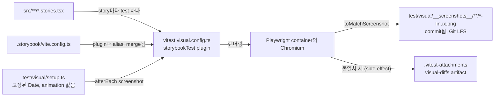

# 0031 — Visual regression tests for backend.ai-ui stories

## Summary

> 낯선 용어는 문서 맨 아래 [용어](#용어)에 모아 두었다.

- `packages/backend.ai-ui`의 모든 Storybook story는 Vitest browser mode로 Chromium에서 렌더링되고, commit된 screenshot([baseline](#용어))과 비교된다. story는 `no-vrt` tag로 비교에서 빠진다.
- baseline은 `mcr.microsoft.com/playwright:v<version>-noble` container에서 `linux/amd64`로 만든 것만 유효하다. `<version>`은 BUI의 정확한 `playwright` pin이다. `-linux.png`로 끝나는 파일은 container만 쓰고, 그 파일만 commit한다.
- `Vitest visual (backend.ai-ui)` workflow는 BUI source, Storybook 설정, Storybook이 제공하는 font와 icon, `pnpm-workspace.yaml`, `pnpm-lock.yaml`을 건드리는 모든 PR과 `main` push에서 같은 container로 비교를 실행하고, 실패하면 diff 이미지를 올린다.
- BUI story의 모양을 바꾸는 PR은 다시 만든 baseline을 같은 PR에 commit한다. `@lablup/ui-common` pin bump도 여기에 포함된다.
- baseline은 Git LFS에 저장하고, 기본 clone은 이 파일들을 pointer file로 받는다. `scripts/visual-test.sh`와 workflow는 test를 실행하기 전에 `scripts/pull-visual-baselines.sh`로 pointer를 이미지로 바꾼다. 이는 사용자 매뉴얼의 이미지만 LFS로 추적한다고 정한 ADR 0029 §1을 넓힌다.
- 지금의 어떤 story도 만들지 않는 commit된 baseline은 실행을 실패시키고, `-u`는 그 파일을 지운다.

## Context

- **What changes pictures**: BUI는 `@lablup/ui-common`을 통해 Astryx를 렌더링한다(ADR 0009). ui-common pin bump, theme token 수정, wrapper refactor는 lint, `tsc`, jsdom Vitest suite가 모두 통과하는 동안에도 component의 모양을 바꿀 수 있다.
- **What exists**: BUI에는 story 파일이 약 110개, story가 약 600개 있다. 이 결정 전에는 두 commit 사이에서 이들의 렌더링을 비교하는 것이 없었다.
- **Repository size**: baseline은 PNG 파일 약 590개, 6.7 MB다. `playwright` bump나 ui-common pin bump는 이 파일을 모두 다시 만들 수 있고, 일반 Git blob이면 매번 다시 만든 파일이 모든 clone의 history에 남는다.
- **Why a container**: font rasterization과 antialiasing은 운영체제와 CPU architecture마다 다르므로, 한 host에서 찍은 screenshot은 다른 host에서 찍은 것과 맞지 않는다. lablup/ui-common은 같은 문제를 고정된 Playwright container로 풀었고(lablup/ui-common#153), 이 결정은 그 설정을 옮겨 온다.

## 설계도

## Decision

### 1. 별도 Vitest config가 story를 browser에서 실행한다

- **Files**: `packages/backend.ai-ui/vitest.visual.config.ts`는 `@storybook/addon-vitest`의 `storybookTest`와 `@vitest/browser-playwright`를 쓰고, viewport는 1200 × 900, time zone은 `UTC`, locale은 `en-US`이다. `no-vrt` tag는 제외한다. `vitest.config.ts`의 jsdom suite는 바뀌지 않고, `pnpm run vitest`는 visual test를 실행하지 않는다.
- **Storybook-only Vite config**: `.storybook/vite.config.ts`는 story에 필요한 plugin(annotation mode compiler를 쓰는 React, Relay, SVGR, `./__generated__` alias)을 가진다. `.storybook/main.ts`의 `builder.viteConfigPath`가 이 파일을 가리키므로, Storybook은 더 이상 library build config인 `vite.config.ts`를 읽지 않는다. visual config도 같은 파일을 merge한다.
- **Setup**: `test/visual/setup.ts`는 `Date`만 가짜로 고정하고(2026-01-15T12:00:00Z), transition과 animation을 끄고, DOM이 600 ms 동안 바뀌지 않을 때까지(최대 5 s) 기다리고, font를 기다린 뒤, story가 그린 영역만 찍는다. 그 영역이 1200 × 900 page보다 크면 setup은 Playwright page와 test frame을 함께 document 크기로 키운다. page보다 큰 frame은 Vitest가 축소하기 때문이다. 크기를 바꿀 때마다 최대 세 번까지 다시 재므로, 한 축이 바뀔 때 다시 흐르는 content도 담긴다. content가 page를 따라 커지는 축에서는 1200이나 900을 유지하고 들어가는 만큼 찍는다. content가 8000 px보다 넓거나 높으면 test는 story 이름과 크기를 보여 주며 실패한다. Chromium은 16384 px를 넘게 찍지 못하기 때문이다. 그런 story는 작게 만들거나 `no-vrt`를 붙인다. 찍은 뒤나 실패한 뒤에는, 크기를 바꾼 적이 있으면 언제나 1200 × 900으로 되돌린다.
- **Fonts**: `preview-head.html`이 연결하는 `resources/fonts`의 local font는 그대로 쓴다. image는 generic family인 `monospace`, `sans-serif`, `serif`를 실행마다 다른 font로 resolve하므로, config는 `FONTCONFIG_FILE`을 `test/visual/fonts.conf`로 설정하고, 이 파일이 세 family를 Liberation Mono, Liberation Sans, Liberation Serif에 묶는다.
- **Stale baselines**: `resolveScreenshotPath`는 실행이 쓰는 baseline 경로를 모두 기록한다. 같은 config의 reporter는 지금의 어떤 story도 만들지 않는 commit된 `*-chromium-linux.png`마다 실행을 실패시킨다. test가 모두 통과한 story 파일에서 실행이 쓰지 않은 파일, 그리고 story 파일이 없어진 모든 파일이 대상이다. baseline은 그 위에서 story 파일이 있는 가장 깊은 directory의 story 파일에 속한다. 그래서 `A/B`라는 이름의 story(하위 directory)는 자기 파일에 남고, `Foo/Bar.stories.tsx`의 baseline은 `Foo.stories.tsx`에 대해 검사되지 않으며, `Foo/Bar.stories.tsx`가 지워지면 `Foo.stories.tsx` 아래에서 stale이 된다. 기록한 경로는 실행이 시작할 때마다 비운다. `-u`이면 대신 지운다. `BUI_VISUAL_CONTAINER=1`일 때만 실행되므로, CI와 `visual-test.sh`에서 실행된다.

### 2. container가 baseline의 유일한 출처다

- **Pin**: `playwright`는 BUI의 정확한 devDependency이고, root의 `@playwright/test`가 resolve하는 버전과 같다. 그래서 e2e suite와 visual test가 같은 browser build를 쓴다. workflow의 `resolve-playwright` job은 `pnpm-lock.yaml`이 `playwright`나 `@playwright/test`를 다른 버전으로 resolve하면 실패하므로, 둘은 함께 올린다. `@vitest/browser`, `@vitest/browser-playwright`, `@vitest/coverage-v8`은 정확한 `vitest` 버전에 peer로 묶이므로, BUI는 넷 모두를 같은 버전으로 정확히 pin한다. Storybook package(`storybook`, `@storybook/*`, `eslint-plugin-storybook`)도 한 버전으로 정확히 pin하므로, `@storybook/addon-vitest`와 `storybook`은 함께만 움직인다. root와 `react/`의 `vitest` range는 바뀌지 않는다.
- **Script**: `scripts/visual-test.sh`(`pnpm run test:visual:docker`, 다시 만들 때는 `-u`)는 `mcr.microsoft.com/playwright:v<pin>-noble`을 `linux/amd64`로 실행한다. 이 script는 checkout마다 이름이 다른 named volume에 `--filter "backend.ai-ui..."`로 설치하므로, host의 `node_modules`를 덮어쓰지 않는다. 설치 전에 `pnpm-lock.yaml`을 따로 복사해 두고, 설치가 이를 다시 쓰면 되돌려 놓는다. npm package `pnpm`과 `@pnpm/exe`가 서로 다른 `packageManagerDependencies`를 기록하기 때문이다. container는 screenshot과 `.vitest-attachments` 말고는 host 파일을 바꾸지 않는다. npm cache는 `bui-visual-npm-cache` volume에 있으므로, `npx`가 실행마다 pnpm을 내려받지 않는다. volume을 지우는 명령은 BUI README에 있다.
- **Naming**: script와 workflow는 `BUI_VISUAL_CONTAINER=1`을 설정한다. 이때만 `resolveScreenshotPath`가 파일 이름을 `<story>-chromium-linux.png`로 짓는다. 없으면 host 실행은, Linux host도 포함해, `<story>-chromium-<platform>-host.png`를 쓴다.
- **Git**: `.gitignore`는 `*-linux.png`를 뺀 모든 screenshot을 무시하므로, host 실행이 자기 그림을 commit할 수 없다.

### 3. CI는 같은 container에서 비교를 실행한다

- **Workflow**: `.github/workflows/vitest-visual-backend-ai-ui.yml`은 같은 `paths`로 `pull_request`와 `main`으로의 `push`에서 실행된다. push 실행은 각각 통과한 두 PR이 merge되어 baseline이 낡는 경우를 잡는다.
- **Image tag**: `resolve-playwright` job이 `package.json`에서 BUI의 `playwright` devDependency를 읽고(`visual-test.sh`가 읽는 값과 같다), 정확한 버전이 아니면 실패한다. visual job은 `mcr.microsoft.com/playwright:v<그 버전>-noble`에서 실행되므로, `playwright` bump는 workflow 수정 없이 tag를 옮긴다.
- **Job**: job은 20분 timeout으로, setup-node의 pnpm cache 없이(`setup-node-pnpm`에 `cache: ""`) 실행된다. container 안에서는 그 cache가 한 번도 hit하지 않고 post-save에 약 80 s가 들기 때문이며, `package.yml`의 `build_docs`와 같다. 실패하면 job은 `.vitest-attachments`를 `visual-diffs` artifact로 올린다.
- **LFS cache**: job은 baseline pointer의 정렬된 blob id에 대한 `bui-visual-lfs-v1-<sha256>`을 key로 하는 `actions/cache` entry에서 `.git/lfs/objects`를 복원하고(`docs-lfs-cache-key.sh --root … --prefix …`), 없으면 가장 최근의 `bui-visual-lfs-v1-` entry로 대신하므로, 바뀐 baseline만 내려받는다. cache miss이면 test가 통과한 뒤 store를 pull에 필요했던 object로 줄이고(`prune-lfs-store.sh`) 저장한다. 모든 PR이 읽을 수 있는 `main` `push`와 이 repository의 PR에서만 저장한다. fork PR 실행은 저장하지 않는다. fork에만 있는 object가 다음 실행에서 origin fetch를 건너뛰고 아래 check를 통과하게 되기 때문이다.
- **Fork PRs**: head repository가 이 repository가 아니면, pull은 origin에 없는 object를 fork의 clone URL에서, 이 repository의 credential 없이 받는다. fork가 하나라도 내주었으면 job은 마지막에 maintainer가 merge 전에 실행할 `git lfs push origin` 명령을 보여 주고 실패한다. `main` push 실행은 origin에서만 받기 때문이다. docs PR preview도 같다(ADR 0029).
- **Gate**: `ci-gate.yml`은 head commit의 모든 `pull_request` workflow를 기다리므로, 새 workflow를 거기에 등록할 필요가 없다. `main` push 실행의 실패는 gate되지 않고 commit에 표시된다.

### 4. 안정될 수 없는 story에는 `no-vrt` tag를 붙인다

- **Rule**: 그림이 `Math.random`이나 setup이 기다리지 않는 timer에 달린 story는 `tags: ['no-vrt']`를 받는다. 어느 페이지도 렌더하지 않는 PoC component(`BAISessionCrowdScene`, `BAISessionPinwheelMeadow`)도 `meta`에 한 번 붙여 뺀다. `Date`가 고정되어 있으므로 날짜에는 tag가 필요 없다.
- **Frozen clock**: 실행 중에 `Date.now()`가 흐르지 않으므로 경과 시간은 0으로 계산되고, lodash `debounce`와 `throttle`은 trailing call을 실행하지 않는다. 둘 다 `Date.now()`를 마지막 호출 시각과 비교하기 때문이다. 지금은 이것이 실행되어야 하는 story가 없다. 그런 story는, 예를 들어 debounce되는 검색창에 입력하는 `play` 함수가 있는 story는 `no-vrt`를 받는다. 흐르는 clock(`shouldAdvanceTime`)도 시도했지만 기각했다. live ticker(`BAIIntervalView`, `BAIAgentTable`의 실행 시간)가 실행마다 다른 초를 보여 주어, 첫 container 실행에서 story 10개가 실패했다.

### 5. baseline은 Git LFS에 저장한다

- **Rule**: 루트 `.gitattributes`는 `packages/backend.ai-ui/test/visual/__screenshots__/**/*.png filter=lfs diff=lfs merge=lfs -text`를 가진다. `.lfsconfig`는 매뉴얼 경로 옆에 `packages/backend.ai-ui/test/visual/__screenshots__/**`를 `lfs.fetchexclude`로 더하므로, 기본 clone은 그곳에 pointer file을 둔다. [ADR 0029](0029-user-manual-images-in-git-lfs.ko.md)의 commit check와 pre-push hook은 이 파일들에도 그대로 적용된다.
- **Pull**: `scripts/pull-visual-baselines.sh`는 pointer file인 baseline이 없으면 바로 끝난다. 있으면 `.github/scripts/lfs/pull-docs-images.sh --root packages/backend.ai-ui/test/visual/__screenshots__`를 실행한다. 그 script는 `lfs.fetchexclude`를 덮어쓰고, local LFS storage에 이미 있는 object를 hash해 손상된 것을 버리고, 쓰는 이미지마다 pointer의 oid와 맞춰 보고, pointer file이 남으면 실패한다. 다른 option(`--remote`, `--fallback-remote`, `--fallback-report`)은 그대로 넘긴다. `--remote`가 없으면, 현재 branch의 upstream remote가 origin이 아닐 때 그 remote에서 받은 뒤 origin에서 받는다. CI는 detached HEAD를 checkout하므로 origin에서 받는다. `pull-docs-images.sh`는 `--root`가 directory가 아니면 실패한다. git-lfs가 없으면 Linux x86_64에서는 `.github/scripts/lfs/install-git-lfs.sh`로 고정된 release를 설치하고, 다른 곳에서는 설치 안내를 보여 주고 멈춘다.
- **Callers**: container에 git-lfs가 없으므로 `visual-test.sh`는 `docker run` 전에 host에서 이 script를 실행한다. workflow는 checkout 뒤 container 안에서 실행한다.
- **Rewrite**: `-u`는 원본 PNG 파일을 쓰고, `git add` 때 LFS clean filter가 이를 pointer로 바꾼다.
- **Pointer left in place**: baseline이 아직 pointer file인 test는 실패한다. Vitest가 이를 PNG로 decode하지 못하기 때문이다.

## 대안과 기각 사유

- **Host screenshots per platform**: `-darwin`과 `-linux` baseline을 나란히 commit한다. 장점은 local 실행이 빠르다는 것이다. 모든 시각적 변경에 두 대의 machine에서 만든 baseline 두 벌이 필요하고, macOS 버전끼리도 렌더링이 다르므로 기각한다.
- **A hosted service (Chromatic and similar)**: 장점은 diff를 검토하는 UI다. container와 artifact가 이미 다루는 일에 외부 service와 account를 더하므로 기각한다.
- **A separate `git lfs pull` script**: screenshot 디렉터리 하나에 `git lfs pull`을 한 번 실행한다. 처음 버전이었지만 기각한다. git-lfs는 복원된 cache처럼 local storage에서 찾은 object를 hash하지 않으므로 손상된 object가 확인 없이 baseline에 들어가고, fork fallback도 없었다. `pull-docs-images.sh`가 이미 둘 다 하므로, 대신 그 script가 `--root`를 받는다.
- **`actions/checkout` with `lfs: true`**: Playwright container에는 git-lfs가 없고, `visual-test.sh`는 `actions/checkout`이 아닌 host checkout에서 실행되므로 기각한다.
- **Bump BUI to Vitest 5 to match ui-common**: Vitest 4.1에 이미 browser mode와 `toMatchScreenshot`이 있고, `@storybook/addon-vitest` 10.6이 Vitest 4를 받으므로 기각한다.

## Consequences

- **Caught at review**: BUI component의 시각적 변경은, ui-common pin bump가 가져온 것을 포함해, diff 이미지가 붙은 채로 PR을 실패시키고, 다시 만든 baseline이 diff에서 변경을 보여 준다.
- **Local cost**: baseline을 다시 만들려면 Docker가 필요하고, Apple Silicon에서는 container가 emulation으로 실행되어 host 실행보다 몇 배 느리다.
- **Coverage limit**: 기본 theme(Backend.AI WebUI, light, `en`)만 비교한다. dark mode, neutral theme, 다른 locale은 비교하지 않는다.
- **Upgrade cost**: `playwright` bump는 모든 baseline을 다시 만든다. container tag는 pin을 스스로 따라간다.
- **git-lfs required**: `visual-test.sh`를 실행하고 다시 만든 baseline을 commit하려면 host에 git-lfs가 있어야 한다. 없으면 다시 만든 baseline이 원본 바이트로 commit되고, pre-push hook이 push를 거부하며 `lfs-pointer-check`가 실패한다.

## 출처

- GitHub: #11094. 참조 구현: lablup/ui-common#153.
- 2026-11-10 결정.
- 관련: [ADR 0009](0009-ui-common-as-the-single-entry-point-to-astryx.ko.md), [ADR 0029](0029-user-manual-images-in-git-lfs.ko.md).

## 용어

| 용어     | 뜻                                                                                                 |
| -------- | -------------------------------------------------------------------------------------------------- |
| baseline | baseline은 story 하나의 commit된 기준 screenshot이며, test 실행은 새 screenshot을 이것과 비교한다. |
| `no-vrt` | `no-vrt`는 story를 visual regression test에서 빼는 Storybook tag다.                                |
