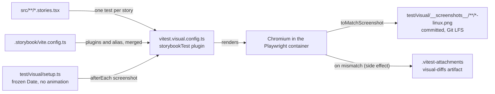

# 0031 — Visual regression tests for backend.ai-ui stories

## Summary

> Unfamiliar terms are collected in the [Glossary](#glossary) at the end.

- Every Storybook story in `packages/backend.ai-ui` renders in Chromium through Vitest browser mode and is compared with a committed screenshot (a [baseline](#glossary)). A story opts out with the tag `no-vrt`.
- Baselines are valid only when they come from the `mcr.microsoft.com/playwright:v<version>-noble` container as `linux/amd64`, where `<version>` is BUI's exact `playwright` pin. Only the container writes files ending in `-linux.png`, and only those are committed.
- The `Vitest visual (backend.ai-ui)` workflow runs the comparison in the same container on every PR and every push to `main` that touches BUI sources, its Storybook config, the fonts or icons Storybook serves, `pnpm-workspace.yaml`, or `pnpm-lock.yaml`, and uploads the diff images when it fails.
- A PR that changes how a BUI story looks commits the rewritten baselines in the same PR. This includes a `@lablup/ui-common` pin bump.
- Baselines are stored in Git LFS, and a default clone holds pointer files for them. `scripts/visual-test.sh` and the workflow replace the pointers with the images through `scripts/pull-visual-baselines.sh` before the tests run. This extends ADR 0029 §1, which names the user manual's images as the only LFS-tracked files.
- A committed baseline that no current story produces fails the run, and `-u` deletes it.

## Context

- **What changes pictures**: BUI renders Astryx through `@lablup/ui-common` (ADR 0009). A ui-common pin bump, a theme token edit, or a wrapper refactor can change how a component looks while lint, `tsc`, and the jsdom Vitest suite all pass.
- **What exists**: BUI has about 110 story files and 600 stories. Before this decision nothing compared their rendering between two commits.
- **Repository size**: the baselines are about 590 PNG files, 6.7 MB. A `playwright` bump or a ui-common pin bump can rewrite all of them, and as plain Git blobs every rewrite would stay in every clone's history.
- **Why a container**: Font rasterization and antialiasing differ between operating systems and CPU architectures, so a screenshot taken on one host does not match one taken on another. lablup/ui-common solved the same problem with a pinned Playwright container (lablup/ui-common#153), and this decision ports that setup.

## Diagram

## Decision

### 1. A separate Vitest config runs the stories in a browser

- **Files**: `packages/backend.ai-ui/vitest.visual.config.ts` uses `storybookTest` from `@storybook/addon-vitest` with `@vitest/browser-playwright`, a 1200 × 900 viewport, the `UTC` time zone, and the `en-US` locale. It excludes the tag `no-vrt`. The jsdom suite in `vitest.config.ts` is unchanged, and `pnpm run vitest` does not run the visual tests.
- **Storybook-only Vite config**: `.storybook/vite.config.ts` holds the plugins the stories need (React with the compiler in annotation mode, Relay, SVGR, the `./__generated__` alias). `.storybook/main.ts` points `builder.viteConfigPath` at it, so Storybook no longer reads the library build config `vite.config.ts`. The visual config merges the same file.
- **Setup**: `test/visual/setup.ts` fakes only `Date` (2026-01-15T12:00:00Z), turns off transitions and animations, waits until the DOM has not changed for 600 ms (at most 5 s), waits for fonts, and captures only the area the story painted. When that area is larger than the 1200 × 900 page, the setup grows the Playwright page and the test frame to the document's size together, because Vitest scales down a frame larger than the page. It captures, then restores 1200 × 900. On an axis where the content grows with the page, it keeps 1200 or 900 and captures what fits.
- **Fonts**: the local fonts in `resources/fonts`, which `preview-head.html` links, stay on. The image resolves the generic families `monospace`, `sans-serif`, and `serif` to different fonts from one run to the next, so the config sets `FONTCONFIG_FILE` to `test/visual/fonts.conf`, which binds them to Liberation Mono, Liberation Sans, and Liberation Serif.
- **Stale baselines**: `resolveScreenshotPath` records every baseline path a run uses. A reporter in the same config then fails the run for each committed `*-chromium-linux.png` that no current story produces: a file the run did not use in a story file whose tests all passed, and any file whose story file is gone. With `-u` it deletes them instead. It runs only when `BUI_VISUAL_CONTAINER=1`, so in CI and in `visual-test.sh`.

### 2. The container is the only source of baselines

- **Pin**: `playwright` is an exact devDependency of BUI, equal to the version the root `@playwright/test` resolves to, so the e2e suites and the visual tests share one browser build. The workflow's `resolve-playwright` job fails when `pnpm-lock.yaml` resolves `playwright` or `@playwright/test` to any other version, so the two are bumped together. `@vitest/browser`, `@vitest/browser-playwright`, and `@vitest/coverage-v8` peer on the exact `vitest` version, so BUI pins all four exactly to the same version. The Storybook packages (`storybook`, `@storybook/*`, `eslint-plugin-storybook`) are pinned exactly to one version too, so `@storybook/addon-vitest` and `storybook` only move together. The root and `react/` `vitest` ranges are unchanged.
- **Script**: `scripts/visual-test.sh` (`pnpm run test:visual:docker`, `-u` to rewrite) runs `mcr.microsoft.com/playwright:v<pin>-noble` as `linux/amd64`. It installs with `--filter "backend.ai-ui..."` into per-checkout named volumes, so the host's `node_modules` is never overwritten. It copies `pnpm-lock.yaml` aside before the install and puts it back when the install rewrote it, because the `pnpm` npm package and `@pnpm/exe` record different `packageManagerDependencies`. The container changes no other host file than the screenshots and `.vitest-attachments`. npm's cache lives in the `bui-visual-npm-cache` volume, so `npx` does not download pnpm on every run. The BUI README lists the command that removes the volumes.
- **Naming**: the script and the workflow set `BUI_VISUAL_CONTAINER=1`. Only then does `resolveScreenshotPath` name a file `<story>-chromium-linux.png`. Without it, a host run, a Linux host included, writes `<story>-chromium-<platform>-host.png`.
- **Git**: `.gitignore` ignores every screenshot except `*-linux.png`, so a host run cannot commit its pictures.

### 3. CI runs the comparison in the same container

- **Workflow**: `.github/workflows/vitest-visual-backend-ai-ui.yml` runs on `pull_request` and on `push` to `main` with the same `paths`. The push run catches baselines that go stale when two PRs that each passed are merged.
- **Image tag**: a `resolve-playwright` job reads BUI's `playwright` devDependency from `package.json`, the same value `visual-test.sh` reads, and fails when it is not an exact version. The visual job runs in `mcr.microsoft.com/playwright:v<that version>-noble`, so a `playwright` bump moves the tag with no workflow edit.
- **Job**: the job runs with a 20-minute timeout and without setup-node's pnpm cache (`cache: ""` on `setup-node-pnpm`), because in the container that cache never hits and its post-save costs about 80 s, as in `package.yml`'s `build_docs`. On failure the job uploads `.vitest-attachments` as the `visual-diffs` artifact.
- **LFS cache**: the job restores `.git/lfs/objects` from an `actions/cache` entry keyed `bui-visual-lfs-v1-<sha256>` over the sorted blob ids of the baseline pointers (`docs-lfs-cache-key.sh --root … --prefix …`), falling back to the newest `bui-visual-lfs-v1-` entry, so only changed baselines are downloaded. On a miss it prunes the store to the objects the pull needed (`prune-lfs-store.sh`) and saves it after the tests pass: on a `push` to `main`, whose entry every PR can read, and on a PR from this repository. A fork PR's run never saves, because objects only the fork has would then skip the fetch from origin and pass the check below.
- **Fork PRs**: when the head repository is not this one, the pull falls back to the fork's clone URL, fetched without this repository's credentials, for the objects origin lacks. When the fork supplied any, the job fails at the end with the `git lfs push origin` command a maintainer runs before merging, because the push run on `main` fetches from origin alone. The docs PR preview does the same (ADR 0029).
- **Gate**: `ci-gate.yml` waits for every `pull_request` workflow on the head commit, so the new workflow needs no registration there. A failure of the push run on `main` is not gated; it shows on the commit.

### 4. A story that cannot be stable is tagged `no-vrt`

- **Rule**: a story whose picture depends on `Math.random` or on a timer the setup does not wait for gets `tags: ['no-vrt']`. So does a PoC component no page renders (`BAISessionCrowdScene`, `BAISessionPinwheelMeadow`), tagged once in its `meta`. Dates need no tag, because `Date` is frozen.
- **Frozen clock**: `Date.now()` does not advance during a run, so elapsed time computes as 0 and a lodash `debounce` or `throttle` never runs its trailing call, since both compare `Date.now()` with the time of the last call. No story depends on one firing today. A story that does, for example a `play` function typing into a debounced search, gets `no-vrt`. A clock that advances (`shouldAdvanceTime`) was tried and rejected: the live tickers (`BAIIntervalView`, the running time in `BAIAgentTable`) then show a different second on every run, and 10 stories failed on the first container run.

### 5. Baselines are stored in Git LFS

- **Rule**: the root `.gitattributes` holds `packages/backend.ai-ui/test/visual/__screenshots__/**/*.png filter=lfs diff=lfs merge=lfs -text`. `.lfsconfig` adds `packages/backend.ai-ui/test/visual/__screenshots__/**` to `lfs.fetchexclude`, next to the manual's path, so a default clone holds pointer files there. The commit check and the pre-push hook of [ADR 0029](0029-user-manual-images-in-git-lfs.md) cover these files unchanged.
- **Pull**: `scripts/pull-visual-baselines.sh` exits at once when no baseline is a pointer file. Otherwise it runs `.github/scripts/lfs/pull-docs-images.sh --root packages/backend.ai-ui/test/visual/__screenshots__`. That script overrides `lfs.fetchexclude`, hashes the objects already in local LFS storage and discards a corrupted one, checks every image it writes against its pointer's oid, and fails when a pointer file remains. Its other options (`--remote`, `--fallback-remote`, `--fallback-report`) pass through. When git-lfs is missing it installs the pinned release with `.github/scripts/lfs/install-git-lfs.sh` on Linux x86_64, and stops with the install instruction elsewhere.
- **Callers**: `visual-test.sh` runs it on the host before `docker run`, because the container has no git-lfs. The workflow runs it inside the container, after checkout.
- **Rewrite**: `-u` writes raw PNG files; the LFS clean filter turns them into pointers at `git add`.
- **Pointer left in place**: a test whose baseline is still a pointer file fails, because Vitest cannot decode it as a PNG.

## Rejected alternatives

- **Host screenshots per platform**: commit `-darwin` and `-linux` baselines side by side. The advantage is fast local runs. It is rejected because every visual change would need two sets of baselines from two machines, and macOS versions also differ in rendering.
- **A hosted service (Chromatic and similar)**: the advantage is a review UI for diffs. It is rejected because it adds an external service and an account for what a container and an artifact already cover.
- **A separate `git lfs pull` script**: one `git lfs pull` on the screenshot directory. It was the first version and is rejected because git-lfs does not hash an object it finds in local storage, such as a restored cache, so a corrupted object would reach the baselines unchecked, and it had no fork fallback. `pull-docs-images.sh` already does both, so it takes `--root` instead.
- **`actions/checkout` with `lfs: true`**: it is rejected because the Playwright container has no git-lfs, and `visual-test.sh` runs on a host checkout, not through `actions/checkout`.
- **Bump BUI to Vitest 5 to match ui-common**: it is rejected because Vitest 4.1 already has browser mode and `toMatchScreenshot`, and `@storybook/addon-vitest` 10.6 accepts Vitest 4.

## Consequences

- **Caught at review**: a visual change in a BUI component, including one that a ui-common pin bump brings in, fails the PR with the diff images attached, and the rewritten baselines show the change in the diff.
- **Local cost**: rewriting baselines requires Docker, and on Apple Silicon the container runs emulated, which is several times slower than a host run.
- **Coverage limit**: only the default theme (Backend.AI WebUI, light, `en`) is compared. Dark mode, the neutral theme, and other locales are not.
- **Upgrade cost**: a `playwright` bump rewrites every baseline. The container tag follows the pin on its own.
- **git-lfs required**: running `visual-test.sh` and committing rewritten baselines need git-lfs on the host. Without it, rewritten baselines are committed as raw bytes, which the pre-push hook refuses and `lfs-pointer-check` fails.

## Sources

- GitHub: #11094. Reference implementation: lablup/ui-common#153.
- Decided 2026-11-10.
- Related: [ADR 0009](0009-ui-common-as-the-single-entry-point-to-astryx.md), [ADR 0029](0029-user-manual-images-in-git-lfs.md).

## Glossary

| Term     | Meaning                                                                                                              |
| -------- | -------------------------------------------------------------------------------------------------------------------- |
| baseline | A baseline is the committed reference screenshot of one story, which a test run compares its new screenshot against. |
| `no-vrt` | `no-vrt` is the Storybook tag that excludes a story from the visual regression tests.                                |
