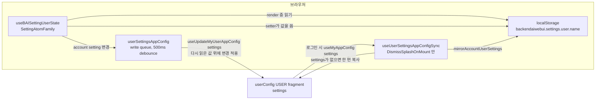

# 0032 — Personal settings in the user app config

## Summary

> 낯선 용어는 문서 맨 아래 [용어](#용어)에 모아 두었다.

- 계정에 속하는 개인 WebUI 설정은 manager app config `userConfig`의 평탄 키 `settings` 하나에 저장한다. 사용자가 다른 브라우저나 기기에서 로그인해도 같은 설정을 받는다.
- `react/src/helper/userSettingsAppConfig.ts`의 `isAccountUserSetting`이 이 [account setting](#용어) 목록을 정한다. `UserSettings`의 나머지 키는 [device-local setting](#용어)으로 브라우저 localStorage에만 남는다.
- localStorage는 account setting의 [mirror](#용어)를 유지하므로, `useBAISettingUserState`는 여전히 값을 동기적으로 돌려주고 API도 바뀌지 않는다.
- 로그인 시 `useUserSettingsAppConfigSync`가 `userConfig.settings`에 있는 account setting을 mirror에 쓴다. 계정에 `settings` 문서가 아직 없으면 이 hook이 이 브라우저의 account setting을 한 번 복사해 넣는다.
- account setting을 바꾸면 mirror에 즉시 쓰고, debounce된 write queue를 거쳐 서버로 보낸다.

## Context

- **localStorage settings**: `useBAISettingUserState`(`react/src/hooks/useBAISetting.tsx`)는 사용자 설정마다 localStorage의 `backendaiwebui.settings.user.<name>`에 저장한다. 브라우저를 바꾼 사용자는 투어 플래그, 테이블 컬럼 선택, 실험 기능 토글, 세션 런처 선호를 잃는다.
- **App config documents**: `react/src/hooks/useAppConfig.ts`는 `useMyAppConfig`로 병합된 `userConfig`를 읽고, `useUpdateMyUserAppConfig`로 사용자 자신의 USER fragment를 쓴다. [ADR 0026](0026-dashboard-boards-in-manager-app-config.ko.md)은 이미 대시보드 보드를 `userConfig.dashboard`에 저장하고, FR-3834는 테마 family를 `userConfig.themeFamily`에 저장한다.
- **Synchronous readers**: 약 100곳의 call site가 render 중에 사용자 설정을 읽고, React 밖의 일부 코드는 `backendaiOptions`(`react/src/global-stores.ts`)로 localStorage를 읽는다. app config 읽기는 suspend하며 로그인된 Relay environment가 필요하다.
- **Device-bound keys**: 일부 설정은 계정이 아니라 브라우저를 설명한다. 로그인 endpoint 기록, "로그인 유지", 창을 닫은 시각, 알림 권한, Electron 업데이트 확인이 그렇다.

## 설계도

## Decision

### 1. Account settings and device-local settings

- **Owner of the list**: `isAccountUserSetting(name)`이 설정의 저장 위치를 정한다. `ACCOUNT_USER_SETTING_KEYS`의 이름과 테이블별 접두사 `hiddenColumnKeys.`, `table_column_overrides.`, `fetchKeyAutoUpdateDelay.`에 맞는 이름을 account setting으로 본다.
- **New setting default**: `UserSettings`에 새로 추가한 설정은 그 이름을 `isAccountUserSetting`에 넣기 전까지 device-local이다.

| 분류         | 설정                                                                                                                                                                                                                                                                                                                                                                                                                                                                                                                                                                                                                                                                                                                                                                         | 이유                                                                               |
| ------------ | ---------------------------------------------------------------------------------------------------------------------------------------------------------------------------------------------------------------------------------------------------------------------------------------------------------------------------------------------------------------------------------------------------------------------------------------------------------------------------------------------------------------------------------------------------------------------------------------------------------------------------------------------------------------------------------------------------------------------------------------------------------------------------- | ---------------------------------------------------------------------------------- |
| account      | `has_opened_tour_neo_session_validation`, `has_opened_tour_deployment_preset_validation`, `has_opened_tour_back_to_user_view`, `has_opened_tour_back_to_admin_settings`, `session_monitor_sort`, `session_monitor_rows`, `session_monitor_condition`, `session_monitor_chip_items`, `compact_sidebar`, `recentSessionHistory`, `pinnedSessionHistory`, `experimental_ai_agents`, `experimental_import_from_huggingface`, `experimental_session_resource_grid`, `experimental_session_monitor`, `session_metrics_board_items`, `resource_panel_type`, `deploymentRevisionCreationMode`, `schedulingHistoryExpandMode`, `chat_intro_alert_dismissed`, `show_accelerator_dedicated_images_first`, `hiddenColumnKeys.*`, `table_column_overrides.*`, `fetchKeyAutoUpdateDelay.*` | 사용자가 고른 값이고 어느 기기에서나 같기를 기대한다                               |
| device-local | `preserve_login`, `last_window_close_time`, `endpoints`                                                                                                                                                                                                                                                                                                                                                                                                                                                                                                                                                                                                                                                                                                                      | 로그인 흐름이 로그인 전에 읽고, 이 브라우저를 설명한다                             |
| device-local | `selected_language`                                                                                                                                                                                                                                                                                                                                                                                                                                                                                                                                                                                                                                                                                                                                                          | 로그인 page가 로그인 전에 UI 언어를 고르려고 읽는다                                |
| device-local | `desktop_notification`, `automatic_update_check`, `max_concurrent_uploads`                                                                                                                                                                                                                                                                                                                                                                                                                                                                                                                                                                                                                                                                                                   | 브라우저의 알림 권한, Electron 설치본, 이 기기의 네트워크가 값을 정한다            |
| device-local | `extra_ai_agents`, `agent_endpoints`                                                                                                                                                                                                                                                                                                                                                                                                                                                                                                                                                                                                                                                                                                                                         | agent binding에 `endpoint_token`이 들어갈 수 있고, 이 값은 서버 문서에 두지 않는다 |
| device-local | `projectGroup.*`                                                                                                                                                                                                                                                                                                                                                                                                                                                                                                                                                                                                                                                                                                                                                             | `backendaiOptions`가 React 밖에서 이 브라우저 로그인의 endpoint id를 키로 쓴다     |
| device-local | `custom_theme_config`                                                                                                                                                                                                                                                                                                                                                                                                                                                                                                                                                                                                                                                                                                                                                        | Branding page의 저장 전 초안이고, 적용된 외관은 이미 app config에 있다             |
| device-local | `recentSearchHits`, `sessionResourceGridHueOverrides`                                                                                                                                                                                                                                                                                                                                                                                                                                                                                                                                                                                                                                                                                                                        | 검색 팔레트는 선택할 때마다 쓰고, 색상 override는 곧 사라지는 세션 id를 키로 쓴다  |
| 삭제         | `has_opened_tour_neo_deployment_validation`, `custom_ssh_port`, `beta_feature`, `start_board_items`, `dashboard_board_items`, `admin_dashboard_board_items`, `custom_dashboard_panels`                                                                                                                                                                                                                                                                                                                                                                                                                                                                                                                                                                                       | 읽는 코드가 없다. 대시보드 키는 ADR 0026이 폐기했다                                |

### 2. `userConfig.settings` holds the account settings

- **Key shape**: `userConfig.settings`는 설정 이름에서 값으로 가는 평탄 객체다. 예: `{ "compact_sidebar": true, "table_column_overrides.SessionList": { … } }`. 점이 들어간 이름도 경로가 아니라 키 하나다.
- **Single writer**: `react/src/helper/userSettingsAppConfig.ts`와 `useUserSettingsAppConfigSync`만 `userConfig.settings`를 쓰고, USER fragment에만 쓴다. 어떤 코드도 다른 scope의 `userConfig`에 `settings` 키를 쓰지 않으므로, 병합된 view는 USER fragment와 같고 서버의 deep merge가 scope 사이에서 배열을 섞지 않는다.
- **Stored null**: 일부 설정은 `null`을 선택값으로 쓰므로(예: 자동 새로 고침 끔을 뜻하는 `fetchKeyAutoUpdateDelay.*`) `null` 값은 JSON `null`로 저장한다. `undefined` 값만 키를 지운다.

### 3. localStorage is the mirror

- **Read path**: `SettingAtomFamily`는 계속 localStorage를 읽으므로 render가 서버를 기다리지 않고, React 밖 코드(`backendaiOptions`, `hasStoredUserSetting`)도 같은 값을 본다.
- **Sign-in rewrite**: `useUserSettingsAppConfigSync`는 splash를 걷기 전에 이미 `userConfig`에서 suspend하는 `DismissSplashOnMount`(`MainLayout.tsx`)에서 실행된다. `userConfig.settings`가 있으면 `mirrorAccountUserSettings`가 문서의 account setting을 모두 localStorage에 쓰고, `refreshSettingAtoms`가 모든 setting atom이 localStorage를 다시 읽게 한다.
- **Absent key**: 문서에 없는 account 키는 이 브라우저의 localStorage 값을 유지하고, 그 설정이 다음에 바뀔 때 서버로 보내진다. e2e spec과 walkthrough 실행이 로그인 전에 투어 플래그를 localStorage에 심고, `mirrorAccountUserSettings`는 이를 지우지 않는다.
- **Before sign-in**: 로그인 page와 로그인 전 화면은 이 브라우저의 마지막 세션이 남긴 mirror를 읽는다.

### 4. One-time copy

- **Trigger**: 로그인 시 `userConfig.settings`가 없으면 `useUserSettingsAppConfigSync`가 `readLocalAccountUserSettings(localStorage)`를 문서로 쓴다. 비어 있어도 쓰므로 복사는 계정마다 한 번만 일어난다.
- **Concurrent copy**: 복사는 다시 읽은 값에 대한 함수 update로 쓴다. 다른 탭이나 기기가 먼저 `settings`를 썼으면 복사는 그 문서를 유지한다.
- **Shared browser**: 여러 계정이 브라우저 하나를 쓰면, 업그레이드 뒤 처음 로그인한 계정이 이 브라우저의 account setting을 받는다. 복사는 mirror를 바꾸지 않으므로, 문서 없이 다음에 로그인한 계정도 같은 값을 받는다. ADR 0026의 대시보드 보드와 달리 이 값은 작은 선호 설정이고, 어떤 계정도 자기가 가진 데이터를 잃지 않는다.

### 5. Writes are debounced and sent one at a time

- **Queue**: `queueUserSettingWrite(name, value)`는 account setting 변경을 500ms debounce(`USER_SETTINGS_WRITE_DELAY_MS`)의 `createWriteQueue`(`react/src/components/DashboardPanels/writeQueue.ts`)에 넣는다. debounce 안의 변경은 batch 하나로 합치고, batch는 앞 batch가 끝난 뒤에야 시작한다.
- **Callers**: `SettingAtomFamily` setter와 `backendaiwebui.settings:delete` listener가 `user` namespace에 대해 `queueUserSettingWrite`를 부른다. device-local setting은 거기서 무시된다.
- **Replay on the server value**: `startUserSettingsSync`가 설치한 writer는 `useUpdateMyUserAppConfig('settings', current => applyUserSettingChanges(current, batch))`를 부르므로, 다른 기기가 바꾼 키는 이 batch가 같은 키를 바꾸지 않는 한 남는다. `undefined` 값은 키를 지운다.
- **Lifetime**: `useUserSettingsAppConfigSync`가 queue를 시작하기 전에는 queue가 아무것도 보내지 않으므로, 로그인 전 변경은 로컬에 남는다. hook은 탭이 숨겨질 때, `pagehide` 때, unmount 때 queue를 flush한다.
- **Failure**: 실패한 쓰기는 `useBAILogger`로 기록하고, mirror는 새 값을 유지한다. 다음 로그인 때 서버 값으로 mirror를 다시 쓴다.

## 대안과 기각 사유

- **Server as the only store**: 모든 `useBAISettingUserState` reader가 `useMyAppConfig`에서 suspend한다. 값의 위치가 하나가 된다. hook을 로그인 전, `RelayEnvironmentProvider` 밖, React 밖의 `backendaiOptions`에서도 읽으므로 기각한다.
- **Move every key**: `UserSettings` 전부를 `userConfig.settings`로 옮긴다. 규칙이 단순하다. 로그인 흐름이 문서를 읽기 전에 `endpoints`, `preserve_login`, `selected_language`가 필요하고 agent binding에 token이 들어갈 수 있으므로 기각한다.
- **No migration**: ADR 0026 §5처럼 기본값에서 시작한다. 다른 계정으로 잘못 복사되는 일이 없다. 사용자가 몇 달에 걸쳐 정한 투어 플래그와 컬럼 선택을 잃고, 잘못된 계정으로의 복사는 선호 설정 하나의 비용이므로 기각한다.
- **One app config key per setting**: 설정마다 `userConfig`의 최상위 키로 둔다. 설정을 이름으로 읽을 수 있다. 테이블별 이름은 끝이 열려 있고, 하위 키 하나가 사용자의 다른 키(`dashboard`, `themeFamily`)와 분리를 유지하므로 기각한다.
- **Write per change**: setter를 부를 때마다 즉시 upsert한다. 구현이 단순하다. 컬럼 크기 조정이나 필터 입력이 문서 전체 upsert를 여러 번 만들고, 동시에 보낸 upsert가 서로의 변경을 지우므로 기각한다.

## Consequences

- **Cross-device preferences**: 사용자의 투어, 컬럼, 실험 기능 토글, 세션 런처 선택이 계정을 따라간다.
- **Unchanged call sites**: `useBAISettingUserState`의 call site는 바뀌지 않는다. 설정 이름만이 저장 위치를 정한다.
- **Stale value at first paint**: 로그인 전, 그리고 오래전에 쓴 기기에서 로그인한 직후 render 한 번 동안 component는 `refreshSettingAtoms`가 실행되기 전까지 mirror의 옛 값을 보여 준다.
- **No live cross-tab update**: 한 탭에서 바꾼 값은 열려 있는 다른 탭에 그 탭의 다음 로그인 때 도달한다.
- **Removal on one device**: 한 기기가 키를 지우면, 다른 기기는 그 키가 다시 바뀔 때까지 자기 로컬 값을 유지한다.
- **Last write wins per key**: 두 기기가 debounce 하나 안에 같은 키를 바꾸면 서버에 마지막으로 도달한 쓰기의 값이 남는다.

## 출처

- #10435 — Migrate personal WebUI settings from localStorage to the userConfig app config.
- #8525 (FR-3435) — 이 이슈를 분리해 낸 상위 작업.
- 2026-11-10 결정.

관련: [ADR 0026](0026-dashboard-boards-in-manager-app-config.ko.md), [ADR 0028](0028-webui-settings-in-the-app-config-settings-key.ko.md).

## 용어

| 용어                 | 뜻                                                                                                                    |
| -------------------- | --------------------------------------------------------------------------------------------------------------------- |
| account setting      | `isAccountUserSetting`이 true를 돌려주는 사용자 설정이다. `userConfig.settings`에 저장하고 localStorage에 mirror한다. |
| device-local setting | 이 브라우저의 localStorage에만 저장하는 사용자 설정이다. 서버에 도달하지 않는다.                                      |
| mirror               | `SettingAtomFamily`가 동기적으로 읽는, account setting의 localStorage 사본이다.                                       |
