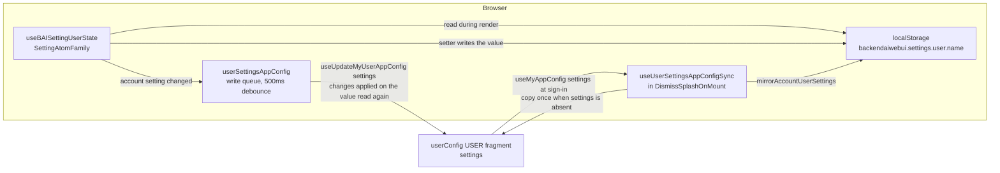

# 0032 — Personal settings in the user app config

## Summary

> Unfamiliar terms are collected in the [Glossary](#glossary) at the end.

- Personal WebUI preferences that belong to the account are stored in the manager app config `userConfig`, under one flat key, `settings`. A user who signs in on another browser or device gets the same preferences.
- `isAccountUserSetting` in `react/src/helper/userSettingsAppConfig.ts` lists these [account settings](#glossary). Every other key of `UserSettings` stays in browser localStorage only, as a [device-local setting](#glossary).
- localStorage keeps a [mirror](#glossary) of the account settings, so `useBAISettingUserState` still returns a value synchronously and its API does not change.
- At sign-in, `useUserSettingsAppConfigSync` writes the account settings that `userConfig.settings` holds into the mirror. When the account has no `settings` document yet, the hook copies this browser's account settings into it once.
- A change to an account setting is written to the mirror at once and sent to the server through a debounced write queue.

## Context

- **localStorage settings**: `useBAISettingUserState` (`react/src/hooks/useBAISetting.tsx`) stores each user setting in localStorage under `backendaiwebui.settings.user.<name>`. A user who switches browsers loses tour flags, table column choices, experimental toggles, and session launcher preferences.
- **App config documents**: `react/src/hooks/useAppConfig.ts` reads the merged `userConfig` view with `useMyAppConfig` and writes the user's own USER fragment with `useUpdateMyUserAppConfig`. [ADR 0026](0026-dashboard-boards-in-manager-app-config.md) already stores dashboard boards in `userConfig.dashboard`, and FR-3834 stores the theme family in `userConfig.themeFamily`.
- **Synchronous readers**: About a hundred call sites read a user setting during render, and some code outside React reads localStorage through `backendaiOptions` (`react/src/global-stores.ts`). The app config read suspends and needs a signed-in Relay environment.
- **Device-bound keys**: Some settings describe the browser, not the account: the login endpoint history, "keep me signed in", the time the window closed, the notification permission, and the Electron update check.

## Diagram

## Decision

### 1. Account settings and device-local settings

- **Owner of the list**: `isAccountUserSetting(name)` decides where a setting lives. It matches the names in `ACCOUNT_USER_SETTING_KEYS` and the per-table prefixes `hiddenColumnKeys.`, `table_column_overrides.`, and `fetchKeyAutoUpdateDelay.`.
- **New setting default**: A setting added to `UserSettings` is device-local until its name is added to `isAccountUserSetting`.

| class        | settings                                                                                                                                                                                                                                                                                                                                                                                                                                                                                                                                                                                                                                                                                                                                                                     | reason                                                                                                          |
| ------------ | ---------------------------------------------------------------------------------------------------------------------------------------------------------------------------------------------------------------------------------------------------------------------------------------------------------------------------------------------------------------------------------------------------------------------------------------------------------------------------------------------------------------------------------------------------------------------------------------------------------------------------------------------------------------------------------------------------------------------------------------------------------------------------- | --------------------------------------------------------------------------------------------------------------- |
| account      | `has_opened_tour_neo_session_validation`, `has_opened_tour_deployment_preset_validation`, `has_opened_tour_back_to_user_view`, `has_opened_tour_back_to_admin_settings`, `session_monitor_sort`, `session_monitor_rows`, `session_monitor_condition`, `session_monitor_chip_items`, `compact_sidebar`, `recentSessionHistory`, `pinnedSessionHistory`, `experimental_ai_agents`, `experimental_import_from_huggingface`, `experimental_session_resource_grid`, `experimental_session_monitor`, `session_metrics_board_items`, `resource_panel_type`, `deploymentRevisionCreationMode`, `schedulingHistoryExpandMode`, `chat_intro_alert_dismissed`, `show_accelerator_dedicated_images_first`, `hiddenColumnKeys.*`, `table_column_overrides.*`, `fetchKeyAutoUpdateDelay.*` | the user chose them and expects them on every device                                                            |
| device-local | `preserve_login`, `last_window_close_time`, `endpoints`                                                                                                                                                                                                                                                                                                                                                                                                                                                                                                                                                                                                                                                                                                                      | the login flow reads them before sign-in, and they describe this browser                                        |
| device-local | `selected_language`                                                                                                                                                                                                                                                                                                                                                                                                                                                                                                                                                                                                                                                                                                                                                          | the login page reads it before sign-in to pick the UI language                                                  |
| device-local | `desktop_notification`, `automatic_update_check`, `max_concurrent_uploads`                                                                                                                                                                                                                                                                                                                                                                                                                                                                                                                                                                                                                                                                                                   | the browser's notification permission, the Electron install, and this machine's connection decide them          |
| device-local | `extra_ai_agents`, `agent_endpoints`                                                                                                                                                                                                                                                                                                                                                                                                                                                                                                                                                                                                                                                                                                                                         | an agent binding can carry an `endpoint_token`, which stays out of server documents                             |
| device-local | `projectGroup.*`                                                                                                                                                                                                                                                                                                                                                                                                                                                                                                                                                                                                                                                                                                                                                             | `backendaiOptions` writes it outside React, keyed by the endpoint id of this browser's login                    |
| device-local | `custom_theme_config`                                                                                                                                                                                                                                                                                                                                                                                                                                                                                                                                                                                                                                                                                                                                                        | it is the Branding page's unsaved draft; the applied appearance lives in app config already                     |
| device-local | `recentSearchHits`, `sessionResourceGridHueOverrides`                                                                                                                                                                                                                                                                                                                                                                                                                                                                                                                                                                                                                                                                                                                        | the search palette writes on every pick, and the hue overrides are keyed by session ids that soon stop existing |
| dropped      | `has_opened_tour_neo_deployment_validation`, `custom_ssh_port`, `beta_feature`, `start_board_items`, `dashboard_board_items`, `admin_dashboard_board_items`, `custom_dashboard_panels`                                                                                                                                                                                                                                                                                                                                                                                                                                                                                                                                                                                       | no code reads them; the dashboard keys were retired by ADR 0026                                                 |

### 2. `userConfig.settings` holds the account settings

- **Key shape**: `userConfig.settings` is a flat object from a setting name to its value, for example `{ "compact_sidebar": true, "table_column_overrides.SessionList": { … } }`. A dotted name is one key, not a path.
- **Single writer**: Only `react/src/helper/userSettingsAppConfig.ts` and `useUserSettingsAppConfigSync` write `userConfig.settings`, and they write only the USER fragment. No code writes a `settings` key into the `userConfig` of another scope, so the merged view equals the USER fragment and the server's deep merge does not mix arrays across scopes.
- **Stored null**: A `null` value is stored as JSON `null`, because some settings use it as a choice, such as `fetchKeyAutoUpdateDelay.*` for auto-refresh off. Only an `undefined` value removes a key.

### 3. localStorage is the mirror

- **Read path**: `SettingAtomFamily` keeps reading localStorage, so a render never waits for the server and code outside React (`backendaiOptions`, `hasStoredUserSetting`) sees the same value.
- **Sign-in rewrite**: `useUserSettingsAppConfigSync` runs in `DismissSplashOnMount` (`MainLayout.tsx`), which already suspends on `userConfig` before the splash goes. When `userConfig.settings` exists, `mirrorAccountUserSettings` writes every account setting it holds into localStorage, and `refreshSettingAtoms` makes every setting atom read localStorage again.
- **Absent key**: An account key the document does not hold keeps this browser's localStorage value, which the setting's next change sends to the server. e2e specs and walkthrough runs seed tour flags into localStorage before sign-in, and `mirrorAccountUserSettings` does not remove them.
- **Before sign-in**: The login page and other pre-login surfaces read the mirror as it was left by the last session in this browser.

### 4. One-time copy

- **Trigger**: At sign-in, when `userConfig.settings` is absent, `useUserSettingsAppConfigSync` writes `readLocalAccountUserSettings(localStorage)` as the document, even when it is empty, so the copy runs once per account.
- **Concurrent copy**: The copy uses a function update on the value read again. When another tab or device wrote `settings` first, the copy keeps that document.
- **Shared browser**: When several accounts share one browser, the first account to sign in after the upgrade receives this browser's account settings. The mirror is not changed by the copy, so the next account that signs in with no document receives the same values. Unlike the dashboard boards of ADR 0026, these values are small preferences, and no account loses data it holds.

### 5. Writes are debounced and sent one at a time

- **Queue**: `queueUserSettingWrite(name, value)` puts a change of an account setting into a `createWriteQueue` (`react/src/components/DashboardPanels/writeQueue.ts`) with a 500ms debounce (`USER_SETTINGS_WRITE_DELAY_MS`). Changes within the debounce are joined into one batch, and a batch starts only after the previous one finished.
- **Callers**: The `SettingAtomFamily` setter and the `backendaiwebui.settings:delete` listener call `queueUserSettingWrite` for the `user` namespace. A device-local setting is ignored there.
- **Replay on the server value**: `startUserSettingsSync` installs a writer that calls `useUpdateMyUserAppConfig('settings', current => applyUserSettingChanges(current, batch))`, so a key another device changed survives unless this batch changes it too. An `undefined` value removes the key.
- **Lifetime**: The queue sends nothing before `useUserSettingsAppConfigSync` started it, so a change made before sign-in stays local. The hook flushes the queue when the tab is hidden, on `pagehide`, and when it unmounts.
- **Failure**: A failed write is logged with `useBAILogger`, and the mirror keeps the new value. The next sign-in rewrites the mirror from the server.

## Rejected alternatives

- **Server as the only store**: Every `useBAISettingUserState` reader suspends on `useMyAppConfig`. The value has one home. This is rejected because the hook is read before sign-in, outside `RelayEnvironmentProvider`, and by `backendaiOptions` outside React.
- **Move every key**: All of `UserSettings` goes to `userConfig.settings`. The rule is simple. This is rejected because the login flow needs `endpoints`, `preserve_login`, and `selected_language` before any document can be read, and an agent binding can carry a token.
- **No migration**: Follow ADR 0026 §5 and start from defaults. Nothing is copied into the wrong account. This is rejected because users would lose tour flags and column choices they set over months, and a wrong-account copy costs only a preference.
- **One app config key per setting**: Each setting becomes a top-level key of `userConfig`. A setting can be read by name. This is rejected because the per-table names are open-ended, and a flat sub-key keeps the user's other keys (`dashboard`, `themeFamily`) apart.
- **Write per change**: Every setter call upserts at once. The implementation is simple. This is rejected because a column resize or a typed filter produces many whole-document upserts, and upserts sent at the same time erase each other's changes.

## Consequences

- **Cross-device preferences**: A user's tours, columns, experimental toggles, and session launcher choices follow the account.
- **Unchanged call sites**: No call site of `useBAISettingUserState` changes; only the setting's name decides where it is stored.
- **Stale value at first paint**: Before sign-in, and for one render after it on a device the user last used long ago, a component shows the mirror's old value until `refreshSettingAtoms` runs.
- **No live cross-tab update**: A change made in one tab reaches another open tab only at its next sign-in.
- **Removal on one device**: When one device removes a key, another device keeps its local value for that key until the key changes again.
- **Last write wins per key**: Two devices that change the same key within one debounce keep the value whose write reached the server last.

## Sources

- #10435 — Migrate personal WebUI settings from localStorage to the userConfig app config.
- #8525 (FR-3435) — the split that produced this issue.
- Decided 2026-11-10.

Related: [ADR 0026](0026-dashboard-boards-in-manager-app-config.md), [ADR 0028](0028-webui-settings-in-the-app-config-settings-key.md).

## Glossary

| term                 | meaning                                                                                                                           |
| -------------------- | --------------------------------------------------------------------------------------------------------------------------------- |
| account setting      | A user setting for which `isAccountUserSetting` returns true. It is stored in `userConfig.settings` and mirrored in localStorage. |
| device-local setting | A user setting stored only in this browser's localStorage. It does not reach the server.                                          |
| mirror               | The localStorage copy of the account settings that `SettingAtomFamily` reads synchronously.                                       |
