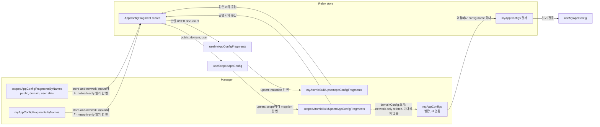
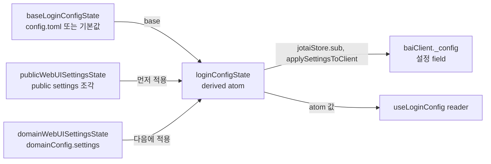

# 0033 — Scoped and merged app config hooks

## Summary

> 낯선 용어는 문서 맨 아래 [용어](#용어)에 모아 두었다.

- `react/src/hooks/useAppConfig.ts`는 hook 세 개를 둔다. `useScopedAppConfig(request)`는 호출부가 [scope object](#용어) `{ type, id }`로 지정한 scope의 [raw document](#용어)를 읽고 쓴다. `useMyAppConfigFragments(configNames)`는 로그인한 사용자 본인의 USER document를 `my*` field로 읽고 쓴다. `useMyAppConfig(configName, subKey)`는 [merged view](#용어)를 읽기만 한다.
- 쓰기는 scope마다 upsert 한 번이다. `upsert`는 hook이 들고 있는 사본으로 문서 전체를 만들고, upsert 응답이 그 사본을 갱신하게 두며, 쓴 문서를 돌려준다.
- hook은 store의 사본을 먼저 그리고 mount될 때마다 문서를 한 번 더 읽으므로, 쓰기의 기준은 화면이 mount될 때의 문서다. 그 뒤 CLI, 다른 관리자, 다른 탭이 바꾼 값은 다음 쓰기가 덮어쓴다.
- `loginConfigState`는 base config, public `settings` document, domain `settings` document 세 atom에서 계산하는 derived atom이다. 시스템 설정 페이지는 자기가 쓴 층의 atom을 set하고, subscription이 모든 변경을 `baiClient._config`에 복사한다.

## Context

- **Upsert replaces**: `scopedAtomicBulkUpsertAppConfigFragments`와 `myAtomicBulkUpsertAppConfigFragments`는 받은 `config`를 `(configName, scope)`의 문서 전체로 저장하고, manager는 JSON merge를 하지 않는다. key 하나를 바꾸는 client도 나머지 key를 모두 보내야 한다.
- **One scope per field**: `scopedAppConfigFragmentsByNames`와 scoped upsert 입력은 다른 `scoped*` query(`ProjectScope`)처럼 OR로 묶는 scope 목록이 아니라 `AppConfigScopeRef { scopeType, scopeId }` 하나를 받는다. `scopeId`는 domain id 또는 user id이고, PUBLIC이면 null이다. 요청 한 번에 여러 scope를 읽으려면 scope마다 alias field가 하나씩 필요하다.
- **Read permissions**: `scopedAppConfigFragmentsByNames`는 모든 역할에 PUBLIC과 호출자 본인의 USER scope를 돌려준다. DOMAIN scope는 superadmin에게만 돌려주고, domain admin과 일반 사용자에게는 `app_config_fragment`의 `READ`를 거부한다.
- **Own-user fields**: `myAppConfigFragmentsByNames`와 `myAtomicBulkUpsertAppConfigFragments`는 호출자 본인의 USER scope에 작용하고 scope id를 받지 않는다. 읽기는 요청한 이름마다 `AppConfigFragment`를 하나씩 돌려주고, scope에 fragment가 없는 이름은 null이다. hook은 그중 `id`, `configName`, `config`를 선택한다.
- **Merged view**: `myAppConfigs`는 이름마다 `AppConfig { configName config }` 하나를 돌려준다. 호출자가 볼 수 있는 모든 fragment(PUBLIC, 호출자의 domain, 호출자 본인의 USER)를 allow-list rank 순서로 deep merge한 결과다(manager의 `VisibleAppConfigFragmentTarget`). `id`도 scope별 구분도 없으므로, Relay는 이를 upsert가 돌려준 fragment와 연결하지 못하고 client는 여기서 scope 하나의 document를 되살리지 못한다.
- **Settings at sign-in**: ADR 0028은 public과 domain `settings` document를 `config.toml` 위에 겹친다. `loginSessionAuth.ts`의 `connectViaGQL`은 로그인할 때 `myAppConfigs(["domainConfig"])`를 읽고, `applyConfigToClient`가 적용이 끝난 config를 `baiClient._config`에 복사한다. 대부분의 화면은 시스템 설정 field를 atom이 아니라 `baiClient._config`에서 읽는다.

## 설계도

## Decision

### 1. `useAppConfig.ts`의 hook 세 개

| Hook                                   | 읽기                                                                  | 쓰기                               | Fetch policy                                                  |
| -------------------------------------- | --------------------------------------------------------------------- | ---------------------------------- | ------------------------------------------------------------- |
| `useScopedAppConfig(request)`          | 요청한 scope마다 `scopedAppConfigFragmentsByNames` 하나, query 하나로 | `upsert(changes)`, scoped mutation | `store-and-network`, mount마다 `network-only` 읽기 한 번 추가 |
| `useMyAppConfigFragments(configNames)` | `myAppConfigFragmentsByNames`                                         | `upsert(changes)`, `my*` mutation  | `store-and-network`, mount마다 `network-only` 읽기 한 번 추가 |
| `useMyAppConfig(configName, subKey?)`  | 요청마다 config name 하나로 `myAppConfigs`                            | 없음                               | `store-or-network`                                            |

- **Lifecycle**: 모든 hook이 suspend하므로 호출부는 `Suspense` boundary 아래에 있어야 하고, 모든 hook은 로그인한 뒤에만 동작한다.
- **Scope object**: `AppConfigScope`는 `{ type: 'public' }` 또는 `{ type: 'domain' | 'user'; id: string }`이다. 호출부가 domain id(`useCurrentDomain().id`)나 user id를 넘기고, `PUBLIC_SCOPE`는 export된 PUBLIC 객체다.
- **Request shape**: `ScopedAppConfigRequest`는 `{ scope, configNames }` 항목 하나 또는 그 배열이고, scope type마다 항목은 하나까지다. query에 type마다 field가 하나뿐이므로, 같은 type이 두 번 나오면 `useScopedAppConfig`가 render 중에 예외를 던진다.
- **One query**: `useAppConfigScopedQuery`는 alias field `scopedAppConfigFragmentsByNames` 세 개(`public`, `domain`, `user`)를 둔다. 각 field에는 `@skip(if:)`과 `@catch(to: NULL)`이 붙는다. 건너뛰는 field에는 `scopeId` 없이 `{ scopeType }`만 넘기고, 입력 type이 이를 허용한다.
- **Return shape**: `useScopedAppConfig`는 `{ public, domain, user, upsert }`를 돌려준다. 각 scope는 요청한 이름에서 raw document로 가는 map이고, scope에 fragment가 없는 이름은 `undefined`, 요청하지 않았거나, 이름 없이 요청했거나, 읽을 수 없는 scope는 통째로 `undefined`다. `useMyAppConfigFragments`는 같은 map을 담은 `{ documents, upsert }`를 돌려준다. 이 hook의 query에는 `@catch`가 없어서 읽기 오류는 error boundary로 간다.
- **Own USER scope**: 로그인한 사용자 본인의 `userConfig`만 읽고 쓰는 화면은 모두 `useMyAppConfigFragments`를 쓴다. `user` scope를 넘기는 `useScopedAppConfig`는 호출부가 지정한 사용자의 document를 다룰 때 쓴다.
- **Read on every mount**: `useLazyLoadQuery`는 `MainLayout`의 `userConfig` 읽기처럼 mount된 다른 reader가 붙잡고 있는 query를 다시 가져오지 않는다. 그래서 raw document를 읽는 hook마다 effect 하나가 화면이 mount될 때마다 `network-only`로 문서를 읽는다.
- **Merged view per name**: `useMyAppConfig`는 `myAppConfigs`에 config name 하나만 묻는다. 그래서 `domainConfig` reader는 로그인 query(`loginSessionAuth.ts`)나 `AnnouncementBanner`가 쓴 `myAppConfigs(["domainConfig"])` 결과가 store에 남아 있는 동안 그것을 다시 쓴다. `MergedAppConfigName`이 `configName`을 `domainConfig`와 `publicConfigByDomain`으로 제한한다.
- **Domain slice**: `publicConfigByDomain`은 domain마다 조각 하나를 가지므로, 호출부는 change의 `subKey`(`[domainName, key]`)와 `useMyAppConfig('publicConfigByDomain', [domainName, key])` 양쪽에 domain 이름을 첫 경로로 넘긴다.

### 2. scope마다 upsert 한 번

- **Change shape**: `AppConfigChange`는 `{ scope, configName, subKey, value }`이다. `subKey`는 문서 안을 가리키는 lodash 경로(`string | string[]`)이고, `scope`는 hook을 호출할 때 넘긴 scope object다. `MyAppConfigChange`는 `scope`가 빠진 같은 모양이다. `value`는 다음 값이거나 `subKey`의 현재 값을 받는 함수이고, `undefined`는 key를 지운다. `upsert`는 change 하나나 배열을 받는다.
- **Write base**: `upsert`는 change를 scope별로 묶는다. scope마다 아직 진행 중인 hook query의 읽기를 기다린 뒤 Relay store에서 문서를 꺼내고, `applySubKey`로 change를 순서대로 적용해 바뀐 문서를 mutation 하나로 보낸다. Relay가 이미 record를 수거했으면 network에서 다시 읽는다.
- **Refused changes**: `upsert`는 아무것도 보내기 전에 모든 change를 검사하고, hook이 요청하지 않은 이름이나 요청한 것과 다른 scope id가 있으면 예외를 던진다.
- **Unreadable scope**: 읽지 못한 scope는 기준 문서가 비므로 `upsert`가 예외를 던진다. 이 검사는 그 scope의 차례가 왔을 때 돌기 때문에, 같은 호출에서 앞선 scope는 이미 쓰인 뒤다.
- **Result**: `upsert`는 쓴 문서를 돌려준다. `useScopedAppConfig`는 scope type을 key로 한 `WrittenAppConfigDocuments`를, `useMyAppConfigFragments`는 이름 map을 돌려준다. GraphQL 오류가 나면 promise가 오류 메시지와 함께 reject된다.
- **Store update**: 두 mutation 모두 `{ id configName config }`를 선택하므로 응답이 돌려받은 record를 갱신한다. 각 mutation의 `updater`는 hook의 읽기 field를 돌려받은 fragment로 연결해, 첫 쓰기와 fragment가 purge된 뒤의 쓰기를 처리한다.
- **Ordering**: `serializeWrite`는 scope마다 module 수준 queue 하나를 두고(key는 `<SCOPE_TYPE>:<scopeId>`, `useMyAppConfigFragments`는 `USER:me`) 그 scope에 대한 쓰기를 줄 세우므로, 쓰기는 앞의 쓰기가 끝난 뒤 시작하고 그 응답 위에서 만든다. `upsert` 한 번에 든 여러 scope는 차례로 쓰고, 원자적이지 않다.

### 3. 누가 어느 view를 읽는가

| Config name            | Reader와 writer                                                                                                                        | Hook                                                                                     |
| ---------------------- | -------------------------------------------------------------------------------------------------------------------------------------- | ---------------------------------------------------------------------------------------- |
| `userConfig`           | `MainLayout` (`themeFamily`), `useDashboardBoards`, `FolderCreateModal`, `useRecentSessionHistory`, `UserSettingsGeneralPane` (쓰기만) | `useMyAppConfigFragments(['userConfig'])`                                                |
| `domainConfig`         | `AnnouncementBanner`, `useDashboardBoards` (template)                                                                                  | `useMyAppConfig('domainConfig', …)`                                                      |
| `domainConfig`         | `AnnouncementEditModal` (superadmin 전용)                                                                                              | `useScopedAppConfig({ scope: { type: 'domain', id }, configNames: ['domainConfig'] })`   |
| `publicConfigByDomain` | `useDashboardBoards` (template)                                                                                                        | `useMyAppConfig('publicConfigByDomain', …)`                                              |
| `publicConfigByDomain` | `BrandingSettingList` (superadmin 전용, 쓰기만)                                                                                        | `useScopedAppConfig({ scope: PUBLIC_SCOPE, configNames: ['publicConfigByDomain'] })`     |
| 둘 다                  | `WebUISettingsPage` (superadmin 전용)                                                                                                  | `useScopedAppConfig([{ scope: { type: 'domain', id }, … }, { scope: PUBLIC_SCOPE, … }])` |

- **Merged refetch**: 모든 사용자가 `domainConfig`를 merged view로 읽으므로, `domainConfig` 쓰기는 upsert가 끝난 뒤 merged `domainConfig` view를 `network-only`로 읽기 시작한다. 쓰기는 그 읽기를 기다리지 않고, 읽기가 실패하면 쓰기는 실패하지 않은 채 merged view만 옛 값으로 남는다. `publicConfigByDomain` 쓰기는 다시 가져오지 않는다.
- **Draft follows the refresh**: `WebUISettingList`는 저장된 문서로 draft를 시작한다. mount 읽기나 페이지 자신의 upsert로 저장된 문서가 바뀌었고 draft가 아직 이전 저장값과 같으면, draft는 그 값을 편집으로 보이지 않고 새로 읽은 값을 따라간다.

### 4. login config의 settings 층

| Atom                       | 담는 값                                                                         | 쓰는 곳                                                                        |
| -------------------------- | ------------------------------------------------------------------------------- | ------------------------------------------------------------------------------ |
| `baseLoginConfigState`     | `LoginConfigState`로 처리한 `config.toml`, 또는 기본값                          | `initializeConfigOnce`, `loadConfigFromWebServer`; 비어 있으면 `connectViaGQL` |
| `publicWebUISettingsState` | 로그인 페이지 domain의 public `settings` 조각                                   | `initializeConfigOnce`, `loadConfigFromWebServer`, `WebUISettingsPage`         |
| `domainWebUISettingsState` | 로그인한 domain의 `domainConfig.settings`                                       | `connectViaGQL`, `WebUISettingsPage`                                           |
| `loginConfigState`         | derived: base에 public, 다음 domain document를 `applyWebUISettings`로 적용한 값 | 없음; 읽기 전용                                                                |

- **Layer write**: `WebUISettingsPage`는 `upsert`가 돌려준 `settings` document로 `domainWebUISettingsState`나 `publicWebUISettingsState`를 set한다. 그래서 `loginConfigState`와 그 reader는 다시 가져오지 않고 갱신된다.
- **Client mirror**: `DefaultProviders.tsx`가 `jotaiStore`에 한 번 설치하는 `syncLoginConfigToClient`는 `baiClient.ready`가 true이고 `baiClient._config`가 있는 동안 `loginConfigState`가 바뀔 때마다 `applySettingsToClient`를 부른다. `applySettingsToClient`는 설정 field만 쓴다. 신원과 연결 field, `ready` 설정은 로그인할 때 `applyConfigToClient`가 여전히 맡는다.
- **Reload after Apply**: mount할 때 `baiClient._config`를 한 번만 읽는 화면은 다시 mount될 때까지 옛 값을 들고 있으므로, `WebUISettingList`는 Apply 뒤에 여전히 페이지를 새로 고친다.

## 대안과 기각 사유

- **Scope keys without ids**: `useScopedAppConfig({ public?, domain?, user? })`는 scope key마다 이름 목록을 받고 id는 로그인한 domain과 사용자로 채운다. 호출부가 다른 domain이나 사용자를 지정할 수 없고, 어느 id에 쓰는지 호출부에 드러나지 않아 기각했다.
- **Scoped hook for the own USER scope**: `userConfig` 화면이 `{ type: 'user', id: user_uuid }`로 `useScopedAppConfig`를 부른다. `my*` field가 이미 정하는 scope를 위해 화면마다 user id를 읽어야 하고, scoped mutation은 호출부가 넘긴 id를 그대로 보내므로 기각했다.
- **Merged view for `userConfig`**: `userConfig` reader가 `useMyAppConfig`로 읽고 `my*` mutation으로 쓴다. merged view에는 scope별 구분이 없어서 그 위에서 만든 문서 전체 쓰기가 PUBLIC과 DOMAIN 값을 USER document에 복사하고, ADR 0026은 dashboard board 배열을 deep merge에서 제외하므로 기각했다.
- **One hook call per scope**: `useScopedAppConfig(scope, configName)`가 호출마다 scope 하나를 읽고, scope 두 개를 편집하는 페이지는 두 번 부른다. 두 번째 호출은 첫 읽기가 끝난 뒤에야 suspend하므로 시스템 설정 페이지가 문서 두 개를 차례로 읽게 되어 기각했다.
- **Changed key on the merged atom**: 쓰기 뒤에 페이지가 바뀐 key를 `loginConfigState`에 직접 set한다. `loginConfigState`에는 층이 이미 적용된 값이 들어 있어서 층에서 빠진 key가 옛 값을 유지하고, `baiClient._config`에는 아무것도 닿지 않으므로 기각했다.
- **Re-read before each write**: setter마다 upsert 전에 network에서 raw document를 읽는다. 변경마다 요청이 하나 늘고, #10941이 시스템 설정 페이지를 변경할 때마다 저장하게 하므로 기각했다.

## Consequences

- **Request count**: 변경 하나는 scope마다 upsert 한 번이고, `domainConfig` 변경은 merged refetch로 요청이 하나 더 든다. 화면은 요청한 문서를 mount마다 한 번 읽고, store에 아무것도 없으면 suspend하는 읽기와 mount 읽기로 두 번 읽는다.
- **Lost concurrent edits**: 화면이 mount된 뒤 CLI, 다른 관리자, 같은 계정의 다른 탭이 바꾼 값은 다음 쓰기가 덮어쓴다. 화면을 다시 mount하거나 페이지를 새로 고치면 그 값을 가져온다.
- **Defaults from DOMAIN-scope `userConfig`**: 화면이 USER raw document를 읽으므로, DOMAIN scope에 쓴 `userConfig` 값은 화면에 닿지 않는다.
- **Same-kind scopes**: scoped query는 scope 종류마다 field가 하나라서, 한 번 호출하면 domain 하나와 사용자 하나까지만 읽는다.
- **Separate queues**: `useMyAppConfigFragments`와 로그인한 사용자 본인 id로 부른 `useScopedAppConfig`는 쓰기를 따로 줄 세우므로, 둘이 같은 document를 동시에 쓰면 안 된다. 그렇게 쓰는 화면은 없다.
- **Stale merged view**: `useMyAppConfig`는 mount할 때 다시 읽지 않으므로, 다른 관리자나 CLI가 바꾼 `domainConfig`는 페이지를 새로 고치거나 이 탭이 `domainConfig`를 쓸 때까지 보이지 않는다.
- **Re-login**: 같은 페이지에서 다른 domain으로 로그인하면 `domainWebUISettingsState`가 바뀌므로, 이전 domain settings의 key는 하나도 적용된 채 남지 않는다.

## 출처

- #11146 — 이 결정.
- #10941 — 시스템 설정 페이지가 변경할 때마다 저장한다(PR #11090).
- Manager `1b01ca06e6`: `models/app_config_fragment/upserters.py`(문서 전체 upsert), `models/app_config_fragment/scopes.py`(`VisibleAppConfigFragmentTarget`).
- `data/schema.graphql`: `AppConfig`, `AppConfigScopeRef`, `myAppConfigFragmentsByNames`, `myAtomicBulkUpsertAppConfigFragments`.

관련: [ADR 0026](0026-dashboard-boards-in-manager-app-config.ko.md), [ADR 0028](0028-webui-settings-in-the-app-config-settings-key.ko.md).

## 용어

| 용어         | 뜻                                                                                                                                                                                                           |
| ------------ | ------------------------------------------------------------------------------------------------------------------------------------------------------------------------------------------------------------ |
| raw document | app config fragment 하나의 `config`이고, config name 하나에 대해 scope 하나(PUBLIC, domain 하나, 사용자 하나)에 저장된 문서다.                                                                               |
| merged view  | `myAppConfigs`가 돌려주는 문서이고, manager가 호출자가 볼 수 있는 한 config name의 모든 fragment를 app config allow list가 scope마다 주는 rank(PUBLIC 100, DOMAIN 200, USER 300) 순서로 deep merge해 만든다. |
| scope object | 호출부가 `useScopedAppConfig`와 각 change에 넘기는 `AppConfigScope` 값이고, scope type과, DOMAIN·USER일 때 domain id나 user id를 담는다.                                                                     |
