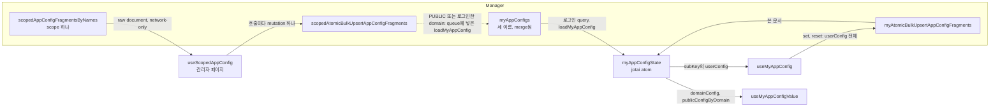
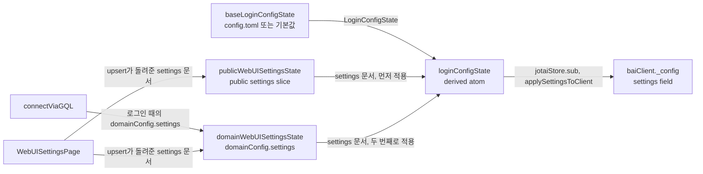

# 0033 — App config hooks

## Summary

> 낯선 용어는 문서 맨 아래 [용어](#용어)에 모아 두었다.

- 로그인은 로그인한 사용자의 `publicConfigByDomain`, `domainConfig`, `userConfig` [merged view](#용어)를 한 번 읽어 jotai atom `myAppConfigState`에 담는다. 필요할 때는 `loadMyAppConfig()`가 이를 다시 읽는다.
- 관리자 페이지가 아닌 화면은 app config를 이 atom에서만 읽는다. `useMyAppConfig(subKey)`는 `userConfig`를 읽고 쓰며, `useMyAppConfigValue(configName, subKey?)`는 `domainConfig`와 `publicConfigByDomain`을 읽는다. 두 hook은 자체 query를 보내지 않고 suspend하지 않는다.
- 관리자 페이지는 `useScopedAppConfig(scope, configNames)`로 scope 하나의 [raw document](#용어)를 읽고 쓴다. 이 hook은 `network-only`로 읽고 atom에는 쓰지 않는다. PUBLIC이나 로그인한 domain에 쓰면 atom을 다시 읽는다.
- 이 설계는 manager의 기본 [allow-list](#용어)에 기댄다. `publicConfigByDomain`과 `domainConfig`는 각각 scope 하나에서 오고, 두 scope(DOMAIN과 USER)를 merge하는 것은 `userConfig`뿐이다.
- `loginConfigState`는 base config, public `settings` 문서, domain `settings` 문서에서 계산하는 derived atom이다.

## Context

- **Whole-document upsert**: `scopedAtomicBulkUpsertAppConfigFragments`와 `myAtomicBulkUpsertAppConfigFragments`는 받은 `config`를 `(configName, scope)`의 문서 전체로 저장한다. 키 하나를 바꾸는 클라이언트도 나머지 키를 모두 보낸다.
- **Merged view**: `myAppConfigs(configNames)`는 이름마다 `{ configName config }` 하나를 돌려준다. manager는 호출자가 볼 수 있는 그 이름의 fragment를 allow-list rank 오름차순으로 merge한다(manager의 `services/app_config/service.py`에 있는 `_recursive_override`). 객체는 키별로 merge하고, 배열·스칼라·명시적 `null`은 아래 값을 통째로 바꾼다. 응답에는 `id`도 scope별 구분도 없다.
- **Default allow-list**: manager migration `ede445fb9d0d`가 `publicConfigByDomain`을 PUBLIC(rank 100)에, `domainConfig`를 DOMAIN(200)에, `userConfig`를 DOMAIN(200)과 USER(300)에 seed한다. 따라서 로그인한 사용자 본인 domain에 대해서는 merged `publicConfigByDomain`과 `domainConfig`가 raw document와 같다.
- **Merge scope**: `myAppConfigs`는 superadmin에게도 호출자 본인의 domain만 merge한다. `publicConfigByDomain`은 PUBLIC 문서 하나라서 모든 domain의 slice가 내려온다.
- **Read permissions**: `myAppConfigs`는 모든 role에 세 이름을 모두 응답한다. `scopedAppConfigFragmentsByNames`는 DOMAIN scope를 superadmin에게만 응답한다. 거부되는 scoped field가 다른 field와 같은 요청에 들어 있으면 manager는 요청 전체를 `data: null`로 응답하며, 거부된 field의 `@catch`로는 다른 field의 data를 되찾지 못한다.
- **Settings at sign-in**: ADR 0028은 public과 domain `settings` 문서를 `config.toml` 위에 층으로 쌓는다. `loginSessionAuth.ts`의 `connectViaGQL`이 로그인할 때 `myAppConfigs`를 읽고, `applyConfigToClient`가 유효 config를 `baiClient._config`에 복사하고 client를 ready로 만든다.

## 설계도

### App config 읽기와 쓰기

### 로그인 config 층

## Decision

### 1. `myAppConfigState`와 `loadMyAppConfig`

- **Atom**: `react/src/hooks/useAppConfig.ts`의 `myAppConfigState`는 `{ status, configs }`를 담는다. `configs`는 `publicConfigByDomain`, `domainConfig`, `userConfig` 각각을 merge된 문서에 대응시키고, `status`는 `idle`, `loaded`, `failed` 중 하나다. `useMyAppConfigStatus()`가 `status`를 돌려준다.
- **Sign-in read**: `loginSessionAuthMyUserQuery`가 세 이름의 `myAppConfigs`를 `@catch(to: NULL)`로 선택하고, `connectViaGQL`이 `applyConfigToClient`가 client를 ready로 만들기 전에 응답을 `setMyAppConfigs`에 넘긴다. `useSuspendedBackendaiClient` 뒤의 화면은 atom이 응답을 담기 전에 렌더하지 않는다.
- **Reload**: `loadMyAppConfig(store, environment?)`는 일반 함수다. 같은 세 이름을 `fetchQuery`와 `network-only`로 읽고 `setMyAppConfigs`로 응답을 저장한다. 읽기가 진행 중일 때 들어온 호출은 그 뒤에 시작하는 읽기 하나를 함께 쓰므로, 쓰기가 몰려도 읽기는 많아야 두 번이다.
- **Failed read**: 첫 읽기가 실패하면 `setMyAppConfigs`가 `status: 'failed'`로 둔다. 이후 읽기가 실패하면 이전 응답과 `loaded` 상태를 유지한다. 그 응답이 여전히 다음 쓰기의 기준이 될 수 있기 때문이다.
- **Failed-read readers**: 값이 없음을 "계정에 값이 없다"로 해석하는 reader는 먼저 `useMyAppConfigStatus()`를 확인한다. `status`가 `loaded`가 아니면 `DismissSplashOnMount`는 mirror에 있는 테마 family를 유지하고, `useSessionHistoryStore`는 로컬 기록을 옮기지 않는다.
- **Server switch**: `loadConfigFromWebServer`가 `clearMyAppConfigs`를 불러서 이전 서버의 문서가 계속 적용되지 않게 한다.
- **Outside changes**: CLI, 다른 관리자, 다른 탭이 바꾼 값은 다음 읽기 뒤에 보인다. 다음 읽기는 페이지 새로고침, `reset`, 이 탭이 PUBLIC이나 로그인한 domain에 한 쓰기(§3)다.

### 2. `useMyAppConfig`와 `useMyAppConfigValue`

| Hook                                          | 돌려주는 값           | 읽는 곳                                                    | 쓰는 곳                                                  |
| --------------------------------------------- | --------------------- | ---------------------------------------------------------- | -------------------------------------------------------- |
| `useMyAppConfig<T>(subKey)`                   | `[value, set, reset]` | `subKey`의 `configs.userConfig`                            | `myAtomicBulkUpsertAppConfigFragments`를 거친 USER scope |
| `useMyAppConfigValue<T>(configName, subKey?)` | 값                    | `configs.domainConfig` 또는 `configs.publicConfigByDomain` | 없음                                                     |
| `useMyAppConfigStatus()`                      | `status`              | `myAppConfigState.status`                                  | 없음                                                     |

- **Write base**: `set(update)`는 atom의 merge된 `userConfig`에 `update`(값, 또는 현재 값을 받는 함수. `undefined`는 키를 지운다)를 적용하고 결과 전체를 USER 문서로 보낸다. mutation이 성공하면 `set`이 그 문서를 atom에 저장하고, 실패하면 atom을 그대로 둔다.
- **Reset**: `reset()`은 같은 방식으로 USER 문서에서 `subKey`를 지운 뒤 `loadMyAppConfig`를 부른다. 그러면 그 키의 DOMAIN scope `userConfig` 값이 다시 보인다.
- **Refused write**: `status`가 `loaded`가 아니면 `set`과 `reset`은 아무것도 보내지 않고 reject한다.
- **Ordering**: `USER:me` key의 module 단위 queue 하나가 모든 `set`, 모든 `reset`, scoped 쓰기 뒤의 다시 읽기를 실행한다. 작업은 앞 작업이 끝난 뒤 시작하고 앞 작업이 남긴 atom을 기준으로 다음 USER 문서를 만든다. 그래서 다시 읽기가 읽는 도중에 끝난 `set`을 덮어쓰지 못한다. `reset`은 쓰기와 다시 읽기를 작업 하나로 실행하므로, `reset` 도중에 들어온 `set`은 다시 읽은 문서를 기준으로 만든다.
- **Domain slice**: `publicConfigByDomain`은 domain마다 slice를 하나씩 담으므로, 호출부는 domain 이름을 경로의 첫 segment로 넘긴다. 예: `useMyAppConfigValue('publicConfigByDomain', [domainName, key])`.
- **Optimistic display**: hook은 서버가 받아들인 값만 보여 준다. 대기 중인 값을 보여 주는 호출부는 `useDashboardBoards`, `useSessionHistoryStore`, `UserSettingsGeneralPane`처럼 그 값을 직접 들고 있다.

### 3. `useScopedAppConfig`

- **Signature**: `useScopedAppConfig(scope, configNames)`는 `AppConfigScope`인 `{ type: 'public' }`(`PUBLIC_SCOPE`) 또는 `{ type: 'domain' | 'user'; id }`와 읽을 이름 목록을 받는다. `{ scopedAppConfig, upsertScopedAppConfig }`를 돌려준다.
- **Read**: `useAppConfigScopedQuery`는 `scopedAppConfigFragmentsByNames` field 하나를 `@catch(to: NULL)`로 선택하고 `network-only`로 실행한다. 같은 scope와 이름을 동시에 들고 있는 화면들은 읽기 하나를 함께 쓴다. 이 hook은 suspend한다.
- **Return shape**: `scopedAppConfig`는 요청한 이름마다 raw document를 담고, scope에 fragment가 없는 이름은 `undefined`다. manager는 요청한 이름마다 항목 하나를 요청 순서대로 응답하며, hook은 index로 둘을 짝짓는다. scope를 읽을 수 없으면 값 전체가 `undefined`다.
- **Refused change**: `upsertScopedAppConfig(changes)`는 `{ configName, subKey, value }` 하나나 배열을 받고, hook이 요청하지 않은 이름이면 아무것도 보내기 전에 throw한다.
- **Write base**: upsert는 hook의 query가 아직 읽는 중이면 그 읽기를 기다린 뒤 Relay store의 사본을 기준으로 바뀐 문서를 만든다. Relay가 그 사본을 이미 정리했으면 network에서 문서를 읽는다. scope를 읽을 수 없었으면 기준이 빈 문서가 되므로 throw한다.
- **Send**: upsert는 바뀐 문서를 mutation 하나로 보내고 그 문서를 돌려준다.
- **Store update**: mutation의 `updater`가 읽기 field를 응답의 record id로 가리키게 하므로, 첫 쓰기와 purge 뒤의 쓰기도 읽기에 보인다.
- **Late read**: 같은 query의 읽기가 쓰기 도중에 시작해 쓰기 뒤에도 진행 중이면, upsert는 그 읽기를 기다린 뒤 한 번 더 읽는다. 그래서 오래된 응답이 store에 남지 않는다.
- **Ordering**: scope마다 `PUBLIC:`, `domain:<id>`, `user:<id>` key의 queue 하나가 그 scope에 대한 쓰기 순서를 정한다. 이 queue는 `USER:me`와 따로이므로, 로그인한 사용자 본인 USER scope에 대한 `useScopedAppConfig` 쓰기는 `set`과 순서가 맞춰지지 않는다. 그런 쓰기를 하는 화면은 없다.
- **Atom reload**: PUBLIC에 쓰거나 id가 로그인한 domain인 DOMAIN scope에 쓴 뒤, upsert는 기다리지 않고 `USER:me` queue에 `loadMyAppConfig`를 넣는다. 다른 domain이나 user scope에 쓰면 atom을 다시 읽지 않으며, 어떤 쓰기도 atom을 직접 고치지 않는다.

| 페이지                                       | 호출                                                                                                                          |
| -------------------------------------------- | ----------------------------------------------------------------------------------------------------------------------------- |
| `WebUISettingsPage`(superadmin)              | `useScopedAppConfig({ type: 'domain', id }, ['domainConfig'])`와 `useScopedAppConfig(PUBLIC_SCOPE, ['publicConfigByDomain'])` |
| `AnnouncementEditModal`(superadmin)          | `useScopedAppConfig({ type: 'domain', id }, ['domainConfig'])`                                                                |
| `BrandingSettingList`(superadmin, 쓰기 전용) | `useScopedAppConfig(PUBLIC_SCOPE, ['publicConfigByDomain'])`                                                                  |

### 4. 로그인 config의 settings 층

| Atom                       | 담는 값                                                                            | 쓰는 곳                                                                           |
| -------------------------- | ---------------------------------------------------------------------------------- | --------------------------------------------------------------------------------- |
| `baseLoginConfigState`     | `LoginConfigState`로 처리한 `config.toml`, 또는 기본값                             | `initializeConfigOnce`, `loadConfigFromWebServer`, 비어 있을 때의 `connectViaGQL` |
| `publicWebUISettingsState` | 로그인 페이지 domain의 public `settings` slice                                     | `initializeConfigOnce`, `loadConfigFromWebServer`, `WebUISettingsPage`            |
| `domainWebUISettingsState` | 로그인한 domain의 `domainConfig.settings`                                          | `connectViaGQL`, `WebUISettingsPage`                                              |
| `loginConfigState`         | derived: base에 public 문서, 그다음 domain 문서를 `applyWebUISettings`로 적용한 값 | 없음, 읽기 전용                                                                   |

- **Layer write**: `WebUISettingsPage`는 `upsertScopedAppConfig`가 돌려준 `settings` 문서 전체로 `domainWebUISettingsState`나 `publicWebUISettingsState`를 set한다. 그래서 `loginConfigState`와 그 reader가 refetch 없이 갱신된다.
- **Same domain**: `WebUISettingsPage`는 로그인한 domain의 public slice를 `publicWebUISettingsState`에 쓰는데, 이 atom은 로그인 페이지 domain의 slice를 담는다. 배포 하나는 domain 하나를 서비스하므로 두 slice는 같다.
- **Settings copy**: `loginConfigState`가 읽는 사본은 층 atom이고, `AnnouncementBanner`와 대시보드 template이 읽는 사본은 `myAppConfigState.configs.domainConfig`다. `myAppConfigState`를 다시 읽어도 층 atom에는 쓰지 않는다.
- **Client mirror**: `DefaultProviders.tsx`에서 `jotaiStore`에 한 번 설치한 `syncLoginConfigToClient`가, `baiClient.ready`가 true이고 `baiClient._config`가 있는 동안 `loginConfigState`가 바뀔 때마다 `applySettingsToClient`를 부른다.
- **Reload after Apply**: mount할 때 `baiClient._config`를 한 번 읽는 화면은 다시 mount할 때까지 옛 값을 유지하므로, `WebUISettingList`는 Apply 뒤 페이지를 새로고침한다.

## 대안과 기각 사유

- **Raw USER document for `userConfig`**: `userConfig` 화면이 `myAppConfigFragmentsByNames`로 USER fragment를 읽고 쓴다. DOMAIN scope `userConfig`에 쓴 값이 어떤 화면에도 닿지 않고, 화면마다 자기 읽기에 suspend하므로 기각했다.
- **Relay store as the shared copy**: 각 hook이 `store-or-network`로 문서를 읽고, 페이지 로드마다 사본 하나를 Relay store가 공유하게 한다. 로그인 읽기 한 번이 이미 세 이름을 모두 답하는데도 읽는 화면마다 자기 query를 보내거나 기다리며 suspend하므로 기각했다.
- **One request for every scope**: `useScopedAppConfig`가 scope 여러 개를 받아 alias field들로 된 query 하나로 읽는다. 거부되는 DOMAIN field가 있으면 manager가 요청 전체를 `data: null`로 응답해 읽을 수 없는 scope 하나가 읽을 수 있는 scope까지 가리므로 기각했다.
- **Changed keys on a merged atom**: scoped 쓰기 뒤 페이지가 바뀐 키를 `myAppConfigState`나 derived `loginConfigState`에 set한다. manager의 merge를 클라이언트에서 반복하고, 쓴 문서에 더는 없는 키가 옛 값을 유지하므로 기각했다. §4는 대신 층 문서 전체를 바꾼다.
- **Optimistic atom update in `set`**: `set`이 mutation 전에 atom을 쓰고 실패하면 되돌린다. 현재 호출부가 이미 대기 중인 값을 직접 들고 있고, 되돌리기가 optimistic 값을 기준으로 만든 다음 쓰기까지 되돌릴 수 있어 기각했다.

## Consequences

- **Request count**: 로그인은 query 하나로 세 이름을 모두 읽는다. `userConfig` 변경은 upsert 한 번, `reset`은 upsert 한 번과 읽기 한 번이다. System Settings는 두 scope를 차례로 읽어 query 하나보다 왕복이 한 번 많다.
- **Copied defaults**: merged view가 쓰기 기준이므로 첫 `set`이 DOMAIN scope `userConfig`의 키를 모두 USER 문서로 복사한다. 그 사용자의 해당 키는 이후 DOMAIN 기본값이 바뀌어도 따라가지 않으며, `reset`에 넘긴 키만 다시 따른다.
- **Object defaults**: 객체는 키별로 merge되므로, 객체인 DOMAIN scope 기본값은 사용자의 객체 아래에 하위 키를 남긴다. `reset`은 USER 문서에서 키를 지우고 기본값을 다시 보여 주며, 기본값을 숨기려면 `set(null)`이 필요하다.
- **Allow-list dependency**: allow-list가 `publicConfigByDomain`이나 `domainConfig`에 scope를 추가하면 `useMyAppConfigValue`가 더는 raw document를 돌려주지 않는다. `userConfig`에 PUBLIC을 추가하면 `set`이 PUBLIC 값도 USER 문서로 복사한다.
- **Lost concurrent edits**: atom을 마지막으로 읽은 뒤 다른 탭이나 CLI가 USER 문서에 한 변경은 `set`이 덮어쓴다.
- **Act-as**: act-as 탭은 대상 계정의 `userConfig`를 읽고 쓴다.

## 출처

- #11146 — 이 결정, 2026-11-18.
- #11293 — act-as 탭이 보낼 수 있는 쓰기.
- Manager `services/app_config/service.py`(`_recursive_override`, `_merge_configs`), `models/app_config_fragment/upserters.py`(문서 전체 upsert), migration `ede445fb9d0d`(기본 allow-list).
- 2026-11-18 dev 클러스터 실측: `adminAppConfigAllowLists`, superadmin과 일반 사용자에 대한 `myAppConfigs`와 `scopedAppConfigFragmentsByNames` 비교.

관련: [ADR 0026](0026-dashboard-boards-in-manager-app-config.ko.md), [ADR 0028](0028-webui-settings-in-the-app-config-settings-key.ko.md).

## 용어

| 용어         | 뜻                                                                                                                                         |
| ------------ | ------------------------------------------------------------------------------------------------------------------------------------------ |
| raw document | app config fragment 하나의 `config`로, config 이름 하나에 대해 scope 하나(PUBLIC, domain 하나, user 하나)에 저장된 문서다.                 |
| merged view  | `myAppConfigs`가 돌려주는 문서로, manager가 호출자가 볼 수 있는 config 이름 하나의 fragment를 allow-list rank 오름차순으로 merge해 만든다. |
| allow-list   | manager의 `app_config_allow_list` table로, config 이름을 어느 scope에 저장할 수 있는지와 merge에서 각 scope가 갖는 rank를 정한다.          |
