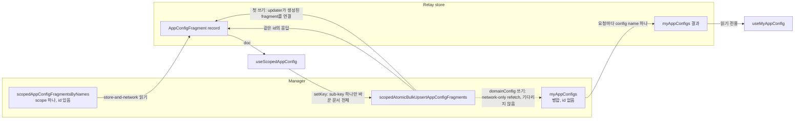

# 0033 — Scoped and merged app config hooks

## Summary

> 낯선 용어는 문서 맨 아래 [용어](#용어)에 모아 두었다.

- `react/src/hooks/useAppConfig.ts`는 hook 두 개를 둔다. `useScopedAppConfig(scope, configName)`는 scope 하나의 [raw document](#용어)를 읽고 쓴다. `useMyAppConfig(configName, subKey)`는 [merged view](#용어)를 읽기만 한다.
- 쓰기 한 번은 upsert 한 번이다. `setKey`는 Relay store에 있는 사본으로 문서 전체를 만들고, upsert 응답이 그 사본을 갱신하게 둔다. Relay가 저장된 사본을 이미 수거했을 때만 쓰기 전에 network에서 문서를 읽는다.
- 모든 `userConfig` reader가 USER raw document를 읽으므로, 쓰기 결과는 upsert 응답만으로 화면에 나타난다. merged view는 `domainConfig`와 `publicConfigByDomain` reader만 쓰고, `domainConfig` 쓰기가 merged `domainConfig` view를 다시 가져온다.
- 쓰기의 기준은 Relay store의 사본이고, 이 탭의 upsert가 그 사본을 갱신한다. `MainLayout`이 로그인 때 읽은 USER `userConfig`를 계속 들고 있으므로, `userConfig`의 사본은 로그인 때 읽은 것이다. 사본을 읽은 뒤 CLI, 다른 관리자, 다른 탭이 바꾼 값은 다음 쓰기가 덮어쓴다.

## Context

- **Upsert replaces**: `scopedAtomicBulkUpsertAppConfigFragments`는 받은 `config`를 `(configName, scope)`의 문서 전체로 저장하고, manager는 JSON merge를 하지 않는다. key 하나를 바꾸는 client도 나머지 key를 모두 보내야 한다.
- **Per-scope setters**: 이 결정 전에는 각 setter가 upsert 전에 raw document를 network로 읽었고, 일부 호출부가 그 뒤 merged view를 다시 가져왔다. 그래서 변경 한 번에 요청이 두세 번 나갔다.
- **Read permissions**: `scopedAppConfigFragmentsByNames`는 모든 역할에 PUBLIC과 호출자 본인의 USER scope를 돌려준다. DOMAIN scope는 superadmin에게만 돌려주고, domain admin과 일반 사용자에게는 `app_config_fragment`의 `READ`를 거부한다.
- **Merged view has no id**: `myAppConfigs`는 `id` 없는 `AppConfig { configName config }`를 돌려주므로, Relay가 upsert가 돌려준 fragment와 연결하지 못한다. merged view는 client가 다시 가져올 때까지 옛 값을 유지한다.
- **Merged view includes PUBLIC**: `myAppConfigs`는 호출자가 볼 수 있는 public, domain, 본인 user fragment를 합치므로(manager의 `VisibleAppConfigFragmentTarget`) `publicConfigByDomain`도 돌려준다.

## 설계도

## Decision

### 1. `useAppConfig.ts`의 hook 두 개

| Hook                                    | 읽는 것                                                               | 쓰는 것                  | Fetch policy        |
| --------------------------------------- | --------------------------------------------------------------------- | ------------------------ | ------------------- |
| `useScopedAppConfig(scope, configName)` | scope 하나, config name 하나에 대한 `scopedAppConfigFragmentsByNames` | `setKey(subKey, update)` | `store-and-network` |
| `useMyAppConfig(configName, subKey?)`   | 요청마다 config name 하나에 대한 `myAppConfigs`                       | 없음                     | `store-or-network`  |

- **Scope type**: `AppConfigScope`는 `{ scopeType: 'PUBLIC' }`, `{ scopeType: 'DOMAIN'; scopeId? }`, `{ scopeType: 'USER'; scopeId? }` 중 하나다. `scopeId`가 없으면 로그인한 사용자의 domain id(`useCurrentDomain().id`, DOMAIN) 또는 user id(USER)가 된다.
- **Return shape**: `useScopedAppConfig`는 `{ doc, setKey }`를 돌려준다. `doc`은 raw document이고, scope에 그 이름의 fragment가 없으면 `undefined`다.
- **Refresh rule**: `store-and-network`의 `useLazyLoadQuery`는 mount가 query의 cache entry를 새로 만들 때, 즉 다른 mount된 reader가 그 query를 retain하지 않을 때만 network에서 문서를 읽는다. `MainLayout`이 로그인 때 읽은 USER `userConfig`를 retain하므로, `userConfig` reader는 page를 새로고침할 때까지 그 사본을 다시 쓴다.
- **Merged view per name**: `useMyAppConfig`는 자기 config name 하나로 `myAppConfigs`를 물으므로, `domainConfig` reader는 sign-in query(`loginSessionAuth.ts`)나 `MainLayout`의 `AnnouncementBanner`가 store에 남긴 `myAppConfigs(["domainConfig"])` 결과를 다시 쓸 수 있다.
- **Domain slice**: `publicConfigByDomain`은 domain마다 slice 하나를 두므로, 호출부는 `setKey([domainName, key], …)`와 `useMyAppConfig('publicConfigByDomain', [domainName, key])` 모두에 domain 이름을 첫 경로로 넘긴다.

### 2. 쓰기마다 upsert 한 번

- **Write base**: `setKey`는 같은 문서에 대해 진행 중인 읽기를 기다린 뒤, Relay store에서 문서를 읽고 `applySubKey`로 sub-key를 바꾼 결과를 `scopedAtomicBulkUpsertAppConfigFragments` 한 번으로 보낸다. Relay가 record를 이미 수거했으면 network에서 문서를 읽는다.
- **Store update**: upsert가 `{ id configName config }`를 선택하므로, 응답이 돌려준 record를 갱신한다. mutation의 `updater`가 읽기를 돌려받은 fragment로 가리키게 하므로 첫 쓰기와 fragment가 purge된 뒤의 쓰기도 다루고, 다음 쓰기는 그 위에서 만든다.
- **Ordering**: `serializeWrite`가 한 문서(`scopeType`, `scopeId`, `configName`)에 대한 쓰기를 줄 세우므로, 쓰기는 앞 쓰기가 끝난 뒤 시작하고 그 응답 위에서 만든다.
- **Value update**: `update`는 다음 값이거나, `subKey`의 현재 값을 받는 함수다. `undefined`는 key를 지운다.

### 3. 어떤 view를 누가 읽는가

| Config name            | Reader와 writer                                                                                   | Hook                                                                  |
| ---------------------- | ------------------------------------------------------------------------------------------------- | --------------------------------------------------------------------- |
| `userConfig`           | `MainLayout`(`themeFamily`), `useDashboardBoards`, `FolderCreateModal`, `useRecentSessionHistory` | `useScopedAppConfig({ scopeType: 'USER' }, 'userConfig')`             |
| `userConfig`           | `UserSettingsGeneralPane`(쓰기만)                                                                 | `useScopedAppConfig({ scopeType: 'USER' }, 'userConfig')`             |
| `domainConfig`         | `AnnouncementBanner`, `useDashboardBoards`(template)                                              | `useMyAppConfig('domainConfig', …)`                                   |
| `domainConfig`         | `AnnouncementEditModal`, `WebUISettingsPage`(superadmin 전용)                                     | `useScopedAppConfig({ scopeType: 'DOMAIN' }, 'domainConfig')`         |
| `publicConfigByDomain` | `useDashboardBoards`(template)                                                                    | `useMyAppConfig('publicConfigByDomain', …)`                           |
| `publicConfigByDomain` | `WebUISettingsPage`(superadmin 전용)                                                              | `useScopedAppConfig({ scopeType: 'PUBLIC' }, 'publicConfigByDomain')` |
| `publicConfigByDomain` | `BrandingSettingList`(superadmin 전용, 쓰기만)                                                    | `useScopedAppConfig({ scopeType: 'PUBLIC' }, 'publicConfigByDomain')` |

- **Merged refetch**: 모든 사용자가 `domainConfig`를 merged view로 읽으므로, `domainConfig` 쓰기는 upsert가 끝난 뒤 merged `domainConfig` view를 `network-only`로 읽기 시작한다. 쓰기는 그 읽기를 기다리지 않고, 읽기가 실패해도 쓰기는 실패하지 않으며 merged view만 옛 값으로 남는다. `publicConfigByDomain` 쓰기는 다시 가져오지 않는다. Branding page와 System Settings는 적용 뒤 page를 새로고침한다.
- **Draft follows the refresh**: `WebUISettingList`는 저장된 문서로 draft를 채운다. `store-and-network`의 background 읽기가 저장된 문서를 바꾸고 draft가 이전 저장값과 같으면, draft는 그 값을 수정으로 보여 주지 않고 갱신된 값을 받는다.

## 대안과 기각 사유

- **Re-read before each write**: 각 setter가 upsert 전에 raw document를 network로 읽는다. 다른 탭이 방금 바꾼 값이 남는다. 변경마다 요청이 하나 더 나가고 System Settings는 바뀔 때마다 저장하게 되므로(#10941) 기각한다.
- **Merged view for `userConfig`**: `userConfig` reader가 `useMyAppConfig`를 유지하고 쓰기마다 merged view를 다시 가져온다. DOMAIN scope `userConfig` 기본값이 계속 반영된다. 쓰기마다 요청이 하나 더 나가고, WebUI에는 DOMAIN scope `userConfig`를 쓰는 곳이 없으며 ADR 0026이 대시보드를 그 값에서 떼어 두었으므로 기각한다.
- **`my*` mutation for USER**: 본인 user 쓰기를 `myAtomicBulkUpsertAppConfigFragments`로 보낸다. scoped mutation이 호출자 본인의 USER scope를 받으므로 mutation 하나로 모든 scope를 쓸 수 있어 기각한다.

## Consequences

- **Request count**: 변경 한 번은 upsert 한 번이고, `domainConfig` 변경은 merged refetch로 요청이 하나 더 나간다. 화면은 다른 mount된 reader가 raw document를 들고 있지 않을 때만 읽는다.
- **Lost concurrent edits**: 이 탭이 문서를 읽은 뒤 CLI, 다른 관리자, 같은 계정의 다른 탭이 바꾼 값은 다음 쓰기가 덮어쓴다. `userConfig`에서는 로그인 뒤의 모든 변경이 해당한다. page를 새로고침하면 그 값을 가져온다.
- **Defaults from DOMAIN-scope `userConfig`**: 화면이 USER raw document를 읽으므로, DOMAIN scope에 쓴 `userConfig` 값은 더 이상 화면에 닿지 않는다.
- **Superadmin-only raw reads**: superadmin이 아니면 manager가 DOMAIN scope 읽기를 거부하고 `useLazyLoadQuery`가 그 오류를 가장 가까운 error boundary로 올리므로, superadmin route(`access: 'superadmin'`)와 superadmin으로 막은 component만 이를 부른다.

## 출처

- #11146 — 이 결정, 2026-11-12에 결정.
- #10941 — 다음 단계로, System Settings가 바뀔 때마다 저장한다(PR #11090).
- Manager `1b01ca06e6`: `models/app_config_fragment/upserters.py`(문서 전체 upsert), `models/app_config_fragment/scopes.py`(`VisibleAppConfigFragmentTarget`).

관련: [ADR 0026](0026-dashboard-boards-in-manager-app-config.ko.md), [ADR 0028](0028-webui-settings-in-the-app-config-settings-key.ko.md).

## 용어

| 용어         | 뜻                                                                                                                                                                                                              |
| ------------ | --------------------------------------------------------------------------------------------------------------------------------------------------------------------------------------------------------------- |
| raw document | scope 하나(PUBLIC, domain 하나, user 하나)에 config name 하나로 저장된 app config fragment의 `config`다.                                                                                                        |
| merged view  | `myAppConfigs`가 돌려주는 문서로, manager가 호출자가 볼 수 있는 config name 하나의 fragment를 manager의 app config allow list가 scope마다 준 rank(PUBLIC 100, DOMAIN 200, USER 300) 순서로 deep-merge해 만든다. |
