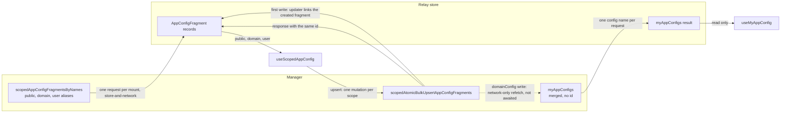

# 0033 — Scoped and merged app config hooks

## Summary

> Unfamiliar terms are collected in the [Glossary](#glossary) at the end.

- `react/src/hooks/useAppConfig.ts` exposes two hooks. `useScopedAppConfig({ public?, domain?, user? })` reads the [raw documents](#glossary) of the PUBLIC, current DOMAIN and own USER scopes in one request and writes them with `upsert`. `useMyAppConfig(configName, subKey)` reads the [merged view](#glossary) and never writes.
- A write is one upsert per scope. `upsert` builds each whole document from the copy the hook holds and lets the upsert response update that copy.
- The hook renders the store's copy first and reads the documents once more on every mount, so the write base is the document as it stood when the screen mounted. A change that the CLI, another admin, or another tab makes after that is overwritten by the next write.
- Every `userConfig` reader reads the USER raw document. Only `domainConfig` and `publicConfigByDomain` readers use the merged view, and a `domainConfig` write refetches it.

## Context

- **Upsert replaces**: `scopedAtomicBulkUpsertAppConfigFragments` stores the `config` it receives as the whole document of `(configName, scope)`; the manager does no JSON merge. A client that changes one key must send every other key too.
- **One scope per field**: `scopedAppConfigFragmentsByNames` and the upsert input take one `AppConfigScopeRef { scopeType, scopeId }`, not the OR'd scope lists other `scoped*` queries take (`ProjectScope`). Several scopes in one request need one aliased field per scope.
- **Read permissions**: `scopedAppConfigFragmentsByNames` answers PUBLIC and the caller's own USER scope for every role. It answers the DOMAIN scope only for a superadmin; a domain admin and a regular user are denied `READ` on `app_config_fragment`.
- **Merged view has no id**: `myAppConfigs` returns `AppConfig { configName config }` with no `id`, so Relay cannot match it to the fragment an upsert returns. The merged view keeps its old value until the client fetches it again.
- **Merged view includes PUBLIC**: `myAppConfigs` merges the public, domain, and own-user fragments the caller can see (`VisibleAppConfigFragmentTarget` in the manager), so it returns `publicConfigByDomain` as well.

## Diagram

## Decision

### 1. Two hooks in `useAppConfig.ts`

| Hook                                  | Reads                                                                    | Writes            | Fetch policy                                                     |
| ------------------------------------- | ------------------------------------------------------------------------ | ----------------- | ---------------------------------------------------------------- |
| `useScopedAppConfig(request)`         | `scopedAppConfigFragmentsByNames` once per requested scope, in one query | `upsert(changes)` | `store-and-network`, plus one `network-only` read on every mount |
| `useMyAppConfig(configName, subKey?)` | `myAppConfigs` for one config name per request                           | none              | `store-or-network`                                               |

- **Request shape**: `ScopedAppConfigRequest` is `{ public?: AppConfigName[]; domain?: AppConfigName[]; user?: AppConfigName[] }`. `domain` is the signed-in user's domain (`useCurrentDomain().id`) and `user` is the signed-in user; a caller cannot name another id.
- **One query**: `useAppConfigScopedQuery` holds three aliased `scopedAppConfigFragmentsByNames` fields (`public`, `domain`, `user`). Each carries `@skip(if:)` for a scope the request leaves out and `@catch(to: NULL)`, so a scope the caller may not read comes back `undefined` without failing the others.
- **Return shape**: the hook returns `{ public, domain, user, upsert }`. Each scope is a map from the requested names to the raw document, `undefined` for a name the scope holds no fragment for, and the whole scope is `undefined` when it was not requested or not readable.
- **Read on every mount**: `useLazyLoadQuery` does not fetch a query that another mounted reader still retains, such as `MainLayout`'s `userConfig` read. An effect therefore reads the documents with `network-only` every time the screen mounts. A screen that wants to skip that read takes the value from state set at sign-in instead of calling this hook.
- **Merged view per name**: `useMyAppConfig` asks `myAppConfigs` for its one config name, so the `domainConfig` readers can reuse the `myAppConfigs(["domainConfig"])` result that the sign-in query (`loginSessionAuth.ts`) or `AnnouncementBanner` in `MainLayout` left in the store.
- **Domain slice**: `publicConfigByDomain` holds one slice per domain, so callers pass the domain name as the first path segment, both to a change's `subKey` (`[domainName, key]`) and to `useMyAppConfig('publicConfigByDomain', [domainName, key])`.

### 2. One upsert per scope

- **Change shape**: `AppConfigChange` is `{ scope, configName, subKey, value }`. `value` is the next value, or a function of the current value at `subKey`; `undefined` removes the key. `upsert` takes one change or an array.
- **Write base**: `upsert` groups the changes by scope. For each scope it waits for a read of the hook's query still in flight, takes the documents from the Relay store, applies the changes in order with `applySubKey`, and sends the touched documents as one `scopedAtomicBulkUpsertAppConfigFragments`. When Relay has already collected the records, it reads them from the network instead.
- **Unreadable scope**: `upsert` throws, and sends nothing, for a scope that came back unreadable or a name the hook did not request, because the base would be empty.
- **Store update**: The upsert selects `{ id configName config }`, so the response updates the returned records. The mutation's `updater` points the read at each returned fragment, which covers a first write and a write after the fragment was purged.
- **Ordering**: `serializeWrite` queues the writes to one scope (`scopeType` and `scopeId`), so a write starts after the previous one settles and builds on its response. Several scopes in one `upsert` are written one after another and are not atomic.

### 3. Who reads which view

| Config name            | Readers and writers                                                                                                                         | Hook                                                                                 |
| ---------------------- | ------------------------------------------------------------------------------------------------------------------------------------------- | ------------------------------------------------------------------------------------ |
| `userConfig`           | `MainLayout` (`themeFamily`), `useDashboardBoards`, `FolderCreateModal`, `useRecentSessionHistory`, `UserSettingsGeneralPane` (writes only) | `useScopedAppConfig({ user: ['userConfig'] })`                                       |
| `domainConfig`         | `AnnouncementBanner`, `useDashboardBoards` (templates)                                                                                      | `useMyAppConfig('domainConfig', …)`                                                  |
| `domainConfig`         | `AnnouncementEditModal` (superadmin only)                                                                                                   | `useScopedAppConfig({ domain: ['domainConfig'] })`                                   |
| `publicConfigByDomain` | `useDashboardBoards` (templates)                                                                                                            | `useMyAppConfig('publicConfigByDomain', …)`                                          |
| `publicConfigByDomain` | `BrandingSettingList` (superadmin only, writes only)                                                                                        | `useScopedAppConfig({ public: ['publicConfigByDomain'] })`                           |
| both                   | `WebUISettingsPage` (superadmin only)                                                                                                       | `useScopedAppConfig({ domain: ['domainConfig'], public: ['publicConfigByDomain'] })` |

- **Merged refetch**: A `domainConfig` write starts a `network-only` read of the merged `domainConfig` view after its upsert lands, because every user reads `domainConfig` through it. The write does not wait for that read, and a failed read leaves the merged view stale without failing the write. A `publicConfigByDomain` write does not refetch; the Branding page and System Settings reload the page after they apply.
- **Draft follows the refresh**: `WebUISettingList` seeds its draft from the saved documents. When the mount's read changes them and the draft still equals the previous saved value, the draft takes the refreshed value instead of showing it as an edit.

## Rejected alternatives

- **Re-read before each write**: Each setter reads the raw document from the network before its upsert. A change another tab made a moment ago survives. Rejected because every change costs an extra request, and System Settings will save on every change (#10941).
- **Merged view for `userConfig`**: `userConfig` readers keep `useMyAppConfig` and each write refetches the merged view. DOMAIN-scope `userConfig` defaults keep applying. Rejected because every write then costs a second request, and nothing in the WebUI writes DOMAIN-scope `userConfig`; ADR 0026 keeps the dashboard out of it.
- **One hook call per scope**: `useScopedAppConfig(scope, configName)` reads one scope per call, and a page that edits two scopes calls it twice. Each call stays small. Rejected because the second call suspends only after the first read lands, so System Settings read its two documents one after the other.
- **`my*` mutation for USER**: The own-user write goes through `myAtomicBulkUpsertAppConfigFragments`. Rejected because the scoped mutation accepts the caller's own USER scope, so one mutation serves every scope.

## Consequences

- **Request count**: A change costs one upsert per scope; a `domainConfig` change costs one more request for the merged refetch. A screen reads its requested scopes once per mount, and twice when the store held nothing for them: the suspending read and the mount read.
- **Lost concurrent edits**: The next write overwrites a change that the CLI, another admin, or another tab of the same account made after the screen mounted. Remounting the screen or reloading the page picks the change up.
- **Defaults from DOMAIN-scope `userConfig`**: A `userConfig` value written at DOMAIN scope no longer reaches the screens, because they read the USER raw document.
- **Same-kind scopes**: The query has one field per scope kind, so one call reads one domain and one user, the signed-in ones. Reading another domain's or user's document needs a new field or a new hook.

## Sources

- #11146 — this decision, decided on 2026-11-12.
- #10941 — System Settings saves on every change, the next step (PR #11090).
- Manager `1b01ca06e6`: `models/app_config_fragment/upserters.py` (whole-document upsert), `models/app_config_fragment/scopes.py` (`VisibleAppConfigFragmentTarget`).

Related: [ADR 0026](0026-dashboard-boards-in-manager-app-config.md), [ADR 0028](0028-webui-settings-in-the-app-config-settings-key.md).

## Glossary

| Term         | Meaning                                                                                                                                                                                                                                               |
| ------------ | ----------------------------------------------------------------------------------------------------------------------------------------------------------------------------------------------------------------------------------------------------- |
| raw document | The `config` of one app config fragment, stored at one scope (PUBLIC, one domain, or one user) for one config name.                                                                                                                                   |
| merged view  | The document `myAppConfigs` returns, which the manager builds by deep-merging every fragment of one config name the caller can see, in the order of the rank the manager's app config allow list gives each scope (PUBLIC 100, DOMAIN 200, USER 300). |
