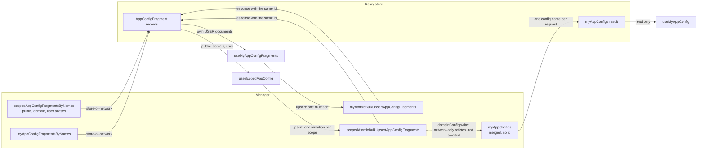
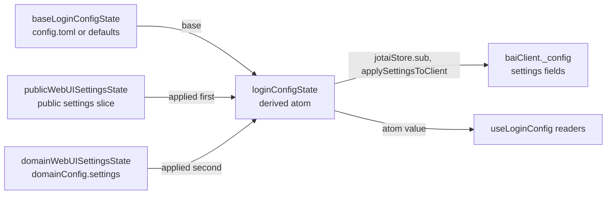

# 0033 — Scoped and merged app config hooks

## Summary

> Unfamiliar terms are collected in the [Glossary](#glossary) at the end.

- `react/src/hooks/useAppConfig.ts` exposes three hooks. `useScopedAppConfig(request)` reads and writes the [raw documents](#glossary) of the scopes the caller names, each as a [scope object](#glossary) `{ type, id }`. `useMyAppConfigFragments(configNames)` reads and writes the signed-in user's own USER documents through the `my*` fields. `useMyAppConfig(configName, subKey)` reads the [merged view](#glossary) and never writes.
- A write is one upsert per scope. `upsertScopedAppConfig` and `upsertMyAppConfigFragments` build each whole document from the copy the hook holds, let the upsert response update that copy, and resolve with the documents they wrote.
- A hook reads its documents from the network the first time and from the store after that, until the page reloads, so the write base is the document as this page load first read it. A change that the CLI, another admin, or another tab makes after that is overwritten by the next write.
- `loginConfigState` is a derived atom over three atoms: the base config, the public `settings` document, and the domain `settings` document. System Settings sets the layer it wrote, and a subscription copies every change into `baiClient._config`.

## Context

- **Upsert replaces**: `scopedAtomicBulkUpsertAppConfigFragments` and `myAtomicBulkUpsertAppConfigFragments` store the `config` they receive as the whole document of `(configName, scope)`; the manager does no JSON merge. A client that changes one key must send every other key too.
- **One scope per field**: `scopedAppConfigFragmentsByNames` and the scoped upsert input take one `AppConfigScopeRef { scopeType, scopeId }`, not the OR'd scope lists other `scoped*` queries take (`ProjectScope`). `scopeId` is the domain id or the user id, and is null for PUBLIC. Several scopes in one request need one aliased field per scope.
- **Read permissions**: `scopedAppConfigFragmentsByNames` answers PUBLIC and the caller's own USER scope for every role. It answers the DOMAIN scope only for a superadmin; a domain admin and a regular user are denied `READ` on `app_config_fragment`.
- **Own-user fields**: `myAppConfigFragmentsByNames` and `myAtomicBulkUpsertAppConfigFragments` act on the caller's own USER scope and take no scope id. The read answers one `AppConfigFragment` per requested name, null where the scope holds none; the hooks select its `id`, `configName` and `config`.
- **Merged view**: `myAppConfigs` returns one `AppConfig { configName config }` per name: every fragment the caller can see (PUBLIC, the caller's domain, the caller's own USER) deep-merged by allow-list rank (`VisibleAppConfigFragmentTarget` in the manager). It has no `id` and no per-scope split, so Relay cannot match it to the fragment an upsert returns, and a client cannot recover one scope's document from it.
- **Settings at sign-in**: ADR 0028 layers the public and the domain `settings` documents over `config.toml`. `connectViaGQL` in `loginSessionAuth.ts` reads `myAppConfigs(["domainConfig"])` at sign-in, and `applyConfigToClient` copies the effective config into `baiClient._config`. Most screens read the System Settings fields from `baiClient._config`, not from an atom.

## Diagram

## Decision

### 1. Three hooks in `useAppConfig.ts`

| Hook                                   | Reads                                                                    | Writes                                                | Fetch policy       |
| -------------------------------------- | ------------------------------------------------------------------------ | ----------------------------------------------------- | ------------------ |
| `useScopedAppConfig(request)`          | `scopedAppConfigFragmentsByNames` once per requested scope, in one query | `upsertScopedAppConfig(changes)`, scoped mutation     | `store-or-network` |
| `useMyAppConfigFragments(configNames)` | `myAppConfigFragmentsByNames`                                            | `upsertMyAppConfigFragments(changes)`, `my*` mutation | `store-or-network` |
| `useMyAppConfig(configName, subKey?)`  | `myAppConfigs` for one config name per request                           | none                                                  | `store-or-network` |

- **Lifecycle**: every hook suspends, so a caller sits under a `Suspense` boundary, and every hook runs only after sign-in.
- **Scope object**: `AppConfigScope` is `{ type: 'public' }` or `{ type: 'domain' | 'user'; id: string }`. The caller passes the domain id (`useCurrentDomain().id`) or the user id; `PUBLIC_SCOPE` is the exported PUBLIC object.
- **Request shape**: `ScopedAppConfigRequest` is one `{ scope, configNames }` item or an array of them, with at most one item per scope type. `useScopedAppConfig` throws during render when a type appears twice, because the query holds one field per type.
- **One query**: `useAppConfigScopedQuery` holds three aliased `scopedAppConfigFragmentsByNames` fields (`public`, `domain`, `user`). Each carries `@skip(if:)` and `@catch(to: NULL)`. A skipped field gets `{ scopeType }` with no `scopeId`, which the input type allows.
- **Return shape**: `useScopedAppConfig` returns `{ scopedAppConfig: { public, domain, user }, upsertScopedAppConfig }`. Each scope in `scopedAppConfig` is a map from the requested names to the raw document, `undefined` for a name the scope holds no fragment for, and the whole scope is `undefined` when it was not requested, was requested with no names, or was not readable. `useMyAppConfigFragments` returns `{ myAppConfigFragments, upsertMyAppConfigFragments }`, where `myAppConfigFragments` is the same map; its query has no `@catch`, so a read error reaches the error boundary.
- **Own USER scope**: every screen that reads or writes only the signed-in user's `userConfig` uses `useMyAppConfigFragments`. `useScopedAppConfig` with a `user` scope is for a document of a user the caller names.
- **Read once per page load**: The raw-document hooks read with `store-or-network`, so a screen sends a request only while the store does not hold its documents, and renders the store's copy otherwise. A hook has no effect of its own: it reads and returns. The documents change in this tab only through this tab's upserts, whose responses update the store.
- **Merged view per name**: `useMyAppConfig` asks `myAppConfigs` for its one config name, so a `domainConfig` reader reuses the `myAppConfigs(["domainConfig"])` result that the sign-in query (`loginSessionAuth.ts`) or `AnnouncementBanner` wrote, while the store still holds it. `MergedAppConfigName` limits `configName` to `domainConfig` and `publicConfigByDomain`.
- **Domain slice**: `publicConfigByDomain` holds one slice per domain, so callers pass the domain name as the first path segment, both to a change's `subKey` (`[domainName, key]`) and to `useMyAppConfig('publicConfigByDomain', [domainName, key])`.

### 2. One upsert per scope

- **Change shape**: `AppConfigChange` is `{ scope, configName, subKey, value }`, where `scope` is the scope object the hook was called with and `subKey` is a lodash path (`string | string[]`) into the document. `MyAppConfigChange` is the same without `scope`. `value` is the next value, or a function of the current value at `subKey`; `undefined` removes the key. Both upsert functions take one change or an array.
- **Write base**: each upsert function groups the changes by scope. For each scope it waits for a read of the hook's query still in flight, takes the documents from the Relay store, applies the changes in order with `applySubKey`, and sends the touched documents as one mutation. When Relay has already collected the records, it reads them from the network instead.
- **Refused changes**: each upsert function checks every change before it sends anything, and throws for a name the hook did not request or a scope id that differs from the requested one.
- **Unreadable scope**: `upsertScopedAppConfig` throws when a scope came back unreadable, because the base would be empty. That check runs when the scope's turn comes, so scopes earlier in the same call are already written.
- **Result**: `upsertScopedAppConfig` resolves with `WrittenAppConfigDocuments`, the written documents keyed by scope type; `upsertMyAppConfigFragments` resolves with a map of the written names. A GraphQL error rejects the promise with the error messages.
- **Store update**: both mutations select `{ id configName config }`, so the response updates the returned records. Each mutation's `updater` points the hook's read field at the returned fragments, which covers a first write and a write after the fragment was purged.
- **Ordering**: `serializeWrite` keeps one module-level queue per scope, keyed `<SCOPE_TYPE>:<scopeId>` or `USER:me` for `useMyAppConfigFragments`, and queues the writes to that scope, so a write starts after the previous one settles and builds on its response. Several scopes in one `upsertScopedAppConfig` call are written one after another and are not atomic.

### 3. Who reads which view

| Config name            | Readers and writers                                                                                                                         | Hook                                                                                     |
| ---------------------- | ------------------------------------------------------------------------------------------------------------------------------------------- | ---------------------------------------------------------------------------------------- |
| `userConfig`           | `MainLayout` (`themeFamily`), `useDashboardBoards`, `FolderCreateModal`, `useRecentSessionHistory`, `UserSettingsGeneralPane` (writes only) | `useMyAppConfigFragments(['userConfig'])`                                                |
| `domainConfig`         | `AnnouncementBanner`, `useDashboardBoards` (templates)                                                                                      | `useMyAppConfig('domainConfig', …)`                                                      |
| `domainConfig`         | `AnnouncementEditModal` (superadmin only)                                                                                                   | `useScopedAppConfig({ scope: { type: 'domain', id }, configNames: ['domainConfig'] })`   |
| `publicConfigByDomain` | `useDashboardBoards` (templates)                                                                                                            | `useMyAppConfig('publicConfigByDomain', …)`                                              |
| `publicConfigByDomain` | `BrandingSettingList` (superadmin only, writes only)                                                                                        | `useScopedAppConfig({ scope: PUBLIC_SCOPE, configNames: ['publicConfigByDomain'] })`     |
| both                   | `WebUISettingsPage` (superadmin only)                                                                                                       | `useScopedAppConfig([{ scope: { type: 'domain', id }, … }, { scope: PUBLIC_SCOPE, … }])` |

- **Merged refetch**: a `domainConfig` write starts a `network-only` read of the merged `domainConfig` view after its upsert lands, because every user reads `domainConfig` through it. The write does not wait for that read, and a failed read leaves the merged view stale without failing the write. A `publicConfigByDomain` write does not refetch.
- **Draft follows the refresh**: `WebUISettingList` seeds its draft from the saved documents. When the saved documents change after the page's own upsert, and the draft still equals the previous saved value, the draft takes the refreshed value instead of showing it as an edit.

### 4. Settings layers in the login config

| Atom                       | Holds                                                                                       | Written by                                                                          |
| -------------------------- | ------------------------------------------------------------------------------------------- | ----------------------------------------------------------------------------------- |
| `baseLoginConfigState`     | `config.toml` processed into `LoginConfigState`, or the defaults                            | `initializeConfigOnce`, `loadConfigFromWebServer`; `connectViaGQL` when still empty |
| `publicWebUISettingsState` | the public `settings` slice of the login page's domain                                      | `initializeConfigOnce`, `loadConfigFromWebServer`, `WebUISettingsPage`              |
| `domainWebUISettingsState` | the signed-in domain's `domainConfig.settings`                                              | `connectViaGQL`, `WebUISettingsPage`                                                |
| `loginConfigState`         | derived: the base with the public, then the domain document applied by `applyWebUISettings` | nothing; read only                                                                  |

- **Layer write**: `WebUISettingsPage` sets `domainWebUISettingsState` or `publicWebUISettingsState` from the `settings` document `upsertScopedAppConfig` returned, so `loginConfigState` and its readers update without a refetch.
- **Client mirror**: `syncLoginConfigToClient`, installed once on `jotaiStore` in `DefaultProviders.tsx`, calls `applySettingsToClient` on every change of `loginConfigState` while `baiClient.ready` is true and `baiClient._config` exists. `applySettingsToClient` writes the settings fields only; `applyConfigToClient` still writes the identity and connection fields and sets `ready` at sign-in.
- **Reload after Apply**: `WebUISettingList` still reloads the page after Apply, because screens that read `baiClient._config` once at mount keep the old value until they mount again.

## Rejected alternatives

- **Scope keys without ids**: `useScopedAppConfig({ public?, domain?, user? })` takes name lists per scope key and fills the ids from the signed-in domain and user. Rejected because a caller cannot name another domain or user, and nothing at the call site shows which id is written.
- **Scoped hook for the own USER scope**: the `userConfig` screens call `useScopedAppConfig` with `{ type: 'user', id: user_uuid }`. Rejected because every screen then reads the user id for a scope the `my*` fields already imply, and the scoped mutation sends whatever id the caller passes.
- **Merged view for `userConfig`**: `userConfig` readers use `useMyAppConfig` and write with the `my*` mutation. Rejected because the merged view has no per-scope split, so a whole-document write built on it would copy PUBLIC and DOMAIN values into the USER document, and ADR 0026 keeps dashboard board arrays out of a deep merge.
- **One hook call per scope**: `useScopedAppConfig(scope, configName)` reads one scope per call, and a page that edits two scopes calls it twice. Rejected because the second call suspends only after the first read lands, so System Settings reads its two documents one after the other.
- **Changed key on the merged atom**: after a write, the page sets the changed keys on `loginConfigState` directly. Rejected because `loginConfigState` holds the layers already applied, so a key a layer stops carrying keeps its old value, and nothing reached `baiClient._config`.
- **Read on every mount**: an effect in each raw-document hook reads the documents with `network-only` whenever a screen mounts, so the write base is the document as it stood when the screen opened. Rejected because a reading hook then carries a fetch effect of its own, the first visit reads every document twice, and the mount read can land after a write's response and put the older document back.
- **Re-read before each write**: each setter reads the raw document from the network before its upsert. Rejected because every change costs an extra request, and #10941 makes System Settings save on every change.

## Consequences

- **Request count**: a change costs one upsert per scope; a `domainConfig` change costs one more request for the merged refetch. A screen reads its requested documents once per page load, the first time the store does not hold them.
- **Lost concurrent edits**: the next write overwrites a change that the CLI, another admin, or another tab of the same account made after this page load read the document. Reloading the page picks the change up.
- **Defaults from DOMAIN-scope `userConfig`**: a `userConfig` value written at DOMAIN scope does not reach the screens, because they read the USER raw document.
- **Same-kind scopes**: the scoped query has one field per scope kind, so one call reads at most one domain and one user.
- **Separate queues**: `useMyAppConfigFragments` and a `useScopedAppConfig` call for the signed-in user's own id queue their writes separately, so the two must not write the same document concurrently. No screen does.
- **Stale merged view**: `useMyAppConfig` does not read again on mount, so a `domainConfig` change another admin or the CLI makes stays unseen until the page reloads or this tab writes `domainConfig`.
- **Re-login**: signing in to another domain on the same page replaces `domainWebUISettingsState`, so no key of the previous domain's settings stays applied.

## Sources

- #11146 — this decision.
- #10941 — System Settings saves on every change (PR #11090).
- Manager `1b01ca06e6`: `models/app_config_fragment/upserters.py` (whole-document upsert), `models/app_config_fragment/scopes.py` (`VisibleAppConfigFragmentTarget`).
- `data/schema.graphql`: `AppConfig`, `AppConfigScopeRef`, `myAppConfigFragmentsByNames`, `myAtomicBulkUpsertAppConfigFragments`.

Related: [ADR 0026](0026-dashboard-boards-in-manager-app-config.md), [ADR 0028](0028-webui-settings-in-the-app-config-settings-key.md).

## Glossary

| Term         | Meaning                                                                                                                                                                                                                                               |
| ------------ | ----------------------------------------------------------------------------------------------------------------------------------------------------------------------------------------------------------------------------------------------------- |
| raw document | The `config` of one app config fragment, stored at one scope (PUBLIC, one domain, or one user) for one config name.                                                                                                                                   |
| merged view  | The document `myAppConfigs` returns, which the manager builds by deep-merging every fragment of one config name the caller can see, in the order of the rank the manager's app config allow list gives each scope (PUBLIC 100, DOMAIN 200, USER 300). |
| scope object | The `AppConfigScope` value a caller passes to `useScopedAppConfig` and to each change: the scope type, plus the domain id or user id for DOMAIN and USER.                                                                                             |
