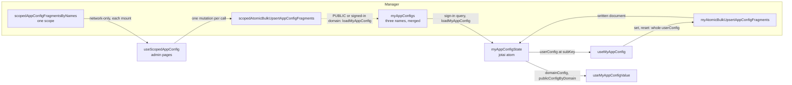
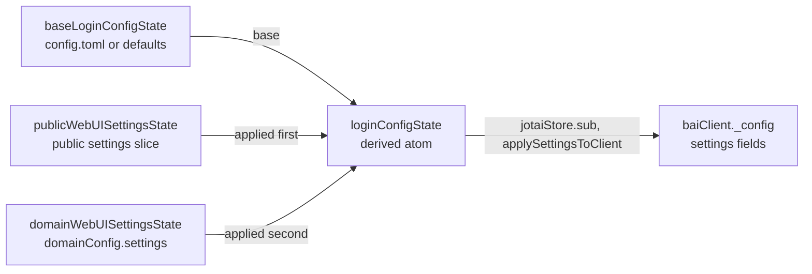

# 0033 — App config hooks

## Summary

> Unfamiliar terms are collected in the [Glossary](#glossary) at the end.

- Sign-in reads the signed-in user's [merged view](#glossary) of `publicConfigByDomain`, `domainConfig` and `userConfig` once and stores it in the jotai atom `myAppConfigState`. `loadMyAppConfig()` reads it again on demand.
- Screens that are not admin pages read app config only from that atom: `useMyAppConfig(subKey)` reads and writes `userConfig`, and `useMyAppConfigValue(configName, subKey)` reads `domainConfig` and `publicConfigByDomain`. They send no query of their own and do not suspend.
- Admin pages read and write one scope's [raw documents](#glossary) with `useScopedAppConfig(scope, configNames)`, which reads from the network each time the page mounts and does not write the atom. A write to PUBLIC or to the signed-in domain reloads the atom.
- The design rests on the manager's [allow-list](#glossary) as deployed: `publicConfigByDomain` and `domainConfig` each come from one scope, and only `userConfig` merges two (DOMAIN and USER).
- `loginConfigState` stays a derived atom over the base config, the public `settings` document and the domain `settings` document, as before.

## Context

- **Upsert replaces**: `scopedAtomicBulkUpsertAppConfigFragments` and `myAtomicBulkUpsertAppConfigFragments` store the `config` they receive as the whole document of `(configName, scope)`. A client that changes one key sends every other key too.
- **Merged view**: `myAppConfigs(configNames)` returns one `{ configName config }` per name. The manager merges every fragment of that name the caller can see, in ascending allow-list rank (`_recursive_override` in the manager's `services/app_config/service.py`): objects merge key by key, and an array, a scalar or an explicit `null` replaces the lower value whole. The answer has no `id` and no per-scope split.
- **Allow-list**: the cluster at 10.82.1.171 registers `publicConfigByDomain` at PUBLIC (rank 100), `domainConfig` at DOMAIN (200), and `userConfig` at DOMAIN (200) and USER (300). For the signed-in user's own domain, the merged `publicConfigByDomain` and `domainConfig` therefore equal their raw documents.
- **Merge scope**: `myAppConfigs` merges the caller's own domain only, for a superadmin too. `publicConfigByDomain` is one PUBLIC document, so every domain's slice comes back.
- **Read permissions**: `myAppConfigs` answers all three names for every role. `scopedAppConfigFragmentsByNames` answers the DOMAIN scope only for a superadmin. When a denied scoped field shares a request with other fields, the manager returns `data: null` for the whole request, so `@catch` on the field saves none of the others.
- **Settings at sign-in**: ADR 0028 layers the public and the domain `settings` documents over `config.toml`. `connectViaGQL` in `loginSessionAuth.ts` reads `myAppConfigs` at sign-in, and `applyConfigToClient` copies the effective config into `baiClient._config` and marks the client ready.

## Diagram

## Decision

### 1. `myAppConfigState` and `loadMyAppConfig`

- **Atom**: `myAppConfigState` in `react/src/hooks/useAppConfig.ts` holds `{ status, configs }`. `configs` maps each of `publicConfigByDomain`, `domainConfig` and `userConfig` to its merged document; `status` is `idle`, `loaded` or `failed`.
- **Sign-in read**: `loginSessionAuthMyUserQuery` selects `myAppConfigs` for the three names with `@catch(to: NULL)`, and `connectViaGQL` passes the answer to `setMyAppConfigs` before `applyConfigToClient` marks the client ready. No screen behind `useSuspendedBackendaiClient` renders before the atom holds the answer.
- **Reload**: `loadMyAppConfig(store, environment?)` is a plain function. It reads the same three names with `fetchQuery` and `network-only` and stores the answer through `setMyAppConfigs`.
- **Failed read**: when the first read fails, `setMyAppConfigs` sets `status: 'failed'`. A failed later read keeps the earlier answer and its `loaded` status, because that answer is still a base the next write can build on.
- **Server switch**: `loadConfigFromWebServer` calls `clearMyAppConfigs`, so the previous server's documents do not stay applied.
- **Outside changes**: a change the CLI, another admin or another tab makes shows after the next read: a page reload, a `reset`, or an admin's write to their own scope.

### 2. `useMyAppConfig` and `useMyAppConfigValue`

| Hook                                          | Returns               | Reads                                                    | Writes                                                         |
| --------------------------------------------- | --------------------- | -------------------------------------------------------- | -------------------------------------------------------------- |
| `useMyAppConfig<T>(subKey)`                   | `[value, set, reset]` | `configs.userConfig` at `subKey`                         | the USER scope, through `myAtomicBulkUpsertAppConfigFragments` |
| `useMyAppConfigValue<T>(configName, subKey?)` | the value             | `configs.domainConfig` or `configs.publicConfigByDomain` | nothing                                                        |

- **Write base**: `set(update)` applies `update` (a value, or a function of the current value; `undefined` removes the key) to the merged `userConfig` in the atom and sends the whole result as the USER document. After the mutation succeeds, `set` stores that document in the atom; a failed mutation leaves the atom as it was.
- **Reset**: `reset()` removes `subKey` from the USER document the same way, then calls `loadMyAppConfig`, so the DOMAIN-scope `userConfig` value at that key shows again.
- **Refused write**: `set` and `reset` reject without sending anything while `status` is not `loaded`.
- **Ordering**: one module-level queue holds every `set` and `reset`. A write starts after the previous one settles and builds on the atom it left. `reset` runs its write and its reload as one queued task, so a `set` made during a `reset` builds on the reloaded document.
- **Domain slice**: `publicConfigByDomain` holds one slice per domain, so callers pass the domain name as the first path segment, `useMyAppConfigValue('publicConfigByDomain', [domainName, key])`.
- **Optimistic display**: the hooks show a value only after the server accepted it. A caller that shows a pending value keeps it itself, as `useDashboardBoards`, `useSessionHistoryStore` and `UserSettingsGeneralPane` do.

### 3. `useScopedAppConfig`

- **Signature**: `useScopedAppConfig(scope, configNames)` takes an `AppConfigScope`, `{ type: 'public' }` (`PUBLIC_SCOPE`) or `{ type: 'domain' | 'user'; id }`, and the names to read. It returns `{ scopedAppConfig, upsertScopedAppConfig }`.
- **Read**: `useAppConfigScopedQuery` selects one `scopedAppConfigFragmentsByNames` field with `@catch(to: NULL)` and runs with `network-only`, so each mount reads the documents again. It suspends.
- **Return shape**: `scopedAppConfig` maps each requested name to its raw document, `undefined` for a name the scope holds no fragment for. The whole value is `undefined` when the scope was not readable.
- **Write**: `upsertScopedAppConfig(changes)` takes one `{ configName, subKey, value }` or an array. It throws before sending anything for a name the hook did not request. It waits for a read of the hook's query still in flight, builds the touched documents on the Relay store's copy, sends one mutation, and resolves with the documents it wrote. The mutation's `updater` points the read field at the returned fragments, which covers a first write and a write after a purge.
- **Unreadable scope**: `upsertScopedAppConfig` throws when the scope came back unreadable, because the base would be empty.
- **Ordering**: one queue per scope, keyed `<type>:<id>`, orders the writes to that scope.
- **Atom reload**: after a write to PUBLIC, or to the DOMAIN scope whose id is the signed-in domain's, `upsertScopedAppConfig` calls `loadMyAppConfig` without waiting for it. A write to another domain or to a user scope does not reload the atom, and no write patches the atom directly.

| Page                                            | Call                                                                                                                            |
| ----------------------------------------------- | ------------------------------------------------------------------------------------------------------------------------------- |
| `WebUISettingsPage` (superadmin)                | `useScopedAppConfig({ type: 'domain', id }, ['domainConfig'])` and `useScopedAppConfig(PUBLIC_SCOPE, ['publicConfigByDomain'])` |
| `AnnouncementEditModal` (superadmin)            | `useScopedAppConfig({ type: 'domain', id }, ['domainConfig'])`                                                                  |
| `BrandingSettingList` (superadmin, writes only) | `useScopedAppConfig(PUBLIC_SCOPE, ['publicConfigByDomain'])`                                                                    |

### 4. Settings layers in the login config

| Atom                       | Holds                                                                                       | Written by                                                                          |
| -------------------------- | ------------------------------------------------------------------------------------------- | ----------------------------------------------------------------------------------- |
| `baseLoginConfigState`     | `config.toml` processed into `LoginConfigState`, or the defaults                            | `initializeConfigOnce`, `loadConfigFromWebServer`; `connectViaGQL` when still empty |
| `publicWebUISettingsState` | the public `settings` slice of the login page's domain                                      | `initializeConfigOnce`, `loadConfigFromWebServer`, `WebUISettingsPage`              |
| `domainWebUISettingsState` | the signed-in domain's `domainConfig.settings`                                              | `connectViaGQL`, `WebUISettingsPage`                                                |
| `loginConfigState`         | derived: the base with the public, then the domain document applied by `applyWebUISettings` | nothing; read only                                                                  |

- **Layer write**: `WebUISettingsPage` sets `domainWebUISettingsState` or `publicWebUISettingsState` from the `settings` document `upsertScopedAppConfig` returned, so `loginConfigState` and its readers update without a refetch.
- **Client mirror**: `syncLoginConfigToClient`, installed once on `jotaiStore` in `DefaultProviders.tsx`, calls `applySettingsToClient` on every change of `loginConfigState` while `baiClient.ready` is true and `baiClient._config` exists.
- **Reload after Apply**: `WebUISettingList` still reloads the page after Apply, because screens that read `baiClient._config` once at mount keep the old value until they mount again.

## Rejected alternatives

- **Raw USER document for `userConfig`**: `userConfig` screens read and write the USER fragment through `myAppConfigFragmentsByNames`. Rejected because a value written at DOMAIN-scope `userConfig` then never reaches a screen, and every screen suspends on its own read.
- **Relay store as the shared copy**: each hook reads its documents with `store-or-network` and relies on the Relay store to share one copy per page load. Rejected because every reading screen sends or waits for a query of its own and suspends, while one sign-in read already answers all three names.
- **One request for every scope**: `useScopedAppConfig` takes several scopes and reads them in one query of aliased fields. Rejected because a denied DOMAIN field makes the manager return `data: null` for the whole request, so one unreadable scope hides the readable ones; System Settings pays one extra round trip for two calls instead.
- **Changed key on the merged atom**: after a scoped write, the page sets the changed keys on `myAppConfigState` or `loginConfigState` directly. Rejected because it repeats the manager's merge in the client, and a key a layer stops carrying would keep its old value.
- **Optimistic atom update in `set`**: `set` writes the atom before the mutation and rolls it back on failure. Rejected because the current callers already keep their own pending value, and a rollback could undo a later write that built on the optimistic value.

## Consequences

- **Request count**: sign-in reads all three names in its existing query. A `userConfig` change costs one upsert; a `reset` costs one upsert and one read. An admin page reads its scope at every mount, and System Settings reads its two scopes one after the other.
- **Copied defaults**: the first `set` copies every DOMAIN-scope `userConfig` key into the USER document, because the merged view is the write base. Those keys no longer follow later changes of the DOMAIN default for that user; only a key passed to `reset` does.
- **Object defaults**: a DOMAIN-scope default that is an object keeps its sub-keys under a user's object, because objects merge key by key. `reset` removes the key from the USER document and shows the default again; hiding a default needs `set(null)`.
- **Allow-list dependency**: if the allow-list adds a scope to `publicConfigByDomain` or `domainConfig`, the merged view stops equalling the raw document; if it adds PUBLIC to `userConfig`, `set` also copies PUBLIC values into the USER document. Either change needs this ADR revisited.
- **Lost concurrent edits**: a `set` overwrites a change another tab or the CLI made to the USER document after the atom was last read.
- **Act-as**: an act-as tab reads and writes the target account's `userConfig`. Which writes it may send is #11293.

## Sources

- #11146 — this decision.
- #11293 — act-as write scope.
- Manager `services/app_config/service.py` (`_recursive_override`, `_merge_configs`), `models/app_config_fragment/upserters.py` (whole-document upsert).
- Live reads of 10.82.1.171 on 2026-11-18: `adminAppConfigAllowLists`, and `myAppConfigs` against `scopedAppConfigFragmentsByNames` for a superadmin and a regular user.

Related: [ADR 0026](0026-dashboard-boards-in-manager-app-config.md), [ADR 0028](0028-webui-settings-in-the-app-config-settings-key.md).

## Glossary

| Term         | Meaning                                                                                                                                                     |
| ------------ | ----------------------------------------------------------------------------------------------------------------------------------------------------------- |
| raw document | The `config` of one app config fragment, stored at one scope (PUBLIC, one domain, or one user) for one config name.                                         |
| merged view  | The document `myAppConfigs` returns, which the manager builds by merging every fragment of one config name the caller can see in ascending allow-list rank. |
| allow-list   | The manager's `app_config_allow_list` table, which says at which scopes a config name may be stored and the rank each scope has in the merge.               |
