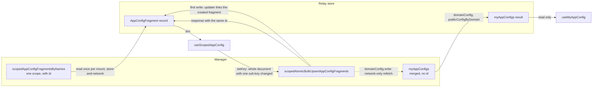

# 0033 — Scoped and merged app config hooks

## Summary

> Unfamiliar terms are collected in the [Glossary](#glossary) at the end.

- `react/src/hooks/useAppConfig.ts` exposes two hooks. `useScopedAppConfig(scope, configName)` reads and writes one scope's [raw document](#glossary). `useMyAppConfig(configName, subKey)` reads the [merged view](#glossary) and never writes.
- A write is one upsert. `setKey` builds the whole document from the copy in the Relay store and lets the upsert response update that copy. A write reads the document from the network first only when Relay has already collected the stored copy.
- Every `userConfig` reader reads the USER raw document, so a write shows on screen from the upsert response alone. Only `domainConfig` and `publicConfigByDomain` readers use the merged view, and a `domainConfig` write refetches it.
- The write base is the document read when the screen mounted. A change that the CLI, another admin, or another tab of the same account makes after that mount is overwritten by the next write.

## Context

- **Upsert replaces**: `scopedAtomicBulkUpsertAppConfigFragments` stores the `config` it receives as the whole document of `(configName, scope)`; the manager does no JSON merge. A client that changes one key must send every other key too.
- **Per-scope setters**: Before this decision, each setter read the raw document from the network before its upsert, and some callers refetched the merged view afterwards, so one change cost two or three requests.
- **Read permissions**: `scopedAppConfigFragmentsByNames` answers PUBLIC and the caller's own USER scope for every role. It answers the DOMAIN scope only for a superadmin; a domain admin and a regular user are denied `READ` on `app_config_fragment`.
- **Merged view has no id**: `myAppConfigs` returns `AppConfig { configName config }` with no `id`, so Relay cannot match it to the fragment an upsert returns. The merged view keeps its old value until the client fetches it again.
- **Merged view includes PUBLIC**: `myAppConfigs` merges the public, domain, and own-user fragments the caller can see (`VisibleAppConfigFragmentTarget` in the manager), so it returns `publicConfigByDomain` as well.

## Diagram

## Decision

### 1. Two hooks in `useAppConfig.ts`

| Hook                                    | Reads                                                                       | Writes                   | Fetch policy        |
| --------------------------------------- | --------------------------------------------------------------------------- | ------------------------ | ------------------- |
| `useScopedAppConfig(scope, configName)` | `scopedAppConfigFragmentsByNames` for one scope and one config name         | `setKey(subKey, update)` | `store-and-network` |
| `useMyAppConfig(configName, subKey?)`   | `myAppConfigs` for `domainConfig` and `publicConfigByDomain` in one request | none                     | `store-or-network`  |

- **Scope type**: `AppConfigScope` is `{ scopeType: 'PUBLIC' }`, `{ scopeType: 'DOMAIN'; scopeId? }` or `{ scopeType: 'USER'; scopeId? }`. A missing `scopeId` becomes the signed-in user's domain id (DOMAIN) or user id (USER).
- **Return shape**: `useScopedAppConfig` returns `{ doc, setKey }`. `doc` is the raw document, or `undefined` when the scope holds no fragment for that name.
- **Domain slice**: `publicConfigByDomain` holds one slice per domain, so callers pass the domain name as the first path segment, both to `setKey([domainName, key], …)` and to `useMyAppConfig('publicConfigByDomain', [domainName, key])`.

### 2. One upsert per write

- **Write base**: `setKey` reads the document from the Relay store, applies the sub-key change with `applySubKey`, and sends the result as one `scopedAtomicBulkUpsertAppConfigFragments`. When Relay has already collected the record, it reads the document from the network instead.
- **Store update**: The upsert selects `{ id configName config }`, so the response updates the record the read holds. When the read found no fragment, the mutation's `updater` links the created fragment into the read's result, and the next write builds on it.
- **Ordering**: `serializeWrite` queues the writes to one document (`scopeType`, `scopeId`, and `configName`), so a write starts after the previous one settles and builds on its response.
- **Value update**: `update` is the next value, or a function of the current value at `subKey`. `undefined` removes the key.

### 3. Who reads which view

| Config name            | Readers                                                                                                                                     | Hook                                                                  |
| ---------------------- | ------------------------------------------------------------------------------------------------------------------------------------------- | --------------------------------------------------------------------- |
| `userConfig`           | `MainLayout` (`themeFamily`), `useDashboardBoards`, `FolderCreateModal`, `useRecentSessionHistory`, `UserSettingsGeneralPane` (writes only) | `useScopedAppConfig({ scopeType: 'USER' }, 'userConfig')`             |
| `domainConfig`         | `AnnouncementBanner`, `useDashboardBoards` (templates)                                                                                      | `useMyAppConfig('domainConfig', …)`                                   |
| `domainConfig`         | `AnnouncementEditModal`, `WebUISettingsPage` (superadmin only)                                                                              | `useScopedAppConfig({ scopeType: 'DOMAIN' }, 'domainConfig')`         |
| `publicConfigByDomain` | `useDashboardBoards` (templates)                                                                                                            | `useMyAppConfig('publicConfigByDomain', …)`                           |
| `publicConfigByDomain` | `WebUISettingsPage`, `BrandingSettingList` (superadmin only)                                                                                | `useScopedAppConfig({ scopeType: 'PUBLIC' }, 'publicConfigByDomain')` |

- **Merged refetch**: A `domainConfig` write refetches the merged view with `network-only`, because every user reads `domainConfig` through it. A `publicConfigByDomain` write does not; the Branding page and System Settings reload the page after they apply.

## Rejected alternatives

- **Re-read before each write**: Each setter reads the raw document from the network before its upsert. A change another tab made a moment ago survives. Rejected because every change costs an extra request, and System Settings will save on every change (#10941).
- **Merged view for `userConfig`**: `userConfig` readers keep `useMyAppConfig` and each write refetches the merged view. DOMAIN-scope `userConfig` defaults keep applying. Rejected because every write then costs a second request, and nothing in the WebUI writes DOMAIN-scope `userConfig`; ADR 0026 keeps the dashboard out of it.
- **`my*` mutation for USER**: The own-user write goes through `myAtomicBulkUpsertAppConfigFragments`. Rejected because the scoped mutation accepts the caller's own USER scope, so one mutation serves every scope.

## Consequences

- **Request count**: A change costs one upsert; a `domainConfig` change costs one more request for the merged refetch. A screen reads each raw document once per mount.
- **Lost concurrent edits**: The next write overwrites a change that the CLI, another admin, or another tab of the same account made after the screen mounted. Reloading the screen picks the change up.
- **Defaults from DOMAIN-scope `userConfig`**: A `userConfig` value written at DOMAIN scope no longer reaches the screens, because they read the USER raw document.
- **Superadmin-only raw reads**: For anyone but a superadmin, the manager denies a DOMAIN-scope read and `useLazyLoadQuery` raises the error to the nearest error boundary, so only superadmin routes (`access: 'superadmin'`) and superadmin-gated components may call it.

## Sources

- #11146 — this decision, decided on 2026-11-12.
- #10941 — System Settings saves on every change, the next step (PR #11090).
- Manager `1b01ca06e6`: `models/app_config_fragment/upserters.py` (whole-document upsert), `models/app_config_fragment/scopes.py` (`VisibleAppConfigFragmentTarget`).

Related: [ADR 0026](0026-dashboard-boards-in-manager-app-config.md), [ADR 0028](0028-webui-settings-in-the-app-config-settings-key.md).

## Glossary

| Term         | Meaning                                                                                                                                                                                                                                               |
| ------------ | ----------------------------------------------------------------------------------------------------------------------------------------------------------------------------------------------------------------------------------------------------- |
| raw document | The `config` of one app config fragment, stored at one scope (PUBLIC, one domain, or one user) for one config name.                                                                                                                                   |
| merged view  | The document `myAppConfigs` returns, which the manager builds by deep-merging every fragment of one config name the caller can see, in the order of the rank the manager's app config allow list gives each scope (PUBLIC 100, DOMAIN 200, USER 300). |
