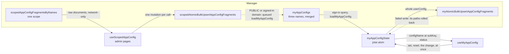
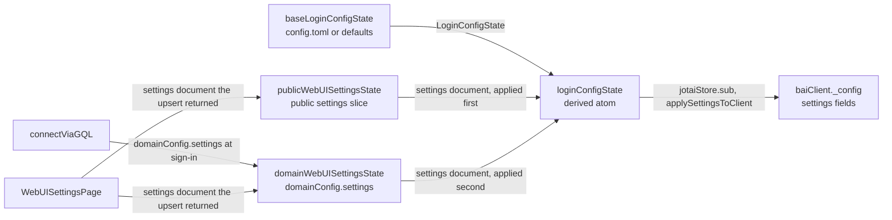

# 0033 — App config hooks

## Summary

> Unfamiliar terms are collected in the [Glossary](#glossary) at the end.

- Sign-in reads the signed-in user's [merged view](#glossary) of `publicConfigByDomain`, `domainConfig` and `userConfig` once and stores it in the jotai atom `myAppConfigState`. `loadMyAppConfig()` reads it again on demand.
- Screens that are not admin pages read app config only from that atom through `useMyAppConfig(configName, subKey?)`, which reads all three names and writes only `userConfig`. It sends no query of its own and does not suspend.
- Admin pages read and write one scope's [raw documents](#glossary) with `useScopedAppConfig(scope, configNames)`, which reads with `network-only` and does not write the atom. A write to PUBLIC or to the signed-in domain reloads the atom.
- The design rests on the manager's default [allow-list](#glossary): `publicConfigByDomain` and `domainConfig` each come from one scope, and only `userConfig` merges two (DOMAIN and USER).
- `loginConfigState` is a derived atom over the base config, the public `settings` document and the domain `settings` document.

## Context

- **Whole-document upsert**: `scopedAtomicBulkUpsertAppConfigFragments` and `myAtomicBulkUpsertAppConfigFragments` store the `config` they receive as the whole document of `(configName, scope)`. A client that changes one key sends every other key too.
- **Merged view**: `myAppConfigs(configNames)` returns one `{ configName config }` per name. The manager merges every fragment of that name the caller can see, in ascending allow-list rank (`_recursive_override` in the manager's `services/app_config/service.py`): objects merge key by key, and an array, a scalar or an explicit `null` replaces the lower value whole. The answer has no `id` and no per-scope split.
- **Default allow-list**: the manager migration `ede445fb9d0d` seeds `publicConfigByDomain` at PUBLIC (rank 100), `domainConfig` at DOMAIN (200), and `userConfig` at DOMAIN (200) and USER (300). For the signed-in user's own domain, the merged `publicConfigByDomain` and `domainConfig` therefore equal their raw documents.
- **Merge scope**: `myAppConfigs` merges the caller's own domain only, for a superadmin too. `publicConfigByDomain` is one PUBLIC document, so every domain's slice comes back.
- **Read permissions**: `myAppConfigs` answers all three names for every role. `scopedAppConfigFragmentsByNames` answers the DOMAIN scope only for a superadmin. When a denied scoped field shares a request with other fields, the manager answers the whole request with `data: null`, and `@catch` on the denied field does not bring the other fields back.
- **Settings at sign-in**: ADR 0028 layers the public and the domain `settings` documents over `config.toml`. `connectViaGQL` in `loginSessionAuth.ts` reads `myAppConfigs` at sign-in, and `applyConfigToClient` copies the effective config into `baiClient._config` and marks the client ready.

## Diagram

### App config reads and writes

### Login config layers

## Decision

### 1. `myAppConfigState` and `loadMyAppConfig`

- **Atom**: `myAppConfigState` in `react/src/hooks/useAppConfig.ts` holds `{ status, configs }`. `configs` maps each of `publicConfigByDomain`, `domainConfig` and `userConfig` to its merged document; `status` is `idle`, `loaded` or `failed`. `useMyAppConfig` returns `status` as its fourth item.
- **Sign-in read**: `loginSessionAuthMyUserQuery` selects `myAppConfigs` for the three names with `@catch(to: NULL)`, and `connectViaGQL` passes the answer to `setMyAppConfigs` before `applyConfigToClient` marks the client ready. No screen behind `useSuspendedBackendaiClient` renders before the atom holds the answer.
- **Reload**: `loadMyAppConfig(store, environment?)` is a plain function. It reads the same three names with `fetchQuery` and `network-only` and stores the answer through `setMyAppConfigs`. Calls made while a read runs share one read that starts after it, so a burst of writes costs at most two reads. A `userConfig` change made in the atom and not sent yet is applied again on the answer, so a reload does not undo it.
- **Failed read**: when the first read fails, `setMyAppConfigs` sets `status: 'failed'`. A failed later read keeps the earlier answer and its `loaded` status, because that answer is still a base the next write can build on.
- **Failed-read readers**: a reader that treats a missing value as "the account has none" checks the `status` `useMyAppConfig` returns first. `DismissSplashOnMount` keeps the mirrored theme family, and `useSessionHistoryStore` does not move the local history, while `status` is not `loaded`.
- **Server switch**: `loadConfigFromWebServer` calls `clearMyAppConfigs`, so the previous server's documents do not stay applied.
- **Outside changes**: a change the CLI, another admin or another tab makes shows after the next read: a page reload, a `reset`, or this tab's write to PUBLIC or the signed-in domain (§3).

### 2. `useMyAppConfig`

| Call                                                                | Returns                                 | Reads                                     | Writes                                                         |
| ------------------------------------------------------------------- | --------------------------------------- | ----------------------------------------- | -------------------------------------------------------------- |
| `useMyAppConfig<T>('userConfig', subKey)`                           | `[value, set, reset, status]`           | `configs.userConfig` at `subKey`          | the USER scope, through `myAtomicBulkUpsertAppConfigFragments` |
| `useMyAppConfig<T>('domainConfig' \| 'publicConfigByDomain', subKey?)` | `[value, undefined, undefined, status]` | `configs[configName]` at `subKey`, or all | nothing                                                        |

- **Write base**: `set(update)` applies `update` (a value, or a function of the current value; `undefined` removes the key) to the merged `userConfig` in the atom at once (`applyMyUserConfig`), then sends the atom's whole `userConfig` as the USER document (`sendMyUserConfig`). A send whose document equals the one the server last accepted sends nothing.
- **Rollback**: the module keeps the `userConfig` the server last accepted, read or written. When a write fails, each path where its document differs from that one goes back to the accepted value, unless the path changed again after the write was sent; `set` then rejects.
- **Reset**: `reset()` removes `subKey` from the USER document the same way, then calls `loadMyAppConfig`, so the DOMAIN-scope `userConfig` value at that key shows again.
- **Refused write**: `set` and `reset` reject without sending anything while `status` is not `loaded`.
- **Ordering**: one module-level queue, keyed `USER:me`, runs every `set`, every `reset`, and the reload after a scoped write. A task starts after the previous one settles and builds on the atom it left, so a reload cannot replace a `set` that lands while it reads. `reset` runs its write and its reload as one task; a change made during a `reset` stays in the atom through the reload, which keeps unsent changes.
- **Domain slice**: `publicConfigByDomain` holds one slice per domain, so callers pass the domain name as the first path segment, `useMyAppConfig('publicConfigByDomain', [domainName, key])`.
- **Optimistic display**: a `userConfig` change shows at once, before the server stores it, and a failed write takes it back. `useDashboardBoards`, `useSessionHistoryStore` and `UserSettingsGeneralPane` still keep their own pending value.

### 3. `useScopedAppConfig`

- **Signature**: `useScopedAppConfig(scope, configNames)` takes an `AppConfigScope`, `{ type: 'public' }` (`PUBLIC_SCOPE`) or `{ type: 'domain' | 'user'; id }`, and the names to read. It returns `{ scopedAppConfig, upsertScopedAppConfig }`.
- **Read**: `useAppConfigScopedQuery` selects one `scopedAppConfigFragmentsByNames` field with `@catch(to: NULL)` and runs with `network-only`. Screens that hold the same scope and names at the same time share one read. The hook suspends.
- **Return shape**: `scopedAppConfig` maps each requested name to its raw document, `undefined` for a name the scope holds no fragment for. The manager answers one entry per requested name, in the requested order, and the hook pairs them by index. The whole value is `undefined` when the scope was not readable.
- **Refused change**: `upsertScopedAppConfig(changes)` takes one `{ configName, subKey, value }` or an array, and throws before sending anything for a name the hook did not request.
- **Write base**: the upsert waits for a read of the hook's query still in flight, then builds the touched documents on the Relay store's copy. When Relay has already collected that copy, it reads the documents from the network instead. It throws when the scope came back unreadable, because the base would be empty.
- **Send**: the upsert sends the touched documents as one mutation and resolves with them.
- **Store update**: the mutation's `updater` points the read field at the record ids the response returns, so a first write and a write after a purge show in the read.
- **Late read**: when a read of the same query started during the write and is still in flight after it, the upsert waits for that read and reads once more, so the older answer does not stay in the store.
- **Ordering**: one queue per scope, keyed `PUBLIC:`, `domain:<id>` or `user:<id>`, orders the writes to that scope. These queues are separate from `USER:me`, so a `useScopedAppConfig` write to the signed-in user's own USER scope is not ordered with `set`; no screen makes one.
- **Atom reload**: after a write to PUBLIC, or to the DOMAIN scope whose id is the signed-in domain's, the upsert queues `loadMyAppConfig` on `USER:me` without waiting for it. A write to another domain or to a user scope does not reload the atom, and no write patches the atom directly.

| Page                                            | Call                                                                                                                            |
| ----------------------------------------------- | ------------------------------------------------------------------------------------------------------------------------------- |
| `WebUISettingsPage` (superadmin)                | `useScopedAppConfig({ type: 'domain', id }, ['domainConfig'])` and `useScopedAppConfig(PUBLIC_SCOPE, ['publicConfigByDomain'])` |
| `AnnouncementEditModal` (superadmin)            | `useScopedAppConfig({ type: 'domain', id }, ['domainConfig'])`                                                                  |
| `BrandingSettingList` (superadmin, writes only) | `useScopedAppConfig(PUBLIC_SCOPE, ['publicConfigByDomain'])`                                                                    |

### 4. Settings layers in the login config

| Atom                       | Holds                                                                                       | Written by                                                                          |
| -------------------------- | ------------------------------------------------------------------------------------------- | ----------------------------------------------------------------------------------- |
| `baseLoginConfigState`     | `config.toml` processed into `LoginConfigState`, or the defaults                            | `initializeConfigOnce`, `loadConfigFromWebServer`; `connectViaGQL` when still empty |
| `publicWebUISettingsState` | the public `settings` slice of the login page's domain                                      | `initializeConfigOnce`, `loadConfigFromWebServer`, `WebUISettingsPage`              |
| `domainWebUISettingsState` | the signed-in domain's `domainConfig.settings`                                              | `connectViaGQL`, `WebUISettingsPage`                                                |
| `loginConfigState`         | derived: the base with the public, then the domain document applied by `applyWebUISettings` | nothing; read only                                                                  |

- **Layer write**: `WebUISettingsPage` sets `domainWebUISettingsState` or `publicWebUISettingsState` to the whole `settings` document `upsertScopedAppConfig` returned, so `loginConfigState` and its readers update without a refetch.
- **Same domain**: `WebUISettingsPage` writes the signed-in domain's public slice into `publicWebUISettingsState`, which holds the login page's domain slice. A deployment serves one domain, so the two are the same slice.
- **Settings copy**: the layer atoms are the copy `loginConfigState` reads; `myAppConfigState.configs.domainConfig` is the copy `AnnouncementBanner` and the dashboard templates read. A reload of `myAppConfigState` does not write the layer atoms.
- **Client mirror**: `syncLoginConfigToClient`, installed once on `jotaiStore` in `DefaultProviders.tsx`, calls `applySettingsToClient` on every change of `loginConfigState` while `baiClient.ready` is true and `baiClient._config` exists.
- **Reload after Apply**: `WebUISettingList` reloads the page after Apply, because screens that read `baiClient._config` once at mount keep the old value until they mount again.

## Rejected alternatives

- **Raw USER document for `userConfig`**: `userConfig` screens read and write the USER fragment through `myAppConfigFragmentsByNames`. Rejected because a value written at DOMAIN-scope `userConfig` then never reaches a screen, and every screen suspends on its own read.
- **Relay store as the shared copy**: each hook reads its documents with `store-or-network` and relies on the Relay store to share one copy per page load. Rejected because every reading screen sends or waits for a query of its own and suspends, while one sign-in read already answers all three names.
- **One request for every scope**: `useScopedAppConfig` takes several scopes and reads them in one query of aliased fields. Rejected because a denied DOMAIN field makes the manager answer the whole request with `data: null`, so one unreadable scope hides the readable ones.
- **Changed keys on a merged atom**: after a scoped write, the page sets the changed keys on `myAppConfigState` or on the derived `loginConfigState`. Rejected because it repeats the manager's merge in the client, and a key the written document no longer carries would keep its old value. §4 instead replaces a whole layer document.
- **Atom written after the server accepts**: `set` stores the document in the atom only after the mutation succeeds. Rejected because a change then shows only after the round trip, so every caller that needs it at once keeps a pending copy of the same value, and the account settings' debounced writes would need a second atom of their own (ADR 0032).

## Consequences

- **Request count**: sign-in reads all three names in one query. A `userConfig` change costs one upsert; a `reset` costs one upsert and one read. System Settings reads its two scopes one after the other, one more round trip than a single query.
- **Copied defaults**: the first `set` copies every DOMAIN-scope `userConfig` key into the USER document, because the merged view is the write base. Those keys no longer follow later changes of the DOMAIN default for that user; only a key passed to `reset` does.
- **Object defaults**: a DOMAIN-scope default that is an object keeps its sub-keys under a user's object, because objects merge key by key. `reset` removes the key from the USER document and shows the default again; hiding a default needs `set(null)`.
- **Allow-list dependency**: if the allow-list adds a scope to `publicConfigByDomain` or `domainConfig`, `useMyAppConfig` no longer returns the raw document for it; if it adds PUBLIC to `userConfig`, `set` also copies PUBLIC values into the USER document.
- **Shown before stored**: a change is visible before the server stores it, and a failed write takes back only the paths it carried.
- **Lost concurrent edits**: a `set` overwrites a change another tab or the CLI made to the USER document after the atom was last read.
- **Act-as**: an act-as tab reads and writes the target account's `userConfig`.

## Sources

- #11146 — this decision, 2026-11-18.
- #11293 — which writes an act-as tab may send.
- Manager `services/app_config/service.py` (`_recursive_override`, `_merge_configs`), `models/app_config_fragment/upserters.py` (whole-document upsert), migration `ede445fb9d0d` (default allow-list).
- Reads of a dev cluster on 2026-11-18: `adminAppConfigAllowLists`, and `myAppConfigs` against `scopedAppConfigFragmentsByNames` for a superadmin and a regular user.

Related: [ADR 0026](0026-dashboard-boards-in-manager-app-config.md), [ADR 0028](0028-webui-settings-in-the-app-config-settings-key.md).

## Glossary

| Term         | Meaning                                                                                                                                                     |
| ------------ | ----------------------------------------------------------------------------------------------------------------------------------------------------------- |
| raw document | The `config` of one app config fragment, stored at one scope (PUBLIC, one domain, or one user) for one config name.                                         |
| merged view  | The document `myAppConfigs` returns, which the manager builds by merging every fragment of one config name the caller can see in ascending allow-list rank. |
| allow-list   | The manager's `app_config_allow_list` table, which says at which scopes a config name may be stored and the rank each scope has in the merge.               |
