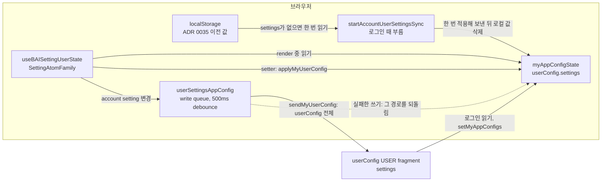

# 0035 — Personal settings in the user app config

## Summary

> 낯선 용어는 문서 맨 아래 [용어](#용어)에 모아 두었다.

- 계정에 속하는 개인 WebUI 설정은 manager app config `userConfig`의 평탄 키 `settings` 하나에 저장한다. 사용자가 다른 브라우저나 기기에서 로그인해도 같은 설정을 받는다.
- `react/src/helper/userSettingsAppConfig.ts`의 `isAccountUserSetting`이 이 [account setting](#용어) 목록을 정한다. `UserSettings`의 나머지 키는 [device-local setting](#용어)으로 브라우저 localStorage에만 남는다.
- 로그인 뒤 account setting은 `myAppConfigState`의 `userConfig.settings`에서 바로 읽는다([ADR 0033](0033-scoped-and-merged-app-config-hooks.ko.md)). 로그인이 첫 render 전에 이 atom을 채우며, localStorage에서는 읽지 않는다. `useBAISettingUserState`는 여전히 값을 동기적으로 돌려주고 API도 바뀌지 않는다.
- 로그인 시 `setMyAppConfigs` 바로 뒤에 `startAccountUserSettingsSync`(`react/src/helper/accountUserSettingsSync.ts`)가 write queue를 시작한다. 계정에 `settings` 문서가 아직 없으면, 이 결정 이전에 이 브라우저가 localStorage에 저장한 값을 한 번 복사해 넣고 localStorage에서 지운다.
- account setting을 바꾸면 `myAppConfigState`에 즉시 보이고, debounce된 write queue를 거쳐 서버로 보낸다. 쓰기가 실패하면 되돌린다. act-as 탭은 대상 계정에 저장하고, super admin의 localStorage를 대상의 app config와 섞지 않는다.

## Context

- **localStorage settings**: `useBAISettingUserState`(`react/src/hooks/useBAISetting.tsx`)는 사용자 설정마다 localStorage의 `backendaiwebui.settings.user.<name>`에 저장한다. 브라우저를 바꾼 사용자는 투어 플래그, 테이블 컬럼 선택, 실험 기능 토글, 세션 런처 선호를 잃는다.
- **App config documents**: `react/src/hooks/useAppConfig.ts`의 `useMyAppConfig('userConfig', subKey)`는 로그인이 채운 `myAppConfigState`에서 로그인한 사용자의 merged `userConfig`를 읽고, 그 `set`이 USER 문서를 쓴다. 쓰기는 사용자마다 한 번에 하나씩 한다([ADR 0033](0033-scoped-and-merged-app-config-hooks.ko.md)). [ADR 0026](0026-dashboard-boards-in-manager-app-config.ko.md)은 이미 대시보드 보드를 `userConfig.dashboard`에 저장하고, FR-3834는 테마 family를 `userConfig.themeFamily`에 저장한다.
- **Synchronous readers**: 약 100곳의 call site가 render 중에 사용자 설정을 읽는다. app config 읽기는 suspend하며 로그인된 Relay environment가 필요하다. React 밖에서 account setting을 읽는 코드는 없다. `backendaiOptions`(`react/src/global-stores.ts`)는 device-local 키만 읽는다.
- **Seeded tests**: e2e spec과 walkthrough 실행은 로그인 전에 localStorage에 투어 플래그를 써서, 투어가 검사할 화면을 가리지 않게 한다. 이 시드는 계정에 `settings` 문서가 없을 때 한 번 복사될 때만 account setting에 닿는다.
- **Act-as**: act-as 탭(`react/src/helper/actAs.ts`)은 my* 읽기를 `X-BackendAI-Act-As`와 함께 보내므로 그 탭의 `userConfig`는 대상 사용자의 문서이고, 이 탭은 super admin의 다른 탭과 localStorage를 공유한다.
- **Device-bound keys**: 일부 설정은 계정이 아니라 브라우저를 설명한다. 로그인 endpoint 기록, "로그인 유지", 창을 닫은 시각, 알림 권한, Electron 업데이트 확인이 그렇다.

## 설계도

## Decision

### 1. Account settings and device-local settings

- **Owner of the list**: `isAccountUserSetting(name)`이 설정의 저장 위치를 정한다. `ACCOUNT_USER_SETTING_KEYS`의 이름과 테이블별 접두사 `hiddenColumnKeys.`, `table_column_overrides.`, `fetchKeyAutoUpdateDelay.`에 맞는 이름을 account setting으로 본다.
- **New setting default**: `UserSettings`에 새로 추가한 설정은 그 이름을 `isAccountUserSetting`에 넣기 전까지 device-local이다.

| 분류              | 설정                                                                                                                                                                                                                                                                                                                                                                                                                                                                                                                                                                                                                                                                                                                         | 이유                                                                                               |
| ----------------- | ---------------------------------------------------------------------------------------------------------------------------------------------------------------------------------------------------------------------------------------------------------------------------------------------------------------------------------------------------------------------------------------------------------------------------------------------------------------------------------------------------------------------------------------------------------------------------------------------------------------------------------------------------------------------------------------------------------------------------- | -------------------------------------------------------------------------------------------------- |
| account           | `session_monitor_sort`, `session_monitor_rows`, `session_monitor_condition`, `session_monitor_chip_items`, `compact_sidebar`, `experimental_ai_agents`, `experimental_import_from_huggingface`, `experimental_session_resource_grid`, `experimental_session_monitor`, `session_metrics_board_items`, `resource_panel_type`, `deploymentRevisionCreationMode`, `schedulingHistoryExpandMode`, `chat_intro_alert_dismissed`, `show_accelerator_dedicated_images_first`, `hiddenColumnKeys.*`, `table_column_overrides.*`, `fetchKeyAutoUpdateDelay.*`, `has_opened_tour_neo_session_validation`, `has_opened_tour_deployment_preset_validation`, `has_opened_tour_back_to_user_view`, `has_opened_tour_back_to_admin_settings` | 사용자가 고른 값이고 어느 기기에서나 같기를 기대한다                                               |
| userConfig 최상위 | `recentSessionHistory`, `pinnedSessionHistory`                                                                                                                                                                                                                                                                                                                                                                                                                                                                                                                                                                                                                                                                               | `useRecentSessionHistory`가 이미 `userConfig` 최상위에 저장하고, 이 브라우저의 사본을 한 번 옮긴다 |
| device-local      | `preserve_login`, `last_window_close_time`, `endpoints`                                                                                                                                                                                                                                                                                                                                                                                                                                                                                                                                                                                                                                                                      | 로그인 흐름이 로그인 전에 읽고, 이 브라우저를 설명한다                                             |
| device-local      | `selected_language`                                                                                                                                                                                                                                                                                                                                                                                                                                                                                                                                                                                                                                                                                                          | 로그인 page가 로그인 전에 UI 언어를 고르려고 읽는다                                                |
| device-local      | `desktop_notification`, `automatic_update_check`, `max_concurrent_uploads`                                                                                                                                                                                                                                                                                                                                                                                                                                                                                                                                                                                                                                                   | 브라우저의 알림 권한, Electron 설치본, 이 기기의 네트워크가 값을 정한다                            |
| device-local      | `extra_ai_agents`, `agent_endpoints`                                                                                                                                                                                                                                                                                                                                                                                                                                                                                                                                                                                                                                                                                         | agent binding에 `endpoint_token`이 들어갈 수 있고, 이 값은 서버 문서에 두지 않는다                 |
| device-local      | `projectGroup.*`                                                                                                                                                                                                                                                                                                                                                                                                                                                                                                                                                                                                                                                                                                             | `backendaiOptions`가 React 밖에서 이 브라우저 로그인의 endpoint id를 키로 쓴다                     |
| device-local      | `custom_theme_config`                                                                                                                                                                                                                                                                                                                                                                                                                                                                                                                                                                                                                                                                                                        | Branding page의 저장 전 초안이고, 적용된 외관은 이미 app config에 있다                             |
| device-local      | `recentSearchHits`, `sessionResourceGridHueOverrides`                                                                                                                                                                                                                                                                                                                                                                                                                                                                                                                                                                                                                                                                        | 검색 팔레트는 선택할 때마다 쓰고, 색상 override는 곧 사라지는 세션 id를 키로 쓴다                  |
| 삭제              | `has_opened_tour_neo_deployment_validation`, `custom_ssh_port`, `beta_feature`, `start_board_items`, `dashboard_board_items`, `admin_dashboard_board_items`, `custom_dashboard_panels`                                                                                                                                                                                                                                                                                                                                                                                                                                                                                                                                       | 읽는 코드가 없다. 대시보드 키는 ADR 0026이 폐기했다                                                |

### 2. `userConfig.settings` holds the account settings

- **Key shape**: `userConfig.settings`는 설정 이름에서 값으로 가는 평탄 객체다. 예: `{ "compact_sidebar": true, "table_column_overrides.SessionList": { … } }`. 점이 들어간 이름도 경로가 아니라 키 하나다.
- **Single writer**: `react/src/helper/userSettingsAppConfig.ts`와 `react/src/helper/accountUserSettingsSync.ts`만 `userConfig.settings`를 쓰고, USER fragment에만 쓴다. 어떤 코드도 다른 scope의 `userConfig`에 `settings` 키를 쓰지 않으므로, 병합된 view는 USER fragment와 같고 서버의 deep merge가 scope 사이에서 배열을 섞지 않는다.
- **Stored null**: 일부 설정은 `null`을 선택값으로 쓰므로(예: 자동 새로 고침 끔을 뜻하는 `fetchKeyAutoUpdateDelay.*`) `null` 값은 JSON `null`로 저장한다. `undefined` 값만 키를 지운다.

### 3. The account settings are read from `myAppConfigState`

- **Read path**: account setting이면 `SettingAtomFamily`가 `react/src/hooks/useBAISetting.tsx`의 파생 atom `accountUserSettingsAtom`을 거쳐 `myAppConfigState`의 `userConfig.settings[name] ?? null`을 돌려준다. setter는 `applyMyUserConfig(store, ['settings', name], value)`(ADR 0033)로 atom을 즉시 바꾼 뒤 `queueUserSettingWrite`를 부른다. 둘 다 localStorage와 `backendaiOptions`를 건드리지 않는다. device-local setting은 localStorage 경로를 그대로 쓴다.
- **Stored or unset**: `useHasStoredUserSetting(name)`은 설정에 값이 있는지를 돌려주며, 명시적인 `null`도 값으로 본다. account setting이면 `userConfig.settings`에 키가 있는지를 읽으므로, 읽기나 사용자의 선택이 키를 넣으면 값이 `null`로 같아도 component가 다시 render된다.
- **First render**: 로그인은 `applyConfigToClient`가 client를 준비 상태로 표시하기 전에 `myAppConfigState`를 채우므로, 첫 render부터 계정의 값이 보인다. 이 값을 다른 곳에 복사하는 component는 없다.
- **Before sign-in, or after a failed read**: account setting은 기본값을 읽고, setter는 아무것도 바꾸지 않는다. 읽기 상태가 `loaded`가 아니면 `applyMyUserConfig`가 거절하기 때문이다. 로그인 전 화면 중 account setting을 쓰는 곳은 없다.

### 4. One-time copy

- **Trigger**: 로그인 시 `userConfig.settings`가 없으면 `startAccountUserSettingsSync`가 `readLocalAccountUserSettings(localStorage)`, 즉 이 결정 이전에 이 브라우저가 저장한 account setting을 읽는다. 그 값이 비어 있지 않으면 `applyMyUserConfig`로 `settings`에 적용하고 문서를 보낸다.
- **Cleanup**: 복사가 성공하면 `removeLocalAccountUserSettings`가 그 키를 localStorage에서 지운다. 복사가 실패하면 atom에서 되돌리고(ADR 0033) 로컬 키는 남겨 두므로, `settings`가 없는 계정으로 다음에 로그인할 때 다시 복사한다. 계정에 이미 `settings`가 있으면 act-as가 아닌 로그인이 그 키를 바로 지우므로, 공유 브라우저의 다음 계정이 이 값을 받지 않는다.
- **Base of the copy**: 복사는 로그인이 읽은 `userConfig` 위에 `settings`를 적용하므로, 사용자의 다른 키는 그대로 함께 간다.
- **Concurrent copy**: 같은 때 복사하는 다른 탭이나 기기는 막지 못하며, 나중에 쓴 쪽이 먼저 쓴 복사를 덮어쓴다.
- **Shared browser**: 여러 계정이 브라우저 하나를 쓰면, 업그레이드 뒤 `settings` 없이 처음 로그인한 계정이 이 브라우저의 값을 받고 그 값은 지워진다. ADR 0026의 대시보드 보드와 달리 이 값은 작은 선호 설정이고, 어떤 계정도 자기가 가진 데이터를 잃지 않는다.

### 5. Writes are debounced and sent one at a time

- **Queue**: `queueUserSettingWrite(name, value)`는 account setting 변경을 500ms debounce(`USER_SETTINGS_WRITE_DELAY_MS`)의 `createWriteQueue`(`react/src/components/DashboardPanels/writeQueue.ts`)에 넣는다. debounce 안의 변경은 batch 하나로 합치고, batch는 앞 batch가 끝난 뒤에야 시작한다.
- **Callers**: `SettingAtomFamily` setter의 account 분기가 `queueUserSettingWrite`를 부른다. `backendaiwebui.settings:set`과 `backendaiwebui.settings:delete` listener는 이 setter를 거쳐 도달한다.
- **Write**: `startUserSettingsSync`가 설치한 writer는 `sendMyUserConfig`(ADR 0033)를 부른다. 이 함수는 settings 변경을 포함한 atom의 `userConfig` 전체를, 이 탭의 다른 `userConfig` 쓰기(대시보드, 테마 family) 뒤에 줄 세워 보낸다. setter가 `undefined`를 받으면 atom에서 키를 지우므로, 쓰는 `settings`에도 그 키가 없다.
- **One read**: 로그인이 페이지 로드마다 `userConfig`를 한 번 읽는다. `startAccountUserSettingsSync`는 `myAppConfigState`에서 읽고 query를 보내지 않는다.
- **Lifetime**: `startAccountUserSettingsSync`가 queue를 시작하기 전에는 queue가 아무것도 보내지 않는다. 로그인이 `setMyAppConfigs` 뒤에 이 함수를 부르고, 두 번째 로그인은 앞의 sync를 먼저 멈추며, 다른 서버에 접속하면 멈춘다(`stopAccountUserSettingsSync`). 탭이 숨겨질 때와 `pagehide` 때 queue를 flush하고, `useLogout`은 로그아웃과 Electron 창 닫기에서 client를 지우기 전에 최대 3초까지 기다리며 flush한다.
- **Failure**: 실패한 쓰기는 `[user settings]` 접두어를 붙여 `console.error`로 기록한다. `sendMyUserConfig`는 그 쓰기가 실어 보낸 경로 중 그 뒤에 바뀌지 않은 경로를 되돌리므로, 설정은 이전 값을 다시 보여 준다.

### 6. An act-as tab writes the target's app config, not the super admin's localStorage

- **Read**: act-as 탭(`getActAsTarget()`이 대상을 돌려줌)에서는 `myAppConfigState`가 대상 사용자의 `userConfig`를 담으므로, 그 탭은 그 사용자의 선택을 보여 준다.
- **Write**: `startAccountUserSettingsSync`가 writer를 시작하므로, 그 탭의 변경은 다른 `userConfig` 쓰기(대시보드 보드, 세션 기록, 테마 패밀리)와 같이 대상 계정에 저장된다. act-as는 "이 사용자로 사용"이고 super admin만 열 수 있다(#11293).
- **localStorage**: 이 탭은 super admin의 다른 탭과 localStorage를 공유하므로, app config 값을 거기서 가져오지도 거기에 두지도 않는다. `startAccountUserSettingsSync`는 로컬 값을 올리지도 지우지도 않고, 세션 기록(`useRecentSessionHistory`)은 로컬 기록을 보여 주지도 옮기지도 않는다.
- **Still device-local**: app config에 없던 설정은 act-as 탭에서도 localStorage를 쓴다. device-local `UserSettings` 키(언어, 데스크톱 알림, 마지막 프로젝트, 최근 검색)와 라이트/다크 `themeMode`가 그렇다.
- **Leaving act-as**: 배너의 Exit과 로그아웃 메뉴는 `exitActAs`가 탭을 닫기 전에 대기 중인 설정을 최대 3초까지 기다리며 flush한다.
- **Overwrites**: act-as 탭의 쓰기는 그 탭이 읽어 온 `userConfig` 전체를 보내므로, 탭을 연 뒤 대상이 자기 브라우저에서 바꾼 내용을 덮어쓴다(ADR 0033, "Lost concurrent edits"). 여기서는 다른 쓰는 쪽이 다른 사람이고, 투어 플래그 같은 account setting 변경 하나로도 쓰기가 일어난다.
- **Theme family mirror**: `userConfig.themeFamily`의 FOUC mirror는 act-as 탭에서 같은 키로 그 탭의 `sessionStorage`에 둔다(`useCustomThemeConfig`, `index.html`). 그래서 대상의 패밀리가 super admin의 다른 탭으로 가지 않는다.

## 대안과 기각 사유

- **localStorage mirror**: localStorage가 account setting의 사본을 두고, 로그인 읽기가 그 사본을 덮어쓴다. 로그인 전 새로 고침에도 값이 남는다. mirror 때문에 공유 계정의 문서가 e2e spec이 심은 값을 덮어쓰고, act-as 대상의 설정이 super admin의 다른 탭으로 옮겨 가고, 값이 바뀔 때마다 모든 setting atom을 다시 읽어야 하므로 기각한다.
- **Settings atom of its own**: `set`이 서버가 쓰기를 받아들인 뒤에야 `myAppConfigState`를 갱신했으므로, account setting을 별도 atom에 두고 로그인 뒤 `userConfig.settings`로 채운다. 그 채우기가 첫 render 뒤에 돌아서 첫 값으로 결정하는 화면(`ai-agent` 라우트, mount 때 한 번 읽는 component)이 기본값을 쓰고, 한 문서의 사본 두 개가 어긋날 수 있으므로 기각한다. 이제 ADR 0033이 변경을 `myAppConfigState`에 즉시 보여 준다.
- **Move every key**: `UserSettings` 전부를 `userConfig.settings`로 옮긴다. 규칙이 단순하다. 로그인 흐름이 문서를 읽기 전에 `endpoints`, `preserve_login`, `selected_language`가 필요하고 agent binding에 token이 들어갈 수 있으므로 기각한다.
- **No migration**: ADR 0026 §5처럼 기본값에서 시작한다. 다른 계정으로 잘못 복사되는 일이 없다. 사용자가 몇 달에 걸쳐 정한 투어 플래그와 컬럼 선택을 잃고, 잘못된 계정으로의 복사는 선호 설정 하나의 비용이므로 기각한다.
- **One app config key per setting**: 설정마다 `userConfig`의 최상위 키로 둔다. 설정을 이름으로 읽을 수 있다. 테이블별 이름은 끝이 열려 있고, 하위 키 하나가 사용자의 다른 키(`dashboard`, `themeFamily`)와 분리를 유지하므로 기각한다.
- **Write per change**: setter를 부를 때마다 즉시 upsert한다. 구현이 단순하다. 컬럼 크기 조정이나 필터 입력이 문서 전체 upsert를 여러 번 만들고, 동시에 보낸 upsert가 서로의 변경을 지우므로 기각한다.

## Consequences

- **Cross-device preferences**: 사용자의 컬럼, 실험 기능 토글, 세션 런처 선택이 계정을 따라간다. 투어는 어느 브라우저에서든 계정마다 한 번만 뜬다.
- **Unchanged call sites**: `useBAISettingUserState`의 call site는 바뀌지 않는다. 설정 이름만이 저장 위치를 정한다.
- **Seeding in tests**: account setting이 필요한 spec은 `e2e/project/start/import-huggingface-model-tab.spec.ts`처럼 로그인한 page 안에서 값을 정하고 되돌린다. localStorage 시드는 더 이상 account setting에 닿지 않는다. 투어 플래그도 account setting이며, 이를 localStorage에 시드하는 e2e와 walkthrough helper는 이후 e2e 변경에서 로그인 뒤 API로 쓰도록 바꾼다.
- **No live cross-tab update**: 한 탭에서 바꾼 값은 열려 있는 다른 탭에 그 탭을 새로 고칠 때 도달한다.
- **Changes from another device**: writer는 이 탭의 문서 사본 위에 자기 키를 다시 적용한다. 그래서 이 탭이 마지막으로 읽은 뒤에 다른 기기나 탭이 바꾼 키는 이 탭의 다음 쓰기가 덮어쓴다. ADR 0033이 모든 app config 화면에 대해 밝힌 것과 같다.
- **Unload loss**: 탭을 닫거나 새로 고치기 직전 500ms debounce 안의 변경은 잃을 수 있다. `pagehide` 때의 flush가 끝난다는 보장이 없기 때문이다.

## 출처

- #10435 — Migrate personal WebUI settings from localStorage to the userConfig app config.
- #8525 (FR-3435) — 이 이슈를 분리해 낸 상위 작업.
- 2026-11-10 결정.

관련: [ADR 0026](0026-dashboard-boards-in-manager-app-config.ko.md), [ADR 0028](0028-webui-settings-in-the-app-config-settings-key.ko.md), [ADR 0033](0033-scoped-and-merged-app-config-hooks.ko.md).

## 용어

| 용어                 | 뜻                                                                                                                                  |
| -------------------- | ----------------------------------------------------------------------------------------------------------------------------------- |
| account setting      | `isAccountUserSetting`이 true를 돌려주는 사용자 설정이다. `userConfig.settings`에 저장하고 로그인 뒤 `myAppConfigState`에서 읽는다. |
| device-local setting | 이 브라우저의 localStorage에만 저장하는 사용자 설정이다. 서버에 도달하지 않는다.                                                    |
