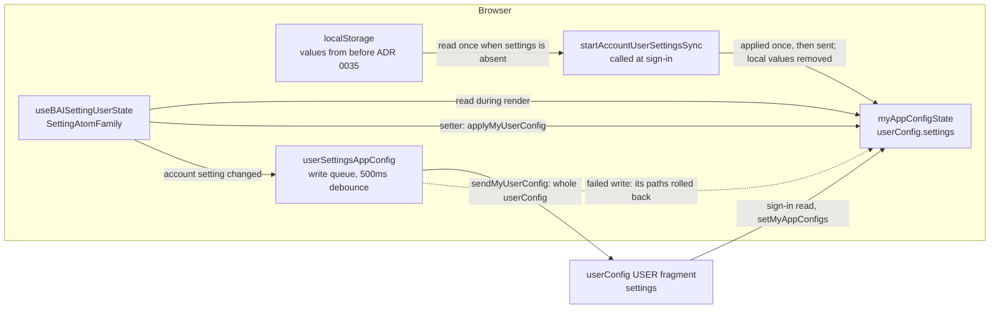

# 0035 — Personal settings in the user app config

## Summary

> Unfamiliar terms are collected in the [Glossary](#glossary) at the end.

- Personal WebUI preferences that belong to the account are stored in the manager app config `userConfig`, under one flat key, `settings`. A user who signs in on another browser or device gets the same preferences.
- `isAccountUserSetting` in `react/src/helper/userSettingsAppConfig.ts` lists these [account settings](#glossary). Every other key of `UserSettings` stays in browser localStorage only, as a [device-local setting](#glossary).
- After sign-in the account settings are read straight from `userConfig.settings` in `myAppConfigState` ([ADR 0033](0033-scoped-and-merged-app-config-hooks.md)), which sign-in fills before the first render, and never from localStorage. `useBAISettingUserState` still returns a value synchronously and its API does not change.
- At sign-in, right after `setMyAppConfigs`, `startAccountUserSettingsSync` (`react/src/helper/accountUserSettingsSync.ts`) starts the write queue. When the account has no `settings` document yet, it copies the values this browser stored in localStorage before this decision into it once, then removes them from localStorage.
- A change to an account setting shows in `myAppConfigState` at once and is sent to the server through a debounced write queue; a failed write rolls it back. An act-as tab sends nothing.

## Context

- **localStorage settings**: `useBAISettingUserState` (`react/src/hooks/useBAISetting.tsx`) stores each user setting in localStorage under `backendaiwebui.settings.user.<name>`. A user who switches browsers loses tour flags, table column choices, experimental toggles, and session launcher preferences.
- **App config documents**: `useMyAppConfig('userConfig', subKey)` in `react/src/hooks/useAppConfig.ts` reads the signed-in user's merged `userConfig` from `myAppConfigState`, which sign-in fills, and its `set` writes the USER document, one write at a time per user ([ADR 0033](0033-scoped-and-merged-app-config-hooks.md)). [ADR 0026](0026-dashboard-boards-in-manager-app-config.md) already stores dashboard boards in `userConfig.dashboard`, and FR-3834 stores the theme family in `userConfig.themeFamily`.
- **Synchronous readers**: About a hundred call sites read a user setting during render. The app config read suspends and needs a signed-in Relay environment. No code outside React reads an account setting: `backendaiOptions` (`react/src/global-stores.ts`) reads only device-local keys.
- **Seeded tests**: e2e specs and walkthrough runs write tour flags into localStorage before sign-in, so the tours do not cover the page they test. Such a seed reaches an account setting only through the one-time copy, while the account has no `settings` document.
- **Act-as**: An act-as tab (`react/src/helper/actAs.ts`) sends the my* reads with `X-BackendAI-Act-As`, so its `userConfig` is the target user's document, and it shares localStorage with the super admin's other tabs.
- **Device-bound keys**: Some settings describe the browser, not the account: the login endpoint history, "keep me signed in", the time the window closed, the notification permission, and the Electron update check.

## Diagram

## Decision

### 1. Account settings and device-local settings

- **Owner of the list**: `isAccountUserSetting(name)` decides where a setting lives. It matches the names in `ACCOUNT_USER_SETTING_KEYS` and the per-table prefixes `hiddenColumnKeys.`, `table_column_overrides.`, and `fetchKeyAutoUpdateDelay.`.
- **New setting default**: A setting added to `UserSettings` is device-local until its name is added to `isAccountUserSetting`.

| class             | settings                                                                                                                                                                                                                                                                                                                                                                                                                                                                                                                                                                                                                                                                                                                     | reason                                                                                                                   |
| ----------------- | ---------------------------------------------------------------------------------------------------------------------------------------------------------------------------------------------------------------------------------------------------------------------------------------------------------------------------------------------------------------------------------------------------------------------------------------------------------------------------------------------------------------------------------------------------------------------------------------------------------------------------------------------------------------------------------------------------------------------------- | ------------------------------------------------------------------------------------------------------------------------ |
| account           | `session_monitor_sort`, `session_monitor_rows`, `session_monitor_condition`, `session_monitor_chip_items`, `compact_sidebar`, `experimental_ai_agents`, `experimental_import_from_huggingface`, `experimental_session_resource_grid`, `experimental_session_monitor`, `session_metrics_board_items`, `resource_panel_type`, `deploymentRevisionCreationMode`, `schedulingHistoryExpandMode`, `chat_intro_alert_dismissed`, `show_accelerator_dedicated_images_first`, `hiddenColumnKeys.*`, `table_column_overrides.*`, `fetchKeyAutoUpdateDelay.*`, `has_opened_tour_neo_session_validation`, `has_opened_tour_deployment_preset_validation`, `has_opened_tour_back_to_user_view`, `has_opened_tour_back_to_admin_settings` | the user chose them and expects them on every device                                                                     |
| userConfig itself | `recentSessionHistory`, `pinnedSessionHistory`                                                                                                                                                                                                                                                                                                                                                                                                                                                                                                                                                                                                                                                                               | already stored at the top level of `userConfig` by `useRecentSessionHistory`, which moves this browser's copy there once |
| device-local      | `preserve_login`, `last_window_close_time`, `endpoints`                                                                                                                                                                                                                                                                                                                                                                                                                                                                                                                                                                                                                                                                      | the login flow reads them before sign-in, and they describe this browser                                                 |
| device-local      | `selected_language`                                                                                                                                                                                                                                                                                                                                                                                                                                                                                                                                                                                                                                                                                                          | the login page reads it before sign-in to pick the UI language                                                           |
| device-local      | `desktop_notification`, `automatic_update_check`, `max_concurrent_uploads`                                                                                                                                                                                                                                                                                                                                                                                                                                                                                                                                                                                                                                                   | the browser's notification permission, the Electron install, and this machine's connection decide them                   |
| device-local      | `extra_ai_agents`, `agent_endpoints`                                                                                                                                                                                                                                                                                                                                                                                                                                                                                                                                                                                                                                                                                         | an agent binding can carry an `endpoint_token`, which stays out of server documents                                      |
| device-local      | `projectGroup.*`                                                                                                                                                                                                                                                                                                                                                                                                                                                                                                                                                                                                                                                                                                             | `backendaiOptions` writes it outside React, keyed by the endpoint id of this browser's login                             |
| device-local      | `custom_theme_config`                                                                                                                                                                                                                                                                                                                                                                                                                                                                                                                                                                                                                                                                                                        | it is the Branding page's unsaved draft; the applied appearance lives in app config already                              |
| device-local      | `recentSearchHits`, `sessionResourceGridHueOverrides`                                                                                                                                                                                                                                                                                                                                                                                                                                                                                                                                                                                                                                                                        | the search palette writes on every pick, and the hue overrides are keyed by session ids that soon stop existing          |
| dropped           | `has_opened_tour_neo_deployment_validation`, `custom_ssh_port`, `beta_feature`, `start_board_items`, `dashboard_board_items`, `admin_dashboard_board_items`, `custom_dashboard_panels`                                                                                                                                                                                                                                                                                                                                                                                                                                                                                                                                       | no code reads them; the dashboard keys were retired by ADR 0026                                                          |

### 2. `userConfig.settings` holds the account settings

- **Key shape**: `userConfig.settings` is a flat object from a setting name to its value, for example `{ "compact_sidebar": true, "table_column_overrides.SessionList": { … } }`. A dotted name is one key, not a path.
- **Single writer**: Only `react/src/helper/userSettingsAppConfig.ts` and `react/src/helper/accountUserSettingsSync.ts` write `userConfig.settings`, and they write only the USER fragment. No code writes a `settings` key into the `userConfig` of another scope, so the merged view equals the USER fragment and the server's deep merge does not mix arrays across scopes.
- **Stored null**: A `null` value is stored as JSON `null`, because some settings use it as a choice, such as `fetchKeyAutoUpdateDelay.*` for auto-refresh off. Only an `undefined` value removes a key.

### 3. The account settings are read from `myAppConfigState`

- **Read path**: For an account setting, `SettingAtomFamily` returns `userConfig.settings[name] ?? null` from `myAppConfigState`, through the derived `accountUserSettingsAtom` in `react/src/hooks/useBAISetting.tsx`. The setter calls `applyMyUserConfig(store, ['settings', name], value)` (ADR 0033), which changes the atom at once, then `queueUserSettingWrite`. Neither touches localStorage or `backendaiOptions`. A device-local setting keeps the localStorage path.
- **Stored or unset**: `useHasStoredUserSetting(name)` returns whether the setting holds a value, an explicit `null` included. For an account setting it reads whether `userConfig.settings` has the key, so a component re-renders when a read or a pick adds the key even while the value stays `null`.
- **First render**: sign-in fills `myAppConfigState` before `applyConfigToClient` marks the client ready, so the first render already shows the account's values. No component copies them anywhere.
- **Before sign-in, or after a failed read**: an account setting reads its default, and its setter changes nothing, because `applyMyUserConfig` refuses while the read status is not `loaded`. No pre-sign-in surface writes one.

### 4. One-time copy

- **Trigger**: At sign-in, when `userConfig.settings` is absent, `startAccountUserSettingsSync` reads `readLocalAccountUserSettings(localStorage)`, the account settings this browser stored before this decision. When that is not empty, it applies them as `settings` with `applyMyUserConfig` and sends the document.
- **Cleanup**: After the copy succeeds, `removeLocalAccountUserSettings` removes those keys from localStorage. A failed copy is rolled back from the atom (ADR 0033) and leaves them, so the next sign-in to an account without `settings` copies them again. When the account already has `settings`, a sign-in outside act-as removes them at once, so a later account on a shared browser does not receive them.
- **Base of the copy**: The copy applies `settings` on the `userConfig` the sign-in read, so the user's other keys go with it unchanged.
- **Concurrent copy**: It is no guard against another tab or device that copies at the same time: the later write replaces the earlier copy.
- **Shared browser**: When several accounts share one browser, the first account without `settings` to sign in after the upgrade receives this browser's values, which are then removed. Unlike the dashboard boards of ADR 0026, these values are small preferences, and no account loses data it holds.

### 5. Writes are debounced and sent one at a time

- **Queue**: `queueUserSettingWrite(name, value)` puts a change of an account setting into a `createWriteQueue` (`react/src/components/DashboardPanels/writeQueue.ts`) with a 500ms debounce (`USER_SETTINGS_WRITE_DELAY_MS`). Changes within the debounce are joined into one batch, and a batch starts only after the previous one finished.
- **Callers**: The account branch of the `SettingAtomFamily` setter calls `queueUserSettingWrite`. The `backendaiwebui.settings:set` and `backendaiwebui.settings:delete` listeners reach it through that setter.
- **Write**: `startUserSettingsSync` installs a writer that calls `sendMyUserConfig` (ADR 0033), which sends the atom's whole `userConfig`, the settings changes included, behind this tab's other `userConfig` writes (the dashboard, the theme family). A setter given `undefined` removes the key from the atom, so the written `settings` no longer has it.
- **One read**: sign-in reads `userConfig` once per page load. `startAccountUserSettingsSync` reads it from `myAppConfigState` and sends no query.
- **Lifetime**: The queue sends nothing before `startAccountUserSettingsSync` started it. Sign-in starts it after `setMyAppConfigs`, a second sign-in stops the previous one first, and joining another server stops it (`stopAccountUserSettingsSync`). It flushes the queue when the tab is hidden and on `pagehide`, and `useLogout` flushes it before it clears the client, on logout and on an Electron window close, waiting at most 3 seconds.
- **Failure**: A failed write is logged with `console.error` under a `[user settings]` prefix, and `sendMyUserConfig` rolls back the paths it carried that nothing changed since, so the setting shows its previous value again.

### 6. An act-as tab saves nothing

- **Read**: In an act-as tab (`getActAsTarget()` returns a target), `myAppConfigState` holds the target user's `userConfig`, so the tab shows that user's choices. Nothing is copied from localStorage.
- **Write**: `startAccountUserSettingsSync` does not start the writer, so a change in that tab shows only in that tab. Another `userConfig` write from that tab, such as a dashboard edit, carries it to the target's account; which writes an act-as tab may send is #11293.

## Rejected alternatives

- **localStorage mirror**: localStorage keeps a copy of the account settings, which the sign-in read overwrites. A value survives a reload before sign-in. This is rejected because the mirror lets a shared account's document overwrite what e2e specs seed, carries an act-as target's settings into the super admin's other tabs, and needs every setting atom re-read after it changes.
- **Settings atom of its own**: The account settings live in a separate atom, seeded from `userConfig.settings` after sign-in, because `set` used to update `myAppConfigState` only after the server accepted a write. This is rejected because the seed ran after the first render, so a screen that decides on its first value (the `ai-agent` route, a component that reads once at mount) used the default, and two copies of one document can drift. ADR 0033 now shows a change in `myAppConfigState` at once.
- **Move every key**: All of `UserSettings` goes to `userConfig.settings`. The rule is simple. This is rejected because the login flow needs `endpoints`, `preserve_login`, and `selected_language` before any document can be read, and an agent binding can carry a token.
- **No migration**: Follow ADR 0026 §5 and start from defaults. Nothing is copied into the wrong account. This is rejected because users would lose tour flags and column choices they set over months, and a wrong-account copy costs only a preference.
- **One app config key per setting**: Each setting becomes a top-level key of `userConfig`. A setting can be read by name. This is rejected because the per-table names are open-ended, and a flat sub-key keeps the user's other keys (`dashboard`, `themeFamily`) apart.
- **Write per change**: Every setter call upserts at once. The implementation is simple. This is rejected because a column resize or a typed filter produces many whole-document upserts, and upserts sent at the same time erase each other's changes.

## Consequences

- **Cross-device preferences**: A user's columns, experimental toggles, and session launcher choices follow the account. A tour shows once per account, on whichever browser.
- **Unchanged call sites**: No call site of `useBAISettingUserState` changes; only the setting's name decides where it is stored.
- **Seeding in tests**: A spec that needs an account setting sets it in the signed-in page and restores it, as `e2e/project/start/import-huggingface-model-tab.spec.ts` does; a localStorage seed no longer reaches an account setting. The tour flags are account settings, and the e2e and walkthrough helpers that seed them into localStorage are to write them through the API after sign-in instead, in a later e2e change.
- **No live cross-tab update**: A change made in one tab reaches another open tab only when that tab is reloaded.
- **Changes from another device**: The writer replays its keys on this tab's copy of the document, so a key another device or tab changed after this tab last read it is overwritten by this tab's next write, as ADR 0033 states for every app config screen.
- **Unload loss**: A change made within the 500ms debounce before the tab is closed or reloaded can be lost, because the flush on `pagehide` is not guaranteed to finish.

## Sources

- #10435 — Migrate personal WebUI settings from localStorage to the userConfig app config.
- #8525 (FR-3435) — the split that produced this issue.
- Decided 2026-11-10.

Related: [ADR 0026](0026-dashboard-boards-in-manager-app-config.md), [ADR 0028](0028-webui-settings-in-the-app-config-settings-key.md), [ADR 0033](0033-scoped-and-merged-app-config-hooks.md).

## Glossary

| term                 | meaning                                                                                                                                             |
| -------------------- | --------------------------------------------------------------------------------------------------------------------------------------------------- |
| account setting      | A user setting for which `isAccountUserSetting` returns true. It is stored in `userConfig.settings` and read from `myAppConfigState` after sign-in. |
| device-local setting | A user setting stored only in this browser's localStorage. It does not reach the server.                                                            |
