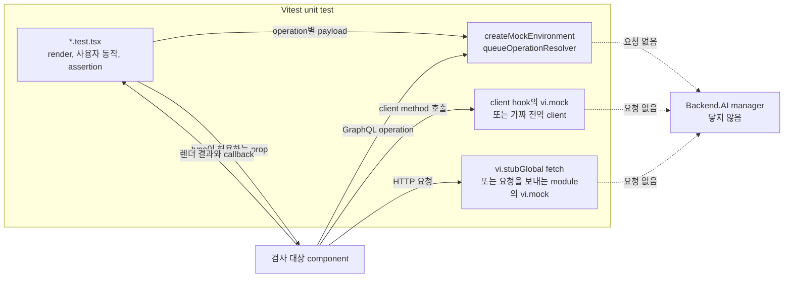

# 0036 — Component unit test conventions

## Summary

> 낯선 용어는 문서 맨 아래 [용어](#용어)에 모아 두었다.

- component unit test는 component가 닿는 모든 API·network 경계를 mock한다: Relay environment, Backend.AI client, `fetch`. 어떤 unit test도 manager에 요청을 보내지 않는다.
- component unit test는 type이 허용하는 prop과 사용자 동작을 주었을 때 component가 의도한 동작을 검사한다. 모든 입력을 다루려 하지 않는다.
- unit test는 component를 잘못 썼을 때의 결과를 검사하지 않는다: type이 막는 prop, 빠진 provider, API가 제공하지 않는 호출. 그런 경우의 test는 그것이 실제로 무언가를 깨뜨린 뒤에, 그 수정과 함께만 추가한다.
- 이 규칙은 `react/src`와 `packages/backend.ai-ui/src`의 component·hook Vitest unit test에 적용한다. 기존 test를 이 규칙에 맞게 다시 쓰지 않는다. 파일은 다른 이유로 고칠 때 맞춘다.
- **Out of scope**: 실제 cluster에 대해 도는 `e2e/`·`e2e-agent/`의 Playwright suite와, 루트 `vitest.config.ts`가 돌리는 script test.

## Context

- **Test count**: `react/src`에는 약 230개, `packages/backend.ai-ui/src`에는 약 110개의 `*.test.ts(x)` 파일이 있다. 기여자와 agent가 component를 바꿀 때마다 test를 더한다.
- **No written convention**: `.github/instructions/react.instructions.md`는 unit test가 Vitest라는 것과 `VERIFY_TESTS=1 bash scripts/verify.sh`로 돌린다는 것만 적는다. test 파일마다 mock 방식과 범위를 제각각 정한다.
- **Mocking in use today**: 약 40개 파일이 `relay-test-utils`의 `createMockEnvironment`를 쓰고, 8개는 `react-relay` 자체를 `vi.mock`으로 바꾼다. 많은 파일이 `useSuspendedBackendaiClient`나 `useConnectedBAIClient`를 `vi.mock`으로 바꾸고, 몇 개는 `fetch`를 `vi.stubGlobal`로 대신한다. MSW를 쓰는 test는 없다.
- **No `fetch` guard**: Node 24에서 jsdom environment는 Node 자체의 `fetch`를 그대로 두므로, `react/src/setupTests.ts`의 fallback은 실행되지 않는다. stub을 빠뜨린 test가 실제 요청을 보내도 아무것도 막지 않는다.
- **Misuse cases in use today**: 일부 test는 type이 이미 막는 사용에 대한 error를 검사한다. 예를 들어 `packages/backend.ai-ui/src/components/BAIUnmountAfterClose.test.tsx`의 `should handle multiple children error gracefully`는 `@ts-expect-error`로 child 두 개를 넘기고 throw를 기대한다. 이런 test는 어떤 caller도 하지 않는 호출에 대한 React의 동작을 고정하고, 읽는 사람은 그것을 요구사항과 구별할 수 없다.

## 설계도

## Decision

### 1. 모든 API·network 경계를 mock한다

- **Relay queries**: query가 있는 component를 렌더하는 test는 그 component를 `RelayEnvironmentProvider` 안에 두고, provider의 environment는 `createMockEnvironment`로 만든다. 그래서 component의 실제 query와 fragment가 돈다. 데이터는 `MockPayloadGenerator.generate(operation, resolvers)`로 만들고, resolver map에는 assertion이 읽는 field만 정한다. 기준은 `react/src/components/ImageList.test.tsx`이다.
- **Resolver queue**: `environment.mock.queueOperationResolver`의 resolver는 순서대로 쓰인다. 새 operation은 queue 맨 앞의 resolver에만 넘어가고, 그 resolver는 payload를 돌려주면 사라진다. 맨 앞 resolver가 아무것도 돌려주지 않으면 operation은 대기 상태로 남고 queue가 막힌다. test는 component가 렌더 중에 보내는 operation마다, 보내는 순서대로 resolver를 하나씩 queue에 넣는다. 클릭 뒤의 mutation처럼 test가 나중에 일으키는 operation은 `environment.mock.resolveMostRecentOperation`이 응답한다.
- **Relay fragments only**: fragment만 읽는 component는 mock environment에서 `@relay_test_operation`을 붙인 test query 아래에 렌더한다. `react/src/components/FileBrowserButtonV2.test.tsx`가 그렇게 한다. 대신 `vi.mock('react-relay')`에서 `useFragment`가 ref를 그대로 데이터로 돌려주게 바꿀 수도 있다. `packages/backend.ai-ui/src/components/fragments/BAIRouteNodes.test.tsx`가 그렇게 한다.
- **Shared `RelayEnvironment`**: `react/src/helper/loginSessionAuth.ts`처럼 `RelayEnvironment` module에 `fetchQuery`를 직접 부르는 코드는 그 module을 `vi.mock`해서 test한다. `react/src/helper/loginSessionAuth.test.ts`가 그렇게 한다.
- **Backend.AI client hooks in `react/src`**: test는 `react/src/hooks`를 `vi.mock`하면서 `importOriginal`로 다른 export를 유지하고, 필요한 client hook(`useSuspendedBackendaiClient`, `useAnonymousBackendaiClient`)을 바꾼다. `ImageList.test.tsx`가 그렇게 한다.
- **Hooks beside the client hook**: `useCurrentDomainValue` 같은 `react/src/hooks/index.tsx`의 hook은 module 안의 binding으로 실제 `useSuspendedBackendaiClient`를 부르고, mock은 그 binding을 바꾸지 않는다. test는 component가 부르는 그런 hook을 같은 `vi.mock`에서 하나씩 바꾼다. `FileBrowserButtonV2.test.tsx`가 `useCurrentDomainValue`를 그렇게 바꾼다.
- **Global client**: `globalThis.backendaiclient`를 읽는 코드는 test가 그곳에 가짜를 넣고 case마다 지워서 test한다. `react/src/hooks/useLogout.test.ts`가 그렇게 한다.
- **Backend.AI client in BUI**: test는 `packages/backend.ai-ui/src/components/provider/BAIClientProvider/hooks/`의 `useConnectedBAIClient`나 `useAnonymousBAIClient`를 `vi.mock`으로 바꾼다. `BAIFileExplorer.createFolder.test.tsx`가 그렇게 한다. 이 hook을 부르는 `react/src` 코드도 같은 방식으로 test한다.
- **Partial client objects**: 가짜 client는 component가 호출하는 member만 가진다.
- **Client package**: `react/vitest.config.ts`는 `backend.ai-client`를 빈 class를 export하는 `react/__test__/backendAiClient.mock.js`로 alias한다. client 자체의 error 처리를 검사하는 test는 `fetch`를 stub한 채 실제 `Client`를 상대 경로로 import할 수 있다. `react/src/hooks/useBackendAIAppLauncher.errors.test.ts`가 그렇게 한다.
- **`fetch`**: `fetch`를 직접 호출하는 component는 `vi.stubGlobal('fetch', ...)`로 test하고, test는 case마다 `vi.unstubAllGlobals`로 되돌린다. 막아 주는 setup 파일이 없으므로 stub은 각 test가 직접 한다.
- **Other request paths**: `XMLHttpRequest`로 `tus-js-client` upload를 하는 것처럼 다른 방법으로 요청을 보내는 component는 그 요청을 보내는 module을 `vi.mock`해서 test한다.
- **No real requests**: unit test는 endpoint, credential, `config.toml`을 읽지 않는다. 실제 manager에 대한 동작은 e2e suite가 맡는다.
- **Other mocks**: 이 절은 API·network 경계만 다룬다. component가 렌더하는 데 필요하면 test는 여전히 `react-i18next`, router, browser API를 mock할 수 있다.

### 2. test는 component가 의도한 동작을 검사한다

- **Source of cases**: case는 component의 목적에서 나온다: 문서화된 prop, component가 처리하는 사용자 동작, 렌더하는 것, 부르는 callback, 보내는 요청. 각 `it`은 그런 동작 하나를, 읽는 사람이 component와 맞춰 볼 수 있는 문장으로 이름 붙인다.
- **Valid input only**: 모든 렌더는 component의 TypeScript type이 받아들이는 prop을, component가 요구하는 provider 안에서 넘긴다. test는 어떤 caller도 만들 수 없는 상태에 닿으려고 component의 prop에 `@ts-expect-error`나 `as any`를 붙이지 않는다.
- **Contract from an ADR**: ADR이 요구하는 동작은 의도한 동작이므로 그 test는 남는다. ADR 0001이 요구하는 `ImageList.test.tsx`의 project scope test가 그 예다.
- **Deliberate errors**: 올바른 입력에 대해 component가 일부러 내는 error는 의도한 동작이다. 예를 들어 권한이 없는 사용자에게 내는 permission error가 그렇다. 잘못된 사용에서만 나오는 error는 그렇지 않다.
- **No coverage target**: coverage 숫자를 올리려고 test를 쓰지 않는다. CI의 coverage report는 정보이지, test가 맞춰야 하는 gate가 아니다.

### 3. 잘못된 사용은 무언가를 깨뜨리기 전까지 unit test가 아니다

- **Excluded cases**: test는 type이 막는 prop 조합, 지원하지 않는 API 호출, 빠진 provider, component가 받지 않는 child 개수의 결과를 검사하지 않는다.
- **When one is added**: 잘못된 사용이 사용자에게 닿아 bug를 일으키면, 그 bug를 고치는 PR이 그것을 재현하는 test를 추가한다. test 이름은 사용자에게 보이는 동작을 적고, PR은 issue를 적는다.
- **Reason**: unit test는 component가 계속 지켜야 할 것을 기록한다. 잘못된 사용에 대한 assertion은 아무도 의존하지 않는 동작을 기록하고, 나중에 그 동작을 바꾸는 변경은 어떤 caller도 깨뜨리지 않으면서 suite를 실패시킨다.

### 4. 규칙을 적어 두는 곳

- **This ADR**: 규칙은 여기 있다. `AGENTS.md`(`CLAUDE.md`로 읽힌다)의 Core Guidelines에 여기를 가리키는 짧은 `Unit Tests` 항목이 있어서, test를 쓰는 agent가 매 session 규칙을 불러온다.
- **Existing files**: tree 전체를 한 번에 고치지 않는다. 변경은 자기가 추가하거나 고치는 case를 1~3절에 맞추고, 같은 파일의 다른 case는 그대로 둔다.

## 대안과 기각 사유

- **Rules only in `CLAUDE.md`**: `AGENTS.md`의 절 하나만 두면 모든 agent session에서 불러온다. review가 강제하는 결정은 ADR에 둔다(`.claude/rules/adr.md`)는 이유로 유일한 자리로는 기각하고, `AGENTS.md`에는 가리키는 항목을 둔다.
- **MSW as the network mock**: MSW는 network 계층에서 요청을 가로채고 test와 story 모두에 쓸 수 있다. 지금 쓰는 test가 없고, Relay의 mock environment가 새 dependency 없이 GraphQL을 다루므로 기각한다.
- **Exhaustive input coverage**: 모든 prop 조합과 error 경로를 test하면 edge case를 일찍 찾는다. 그 test들이 어떤 caller도 의존하지 않는 동작을 고정하고 해 없는 변경에도 실패하므로 기각한다.
- **A coverage threshold**: 최소 coverage 비율을 두면 test를 건너뛰지 못한다. 숫자를 위해 쓴 test를 보상하는데, 2절이 그런 test를 빼므로 기각한다.

## Consequences

- **Stable runs**: 1절을 따르는 test는 돌고 있는 manager에 의존하지 않으므로 CI와 어느 machine에서나 같게 돈다. `fetch` stub을 빠뜨린 test는 예외다. 어떤 setup 파일도 그 요청을 막지 않기 때문이다.
- **Fewer cases per component**: 새 component는 그 목적에 대한 test와 함께 들어온다. reviewer는 test를 case 개수가 아니라 그 동작이 의도된 것인지로 판단한다.
- **Misuse can regress unseen**: 동작이 바뀐 잘못된 사용은 사용자가 만나기 전까지 잡히지 않는다. 그때 수정이 test를 추가한다.
- **Mixed tree**: 잘못된 사용을 검사하거나 type을 넘어서는 기존 test는 변경이 그 case를 고칠 때까지 남는다. 읽는 사람은 한 파일 안에서 두 방식을 모두 만날 수 있다.
- **Mock drift**: `vi.mock` factory가 돌려주는 가짜 client는 client에 대해 type 검사를 받지 않으므로, 실제 API와 어긋나도 unit test는 통과한다. resolver map의 값과 ref를 그대로 돌려주는 `useFragment` mock도 schema에 대해 검사받지 않는다. 그런 어긋남은 e2e suite만 잡는다.

## 출처

- GitHub issue: #11249.
- `react/vitest.config.ts`, `react/src/setupTests.ts`, `packages/backend.ai-ui/vitest.config.ts`, `packages/backend.ai-ui/setupTests.ts`.
- `react/src/components/ImageList.test.tsx`, `packages/backend.ai-ui/src/components/BAIUnmountAfterClose.test.tsx`.
- 결정: 2026-11-16.
- 관련: [ADR 0001](0001-explicit-project-prop-contract.ko.md)은 test가 지키는 ADR contract의 예다.

## 용어

| 용어             | 뜻                                                                                                                        |
| ---------------- | ------------------------------------------------------------------------------------------------------------------------- |
| mock environment | mock environment는 `relay-test-utils`의 Relay environment로, 요청을 보내지 않고 test가 각 operation에 직접 응답하게 한다. |
| misuse           | misuse(잘못된 사용)는 component의 type이나 문서가 허용하지 않는 방식으로 component를 호출하거나 렌더하는 것이다.          |
| MSW              | MSW(Mock Service Worker)는 HTTP 요청을 가로채 test가 정의한 handler로 응답하는 library이다.                               |
