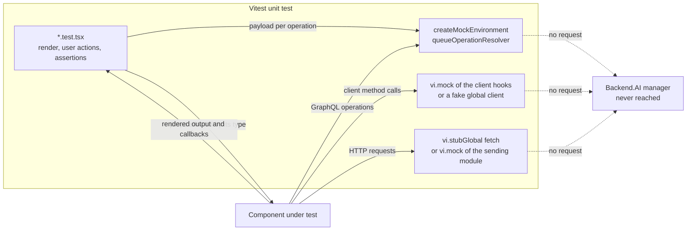

# 0036 — Component unit test conventions

## Summary

> Unfamiliar terms are collected in the [Glossary](#glossary) at the end.

- A component unit test mocks every API and network boundary the component reaches: the Relay environment, the Backend.AI client, and `fetch`. No unit test sends a request to a manager.
- A component unit test checks the behavior the component is meant to have, given props and user actions its types allow. It does not try to cover every input.
- A unit test does not assert what happens when the component is used the wrong way: a prop the type forbids, a missing provider, a call the API does not offer. A test for such a case is added only after it broke something, together with the fix.
- The rules bind the Vitest unit tests of components and hooks under `react/src` and `packages/backend.ai-ui/src`. Existing tests are not rewritten to follow them; a file is brought in line when it is edited for another reason.
- **Out of scope**: the Playwright suites under `e2e/` and `e2e-agent/`, which run against a real cluster, and the script tests the root `vitest.config.ts` runs.

## Context

- **Test count**: `react/src` holds about 230 `*.test.ts(x)` files and `packages/backend.ai-ui/src` about 110. Contributors and agents add more with each component change.
- **No written convention**: `.github/instructions/react.instructions.md` says only that unit tests are Vitest and how `VERIFY_TESTS=1 bash scripts/verify.sh` runs them. Each test file chooses its own mocking and its own scope.
- **Mocking in use today**: About 40 files use `createMockEnvironment` from `relay-test-utils`, and 8 replace `react-relay` itself with `vi.mock`. Many files replace `useSuspendedBackendaiClient` or `useConnectedBAIClient` through `vi.mock`, and a few stub `fetch` with `vi.stubGlobal`. No test uses MSW.
- **No `fetch` guard**: Under Node 24 the jsdom environment keeps Node's own `fetch`, so the fallback in `react/src/setupTests.ts` never runs. Before this ADR nothing stopped a test that forgot its stub from sending a real request.
- **Misuse cases in use today**: some tests assert errors for usage the types already reject, for example `should handle multiple children error gracefully` in `packages/backend.ai-ui/src/components/BAIUnmountAfterClose.test.tsx`, which passes two children under `@ts-expect-error` and expects a throw. Such a test fixes React's behavior for a call no caller makes, and a reader cannot tell it from a requirement.

## Diagram

## Decision

### 1. Every API and network boundary is mocked

- **Relay queries**: A test that renders a component with a query puts it inside `RelayEnvironmentProvider`, whose environment comes from `createMockEnvironment`, so the component's real queries and fragments run. Data comes from `MockPayloadGenerator.generate(operation, resolvers)`, with a resolver map that sets only the fields the assertion reads. `react/src/components/ImageList.test.tsx` is the reference.
- **Resolver queue**: `environment.mock.queueOperationResolver` resolvers are consumed in order. Each new operation is offered only to the resolver at the head of the queue, which is removed once it returns a payload; a head resolver that returns nothing leaves the operation pending and blocks the queue. A test queues one resolver per operation the component sends during render, in the order the component sends them. `environment.mock.resolveMostRecentOperation` answers an operation the test triggers later, such as a mutation after a click.
- **Relay fragments only**: A component that only reads a fragment is rendered under a test query marked `@relay_test_operation` in a mock environment, as `react/src/components/FileBrowserButtonV2.test.tsx` does. A test may instead replace `useFragment` in a `vi.mock('react-relay')` that returns the ref as the data, as `packages/backend.ai-ui/src/components/fragments/BAIRouteNodes.test.tsx` does.
- **Shared `RelayEnvironment`**: Code that calls `fetchQuery` on the `RelayEnvironment` module, such as `react/src/helper/loginSessionAuth.ts`, is tested with a `vi.mock` of that module, as `react/src/helper/loginSessionAuth.test.ts` does.
- **Backend.AI client hooks in `react/src`**: A test replaces the client hooks it needs (`useSuspendedBackendaiClient`, `useAnonymousBackendaiClient`) in a `vi.mock` of `react/src/hooks` that keeps the other exports through `importOriginal`, as `ImageList.test.tsx` does.
- **Hooks beside the client hook**: Hooks in `react/src/hooks/index.tsx` such as `useCurrentDomainValue` call the real `useSuspendedBackendaiClient` through the module's own binding, which the mock does not replace. A test replaces each such hook the component calls in the same `vi.mock`, as `FileBrowserButtonV2.test.tsx` does with `useCurrentDomainValue`.
- **Global client**: Code that reads `globalThis.backendaiclient` is tested with a fake assigned there and removed after each case, as `react/src/hooks/useLogout.test.ts` does.
- **Backend.AI client in BUI**: A test replaces `useConnectedBAIClient` or `useAnonymousBAIClient` from `packages/backend.ai-ui/src/components/provider/BAIClientProvider/hooks/` with `vi.mock`, as `BAIFileExplorer.createFolder.test.tsx` does. `react/src` code that calls these hooks is tested the same way.
- **Partial client objects**: The fake client holds only the members the component calls.
- **Client package**: `react/vitest.config.ts` aliases `backend.ai-client` to `react/__test__/backendAiClient.mock.js`, which exports empty classes. A test of the client's own error handling may import the real `Client` by relative path with `fetch` stubbed, as `react/src/hooks/useBackendAIAppLauncher.errors.test.ts` does.
- **`fetch`**: A component that calls `fetch` directly is tested with `vi.stubGlobal('fetch', ...)`, and the test restores it with `vi.unstubAllGlobals` after each case. `react/src/setupTests.ts` and `packages/backend.ai-ui/setupTests.ts` replace the global `fetch` with a function that throws, so a test that forgets its stub fails instead of sending a request.
- **Other request paths**: A component that sends a request another way, such as an upload through `tus-js-client` over `XMLHttpRequest`, is tested with a `vi.mock` of the module that sends it.
- **No real requests**: A unit test never reads an endpoint, a credential, or `config.toml`. Behavior against a real manager belongs to the e2e suites.
- **Other mocks**: This section governs only API and network boundaries. A test may still mock `react-i18next`, the router, or a browser API when the component needs it to render.

### 2. A test checks the behavior the component is meant to have

- **Source of cases**: The cases come from what the component is for: its documented props, the user actions it handles, what it renders, the callbacks it fires, and the requests it sends. Each `it` names one such behavior in a sentence a reader can check against the component.
- **Valid input only**: Every render passes props its TypeScript type accepts, inside the providers the component requires. A test does not put `@ts-expect-error` or `as any` on the component's props to reach a state no caller can produce.
- **Contract from an ADR**: A behavior an ADR requires is intended behavior, so its test stays. The project-scope tests in `ImageList.test.tsx` that ADR 0001 requires are the example.
- **Deliberate errors**: An error the component raises on purpose for valid input is intended behavior, for example a permission error for a user without the permission. An error that only follows from misuse is not.
- **No coverage target**: A test is not written to raise a coverage number. The coverage report in CI is information, not a gate a test must satisfy.

### 3. A misuse case is not a unit test until it breaks something

- **Excluded cases**: A test does not assert the result of a prop combination the type forbids, an unsupported API call, a missing provider, or a child count the component does not accept.
- **When one is added**: When a misuse reaches users and causes a bug, the PR that fixes the bug adds the test that reproduces it. The test name describes the user-visible behavior, and the PR names the issue.
- **Reason**: A unit test records what the component must keep doing. A misuse assertion records behavior nobody relies on, and a later change that alters it fails the suite without breaking any caller.

### 4. Where the rules are written

- **This ADR**: The rules live here. `AGENTS.md` (read through `CLAUDE.md`) has a short `Unit Tests` entry under Core Guidelines that points here, so agents writing tests load the rules in every session.
- **Existing files**: The tree is not swept. A change brings the cases it adds or edits in line with sections 1 to 3, and the other cases in the same file stay as they are.

## Rejected alternatives

- **Rules only in `CLAUDE.md`**: A section in `AGENTS.md` alone loads in every agent session. It is rejected as the only home because a decision that review enforces lives in an ADR (`.claude/rules/adr.md`), and `AGENTS.md` keeps the pointer.
- **MSW as the network mock**: MSW intercepts requests at the network layer and serves both tests and stories. It is rejected because no test uses it today, and Relay's mock environment already covers GraphQL without a new dependency.
- **Exhaustive input coverage**: Testing every prop combination and error path finds edge cases early. It is rejected because the tests fix behavior no caller relies on and fail on harmless changes.
- **A coverage threshold**: A minimum coverage percentage keeps tests from being skipped. It is rejected because it rewards tests written for the number, which section 2 excludes.

## Consequences

- **Stable runs**: A test that follows section 1 depends on no running manager, so it runs the same in CI and on any machine. A test that forgets its `fetch` stub fails on the guard in the setup files instead of reaching the network.
- **Fewer cases per component**: A new component ships with tests for what it is for. Reviewers judge a test by whether its behavior is intended, not by how many cases there are.
- **Misuse can regress unseen**: A misuse that changes behavior is not caught until a user meets it. The fix then adds the test.
- **Mixed tree**: Existing tests that assert misuse or reach past their types stay until a change edits those cases. A reader can meet both styles in one file.
- **Mock drift**: A fake client returned from a `vi.mock` factory is not type-checked against the client, so it can drift from the real API while the unit test still passes. Resolver-map values and a `useFragment` mock that returns the ref are not checked against the schema either. Only the e2e suites catch that drift.

## Sources

- GitHub issue: #11249.
- `react/vitest.config.ts`, `react/src/setupTests.ts`, `packages/backend.ai-ui/vitest.config.ts`, and `packages/backend.ai-ui/setupTests.ts`.
- `react/src/components/ImageList.test.tsx` and `packages/backend.ai-ui/src/components/BAIUnmountAfterClose.test.tsx`.
- Decided: 2026-11-16.
- Related: [ADR 0001](0001-explicit-project-prop-contract.md) is the example of an ADR contract a test keeps.

## Glossary

| Term             | Meaning                                                                                                                                 |
| ---------------- | --------------------------------------------------------------------------------------------------------------------------------------- |
| mock environment | A mock environment is a Relay environment from `relay-test-utils` that sends no request and lets the test answer each operation itself. |
| misuse           | Misuse is a way of calling or rendering a component that its types or its documentation do not allow.                                   |
| MSW              | MSW (Mock Service Worker) is a library that intercepts HTTP requests and answers them with handlers the test defines.                   |
