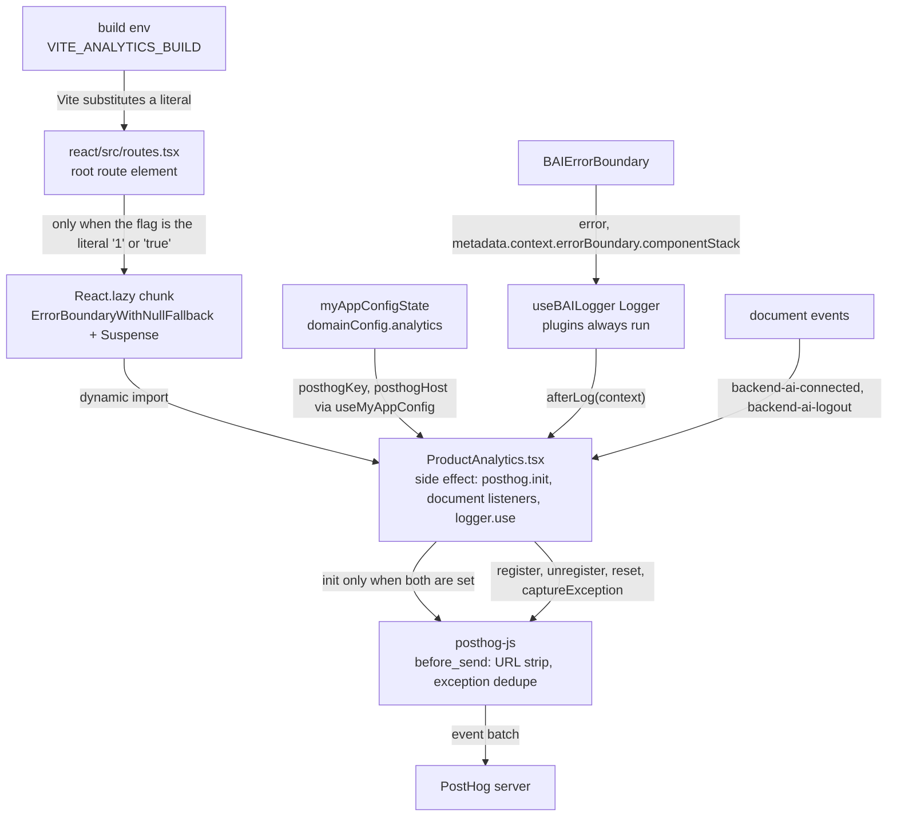

# 0036 — Build-time opt-in PostHog analytics

## Summary

> Unfamiliar terms are collected in the [Glossary](#glossary) at the end.

- The WebUI can send usage flows (time on each screen, clicks, exits) and errors to PostHog. That code is in the bundle only when the build sets `VITE_ANALYTICS_BUILD=1` (or `true`).
- A default build without the flag contains neither the analytics component nor `posthog-js`, and `grep -rli posthog react/build` finds nothing.
- In an [analytics build](#glossary), `ProductAnalytics` calls `posthog.init` only when the signed-in domain's app config `domainConfig.analytics` holds both `posthogKey` and `posthogHost`. The build itself carries no key and no host.
- The new runtime dependency is `posthog-js` in `react/package.json`, and ESLint `no-restricted-imports` blocks importing it outside `react/src/components/ProductAnalytics.tsx`.
- `useBAILogger` calls its [logger plugins](#glossary) in production builds too, and the plugin in `ProductAnalytics` sends ERROR logs to PostHog error tracking.

## Context

- **No usage data**: the WebUI records nothing about whether users get from the session launcher to running an app, or at which step they stop. The team learns of errors only when a user reports them.
- **Self-hosted customers**: the team ships a WebUI built from the same source to self-hosted and air-gapped customers. Those builds must not contain tracking code at all.
- **Per-domain choice**: one analytics build can serve several deployments and domains, and each decides on its own whether it is measured and where events go. The manager app config holds per-domain documents that the WebUI reads at sign-in (ADR 0033).
- **Electron**: the Electron app reuses the web bundle and opens the page from `file://app/index.html`. Cookies do not work on that origin.
- **Silent production logger**: `useBAILogger`'s `Logger` has `enabled` set to `false` in production, and the previous `logging()` returned before calling any plugin. In production a plugin attached with `logger.use()` therefore received no logs.
- **Precedent**: `VITE_REVIEW_OVERLAY_BUILD` in `react/src/routes.tsx` is a build-time opt-in of the same shape.

## Diagram

## Decision

### 1. Build flag

- **Literal comparison**: at module scope, `react/src/routes.tsx` creates `React.lazy(() => import('./components/ProductAnalytics'))` only when `import.meta.env.VITE_ANALYTICS_BUILD === '1' || import.meta.env.VITE_ANALYTICS_BUILD === 'true'`, and `null` otherwise. Rollup drops the dynamic import only when Vite has replaced the value with a literal, so the comparison is written inline, without a helper.
- **Mount point**: the element of the `/` route mounts `ProductAnalytics` inside `ErrorBoundaryWithNullFallback` and `Suspense fallback={null}`. The component waits for the app config (section 2), so screens before sign-in, the login screen included, are not collected.
- **Failure isolation**: `ProductAnalytics` renders `null`. When the chunk fails to load or init throws, `ErrorBoundaryWithNullFallback` empties only that spot.
- **Neutral file name**: the default build's source maps embed the source of `routes.tsx`. The analytics component's file name and symbol are therefore `ProductAnalytics`, which does not contain `posthog`.

### 2. Connection settings

| key                                  | meaning                                             |
| ------------------------------------ | --------------------------------------------------- |
| `domainConfig.analytics.posthogKey`  | PostHog project API key                             |
| `domainConfig.analytics.posthogHost` | PostHog API host, for example `https://posthog.example.com` |

- **Read location**: `ProductAnalytics` reads `useMyAppConfig('domainConfig', 'analytics')`, the merged `domainConfig` that sign-in stores in `myAppConfigState` (ADR 0033). It sends no query of its own.
- **Missing value**: while either value is empty, `ProductAnalytics` does not call `posthog.init`, and the SDK sends no request. This also holds before sign-in and when the app config read failed.
- **Act-as tab**: an act-as tab (`getActAsTarget()` is set) does not start the SDK either, as an act-as tab saves nothing in ADR 0035, so a super admin's impersonation is not counted and leaving act-as does not reset the distinct id the other tabs share.
- **Accepted values**: `posthogKey` must be a string and `posthogHost` an `https:` URL; any other value counts as missing.
- **Script execution**: `posthog-js` loads and runs scripts from `posthogHost` in the WebUI origin, and the production CSP's `'strict-dynamic'` allows any host. Write access to `domainConfig.analytics` therefore amounts to running script in every session of the domain.
- **Who sets it**: no WebUI page edits `analytics`. A superadmin writes it into the domain's `domainConfig` through the manager's app config API or CLI. `WebUISettingsPage` builds its `domainConfig` write on the raw document, so it keeps the key.
- **Readable by every user**: `myAppConfigs` answers `domainConfig` for every role, so every user of the domain can read the key and the host. A PostHog project API key is a public, write-only ingestion key, so this is acceptable; no other secret goes into `analytics`.
- **No secrets in the repository**: the repository is public, so no tracked file carries a real key or host as a default or an example.
- **CSP**: `posthog-js` sends events to `posthogHost` and loads its replay and exception-autocapture extension scripts from the same host. The CSP of the server that hosts an analytics build must allow that host in `connect-src`, and in `script-src` unless the policy uses `'strict-dynamic'`.

### 3. Import guard

- **ESLint rule**: `restrictedImportPatterns` in `react/eslint.config.js` blocks `posthog-js` and `posthog-js/*`. A block only for `src/components/ProductAnalytics.tsx` declares the rule again with `baseRestrictedImportPatterns`, which lacks that entry, and `restrictedImportPaths`.
- **Dependency**: `posthog-js` is in the `dependencies` of `react/package.json`, not in the catalog, and follows `minimumReleaseAge` in `pnpm-workspace.yaml`.

### 4. SDK configuration

| option                            | value                                                   | reason                                           |
| --------------------------------- | ------------------------------------------------------- | ------------------------------------------------ |
| `persistence`                     | `'localStorage'`                                        | cookies do not work on Electron's `file://`      |
| `person_profiles`                 | `'never'`                                               | no person profiles; `identify` is ignored        |
| `capture_pageview`                | `'history_change'`                                      | a pageview on every SPA route change             |
| `capture_pageleave`               | `true`                                                  | time on each screen                              |
| `autocapture`                     | `true`                                                  | clicks                                           |
| `disable_capture_url_hashes`      | `true`                                                  | URL fragments are not sent                       |
| `capture_exceptions`              | unhandled errors and unhandled rejections only          | console errors are not collected                 |
| `session_recording.maskAllInputs` | `true`                                                  | every input value is masked in replay            |
| `session_recording.maskTextSelector` | `'*'`                                                | every text node is masked in replay; some screens show secrets as text |
| `session_recording.maskAllElementAttributes` | `true`                                       | element attributes (`title`, `href`, `aria-label`, `data-*`) are masked in replay |
| `session_recording.maskCapturedNetworkRequestFn` | strips `?` and `#` from `name`             | replay page addresses and recorded request URLs lose their query and fragment |
| `before_send`                     | URL query and fragment removal, `$exception` dedupe     | sections 5 and 7                                 |

- **Platform property**: `ProductAnalytics` registers the super property `platform` (`web` or `electron`) from `globalThis.isElectron`.
- **Session replay**: `ProductAnalytics` neither turns replay on nor off. The SDK records only when the PostHog project's settings turn replay on, and input values and all text are masked even then, so a replay shows layout and pointer movement, not what the screen says.
- **Single start**: the module variable `isStarted` makes init, the `document` listener registration and `logger.use()` happen once, also under StrictMode's double effect run. None of the three is undone while the page lives. Sign-out reloads the page, so the next sign-in reads its domain's `analytics` afresh.

### 5. Privacy defaults

- **URL query and fragment**: `before_send` removes everything from `?` or `#` on in `$current_url`, `$referrer`, `$initial_current_url`, `$initial_referrer`, `$session_entry_url`, `$session_entry_referrer` and `$external_click_url` of `properties`, `$set` and `$set_once`, and in the same keys of each nested `$web_vitals_*_event` object. Replay page addresses go through `maskCapturedNetworkRequestFn` instead (section 4). A query can carry names and ids.
- **Secrets**: the SDK does not collect password inputs. Autocapture sends no input values and replay masks inputs, so the inputs for access keys, secret keys, SSH keys and tokens get no separate `ph-no-capture`. Secrets shown as text (a new keypair's secret key, deployment access tokens) carry the `ph-no-capture` class, so autocapture sends neither their text nor clicks on their copy control, and replay masks their text with all other text. A new screen that shows a secret as text adds the class.
- **Anonymous identity**: the account UUID and the domain must not leave the browser. `ProductAnalytics` therefore never calls `posthog.identify` and uses only the random anonymous distinct id the SDK creates.
- **Role property**: the only user value `ProductAnalytics` registers is the super property `role`, one of `superadmin`, `admin` and `user`, decided from `is_superadmin` and `is_admin` of `globalThis.backendaiclient`. `user_uuid` is read only to tell whether someone is signed in; `user_uuid`, `_config.domainName`, email and name are not registered as properties.
- **Role timing**: `ProductAnalytics` syncs `role` when it starts and on every `backend-ai-connected` event. Before sign-in it removes a `role` stored by an earlier page with `posthog.unregister('role')`.
- **Logout**: on the `backend-ai-logout` event, `posthog.reset()` clears the distinct id and `role`, so neither carries over to the next account signed in after a logout. The reset clears `platform` too, so it is registered again right away. A session that ends without that event (a closed browser, the Electron app-close cleanup, the expired-session re-login reload) keeps the stored distinct id, and the next account on that browser inherits it.

### 6. Logger plugin dispatch in production

- **Dispatch rule**: `logging()` in `packages/backend.ai-ui/src/hooks/useBAILogger.tsx` always calls `beforeLog`, `afterLog` and `onError`, and `enabled` gates only the console call. With no plugin and the console off, `logging()` returns at once. The production console stays quiet.
- **Render errors**: `onError` in `react/src/components/BAIErrorBoundary.tsx` logs the caught error with `logger.withContext('errorBoundary', { componentStack }).error(error)`.

### 7. Error reporting

- **Allow-list**: the plugin in `ProductAnalytics` picks the first `Error` among the arguments of an ERROR-level log, copies only its `name`, `message` and `stack` into a new `Error`, and passes that to `posthog.captureException`. ERROR logs without an `Error`, and the other arguments, are not sent.
- **Logger context**: the plugin sends the `metadata.context` object that `logger.withContext(key, value)` attached as the `logger_context` property. Values passed to `withContext` therefore carry no secrets.
- **Deduplication**: `before_send` sends a `$exception` event whose `$exception_list` type, value and stack frame positions match an earlier one at most once per five minutes per page load. The SDK's own exception rate limiter still applies.

## Rejected alternatives

- **Runtime flag only**: putting the SDK in every build and turning it on only through config keeps a single build. Self-hosted builds would keep tracking code, so this was rejected.
- **Build-time key and host**: `VITE_POSTHOG_KEY` and `VITE_POSTHOG_HOST` read at build time would also cover the login screen. Every deployment and domain would then share the build's one project, and changing it would need a rebuild, so they were replaced by the domain app config on 2026-11-22.
- **`publicConfigByDomain`**: the public document is readable before sign-in and would cover the login screen. The decision is per domain, and the domain document is the place a domain's own config lives, so the public one was not chosen.
- **Static import behind the flag**: importing `ProductAnalytics` statically and wrapping only the JSX in the flag is shorter. Rollup may keep the module and the initial bundle grows, so this was rejected.
- **Identify by user UUID**: `posthog.identify(user_uuid, { role, domain })` would allow per-user analysis across devices. The account UUID and the domain would leave the browser, so this was rejected.
- **Bundled SDK extensions**: `posthog-js/dist/module.full.no-external` bundles the replay and exception extensions so no external script is loaded. It is not a documented entry and more than doubles the chunk, so it was rejected.

## Consequences

- **Zero trace by default**: a default build holds no PostHog code or strings, so existing deployments do not change.
- **No rebuild to configure**: changing the key or the host is an app config write, applied at the next sign-in or page load. A domain without `analytics` sends nothing from an analytics build.
- **Login screen not collected**: events start after sign-in, so funnels that begin on the login screen cannot be measured.
- **Plugin cost in production**: once any plugin is attached, every log call builds a `LogContext` in production too. In a default build without plugins, `logging()` costs what it did before.
- **Duplicate dev console line**: in development, a render error `BAIErrorBoundary` catches is printed to the console once by React and once by `useBAILogger`.
- **Anonymous users only**: the same person on two browsers counts as two users, and per-user funnels across devices are not possible. Logging out also creates a new distinct id, so signing in again on the same browser counts as another user. Person properties and cohorts are unavailable, and analysis by role uses the event property.
- **Rendered values can still be captured**: autocapture's `$el_text` and `$elements_chain` (text and attributes such as `href` and `data-row-key`), and error messages can carry an email, a domain or a UUID shown on screen or returned by the server. Dropping `identify` does not prevent this; it needs separate measures.
- **Path segments stay**: `before_send` leaves the URL path alone, so path segments such as project names and deployment ids stay in events.
- **Minified stack traces**: `ProductAnalytics` uploads no source maps to PostHog. When PostHog cannot find the build's source maps, error stack traces point at minified positions.

## Sources

- GitHub: #10567.
- PostHog [JavaScript library config](https://posthog.com/docs/libraries/js/config), [self-host](https://posthog.com/docs/self-host).
- Decided 2026-10-27. Anonymous identity: 2026-11-01. Key and host moved to the domain app config: 2026-11-22.
- Related: [ADR 0033](0033-scoped-and-merged-app-config-hooks.md); the "Review overlay in a build (`VITE_REVIEW_OVERLAY_BUILD`)" section of `DEV_ENVIRONMENT.md` (a build-time opt-in of the same shape).

## Glossary

| term            | meaning                                                                                                                                                        |
| --------------- | -------------------------------------------------------------------------------------------------------------------------------------------------------------- |
| analytics build | A build made with `VITE_ANALYTICS_BUILD` set to `1` or `true`. It holds the `ProductAnalytics` chunk and `posthog-js`.                                          |
| logger plugin   | An object implementing `useBAILogger`'s `LoggerPlugin` interface, attached with `logger.use()`. It receives `beforeLog`, `afterLog` and `onError` for every log call. |
| super property  | A property registered with `posthog.register()` that is attached to every later event.                                                                        |
| autocapture     | The PostHog SDK feature that records DOM events such as clicks and form submits as events without code.                                                        |
