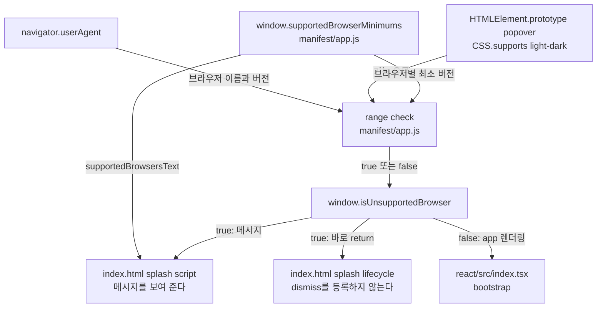

# 0037 — Supported browser range and the load block below it

> section 4의 "app을 로드하지 않는다"는 그래도 이용하기 경로를 더하는 [ADR 0038](0038-use-anyway-past-the-unsupported-browser-block.ko.md)이 일부 대체한다.

## Summary

> 낯선 용어는 문서 맨 아래 [용어](#용어)에 모아 두었다.

- WebUI는 Astryx Tier 2의 브라우저를 지원한다. Chrome 123+, Edge 123+, Safari 17.5+, Firefox 125+다.
- 이 범위보다 오래된 브라우저에서는 app을 로드하지 않는다. 로딩 splash가 화면에 남고, 지원하지 않는 브라우저라는 메시지와 지원 브라우저 목록을 보여 준다.
- 두 검사 중 하나라도 범위 밖이라고 하면 브라우저는 범위 밖이다. feature detection이 Popover API나 CSS `light-dark()`가 없다고 판정하거나, userAgent가 최소 버전보다 오래된 알려진 브라우저를 가리키는 경우다. Internet Explorer는 두 기능이 모두 없으므로 항상 범위 밖이다.
- Electron app은 자체 Chromium을 포함하므로 절대 차단하지 않는다.
- 최소 버전은 `manifest/app.js`의 `window.supportedBrowserMinimums` 표 하나에 둔다. userAgent 검사와 splash 메시지가 모두 이 표를 읽는다.

## Context

- **Astryx floor**: WebUI는 Astryx로 렌더링한다(ADR 0009). `ui-common docs browser-support`는 tier를 정의한다. Tier 1은 CSS anchor positioning이 있는 현재 Baseline이고, Tier 2는 Baseline에서 2년 전으로, Popover API와 `light-dark()`는 동작하고 anchor positioning만 없다. Tier 3는 best effort다. Astryx는 Tier 1과 Tier 2를 공식 지원한다.
- **Tier 2 versions**: Astryx는 Tier 2의 대표 버전으로 Chrome 114+, Edge 114+, Safari 17+, Firefox 125+를 적는다. 이 버전들은 Popover API 기준이다. 모든 theme 색이 컴파일되는 `light-dark()`는 Chrome과 Edge 123, Safari 17.5, Firefox 120에서 들어오므로, 두 기능이 모두 있는 floor는 Chrome 123, Edge 123, Safari 17.5, Firefox 125다.
- **Before this ADR**: 유일한 검사는 `manifest/app.js`의 userAgent 정규식 `(MSIE|Trident)`였고, 이 검사로 `index.html`이 `alert()`과 빨간 splash 문구를 보여 주었다. 다른 오래된 브라우저는 모두 app을 로드해 설명 없이 깨진 화면을 렌더링했고, 사용자는 이를 bug로 보고했다(#11379).
- **Build targets**: `react/vite.config.ts`는 `build.target`을 `es2020, edge88, firefox78, chrome87, safari14`로, `cssTarget`을 `chrome111, edge111, firefox114, safari16.4, ios16.4`로 둔다. `react/package.json`의 production browserslist는 `>0.2%, not dead, not op_mini all`이다. 모두 지원 범위와 같거나 더 낮으므로, 지원 브라우저가 실행할 수 있는 결과물을 컴파일한다.

## 설계도

## Decision

### 1. 지원 범위는 Astryx Tier 2다

- **Range**: Chrome 123+, Edge 123+, Safari 17.5+, Firefox 125+다. Popover API와 CSS `light-dark()`가 모두 있는 버전이다.
- **Anchor positioning**: Tier 2에는 CSS anchor positioning이 없으므로 tooltip, menu, popover가 trigger에서 떨어진 위치에 열릴 수 있다. WebUI는 이를 받아들이고 polyfill을 추가하지 않는다.
- **Moving the range**: Astryx가 Tier 2 floor를 올리면 section 3의 표와 사용자 매뉴얼의 설치 페이지를 같은 PR에서 바꾼다.

### 2. 검사는 두 가지이고, 하나라도 걸리면 차단한다

- **Feature detection**: `manifest/app.js`의 `lacksRequiredBrowserFeatures`는 `HTMLElement.prototype.hasOwnProperty('popover')`가 false이거나 `CSS.supports('color', 'light-dark(#000, #fff)')`가 false이면 기능이 없다고 보고한다.
- **userAgent check**: `identifyBrowser`가 브라우저와 버전을 읽고, `isUserAgentBelowSupportedRange`가 이를 표와 비교한다. `MSIE`나 `Trident`가 있는 UA는 어떤 패턴에도 맞지 않아 feature detection이 판정하고, 거기서 범위 밖이 된다. iPhone, iPad, iPod에서는 모든 iOS 브라우저가 시스템 WebKit을 쓰므로 iOS 버전을 버전으로 쓴다. 데스크톱 모드의 iOS 브라우저(Mac UA에 `CriOS/`, `FxiOS/`, `EdgiOS/`가 있는 경우)는 엔진과 무관한 고정 `Version/`을 보내므로 feature detection에 맡긴다. `Edg/`, `EdgA/`, legacy `Edge/`는 Edge이고, `Firefox/`는 Firefox다. 그 밖의 `Chrome/`이나 `Chromium/` UA(Samsung Internet, Opera 등)는 Chromium 버전으로 Chrome 행과 비교하고, `Version/… Safari/`는 Safari다.
- **Unknown UA**: parser가 알아보지 못한 UA는 userAgent 검사를 통과하고, feature detection만으로 판정한다.
- **Electron**: `isElectron()`이 true이면 두 검사를 실행하지 않고 `window.isUnsupportedBrowser`는 false가 된다.
- **Result**: 결과는 `window.isUnsupportedBrowser`에 담긴다. `manifest/app.js`는 다른 어떤 script보다 먼저 실행되고 ES5 문법과 `globalThis` 대신 `window`만 쓰므로, 거부해야 할 브라우저도 이 파일을 parse하고 실행할 수 있다.

### 3. 최소 버전은 표 하나에 둔다

| Browser | Minimum |
| ------- | ------- |
| Chrome  | 123     |
| Edge    | 123     |
| Safari  | 17.5    |
| Firefox | 125     |

- **Where**: `manifest/app.js`의 `window.supportedBrowserMinimums`이고, 브라우저 이름을 키로 하는 객체이고, 값은 `[17, 5]`처럼 숫자 배열이다.
- **Readers**: `isUserAgentBelowSupportedRange`가 이 표와 비교하고, 같은 스크립트가 이 표를 `window.supportedBrowsersText`인 splash에 보이는 `Chrome 123+, Edge 123+, Safari 17.5+, Firefox 125+` 목록으로 만든다. 코드 안에 버전의 다른 사본은 없다.

### 4. 범위보다 오래된 브라우저는 app을 로드하지 않는다

- **Splash message**: `index.html`에서 splash script 앞에 있는 `<script>`가 loader cube를 숨기고 `#loading-message`에 메시지를 쓴다. 메시지는 영어이고, `navigator.language`가 `ko`로 시작하면 한국어이며, 뒤에 지원 브라우저 목록이 붙는다. `alert()`은 띄우지 않는다.
- **Splash stays**: splash lifecycle script는 `__dismissSplash`, `__enterLoginBackdrop`, fallback timer를 정의하기 전에 return하므로, 아무것도 splash를 제거하지 않는다.
- **App does not start**: `react/src/index.tsx`는 `window.isUnsupportedBrowser`가 false일 때만 `bootstrap()`을 실행한다. `bootstrap()`은 theme config를 로드하고, title을 정하고, act-as handoff를 받아들이고, React root를 렌더링한다. entry module의 static import는 그래도 평가된다. bundle을 parse하지 못하는 브라우저는 거기서 아무 영향 없이 멈춘다.

### 5. build target은 범위보다 적게 약속하지 않는다

- **Rule**: `react/vite.config.ts`의 `build.target`, `cssTarget`과 `react/package.json`의 production browserslist는 지원 범위와 같거나 더 낮게 유지하므로, 결과물은 모든 지원 브라우저에서 실행된다. 이 중 하나를 표의 어떤 행보다 높이려면 그 행을 먼저 올린다.

## 대안과 기각 사유

- **Warn with a dismissible banner and load anyway**: 사용자가 오래된 브라우저에서 계속 쓸 수 있다. Tier 2 아래에서는 theme 색과 layered surface가 깨져 사용자가 WebUI bug처럼 보이는 화면에 도달하므로 기각한다. 이 ADR이 답하는 보고가 바로 그것이다.
- **Feature detection only**: Astryx가 권장하고 버전 표가 필요 없다. 브라우저가 기능을 일부만 또는 버그가 있는 형태로 노출할 수 있고, splash가 사용자가 따를 수 있는 구체적 버전을 보여 주어야 하므로 유일한 검사로는 기각한다.
- **userAgent check only**: 단순하고 버전을 직접 보여 준다. UA는 알 수 없거나 위조될 수 있고, 그래도 feature detection이 기능이 없는 브라우저를 잡으므로 유일한 검사로는 기각한다.
- **An operator setting in `config.toml`**: operator가 범위를 완화할 수 있다. 범위는 site 정책이 아니라 Astryx가 렌더링하는 데 필요한 것에서 나오므로 기각한다.
- **Astryx's representative Tier 2 versions (Chrome 114, Safari 17)**: Astryx 표와 일치한다. 이 버전들에는 `light-dark()`가 없고 Tier 2는 두 기능이 모두 있는 것으로 정의되므로 기각한다.

## Consequences

- **Clear failure**: 오래된 브라우저의 사용자는 깨진 화면 대신 WebUI가 로드되지 않는 이유와 써야 할 버전을 본다.
- **One place to update**: 범위를 바꿀 때는 표와 매뉴얼을 고친다. 검사와 splash 문구는 표를 따른다.
- **Feature detection overrides a new UA**: UA가 최소 버전을 넘더라도 기능 중 하나가 없는 브라우저는 차단된다.
- **Partial early evaluation**: bundle을 parse할 수 있는 차단된 브라우저에서는 `global-stores.ts` 같은 entry module의 import가 그래도 평가된다. 건너뛰는 것은 `bootstrap()` 안의 단계뿐이다.
- **Unverified on real browsers**: 검출은 기능을 stub한 채 userAgent 문자열로 `manifest/app.js`를 평가해 시험했고, 설치된 오래된 브라우저에서는 시험하지 않았다.

## 출처

- GitHub issue: #11379.
- `pnpm exec ui-common docs browser-support --full` (Astryx browser support tier).
- Popover API와 CSS `light-dark()`의 MDN 브라우저 호환성 데이터.
- `manifest/app.js`, `index.html`, `react/src/index.tsx`, `react/vite.config.ts`, `react/package.json`.
- 결정일: 2026-11-23.
- 관련: [ADR 0009](0009-ui-common-as-the-single-entry-point-to-astryx.ko.md)는 `@lablup/ui-common`을 거친 Astryx를 WebUI의 유일한 component system으로 정한다.

## 용어

| 용어              | 뜻                                                                                                                            |
| ----------------- | ----------------------------------------------------------------------------------------------------------------------------- |
| Astryx Tier 2     | Astryx Tier 2는 Popover API와 CSS `light-dark()`는 동작하지만 CSS anchor positioning은 동작하지 않는 브라우저의 집합이다.     |
| Popover API       | Popover API는 `popover` 속성 뒤의 브라우저 기능으로, layer를 top layer에 올리고 바깥을 클릭하면 닫는다.                       |
| `light-dark()`    | `light-dark()`는 요소의 color scheme에 따라 두 색 중 하나를 고르는 CSS 함수이고, 모든 Astryx theme 색이 이 함수로 컴파일된다. |
| feature detection | feature detection은 브라우저의 이름과 버전을 읽는 대신, API나 CSS 값을 제공하는지 runtime에 확인하는 것이다.                  |
| loading splash    | loading splash는 React app이 로드되는 동안 보이는 `index.html`의 `#splash` 화면이다.                                          |
