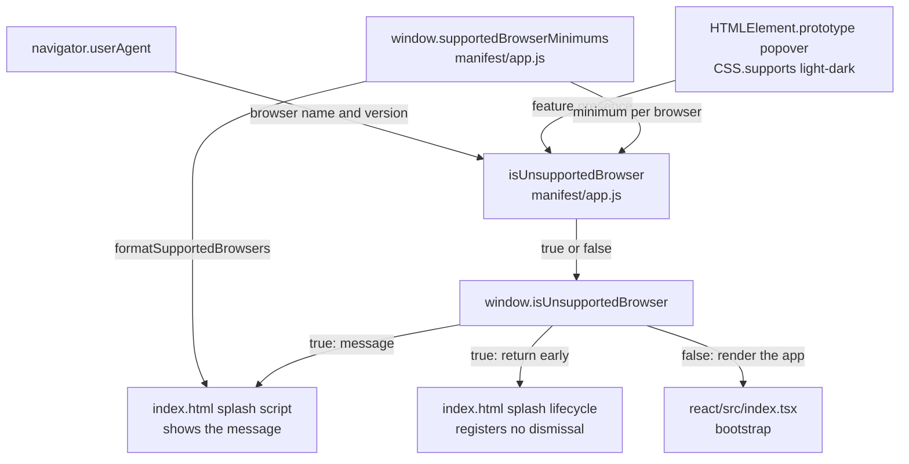

# 0037 — Supported browser range and the load block below it

## Summary

> Unfamiliar terms are collected in the [Glossary](#glossary) at the end.

- The WebUI supports the browsers of Astryx Tier 2: Chrome 123+, Edge 123+, Safari 17.5+ and Firefox 125+.
- A browser below that range does not load the app. The loading splash stays on screen with a message that the browser is not supported and the list of supported browsers.
- A browser is below the range when either check says so: feature detection finds the Popover API or CSS `light-dark()` missing, or the userAgent names a known browser older than its minimum version. Internet Explorer is always below the range.
- The Electron app is never blocked, because it ships its own Chromium.
- The minimum versions live in one table, `window.supportedBrowserMinimums` in `manifest/app.js`. The userAgent check and the splash message both read it.

## Context

- **Astryx floor**: The WebUI renders through Astryx (ADR 0009). `ui-common docs browser-support` defines tiers: Tier 1 is the current Baseline with CSS anchor positioning, Tier 2 is Baseline minus two years, where the Popover API and `light-dark()` work and only anchor positioning is missing, and Tier 3 is best effort. Astryx officially supports Tier 1 and Tier 2.
- **Tier 2 versions**: Astryx lists Chrome 114+, Edge 114+, Safari 17+ and Firefox 125+ as representative Tier 2 versions. Those are the Popover API versions. `light-dark()`, which every theme color compiles to, arrives in Chrome and Edge 123, Safari 17.5 and Firefox 120, so the floor where both features exist is Chrome 123, Edge 123, Safari 17.5 and Firefox 125.
- **Before this ADR**: The only check was the userAgent regex `(MSIE|Trident)` in `manifest/app.js`, which made `index.html` show an `alert()` and a red splash line. Every other old browser loaded the app and rendered a broken screen with no explanation, which users reported as a bug (#11379).
- **Build targets**: `react/vite.config.ts` sets `build.target` to `es2020, edge88, firefox78, chrome87, safari14` and `cssTarget` to `chrome111, edge111, firefox114, safari16.4, ios16.4`. The production browserslist in `react/package.json` is `>0.2%, not dead, not op_mini all`. All of them are at or below the supported range, so they compile output the supported browsers can run.

## Diagram

## Decision

### 1. The supported range is Astryx Tier 2

- **Range**: Chrome 123+, Edge 123+, Safari 17.5+ and Firefox 125+, the versions where both the Popover API and CSS `light-dark()` exist.
- **Anchor positioning**: Tier 2 lacks CSS anchor positioning, so a tooltip, menu or popover can open away from its trigger. The WebUI accepts that and adds no polyfill.
- **Moving the range**: When Astryx advances its Tier 2 floor, the table in section 3 and the user manual's installation page change in the same PR.

### 2. Two checks; either one blocks

- **Feature detection**: `lacksRequiredBrowserFeatures` in `manifest/app.js` reports a missing feature when `HTMLElement.prototype.hasOwnProperty('popover')` is false or `CSS.supports('color', 'light-dark(#000, #fff)')` is false.
- **userAgent check**: `identifyBrowser` reads the browser and its version, and `isUserAgentBelowSupportedRange` compares it with the table. A UA with `MSIE` or `Trident` is Internet Explorer and is always below the range. On iPhone, iPad and iPod the version is the iOS version, because every iOS browser uses the system WebKit. `Edg/`, `EdgA/` and legacy `Edge/` are Edge; `Firefox/` is Firefox; any other `Chrome/` or `Chromium/` UA, such as Samsung Internet or Opera, is checked by its Chromium version against the Chrome row; `Version/… Safari/` is Safari.
- **Unknown UA**: A UA the parser does not recognise passes the userAgent check, and only feature detection decides.
- **Electron**: `isUnsupportedBrowser` returns false when `isElectron()` is true, before either check runs.
- **Result**: `window.isUnsupportedBrowser` holds the result. `manifest/app.js` runs before any other script and uses only ES5 syntax and `window` instead of `globalThis`, so the browsers it must reject can still parse and run it.

### 3. One table holds the minimum versions

| Browser | Minimum |
| ------- | ------- |
| Chrome  | 123     |
| Edge    | 123     |
| Safari  | 17.5    |
| Firefox | 125     |

- **Where**: `window.supportedBrowserMinimums` in `manifest/app.js`, an array of `{ name, version }` where `version` is an array of numbers such as `[17, 5]`.
- **Readers**: `isUserAgentBelowSupportedRange` compares against it, and `formatSupportedBrowsers` turns it into the `Chrome 123+, Edge 123+, Safari 17.5+, Firefox 125+` list the splash shows. No other copy of the versions exists in code.

### 4. A browser below the range does not load the app

- **Splash message**: A `<script>` in `index.html` before the splash script hides the loader cube and writes the message into `#loading-message`: English, or Korean when `navigator.language` starts with `ko`, followed by the supported browser list. It shows no `alert()`.
- **Splash stays**: The splash lifecycle script returns before it defines `__dismissSplash`, `__enterLoginBackdrop` or its fallback timers, so nothing removes the splash.
- **App does not start**: `react/src/index.tsx` runs `bootstrap()`, which loads the theme config, sets the title, adopts the act-as handoff and renders the React root, only when `window.isUnsupportedBrowser` is false. The entry module's static imports still evaluate; a browser that cannot parse the bundle stops there without effect.

### 5. Build targets do not promise less than the range

- **Rule**: `build.target`, `cssTarget` in `react/vite.config.ts` and the production browserslist in `react/package.json` stay at or below the supported range, so the output runs on every supported browser. Raising one of them above a row of the table requires raising that row first.

## Rejected alternatives

- **Warn with a dismissible banner and load anyway**: it lets a user continue on an old browser. It is rejected because below Tier 2 theme colors and layered surfaces break, so the user reaches a screen that looks like a WebUI bug, which is the report this ADR answers.
- **Feature detection only**: Astryx recommends it and it needs no version table. It is rejected as the only check because a browser can expose a feature in a partial or buggy form, and because the splash must name concrete versions a user can act on.
- **userAgent check only**: it is simple and names versions directly. It is rejected as the only check because a UA can be unknown or spoofed, and feature detection still catches a browser missing the features.
- **An operator setting in `config.toml`**: it would let an operator relax the range. It is rejected because the range follows from what Astryx needs to render, not from a site policy.
- **Astryx's representative Tier 2 versions (Chrome 114, Safari 17)**: they match the Astryx table. They are rejected because those versions lack `light-dark()`, and Tier 2 is defined by both features being present.

## Consequences

- **Clear failure**: A user on an old browser sees why the WebUI does not load and which versions to use, instead of a broken screen.
- **One place to update**: A range change edits the table and the manual; the check and the splash text follow the table.
- **Feature detection overrides a new UA**: A browser whose UA meets the minimum but lacks one of the features is still blocked.
- **Partial early evaluation**: On a blocked browser that can parse the bundle, the entry module's imports, such as `global-stores.ts`, still evaluate. Only the steps inside `bootstrap()` are skipped.
- **Unverified on real browsers**: The detection was tested by evaluating `manifest/app.js` against userAgent strings with stubbed features, not on installed old browsers.

## Sources

- GitHub issue: #11379.
- `pnpm exec ui-common docs browser-support --full` (Astryx browser support tiers).
- MDN browser compatibility data for the Popover API and CSS `light-dark()`.
- `manifest/app.js`, `index.html`, `react/src/index.tsx`, `react/vite.config.ts` and `react/package.json`.
- Decided: 2026-11-23.
- Related: [ADR 0009](0009-ui-common-as-the-single-entry-point-to-astryx.md) makes Astryx, through `@lablup/ui-common`, the WebUI's only component system.

## Glossary

| Term              | Meaning                                                                                                                                    |
| ----------------- | ------------------------------------------------------------------------------------------------------------------------------------------ |
| Astryx Tier 2     | Astryx Tier 2 is the set of browsers where the Popover API and CSS `light-dark()` work but CSS anchor positioning does not.                |
| Popover API       | The Popover API is the browser feature behind the `popover` attribute, which puts a layer in the top layer and closes it on outside click. |
| `light-dark()`    | `light-dark()` is a CSS function that picks one of two colors by the element's color scheme; every Astryx theme color compiles to it.      |
| feature detection | Feature detection is checking at runtime whether the browser provides an API or CSS value, instead of reading its name and version.        |
| loading splash    | The loading splash is the `#splash` screen in `index.html` that shows while the React app loads.                                           |
