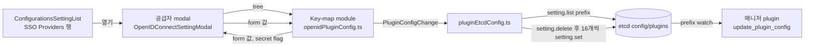

# 0038 — Manager plugin settings through raw etcd with write-only secrets

## Summary

> 낯선 용어는 문서 맨 아래 [용어](#용어)에 모아 두었다.

- WebUI는 SSO 공급자 같은 매니저 plugin의 설정을, superadmin 전용 `/config/get|set|delete` API(`baiClient.setting`)로 etcd의 [plugin config tree](#용어)를 읽고 써서 편집한다.
- plugin 설정의 etcd 접근은 모두 `react/src/pages/WebUISettingsPage/helper/pluginEtcdConfig.ts`를 거친다. 공급자마다 그 옆에 key-map module 하나를 두고, 이 module이 tree를 form 값으로, form 값을 `PluginConfigChange`로 바꾼다.
- secret leaf는 쓰기 전용이다. 편집기는 값이 설정되었는지만 보여 주고 값 자체는 보여 주지 않으며, 빈 칸으로 두면 저장된 값을 유지한다.
- 모든 편집기는 시스템 설정 Configurations 탭의 "SSO Providers" 그룹에 행 하나로 놓이고, 자기 modal을 열며, 매니저에 plugin이 설치되어 있어야 한다고 알린다.
- WebUI는 값의 형태(URL, 필수 key)만 검사한다. 연결을 시험하거나 어떤 plugin이 설치되었는지 알아내지 않는다.

## Context

- **Plugin settings**: 매니저의 SSO 연동은 plugin이다. OpenID Connect는 매니저에 들어 있고(`ai/backend/manager/plugin/openid/`), SAML과 LDAP는 별도 plugin(`backend.ai-saml-plugin`, `backend.ai-ldap-plugin`)이다. 각 plugin은 etcd prefix `config/plugins/<group>/<name>/`에서 설정을 읽고(`ai/backend/common/plugin/__init__.py`), prefix가 바뀌면 다시 읽는다. `require_explicit_allow`인 plugin은 매니저의 plugin allowlist에 이름이 있어야만 로드되고, OpenID Connect의 엔드포인트처럼 plugin이 시작할 때만 읽는 key도 있다. SAML과 LDAP의 root는 #9774에 적혀 있다.
- **Raw etcd API**: `POST /config/get`, `/config/set`, `/config/delete`는 superadmin 전용이고 etcd key를 그대로 다룬다(`manager/api/rest/etcd/handler.py`). WebUI는 이미 `baiClient.setting`으로 이 API를 써서 이미지 pull 방식, overlay network MTU, scheduler 옵션을 편집한다.
- **String leaves**: etcd는 모든 값을 문자열로 저장한다. prefix 읽기는 매니저가 key를 unquote한 중첩 객체를 돌려준다(`make_dict_from_pairs`). prefix이기도 한 key의 자기 값은 `''` 아래에 들어간다.
- **Write limit**: 중첩 객체를 넘긴 `/config/set` 호출 한 번은 leaf를 transaction 하나로 쓰고, leaf가 16개를 넘으면 거부한다. 매니저는 이 객체의 key를 quote하지 않는다.
- **Plaintext secrets**: `/config/get`은 client secret, 서명 key, bind 비밀번호를 평문으로 돌려준다. 설치된 plugin 목록을 주는 API도, 공급자 연결을 시험하는 API도 없다.
- **Login buttons**: 로그인 페이지가 어떤 SSO 버튼을 보여 줄지는 별도 WebUI 설정 `singleSignOnVendors`(ADR 0028)가 정하며, plugin 설정에 속하지 않는다.

## 설계도

## Decision

### 1. plugin 설정의 etcd 접근은 helper 하나가 맡는다

- **Module**: `react/src/pages/WebUISettingsPage/helper/pluginEtcdConfig.ts`가 `readPluginConfig(client, root)`, `applyPluginConfigChange(client, change)`, `emptyPluginConfigChange`, `isPluginConfigChangeEmpty`, `getPluginConfigLeaf`, `getPluginConfigSubtree`, `quotePluginConfigKey`, `isHttpUrl`과 type `PluginConfigTree`, `PluginConfigChange`, `PluginSettingClient`, `PluginSecretStatus`를 export한다. 두 공급자가 함께 쓰는 코드는 key-map module이 아니라 여기에 둔다. component는 plugin 설정을 위해 `baiClient.setting`을 직접 부르지 않는다.
- **Paths**: `root`는 `<group>/<name>` 형식이며, 예를 들어 `webapp/openid`이다. `PluginConfigChange`의 경로는 모두 `config/plugins/` 기준 상대 경로이고 `/`로 구분한다.
- **Change shape**: `PluginConfigChange`는 `{ set: Record<string, string>; remove: string[]; removeTree: string[] }`이다. `applyPluginConfigChange`는 `removeTree`의 각 subtree를 지우고(끝에 `/`를 붙인 prefix 삭제), 이어서 `remove`의 각 key를 지운 뒤, `set`을 leaf 16개 이하의 `/config/set` 호출로 나누어 쓴다.
- **Lists**: `group_order`나 `allowed_redirect_hosts`처럼 plugin이 쉼표 구분으로 읽는 목록은 쉼표로 구분한 문자열 하나로 쓰므로, 사용자가 입력하는 항목에는 쉼표가 들어갈 수 없다.
- **User-supplied key segments**: IdP 그룹 ID처럼 사용자 입력에서 온 key segment는 `quotePluginConfigKey`(`encodeURIComponent`)로 quote하며, 매니저가 읽을 때 unquote한다. `group_order`의 ID처럼 같은 값을 leaf 안에 쓸 때는 quote하지 않는다.

### 2. 공급자마다 key-map module 하나

| 공급자 | Module | etcd root |
| --- | --- | --- |
| OpenID Connect | `helper/openidPluginConfig.ts` | `webapp/openid`, `hook/openid` |

- **Read**: `read<Provider>StoredConfig(...trees)`는 `{ values, secrets, isEmpty }`를 돌려준다. secret을 뺀 form 값, secret leaf마다 flag 또는 `PluginSecretStatus` 하나, plugin에 key가 하나도 없는지 여부이다. modal은 `useSuspenseTanQuery`의 `queryFn`(key `['plugin-config', <name>]`, `staleTime`과 `gcTime` 0)에서 tree를 읽고 이 결과만 돌려주므로, secret 값은 query cache에도 form에도 들어가지 않는다.
- **Write**: `build<Provider>ConfigChange(values, stored)`는 읽어 둔 값을 form 값으로 바꾸는 `PluginConfigChange`를 돌려준다. 바뀌지 않은 key는 쓰지 않고, 비운 선택 key는 지우며, `group_mapping`처럼 목록을 나타내는 subtree는 통째로 바꾼다.
- **Key names**: module은 plugin 자신의 config model(OpenID Connect는 `ai/backend/manager/plugin/openid/config.py`)을 따르고, module header에 그 파일을 적는다.

### 3. secret leaf는 쓰기 전용이다

- **Display**: secret field는 빈 password input(PEM key는 빈 text area)으로 그리고, 그 아래에 "설정됨" 또는 "설정 안 됨"을 보여 준다. 저장된 값은 field에 넣지 않는다.
- **Blank keeps**: secret field를 비워 두면 저장된 값이 바뀌지 않는다. field는 저장된 값이 없을 때만 필수이다.
- **Linked copies**: 두 plugin 부분이 secret 하나를 공유해야 하면 field 하나가 둘 다 쓰고, 저장된 두 값 중 하나만 설정되어 있거나 두 값이 다르면 `mismatch`로 읽어 새 값을 요구한다. OpenID Connect의 토큰 서명 `secret`은 `webapp/openid`와 `hook/openid` 양쪽에 있다.
- **Exclusive credentials**: plugin이 두 credential 중 정확히 하나만 받으면, 저장할 때 고른 쪽이 아닌 credential의 key를 지운다. OpenID Connect의 `client_secret`과, `private_key`와 `certificate`의 쌍이 이렇게 동작한다. `client_assertion_alg`는 개인 키에 속하므로 개인 키와 함께 지운다.

### 4. 배치와 범위

- **Placement**: 공급자마다 `ConfigurationsSettingList`(시스템 설정, Configurations 탭)의 `settings-sso` 그룹에 행 하나를 두며, 이 탭은 superadmin 전용이다. 행의 버튼이 공급자 modal을 연다. 그룹 설명은 시스템 설정 탭의 `singleSignOnVendors` 설정으로 링크한다.
- **Installation notice**: WebUI가 plugin 설치 여부를 알 수 없으므로, 모든 modal은 매니저에 plugin이 설치되고 허용되어 있어야 한다고 알리고, plugin이 시작할 때만 읽어 매니저 재시작이 필요한 key를 알린다.
- **Validation**: field는 형태만 검사한다. http(s) URL, 필수 key, 함께 있어야 하는 key를 본다. 어떤 편집기도 ID 공급자에 접속하지 않는다.

## 대안과 기각 사유

- **App config documents**: 공급자 설정을 매니저 app config(ADR 0028)에 두고 plugin이 거기서 읽게 한다. WebUI 전체가 설정 저장소 하나를 쓴다. 기각한다. plugin은 etcd만 읽으므로 plugin마다 매니저 변경이 필요하고, app config 문서는 superadmin이 아닌 사용자도 읽을 수 있다.
- **Round-trip secrets**: 저장된 secret을 form에 불러오고, 저장할 때 tree 전체를 다시 쓴다. 저장 로직이 tree put 한 번으로 끝난다. 기각한다. modal을 여는 사람마다 페이지에서 secret을 보게 되고, 오래된 탭이 예전 secret을 다시 쓴다.
- **Generic key-value editor**: `config/plugins` 아래 key를 key-value 쌍으로 늘어놓는 편집기 하나를 둔다. key map 없이 모든 plugin을 다룬다. 기각한다. secret을 가리거나, URL을 검사하거나, 연결된 key와 배타적인 key를 일관되게 유지할 수 없다.
- **One set per leaf**: key마다 `/config/set`을 따로 부른다. 16개 제한과 key quote를 피한다. 기각한다. 쓸 때마다 plugin의 config watcher가 깨어나, 편집기 하나가 plugin에 불완전한 설정을 여러 번 연달아 보낸다.

## Consequences

- **SAML and LDAP**: SAML(`webapp/saml`)이나 LDAP(`hook/ldap`)를 더하려면 key-map module 하나, modal 하나, 행 하나를 추가한다. 그 plugin의 config model을 보고 작성한다.
- **Browser exposure**: `/config/get`은 여전히 secret 값을 브라우저로 보낸다. 편집기는 그 값이 cache나 form에 닿기 전에 버릴 뿐이다. network에서도 감추려면 key 존재 여부만 돌려주는 매니저 API가 필요하다.
- **Partial configs**: leaf 16개를 넘거나 쓰기 전에 지우는 저장은 중간 상태를 거치고, plugin의 watcher는 그 상태를 하나하나 본다. 잘못된 상태는 검증에 실패하고 plugin은 이전 설정을 유지한다. 지운 뒤 쓰기 전의 빈 그룹 매핑처럼 유효한 상태는 그 순간 동안 적용된다.
- **Version drift**: plugin config model은 plugin과 함께 버전이 매겨진다. 설치된 plugin이 모르는 key는 그 pydantic model이 추가 key를 막지 않으므로 무시된다. WebUI가 모르는 key는 편집기가 자기가 매핑한 key만 쓰므로 남지만, `group_mapping`처럼 통째로 바꾸는 subtree 안의 key는 예외이다.
- **No installation check**: 관리자는 설치되지 않은 plugin의 설정도 저장할 수 있다. plugin이 설치되기 전까지 아무도 그 값을 읽지 않는다.

## 출처

- #9774 (FR-4001의 클론), 2026-11-18 결정.
- Backend.AI 저장소의 `ai/backend/manager/plugin/openid/config.py`, `ai/backend/manager/plugin/openid/webapp.py`, `ai/backend/manager/api/rest/etcd/handler.py`, `ai/backend/manager/services/etcd_config/service.py`, `ai/backend/common/etcd.py`, `ai/backend/common/plugin/__init__.py`.
- 관련: [ADR 0028](0028-webui-settings-in-the-app-config-settings-key.ko.md).

## 용어

| 용어 | 뜻 |
| --- | --- |
| plugin config tree | plugin 하나의 etcd prefix `config/plugins/<group>/<name>/` 아래 key들이며, 문자열로 된 중첩 객체 하나로 읽힌다. `<group>`은 `webapp`이나 `hook` 같은 plugin 종류이다. |
| secret leaf | client secret, 개인 키, 서명 secret, bind 비밀번호처럼 값이 접근 권한을 주는 plugin config key이다. |
