# 0038 — Manager plugin settings through raw etcd with write-only secrets

## Summary

> Unfamiliar terms are collected in the [Glossary](#glossary) at the end.

- The WebUI edits a manager plugin's settings, such as an SSO provider's, by reading and writing its [plugin config tree](#glossary) in etcd through the superadmin `/config/get|set|delete` API (`baiClient.setting`).
- All etcd access for plugin settings goes through `react/src/pages/WebUISettingsPage/helper/pluginEtcdConfig.ts`. Each provider gets one key-map module beside it that converts the tree to form values and the form values to a `PluginConfigChange`.
- A secret leaf is write-only: the editor shows only whether it is set, never its value, and a blank field keeps the stored value.
- Every editor appears as a row in the "SSO Providers" group of the System Settings Configurations tab, opens its own modal, and says that the plugin must be installed on the manager.
- The WebUI validates only the shape of the values (URLs, required keys). It does not test a connection or detect which plugins are installed.

## Context

- **Plugin settings**: The manager's SSO integrations are plugins: OpenID Connect ships with the manager (`ai/backend/manager/plugin/openid/`), SAML and LDAP ship as separate plugins (`backend.ai-saml-plugin`, `backend.ai-ldap-plugin`). Each reads its settings from the etcd prefix `config/plugins/<group>/<name>/` (`ai/backend/common/plugin/__init__.py`) and re-reads it when the prefix changes. A plugin with `require_explicit_allow` loads only when the manager's plugin allowlist names it, and some keys, such as OpenID Connect's endpoints, are read only when the plugin starts. The SAML and LDAP roots are listed in #9774.
- **Raw etcd API**: `POST /config/get`, `/config/set` and `/config/delete` are superadmin-only and act on raw etcd keys (`manager/api/rest/etcd/handler.py`). The WebUI already uses them through `baiClient.setting` for the image pull behavior, the overlay network MTU and the scheduler options.
- **String leaves**: etcd stores every value as a string. A prefix read returns a nested object whose keys the manager has unquoted (`make_dict_from_pairs`); a key that is also a prefix keeps its own value under `''`.
- **Write limit**: One `/config/set` call with a nested object writes its leaves in one transaction and rejects more than 16 leaves. The manager does not quote the keys of that object.
- **Plaintext secrets**: `/config/get` returns client secrets, signing keys and bind passwords as plaintext. No plugin API lists the installed plugins, and no API tests a provider connection.
- **Login buttons**: Which SSO buttons the login page shows is a separate WebUI setting, `singleSignOnVendors` (ADR 0028), and is not part of the plugin's settings.

## Diagram

```mermaid
flowchart LR
  row["ConfigurationsSettingList<br/>SSO Providers row"] -- "open" --> modal["Provider modal<br/>OpenIDConnectSettingModal"]
  modal -- "trees" --> keymap["Key-map module<br/>openidPluginConfig.ts"]
  keymap -- "form values, secret flags" --> modal
  modal -- "form values" --> keymap
  keymap -- "PluginConfigChange" --> helper["pluginEtcdConfig.ts"]
  helper -- "setting.list prefix" --> etcd[("etcd config/plugins")]
  helper -- "setting.delete, then setting.set chunks of 16" --> etcd
  etcd -- "prefix watch" --> plugin["Manager plugin<br/>update_plugin_config"]
```

## Decision

### 1. One helper owns etcd access for plugin settings

- **Module**: `react/src/pages/WebUISettingsPage/helper/pluginEtcdConfig.ts` exports `readPluginConfig(client, root)`, `applyPluginConfigChange(client, change)`, `emptyPluginConfigChange`, `isPluginConfigChangeEmpty`, `getPluginConfigLeaf`, `getPluginConfigSubtree`, `quotePluginConfigKey`, `isHttpUrl`, and the types `PluginConfigTree`, `PluginConfigChange`, `PluginSettingClient` and `PluginSecretStatus`. Code shared by two providers goes here, not in a key-map module. A component never calls `baiClient.setting` for plugin settings directly.
- **Paths**: A `root` is `<group>/<name>`, for example `webapp/openid`. Every path in a `PluginConfigChange` is relative to `config/plugins/`, separated by `/`.
- **Change shape**: `PluginConfigChange` is `{ set: Record<string, string>; remove: string[]; removeTree: string[] }`. `applyPluginConfigChange` deletes each `removeTree` subtree (prefix delete with a trailing `/`), then each `remove` key, then writes `set` in `/config/set` calls of at most 16 leaves each.
- **Lists**: A list the plugin reads as comma-separated, such as `group_order` or `allowed_redirect_hosts`, is written as one comma-separated string, so an item the user types may not contain a comma.
- **User-supplied key segments**: A key segment that comes from user input, such as an IdP group ID, is quoted with `quotePluginConfigKey` (`encodeURIComponent`), which the manager unquotes on read. The same value written inside a leaf, such as an ID in `group_order`, stays unquoted.

### 2. One key-map module per provider

| Provider | Module | etcd roots |
| --- | --- | --- |
| OpenID Connect | `helper/openidPluginConfig.ts` | `webapp/openid`, `hook/openid` |

- **Read**: `read<Provider>StoredConfig(...trees)` returns `{ values, secrets }` plus whatever raw non-secret leaves the diff needs: the form values without secrets, and one flag or `PluginSecretStatus` per secret leaf. The modal reads the trees in the `useSuspenseTanQuery` `queryFn` (key `['plugin-config', <name>]`) and returns only this result, so secret values never enter the query cache or the form. Suspense raises `staleTime` and `gcTime` to at least 1 s, so the modal removes the query when it unmounts and refetches after a failed save, and the next diff never runs against an old snapshot.
- **Write**: `build<Provider>ConfigChange(values, stored)` returns the `PluginConfigChange` that turns what was read into the form values. An unchanged key is not written, a cleared optional key is removed, and a subtree that represents a list, such as `group_mapping`, is replaced whole.
- **Key names**: The module follows the plugin's own config model (for OpenID Connect, `ai/backend/manager/plugin/openid/config.py`) and the module header names it.

### 3. Secret leaves are write-only

- **Display**: A secret field renders as an empty password input (or an empty text area for a PEM key) with "set" or "not set" beneath it. The stored value is never placed in a field.
- **Blank keeps**: A blank secret field leaves the stored value unchanged. The field is required only while no value is stored.
- **Linked copies**: When two plugin parts must share a secret, one field writes both, and a stored pair where only one copy is set, or the two differ, reads as `mismatch`, which requires a new value. OpenID Connect's token signing `secret` lives in both `webapp/openid` and `hook/openid`.
- **Exclusive credentials**: When a plugin accepts exactly one of two credentials, choosing one removes the other's keys on save. OpenID Connect's `client_secret` and `private_key` with `certificate` work this way; `client_assertion_alg` belongs to the private key and is removed with it.

### 4. Placement and scope

- **Placement**: Each provider is one row in the `settings-sso` group of `ConfigurationsSettingList` (System Settings, Configurations tab), which is superadmin-only. The row's button opens the provider's modal. The group description links to the `singleSignOnVendors` setting on the System Settings tab.
- **Installation notice**: Every modal states that the plugin must be installed and allowed on the manager, because the WebUI cannot detect it, and names the keys the plugin reads only at start, which need a manager restart.
- **Validation**: Fields are checked for shape only: http(s) URLs, required keys, and keys required together. No editor contacts the identity provider.

## Rejected alternatives

- **App config documents**: Store provider settings in the manager app config (ADR 0028) and have the plugins read them there. One settings store would serve the whole WebUI. Rejected: the plugins read only etcd, so this needs a manager change for every plugin, and app config documents are readable by more than superadmins.
- **Round-trip secrets**: Load the stored secrets into the form and write the whole tree back on save. The save logic would be one put of the tree. Rejected: every viewer of the modal would see the secrets in the page, and a stale tab would write back an old secret.
- **Generic key-value editor**: One editor that lists any `config/plugins` keys as raw key-value pairs. It would cover every plugin without a key map. Rejected: it cannot mask secrets, validate URLs or keep linked and exclusive keys consistent.
- **One set per leaf**: Write each key with its own `/config/set` call. It avoids the 16-leaf limit and the key quoting. Rejected: each write wakes the plugin's config watcher, so an editor would send the plugin many partial configs in a row.

## Consequences

- **SAML and LDAP**: Adding SAML (`webapp/saml`) or LDAP (`hook/ldap`) is one key-map module, one modal and one row, written from that plugin's config model.
- **Browser exposure**: `/config/get` still sends the secret values to the browser; the editor only drops them before they reach the cache or the form. Hiding them from the network needs a manager API that returns key presence.
- **Partial configs**: A save of more than 16 leaves, or one that deletes before it writes, passes through intermediate states, and the plugin's watcher sees each. An invalid one fails validation and the plugin keeps its previous settings; a valid one, such as the empty group mapping between the delete and the write, applies for that moment.
- **Version drift**: Plugin config models are versioned with the plugin. A key the installed plugin does not know is ignored, because its pydantic models do not forbid extra keys. A key the WebUI does not know is kept, because the editor writes only the keys it maps, except inside a subtree it replaces whole, such as `group_mapping`.
- **No installation check**: An administrator can save settings for a plugin that is not installed; nothing reads them until it is.

## Sources

- #9774 (cloned from FR-4001), 2026-11-18 decision.
- `ai/backend/manager/plugin/openid/config.py`, `ai/backend/manager/plugin/openid/webapp.py`, `ai/backend/manager/api/rest/etcd/handler.py`, `ai/backend/manager/services/etcd_config/service.py`, `ai/backend/common/etcd.py` and `ai/backend/common/plugin/__init__.py` in the Backend.AI repository.
- Related: [ADR 0028](0028-webui-settings-in-the-app-config-settings-key.md).

## Glossary

| Term | Meaning |
| --- | --- |
| plugin config tree | The keys under one plugin's etcd prefix `config/plugins/<group>/<name>/`, read as one nested object of strings. `<group>` is the plugin kind, such as `webapp` or `hook`. |
| secret leaf | A plugin config key whose value grants access, such as a client secret, a private key, a signing secret or a bind password. |
