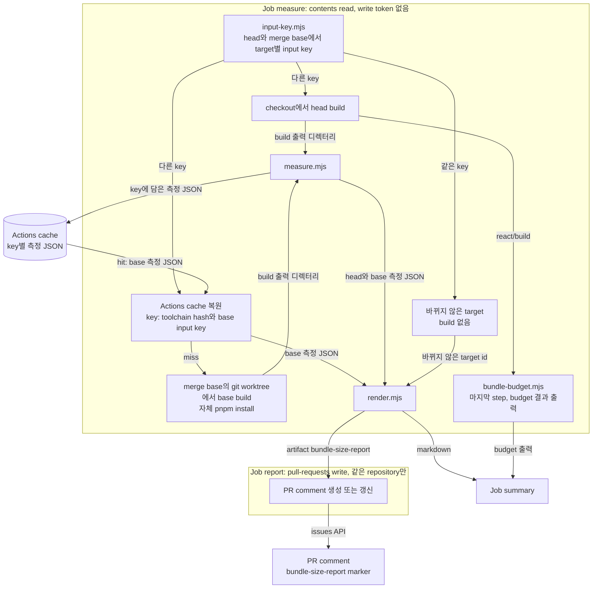

# 0038 — Per-PR bundle size comparison

## Summary

> 낯선 용어는 문서 맨 아래 [용어](#용어)에 모아 두었다.

- `.github/workflows/bundle-size.yml`은 PR이 영향을 주는 [bundle target](#용어)마다 PR head에서 한 번, [merge base](#용어)에서 한 번 build하고, 양쪽 크기와 차이를 보고한다.
- `.github/scripts/bundle-size/targets.mjs`가 bundle target 목록을 가진다. 목록은 WebUI app(`react/build`)과 `backend.ai-ui` library(`packages/backend.ai-ui/dist`)다. target마다 build 명령, 출력 디렉터리, [input paths](#용어)를 적는다.
- target은 head의 [input key](#용어)가 merge base의 input key와 다를 때만 비교한다. input key는 [toolchain hash](#용어)와 함께 Actions cache에서 그 target의 측정값 이름이 되므로, 측정값이 이미 cache에 있는 base는 다시 build하지 않는다.
- workflow는 PR comment 하나를 올리고 push마다 그 comment를 갱신하며, 같은 보고서를 job summary에도 쓴다. fork PR은 job summary만 받는다.
- 비교는 workflow를 실패시키지 않는다. `scripts/bundle-budget.mjs`의 boot-path budget step(#9948)은 현재 동작을 유지한다. 결과를 출력할 뿐 job을 실패시키지 않는다(#11368).
- bundle 크기를 재는 곳은 이 workflow 하나가 된다. `.github/workflows/pr-preview.yml`의 PR Analysis Report에 있는 `📦 Bundle Size` 섹션과 그 `measure-dist.mjs`는 삭제한다.
- **Out of scope**: `packages/backend.ai-client`는 WebUI app만 싣고 `webui` target이 함께 재므로 별도 target이 아니다. 그 밖의 workspace package는 비교하지 않는다.

## Context

- **WebUI app today**: `bundle-size.yml`은 `pnpm run build:react-only`로 app을 build하고 `scripts/bundle-budget.mjs`를 실행한다. 이 script는 [eager chunks](#용어)가 2.8 MB를 넘거나 chunk 하나가 5 MiB service-worker precache 한도를 넘으면 0이 아닌 값으로 끝난다. step은 `pipefail` 없는 shell에서 script를 `tee`로 pipe하므로 job은 그 종료 코드로 실패하지 않는다. `main`은 3.73 MB로 측정되고도 통과한다. script는 head의 숫자를 job summary에 출력하지만 비교할 대상이 없으므로, reviewer는 PR이 무엇을 더했는지 볼 수 없다.
- **`backend.ai-ui` today**: `pr-preview.yml`의 `build` job은 head에서 library를 build한 뒤 `packages/backend.ai-ui/src`를 지우고, base branch 끝에서 `src/`를 checkout해 다시 build한다. 이 job은 head의 `node_modules`를 다시 쓰므로, PR이 dependency나 build config를 바꾸면 base build를 건너뛴다. job은 PR이 `packages/backend.ai-ui/`나 preview 자신의 workflow와 script를 바꿀 때만 돌기 때문에, library 출력을 바꾸는 lockfile 변경은 숫자를 받지 못한다.
- **Checkout ref**: `pull_request` event에서 `ref` 없이 쓴 `actions/checkout`은 PR head가 아니라 PR을 base branch 끝에 merge한 `refs/pull/<N>/merge`를 checkout한다.
- **Cache scope**: run은 자기 ref, PR의 base branch, default branch에 저장된 cache를 복원할 수 있다. PR run이 저장한 cache는 `refs/pull/<N>/merge`에 속하므로, 같은 PR의 이후 run만 그 cache를 복원한다.

## 설계도

## Decision

### 1. Bundle target

`.github/scripts/bundle-size/targets.mjs`는 아래 target 목록을 export한다. 새 target은 이 파일의 새 행에 더해, `bundle-size.yml`의 cache restore step 하나와 cache save step 두 개다. `actions/cache` step 하나는 key 하나만 받기 때문이다. 이 step들은 plan에서 index로 key와 path를 읽으므로, workflow에는 target id도 build 명령도 적히지 않는다.

| id              | 무엇인가                                 | Build 명령                          | 출력 디렉터리                 | Input paths                                                                                                                                                                                             |
| --------------- | ---------------------------------------- | ----------------------------------- | ----------------------------- | ------------------------------------------------------------------------------------------------------------------------------------------------------------------------------------------------------- |
| `webui`         | 브라우저가 내려받는 app                  | `pnpm run build:react-only`         | `react/build`                 | `react/`, `packages/backend.ai-ui/`, `packages/backend.ai-client/`, `resources/`, `data/`, `relay.config.js`, `relay-base.config.js`, `package.json`, `pnpm-lock.yaml`, `pnpm-workspace.yaml`, `.npmrc` |
| `backend.ai-ui` | npm에 `backend.ai-ui`로 배포되는 library | `pnpm --filter backend.ai-ui build` | `packages/backend.ai-ui/dist` | `packages/backend.ai-ui/`, `relay.config.js`, `relay-base.config.js`, `package.json`, `pnpm-lock.yaml`, `pnpm-workspace.yaml`, `.npmrc`                                                                 |

- **Input paths**: target의 input paths는 내용이 바뀌면 build 출력이 바뀔 수 있는 repository 경로 전부다. 실제 input을 빠뜨린 target은 거짓으로 "unchanged"를 보고하므로, 목록은 경로를 넣는 쪽으로 정한다.
- **Workflow trigger**: `bundle-size.yml`은 `pull_request`와 `main`으로의 `push`에서 돈다. 두 `paths:` filter는 모든 target의 input paths와 2항의 toolchain hash 경로의 합집합이다.

### 2. Input key와 toolchain hash

`.github/scripts/bundle-size/input-key.mjs`는 값 두 개를 계산한다.

| 값             | 계산 재료                                                                                                                                                                                                 |
| -------------- | --------------------------------------------------------------------------------------------------------------------------------------------------------------------------------------------------------- |
| Input key      | target `id`와, 표 순서대로 input path마다 `git rev-parse <commit>:<path>`, 그 commit에 경로가 없으면 문자열 `missing`의 SHA-256                                                                           |
| Toolchain hash | `.nvmrc`, `.github/actions/setup-node-pnpm`, `.github/scripts/bundle-size`, `scripts/bundle-budget.mjs`, `.github/workflows/bundle-size.yml`에 대한 `git rev-parse HEAD:<path>`의 SHA-256, 항상 head 기준 |

- **Comparison rule**: `bundle-size.yml`은 target의 head input key가 merge base input key와 다를 때 그 target을 비교한다.
- **Toolchain change**: PR이 toolchain hash 경로 중 하나라도 바꾸면 `bundle-size.yml`은 모든 target을 비교한다. 그래서 측정 코드나 budget을 바꾸는 PR도 그 코드가 만드는 보고서를 본다. input이 바뀌지 않은 target은 key가 같으므로 Δ가 0이고, toolchain 변경의 효과는 Δ에 나타나지 않는다.
- **Cache key**: 측정값은 `bundle-size-<toolchain hash>-<target id>-<input key>`로 `bundle-size-cache/<cache key>.json` 경로에 cache한다. 다른 측정 코드나 다른 Node 버전으로 만든 측정값은 다시 쓰지 않는다.
- **Cache path**: 경로는 side가 아니라 key에만 달려 있다. 한 측정값이 어떤 run에서는 head이고 나중 run에서는 base이기 때문이다.

### 3. Head build와 base build

- **Head commit**: `measure` job은 `github.event.pull_request.head.sha`를 `fetch-depth: 0`으로 checkout한다. 그래서 head는 PR head이고, `git merge-base`는 항상 base를 찾는다.
- **Base commit**: base는 `git merge-base origin/<base_ref> HEAD`다. 다른 branch 위에 쌓인 PR은 부모 branch와 비교하고 자기 layer만 보고한다.
- **Per-target loop**: `.github/scripts/bundle-size/run.mjs`가 cache restore step과 cache save step 사이에서 target마다 이 절의 단계를 실행한다. 첫 head build 전에 `pnpm install --frozen-lockfile`을 실행하므로, 아무것도 build하지 않는 run은 install도 하지 않는다.
- **Cache first**: job은 base의 cache key를 복원한다. hit이면 그 값이 base 측정값이 되고 base build는 돌지 않는다.
- **Equal keys**: toolchain 변경 때문에만 비교하는 target은 head와 base의 cache key가 같고, `run.mjs`는 head 측정값을 `source: "head"`로 base에 쓴다.
- **Separate worktree**: miss이면 job은 `git worktree add "$RUNNER_TEMP/bundle-base" <merge base>`를 실행하고, 그 안에서 `pnpm install --frozen-lockfile`과 target의 build 명령을 실행한다. 그래서 base는 자기 lockfile, config, `node_modules`로 build된다.
- **Shared toolchain**: 두 build 모두 `setup-node-pnpm`이 head 기준으로 설치한 Node와 pnpm에서 돌고, 그 pnpm store를 함께 쓴다.
- **Saving**: push run은 자기가 만든 head 측정값을, PR run은 자기가 build한 base 측정값을 각각 cache key로 저장한다. PR run은 head를 항상 build하고 그 head 측정값을 restore하는 run이 없으므로, PR run은 head 측정값을 저장하지 않는다. cache에는 build 출력이 아니라 측정 JSON만 들어간다.
- **Push to `main`**: push run은 push된 commit에서 cache key가 아직 없는 target을 재고 저장한다. head 값을 job summary에 쓰고 아무것도 post하지 않는다. `concurrency` group은 commit SHA이고 `cancel-in-progress: false`이므로, push된 commit마다 측정값이 남는다.
- **Base failure**: base build가 실패하면 `measure.mjs`는 오류만 담은 base 파일을 쓰고, `render.mjs`는 base 열 자리에 그 오류를 보여 준다. job은 이것 때문에 실패하지 않는다.

### 4. 측정

`.github/scripts/bundle-size/measure.mjs --target <id> --side head|base --dir <출력 디렉터리>`는 `bundle-size/<target id>.<side>.json`을 쓴다.

| 필드             | 내용                                                                        |
| ---------------- | --------------------------------------------------------------------------- |
| `target`, `side` | target id와 `head` 또는 `base`                                              |
| `commit`         | build한 commit                                                              |
| `source`         | `build`, `cache`, 또는 base가 head 측정값일 때(equal keys) `head`           |
| `error`          | build 오류. build가 실패했을 때만 있고, 그 뒤에는 값 필드가 없다            |
| `totals`         | 이름 붙은 byte 수의 object. target별 항목은 아래 표에 있다                  |
| `parts`          | `{ name, bytes, gzipBytes, hash }`의 배열. chunk stem 또는 파일마다 한 항목 |

| Target          | `totals`                                                                                                            | `parts`                                                                                                                           |
| --------------- | ------------------------------------------------------------------------------------------------------------------- | --------------------------------------------------------------------------------------------------------------------------------- |
| `webui`         | eager JS bytes와 gzip bytes, eager chunk 수, 전체 JS bytes와 gzip bytes, 전체 CSS bytes와 gzip bytes, 전체 chunk 수 | `assets/` 아래 `.js` chunk의 [chunk stem](#용어)마다 한 항목. 그 chunk들의 bytes를 합한다. CSS는 totals에만 나온다                |
| `backend.ai-ui` | 전체 JS bytes와 gzip bytes, 전체 CSS bytes와 gzip bytes                                                             | `dist/` 아래 어디에 있든 `.js`, `.css` 파일의 [file stem](#용어)마다 한 항목. 그 파일들의 bytes를 합한다. `.map`과 `.d.ts`는 뺀다 |

- **One eager count**: `webui`의 eager 값은 `scripts/bundle-budget.mjs`가 export하는 `measure()`에서 온다. 그래서 comment와 budget 검사는 같은 chunk를 센다.
- **Entry-point guard**: `scripts/bundle-budget.mjs`는 자기가 entry point일 때(`process.argv[1] && existsSync(process.argv[1]) && import.meta.url === pathToFileURL(realpathSync(process.argv[1])).href`)만 검사를 돌리고 `process.exit`를 부른다. 그래서 `measure()`를 import해도 아무것도 실행되지 않는다. `realpathSync` 덕분에 symlink 경로로 실행해도 검사가 돌고, `existsSync` 덕분에 파일이 아닌 인자가 import 때 예외를 내지 않는다. `input-key.mjs`, `measure.mjs`, `render.mjs`도 같은 guard를 쓴다.
- **Gzip level**: 모든 gzip 값은 `measure()`가 이미 쓰는 `gzipSync` 기본 level을 쓴다.

### 5. 보고서

`.github/scripts/bundle-size/render.mjs`는 측정 파일을 읽어 `bundle-size-report.md`와 `bundle-size-report.json`을 쓴다.

- **Target section**: 비교한 target마다 `totals` 표를 base, head, byte 차이, 백분율 차이와 함께 그린다.
- **Changed parts**: 각 섹션은 totals 아래에 gzip 차이의 절댓값이 가장 큰 `parts` 열 개를 나열한다. 한쪽에만 있는 part는 반대쪽을 0으로 세고 new 또는 removed로 표시한다.
- **Unchanged targets**: input key가 바뀌지 않은 target은 한 줄에 나열한다.
- **Header**: 보고서는 head commit과 merge-base commit을 적고, target마다 base가 cache에서 왔는지 build에서 왔는지, 또는 input이 그대로라 head 측정값이 base를 대신하고 Δ가 0인지 적는다.
- **Marker**: markdown은 `<!-- bundle-size-report -->`로 시작한다. `report` job은 이 문자열로 이전 comment를 찾는다.
- **Manifest**: `bundle-size-report.json`은 `report` job을 위해 `{ "compared": <비교한 target 수> }`를 담는다.

### 6. 전달

- **Job summary**: `measure` job은 모든 run에서 `bundle-size-report.md`를 `$GITHUB_STEP_SUMMARY`에 덧붙인다.
- **Artifact**: `measure` job은 budget step이 돌기 전에 두 보고서 파일을 `bundle-size-report` artifact로 올린다.
- **Report job condition**: `report` job은 같은 repository에서 온 `pull_request` event에 `if: ${{ !cancelled() }}`로 돈다. 그래서 뒤 step이 실패해도 comment가 남는다.
- **Report job token**: `report` job은 `pull-requests: write` 하나만 가진다.
- **Report job content**: `report` job은 코드를 checkout하지 않고, `pnpm install`도 package script도 실행하지 않는다. artifact를 내려받아 `actions/github-script`에서 issues API를 부를 뿐이다.
- **Comment rule**: `compared`가 0보다 크면 `report` job은 marker가 있는 comment를 갱신하거나 새로 만든다. `compared`가 0이면 기존 comment만 갱신하고 새 comment는 만들지 않는다. artifact가 없고 `measure` job의 결과가 `failure`이면, 기존 comment를 측정하지 못한 head commit과 run 링크를 적은 안내로 바꾸고, 새 comment는 만들지 않는다.
- **Skipped workflow**: `paths:` filter가 workflow 전체를 건너뛰면 이전 comment는 그대로 남는다. 그 header에 측정한 commit이 적혀 있다.

### 7. 실패 정책

- **Advisory comparison**: 차이가 아무리 커도 workflow는 실패하지 않는다. `render.mjs`와 `report` job은 어떤 입력에도 0으로 종료한다.
- **Budget step**: `scripts/bundle-budget.mjs`는 `measure` job의 마지막 step으로 head의 `webui` build에서 이전과 같은 `| tee` 명령으로 돈다. 그래서 결과를 출력할 뿐 job을 실패시키지 않는다. 실패하게 만드는 일은 #11368이다.
- **Budget skip**: budget step은 그 run이 head에서 `webui`를 build했을 때만 돈다. PR에서는 `webui`를 비교할 때이고, `main` push에서는 그 commit의 `webui` 측정값이 아직 cache에 없을 때다.
- **Script tests**: `measure` job은 build 전에 `node --test .github/scripts/bundle-size/*.test.mjs`를 실행한다.

### 8. PR Analysis Report에서 제거

- **Removed steps**: `pr-preview.yml`의 `Build and measure the package bundle` step 두 개와 `.github/scripts/pr-preview/measure-dist.mjs`를 삭제한다.
- **Removed section**: `generate-pr-comment.mjs`는 `📦 Bundle Size` 섹션과 `--bundle-head`, `--bundle-base` option을 없애고, 그 test도 해당 case를 없앤다.

## 대안과 기각 사유

- **Keep the `src/` swap of `pr-preview.yml`**: head의 `node_modules`를 다시 쓰므로 두 번째 install이 필요 없다. 그러나 크기를 바꿀 가능성이 가장 높은 PR, 즉 dependency나 build config를 바꾸는 PR을 비교하지 못하므로 기각한다.
- **Always build the base**: cache도 input key도 필요 없다. 그러나 모든 run의 build 시간이 두 배가 되는 반면, 대부분의 merge base는 push run이 이미 잰 `main` commit이므로 기각한다.
- **Compare against the tip of the base branch**: `git merge-base`가 필요 없다. 그러나 PR이 갈라진 뒤 base branch에 merge된 commit이 PR 자신의 차이로 보이므로 기각한다.
- **Select targets from the changed file list**: diff를 target 경로와 맞춰 보면 tree hash가 필요 없다. 그러나 cache에는 어차피 base의 input을 가리키는 key가 필요하고, input key 하나가 두 질문에 모두 답하므로 기각한다.
- **Post from a `workflow_run` workflow**: fork PR도 comment를 받는다. 그러나 `pr-preview.yml` header에 적힌 이유로 기각한다. Copilot coding agent의 push가 승인 대기로 잡은 run 뒤에, 어느 PR 페이지에도 나오지 않는 두 번째 대기 run이 따라온다.
- **Post from a `pull_request_target` workflow**: 이것도 fork PR에 comment를 준다. 그러나 거기서 PR을 build하면 write token을 가진 채 PR이 작성한 코드를 실행하게 된다. `label.yml`과 `assign-linked-issue.yml`은 PR 코드를 checkout하지 않는 방식으로 이를 피한다. 그래서 기각한다.
- **Fail on a size increase over a threshold**: 비교가 gate가 된다. 그러나 gate는 boot-path budget이고(#9948, #11368), PR별 threshold는 새 페이지 같은 의도된 증가까지 실패시키므로 기각한다.
- **A third-party size action**: `preactjs/compressed-size-action` 같은 action은 repository 코드 없이 크기를 비교한다. 그러나 `scripts/bundle-budget.mjs`의 `measure()`를 다시 쓸 수 없어 comment와 budget이 서로 다른 chunk를 세게 되므로 기각한다.

## Consequences

- **Visible size change**: reviewer는 PR에서 영향받은 target마다 얼마나 늘고 줄었는지, 어떤 chunk나 파일이 그렇게 만들었는지 본다.
- **Dependency PRs compared**: lockfile, catalog, Vite config 변경도 차이를 받는다. `src/` 교체 방식은 이것을 주지 못했다.
- **Cost on a cache miss**: base가 cache에 없는 run은 비교하는 target마다 `pnpm install`과 build를 한 번씩 더 돌리므로 몇 분이 늘어난다.
- **Stacked PRs uncached**: stacked PR의 merge base는 부모 branch의 commit이고 push run은 그것을 재지 않으므로, 첫 run은 항상 base를 build한다. 같은 PR의 이후 push는 그 PR 자신의 cache에서 base를 복원한다.
- **Broad input paths**: `react/`나 `packages/backend.ai-ui/` 아래의 test나 story만 바꾼 PR도 target을 build하고 차이 0을 보고한다.
- **Node version not compared**: 양쪽 모두 head의 Node로 build하므로, `.nvmrc`를 바꾼 PR은 모든 target을 비교하지만 새 Node가 양쪽에 준 영향만 보인다.
- **Library build drift**: 같은 commit에서 `backend.ai-ui`를 두 번 build하면 몇백 byte가 달라진다. 그래서 바뀐 것이 없어도 cache의 base와 새 head 사이에 작은 차이가 보일 수 있다.
- **Runner image outside the key**: cache key에는 `ubuntu-latest` image가 들어가지 않으므로, image 갱신 전에 잰 cache의 base가 갱신 뒤에 잰 head와 비교될 수 있다.
- **Fork PRs**: fork PR은 보고서를 job summary에서만 받는다.

## 출처

- #11316 — Add CI workflow comparing bundle size between main and PR per modified package (2026-11-23).
- #9948 — Gate the initial bundle size in CI. `main`의 `scripts/bundle-budget.mjs`와 `.github/workflows/bundle-size.yml`.
- #11368 — Make the boot-path bundle budget check fail CI when it is exceeded.
- `.github/workflows/pr-preview.yml` — 이 결정이 대체하는 `backend.ai-ui` head·base 측정.
- GitHub Docs, "Dependency caching reference"의 cache 접근 제한: run은 자기 ref, base branch, default branch의 cache를 복원하고, PR run은 `refs/pull/<N>/merge`에 저장한다.

## 용어

| 용어           | 뜻                                                                                                                                                                                                                                                  |
| -------------- | --------------------------------------------------------------------------------------------------------------------------------------------------------------------------------------------------------------------------------------------------- |
| bundle target  | bundle target은 이 workflow가 재는 build 출력 하나이며, `.github/scripts/bundle-size/targets.mjs`의 한 행으로 정의된다.                                                                                                                             |
| input paths    | bundle target의 input paths는 내용이 바뀌면 그 target의 build 출력이 바뀔 수 있는 repository 경로들이다.                                                                                                                                            |
| input key      | input key는 target id와, 한 commit에서 그 input paths의 git object hash를 묶은 SHA-256이다(Decision 2항).                                                                                                                                           |
| toolchain hash | toolchain hash는 head의 `.nvmrc`, setup action, 측정 script, budget script, workflow 파일을 묶은 SHA-256이다. 모든 cache key에 들어가므로 측정값은 같은 도구에서만 다시 쓰인다.                                                                     |
| merge base     | merge base는 PR head와 base branch가 공유하는 가장 최근 commit이며, `git merge-base`가 돌려주는 값이다.                                                                                                                                             |
| eager chunks   | eager chunks는 `react/build/index.html`의 entry script, 그것이 정적으로 import하는 모든 chunk, page가 modulepreload하는 모든 chunk이며, `scripts/bundle-budget.mjs`가 모으는 그대로다.                                                              |
| chunk stem     | chunk stem은 `assets/` 아래 `webui` chunk 파일 이름에서 `/-[A-Za-z0-9_-]{8}\.js$/`에 맞는 부분을 뺀 것이다. 예를 들어 `assets/index-B3x9a2Qd.js`의 stem은 `index`다. stem이 같은 chunk들은 합산한다.                                                |
| file stem      | file stem은 `backend.ai-ui` `dist/` 경로에서 build hash를 뺀 것이다. 마지막 `.js` 또는 `.css` 바로 앞의 `-`와 `[A-Za-z0-9_-]` 8글자를 지운다. 예를 들어 `dayjs.min-DLOgbIIN.js`의 stem은 `dayjs.min.js`이고, hash가 없는 경로는 그 자체가 stem이다. |
