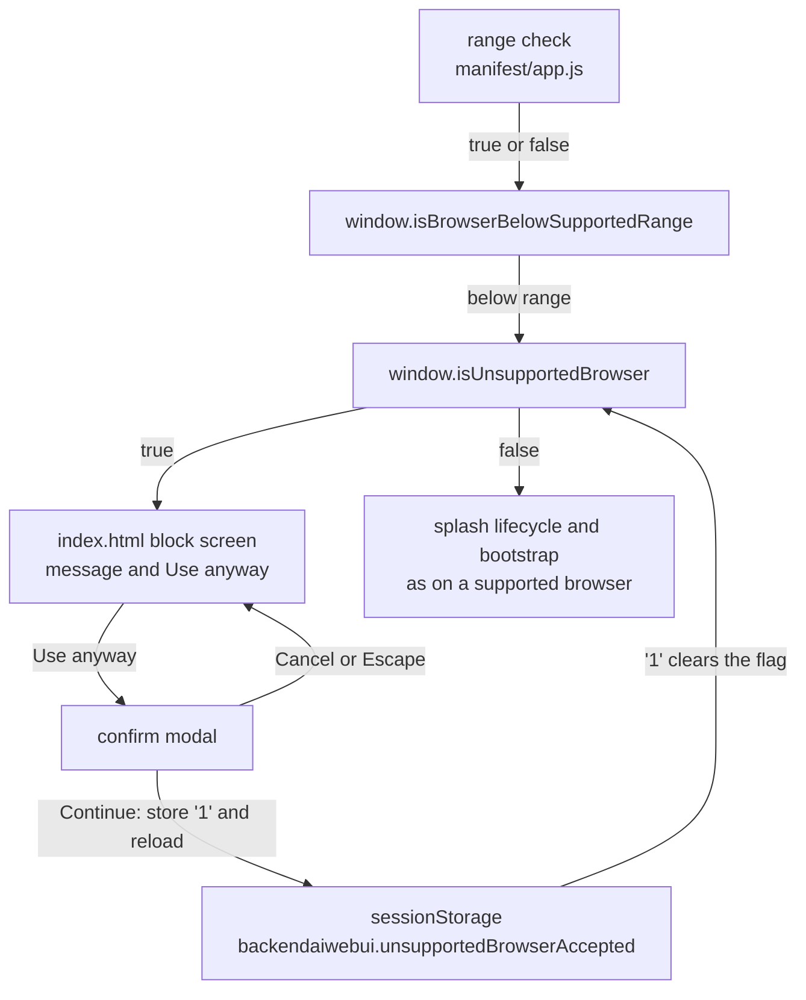

# 0038 — Use-anyway path past the unsupported-browser block

## Summary

> 낯선 용어는 문서 맨 아래 [용어](#용어)에 모아 두었다.

- [ADR 0037](0037-supported-browser-range-and-load-block.ko.md)의 미지원 브라우저 차단 화면에 메시지 아래 "그래도 이용하기" 버튼을 둔다.
- 버튼은 정상 동작을 보장할 수 없다고 경고하는 확인 modal을 연다. 취소하면 차단이 그대로 남고, 계속하면 그 탭의 session 동안 차단을 풀고 페이지를 다시 불러와, 지원 브라우저처럼 app을 로드한다.
- 차단 화면과 modal은 검사에 걸린 브라우저에서 실행되므로, `index.html` 안의 ES5 DOM 코드와 inline style로 쓴다.
- 이 ADR은 ADR 0037의 section 4 중 "app을 로드하지 않는다"와 기각된 대안 "닫을 수 있는 banner로 경고하고 그대로 로드"만 대체한다. 지원 범위, 검사, 버전 표는 ADR 0037이 정한 대로 둔다.

## Context

- **ADR 0037**: Astryx Tier 2보다 오래된 브라우저는 메시지와 함께 로딩 splash에 머물고 app을 로드하지 않는다.
- **Review of that change**: 사용자는 그 자리에서 업그레이드할 수 없는 브라우저로 급히 WebUI에 들어가야 할 때가 있는데, 진행할 길이 없는 차단은 이들을 완전히 막는다(#11403).
- **Where the code runs**: 차단 화면은 Popover API, `light-dark()`, 최신 문법이 없을 수 있는 브라우저에서 `index.html`의 inline `<script>`가 그리므로, Astryx, `@lablup/ui-common`, React bundle을 쓸 수 없다.

## 설계도

## Decision

### 1. flag는 두 개다: 범위 밖, 그리고 차단

- **`window.isBrowserBelowSupportedRange`**: ADR 0037의 두 검사 결과이며, 사용자의 선택으로 바뀌지 않는다.
- **`window.isUnsupportedBrowser`**: 브라우저가 범위 밖이고 그 탭이 아직 수락하지 않았을 때 true다. 차단을 읽는 모든 곳(`index.html`의 차단 화면, splash lifecycle, service worker 조건, `react/src/index.tsx`)은 계속 이 flag를 읽는다.
- **수락**: `sessionStorage['backendaiwebui.unsupportedBrowserAccepted'] === '1'`이며, key는 `manifest/app.js`의 `window.unsupportedBrowserAcceptedKey`다. storage를 읽다가 예외가 나면 수락하지 않은 것으로 본다. 차단 중에는 `react/src/index.tsx`가 app을 띄우지 않고 bootstrap을 `window.__bootstrapApp`으로 노출하며, `index.html`은 splash lifecycle을 실행하지 않고 `window.__startSplashLifecycle`로 둔다. 그래서 차단 화면이 나중에 둘 다 시작할 수 있다.

### 2. 차단 화면은 확인 modal 뒤에 그래도 이용하기를 둔다

- **버튼**: "Use anyway"(`navigator.language`가 `ko`로 시작하면 "그래도 이용하기")를 메시지 아래 `.splash-center`에 붙인다.
- **Modal**: `#splash` 안의 `alertdialog` overlay로, 제목 "지원하지 않는 브라우저", 경고 "이 브라우저는 호환되지 않아 정상 동작을 보장할 수 없습니다. 그래도 이용하시겠습니까?", 취소와 계속 이용하기 버튼을 둔다. 처음 focus는 취소에 있고, 취소, Escape, scrim click은 modal을 닫고 focus를 버튼으로 돌린다.
- **계속**: 수락 key에 `'1'`을 저장하고 `location.reload()`를 부른다. storage가 예외를 내면 다시 불러오지 않는다. 차단 화면이 modal과 버튼을 없애고 로딩 스플래시를 되돌린 뒤, `window.isUnsupportedBrowser`를 false로 바꾸고 `window.__startSplashLifecycle`과 `window.__bootstrapApp`으로 그 자리에서 app을 시작한다. 이 통과는 그 page load 동안만 유지되며, 새로고침하면 차단 화면이 다시 나온다.
- **유지 기간**: 수락은 그 탭의 session 동안 유지된다. 새 탭이나 새 브라우저 session에서는 차단 화면이 다시 나온다. 다만 복제한 탭, 이 탭에서 opener로 연 탭(act-as 탭, `react/src/helper/actAs.ts`의 `window.open`), 복원된 브라우저 session은 `sessionStorage`를 복사하므로 수락을 이어받는다. 로그아웃도 마찬가지다. 로그아웃은 새로고침 전에 `sessionStorage`를 비우므로(`react/src/hooks/useLogout.ts`의 `clearLoginStorage`) 로그아웃한 사용자는 다시 경고를 본다.
- **번들을 실행하지 못하는 브라우저**: 버튼은 차단된 모든 브라우저에 나온다. module 번들을 아예 실행하지 못하는 브라우저(Internet Explorer, `type=module` 미지원, `react/vite.config.ts`의 `build.target` 미만)도 포함된다. 그런 브라우저에서는 계속을 누르면 탭을 닫을 때까지 로딩 스플래시가 그대로 남는다. 경고 문구가 이미 정상 동작을 보장하지 않는다고 말하므로 버튼을 더 좁히지 않는다.

### 3. 차단 코드는 호환성을 넓게 유지한다

- **규칙**: 차단 화면과 modal은 ES5 문법, `document.createElement`, `onclick`, `dark-theme` body class로 고른 literal 색의 inline `element.style`만 쓴다. `<dialog>`, `light-dark()`, app의 CSS 변수, bundle의 어떤 것도 쓰지 않는다.
- **문구**: 영어와 한국어는 차단 메시지처럼 같은 script 안에 둔다. splash에는 i18n runtime이 없다.

## 대안과 기각 사유

- **다시 불러오지 않고 그 자리에서 app을 띄운다**: reload 한 번을 아낀다. splash lifecycle과 `bootstrap()`에 늦게 시작하는 두 번째 진입점이 필요하므로 기각했다. reload는 평소 경로를 그대로 쓴다.
- **선택을 `localStorage`에 기억한다**: 브라우저당 한 번만 묻는다. 다음 방문에서도 경고가 다시 나와 업그레이드할 수 있는 사용자가 상기하도록 기각했다.
- **계속한 뒤 app 안에 경고 banner를 둔다**: 위험을 계속 보이게 한다. 이 ADR의 범위 밖이며, app에는 그런 banner가 없다.

## Consequences

- **막다른 길이 없다**: 오래된 브라우저의 사용자도 명시적인 경고를 거친 뒤 들어갈 수 있다.
- **미지원 화면에 다시 닿을 수 있다**: 계속한 사용자는 ADR 0037이 설명하는 깨진 layout을 볼 수 있고, 확인 modal이 유일한 안내다.
- 수락한 탭에서 **reload가 한 번 더** 일어난다.
- **실제 브라우저에서 검증하지 않았다**: 흐름은 feature 검사가 실패하는 jsdom에서 `index.html`과 `manifest/app.js`를 실행해 확인했고, 설치된 오래된 브라우저에서는 확인하지 않았다.

## 출처

- GitHub issue: #11403. 상위 issue: #11379.
- `manifest/app.js`, `index.html`.
- 결정일: 2026-11-24.
- 관련: [ADR 0037](0037-supported-browser-range-and-load-block.ko.md)은 지원 범위와, 이 ADR이 지나갈 길을 더하는 차단을 정한다.

## 용어

| 용어           | 뜻                                                                                         |
| -------------- | ------------------------------------------------------------------------------------------ |
| block screen   | block screen은 지원 범위보다 오래된 브라우저의 로딩 splash로, 미지원 메시지를 보여 준다.    |
| acceptance     | acceptance는 사용자가 확인 modal에서 계속을 고르면 그 탭이 쓰는 session storage 표시다.     |
| loading splash | loading splash는 React app이 로드되는 동안 보이는 `index.html`의 `#splash` 화면이다.        |
