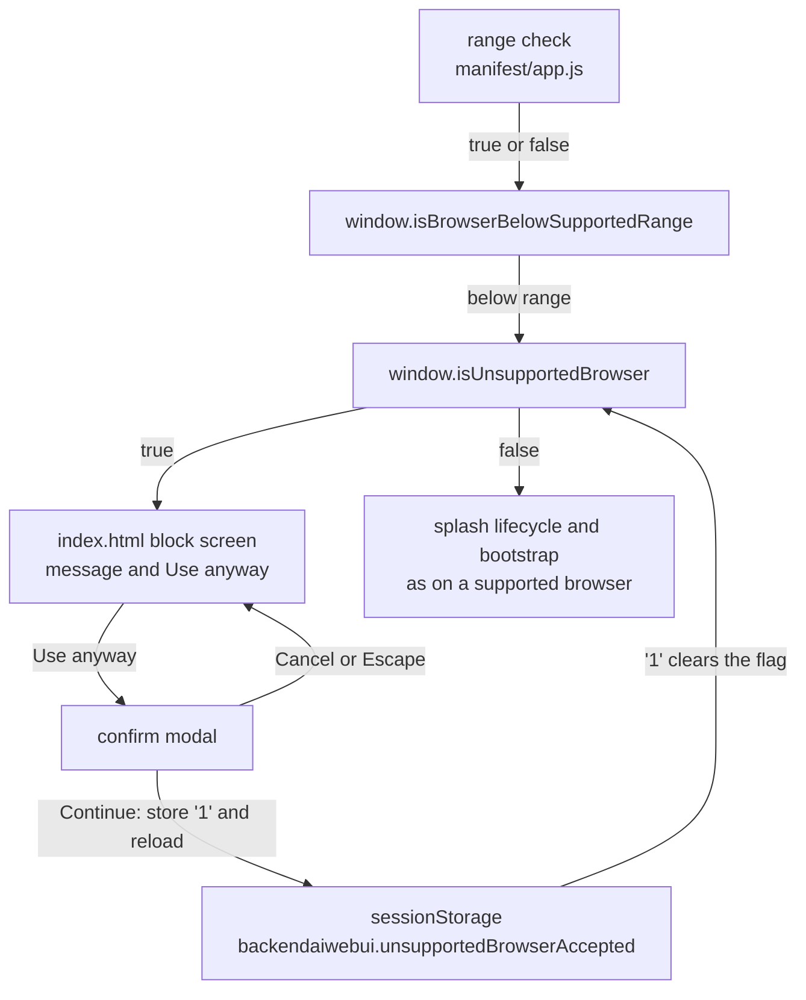

# 0038 — Use-anyway path past the unsupported-browser block

## Summary

> Unfamiliar terms are collected in the [Glossary](#glossary) at the end.

- The unsupported-browser block of [ADR 0037](0037-supported-browser-range-and-load-block.md) gets a "Use anyway" button under its message.
- The button opens a confirm modal that warns that normal behavior is not guaranteed. Cancel keeps the block; Continue lifts it for the tab's session and reloads the page, which then loads the app as on a supported browser.
- The block screen and the modal are ES5 DOM code with inline styles in `index.html`, because they run on the browsers that failed the check.
- This replaces only section 4's "the app does not load" and the rejected alternative "Warn with a dismissible banner and load anyway" of ADR 0037. The supported range, the checks and the version table stay as ADR 0037 decides.

## Context

- **ADR 0037**: A browser below Astryx Tier 2 keeps the loading splash with a message and never loads the app.
- **Review of that change**: Users sometimes have to reach the WebUI urgently from a browser they cannot upgrade on the spot, and a block with no way forward stops them completely (#11403).
- **Where the code runs**: The block screen is drawn by an inline `<script>` in `index.html` on browsers that may lack the Popover API, `light-dark()` or modern syntax, so it cannot use Astryx, `@lablup/ui-common` or the React bundle.

## Diagram

## Decision

### 1. Two flags: below the range, and blocked

- **`window.isBrowserBelowSupportedRange`**: the result of ADR 0037's two checks, unchanged by the user's choice.
- **`window.isUnsupportedBrowser`**: true when the browser is below the range and the tab has not accepted it. Every reader of the block (`index.html`'s block screen, splash lifecycle and service worker gate, and `react/src/index.tsx`) keeps reading this flag.
- **Acceptance**: `sessionStorage['backendaiwebui.unsupportedBrowserAccepted'] === '1'`, under the key `window.unsupportedBrowserAcceptedKey` in `manifest/app.js`. When `sessionStorage` cannot be written, `window.name` equal to that key counts as acceptance too; it also lasts for the tab. A storage read that throws counts as not accepted.

### 2. The block screen offers Use anyway behind a confirm modal

- **Button**: "Use anyway" (Korean "그래도 이용하기" when `navigator.language` starts with `ko`), appended to `.splash-center` under the message.
- **Modal**: an `alertdialog` overlay inside `#splash` with the title "Unsupported browser", the warning "This browser is not compatible, so normal behavior is not guaranteed. Do you want to continue anyway?", and Cancel and Continue buttons. Cancel has the initial focus; Cancel, Escape and a click on the scrim close it and return focus to the button.
- **Continue**: stores `'1'` under the acceptance key and calls `location.reload()`. When storage throws, it sets `window.name` to the key instead and still reloads, so a browser without storage gets past the block as well.
- **Lifetime**: acceptance lasts for the tab's session. A new tab or a new browser session shows the block again. A duplicated tab, a tab opened from this one with an opener (the act-as tab, `window.open` in `react/src/helper/actAs.ts`) and a restored browser session copy `sessionStorage` and `window.name`, so they carry the acceptance over. Logout shows the block again too: it clears `sessionStorage` (`clearLoginStorage` in `react/src/hooks/useLogout.ts`) before it reloads; a user who logs out is warned again.
- **Browsers that cannot run the bundle**: the button is offered to every blocked browser, including one that cannot run the module bundle at all (Internet Explorer, no `type=module`, or below `build.target` in `react/vite.config.ts`). There Continue leaves the loading splash on screen until the tab closes. The warning already says normal behavior is not guaranteed, so the button is not narrowed further.

### 3. The block code stays broadly compatible

- **Rule**: The block screen and the modal use ES5 syntax, `document.createElement`, `onclick` and inline `element.style` with literal colors chosen by the `dark-theme` body class. They use no `<dialog>`, no `light-dark()`, no CSS variables of the app and nothing from the bundle.
- **Strings**: English and Korean live in the same script, as the block message does; the splash has no i18n runtime.

## Rejected alternatives

- **Reveal the app in place without a reload**: it saves one reload. It is rejected because the splash lifecycle and `bootstrap()` would need a second entry point for a late start, while a reload reuses the normal path unchanged.
- **Remember the choice in `localStorage`**: it asks once per browser. It is rejected because the warning should come back on the next visit, so a user who could upgrade is reminded.
- **A warning banner inside the app after Continue**: it would keep the risk visible. It is out of scope here; no such banner exists in the app.

## Consequences

- **No dead end**: A user on an old browser can still get in after an explicit warning.
- **Unsupported screens are reachable again**: After Continue, the user can see the broken layouts ADR 0037 describes; the confirm modal is the only notice.
- **One extra reload** on the accepting tab.
- **Unverified on real browsers**: The flow was checked by running `index.html` and `manifest/app.js` in jsdom, where the feature checks fail, not on installed old browsers.

## Sources

- GitHub issue: #11403. Parent: #11379.
- `manifest/app.js`, `index.html`.
- Decided: 2026-11-24.
- Related: [ADR 0037](0037-supported-browser-range-and-load-block.md) defines the supported range and the block this ADR adds a way past.

## Glossary

| Term           | Meaning                                                                                                    |
| -------------- | ---------------------------------------------------------------------------------------------------------- |
| block screen   | The block screen is the loading splash of a browser below the supported range, with the unsupported message. |
| acceptance     | Acceptance is the session-storage marker a tab writes when its user chose Continue in the confirm modal.   |
| loading splash | The loading splash is the `#splash` screen in `index.html` that shows while the React app loads.           |
