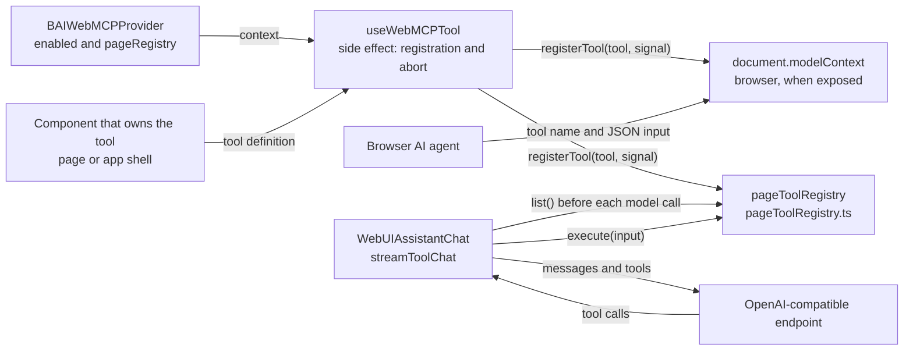

# 0038 — WebUI Assistant tool calls through the page's WebMCP tools

## Summary

> Unfamiliar terms are collected in the [Glossary](#glossary) at the end.

- The WebUI Assistant answers through [tool calling](#glossary) when its endpoint accepts `tools`. The tools it offers the model are the page's own WebMCP tools (ADR 0025) plus `search_manual`, a manual search that runs in the browser.
- BUI's `useWebMCPTool` registers every tool with a second target, the [page registry](#glossary) the host passes to `BAIWebMCPProvider` as `pageRegistry`, as well as with `document.modelContext`. The host passes `pageToolRegistry` only while the user has the WebUI Assistant turned on, and only while `[general] enableWebMCP` is not `false`.
- The assistant offers a fixed list of page tools (`ASSISTANT_PAGE_TOOLS`), rebuilt from the registrations before every model call.
- ADR 0025 section 4 holds for the assistant as for any agent: tools read, navigate, and fill; the user presses Apply, Launch, or Submit.
- When the endpoint rejects `tools`, the assistant keeps answering with the prompt-only path that was there before: manual excerpts in the system prompt, and the dashboard agent prompt on a dashboard.

## Context

- **What the assistant is**: the WebUI Assistant is the floating chat in the WebUI, turned on per user (`experimental_webui_assistant`) and connected to an OpenAI-compatible endpoint the user picks, usually a Backend.AI deployment. It runs entirely in the browser through the AI SDK (`ai`, `@ai-sdk/openai-compatible`).
- **Before this decision**: each answer was one model call whose system prompt carried everything: manual excerpts picked by `searchManual`, or on a dashboard the board, its sources, and worked examples (`buildDashboardChatPrompt`), with the reply parsed as JSON. The model could not act on any other page, and every new capability meant a new prompt and a new parser.
- **What WebMCP already gives**: pages register `bai_*` tools for browser agents (ADR 0025), with validated inputs, structured errors, and the read / navigate / fill boundary. These are the same operations the assistant needs, already owned by the components that hold the data.
- **Why a second target**: `document.modelContext` exists only in a browser with the WebMCP origin trial or flag, and the page cannot list or call what it registered there. The assistant needs the tools in every browser and needs to call them itself.

## Diagram

## Decision

### 1. BUI registers with a page registry as well

- **Prop**: `BAIWebMCPProvider` takes `pageRegistry?: WebMCPModelContext`, the same `registerTool(tool, { signal })` shape as `document.modelContext`, and carries it in `BAIWebMCPContext`.
- **Registration**: while `enabled`, `useWebMCPTool` registers the same descriptor, with the same validation wrapper and signal, with `document.modelContext` when the browser exposes it and with `pageRegistry` when the host passed one. Either target alone is enough.
- **Re-registration**: whether a `pageRegistry` is present is part of the registration key, so turning the assistant on or off re-registers every tool with both targets.
- **Active check**: `useBAIWebMCPActive()` is `true` when `enabled` and at least one target exists, so a component that runs a query for its tool also runs it for the assistant.

### 2. The host registry exists only for the assistant

- **File**: `react/src/components/WebUIAssistant/pageToolRegistry.ts` exports `createPageToolRegistry()` and the app's one `pageToolRegistry`.
- **Type**: `PageToolRegistry extends WebMCPModelContext` with `list(): ReadonlyArray<WebMCPToolDescriptor>`, `get(name): WebMCPToolDescriptor | undefined`, and `subscribe(listener): () => void`. An aborted signal removes the tool unless a newer registration has taken its name; a signal that is already aborted registers nothing.
- **Settling**: `waitForToolsToSettle(registry, { quietMs = 400, timeoutMs = 4000 })` resolves once no tool has registered or unregistered for `quietMs`, or after `timeoutMs`.
- **Gate**: `DefaultProvidersForReactRoot` passes `pageRegistry={pageToolRegistry}` only while `experimental_webui_assistant` is on. With the assistant off, `pageToolRegistry` stays empty, and the tool components run only the queries they run for a browser agent.

### 3. Tool calling, with the prompt-only path as the fallback

- **Probe**: `probeToolCalling` (`assistantToolChat.ts`) sends one `max_tokens: 1` completion with a `tools` entry and `tool_choice: "auto"`. `WebUIAssistantChat` caches its answer per base URL, key, and model. A non-2xx answer or a network error keeps the chat on the prompt-only path, and so does an empty page registry (`[general] enableWebMCP = false`). A message sent before the probe answers waits for it.
- **Loop**: `streamToolChat` (`assistantToolChat.ts`) calls the model up to `MAX_TOOL_STEPS` (8) times and stops at the first call that ends without tool calls, or whose calls all repeat earlier ones (prefetched calls included). Each call gets `toolSetOf(registry)`, rebuilt from `registry.list()`, and its tool executions call `registry.get(name)` at call time; a tool no longer registered returns `{ error: { code: 'tool_unavailable' } }`. After a `bai_navigate` call the loop waits for `waitForToolsToSettle` before the next call. All calls stream into one UI message.
- **Offered tools**: `ASSISTANT_PAGE_TOOLS` lists the page tools a small model's context can hold: `bai_get_current_page`, `bai_navigate`, `bai_get_current_dashboard`, `bai_prepare_dashboard`, `bai_prepare_session`. When `bai_prepare_session` is not registered but `bai_navigate` is, a wrapper with the launcher's input schema takes its name: it calls `bai_navigate` to `/session/start`, waits for the tools to settle, and calls the launcher's own tool.
- **`search_manual`**: always offered. Input `{ query: string }`; output `{ results: [{ title, url, text }] }` with at most 3 results of at most 1500 characters each, or `{ error }` when the manual is not loaded (`searchManualResult`).
- **Prefetch**: before the first model call the assistant runs one tool itself and puts the call and its result in the history, as a tool call the model made (`prefetch` of `streamToolChat`): `search_manual` for a request `looksLikeQuestion` (`DashboardPanels/dashboardChat.ts`) reads as a question, otherwise `bai_get_current_dashboard` when it is registered and the request names a card or panel title or says card, panel, board or dashboard.
- **History**: earlier turns go to the model as text only; their tool calls and results stay out of the context.

### 4. ADR 0025's boundary holds for the assistant

- **No submit tool**: the assistant can only call registered tools and `search_manual`; no tool it can reach saves, launches, or deletes. Changes the assistant makes to the dashboard are a preview with the agent-filled notice; a filled launcher shows its own notice.
- **System prompt**: `WEBUI_ASSISTANT_TOOL_PROFILE` tells the model that changes are only previewed or filled, and that the user presses Apply or Launch.

## Rejected alternatives

- **Keep prompt injection for every capability**: each feature writes its own prompt and reply parser, as the dashboard agent did. It works with a server that has no tool calling. It is rejected as the main path because a capability then exists twice, once for browser agents and once for the assistant, and the assistant still cannot act on another page.
- **Call `document.modelContext` from the page**: the assistant would use the browser's registrations. It needs no second target. It is rejected because the API exists only behind an origin trial or flag, and the page cannot list or call the tools it registered there.
- **Offer every registered tool**: the model sees every `bai_list_visible_*` and filter tool too. It gives the model more reach. It is rejected because the descriptions of all tools do not fit a small model's context next to the conversation.

## Consequences

- **One tool surface**: a page tool written for browser agents is available to the assistant by adding its name to `ASSISTANT_PAGE_TOOLS`, with no new prompt or parser.
- **Small models**: a 0.6B model often answers a how-to question without searching and calls a dashboard tool without reading the card ids, which is why the assistant prefetches; it may still describe steps instead of calling a tool.
- **Endpoint requirement**: tool calling needs a server that accepts `tools` (llama.cpp's server does; vLLM needs `--enable-auto-tool-choice` and a tool parser). Other servers get the prompt-only answers.
- **Two code paths**: the prompt-only path stays until every supported endpoint takes tool calls.

## Sources

- GitHub: #11377 (dashboard tools and this connection), #11298 (dashboard editing in the assistant).
- AI SDK 5 `streamText` and the UI message stream (`ai` 5.0).
- Decided: 2026-11-23.
- Related: [ADR 0025](0025-webmcp-tool-surface.md) decides the tool surface and its read / navigate / fill boundary; this ADR adds a second registration target to its section 1 and widens the registration condition and the active check of its section 2. [ADR 0032](0032-user-manual-markdown-served-by-the-webui.md) decides the manual the search reads.

## Glossary

| Term          | Meaning                                                                                                                                                                                   |
| ------------- | ----------------------------------------------------------------------------------------------------------------------------------------------------------------------------------------- |
| tool calling  | A chat completion request lists functions in `tools`; the model answers with calls to them instead of text, the client runs each call and sends the result back, and the model continues. |
| page registry | The in-page list of WebMCP tools the host passes to `BAIWebMCPProvider` as `pageRegistry`. In the WebUI it is `pageToolRegistry`, which the WebUI Assistant reads.                        |
