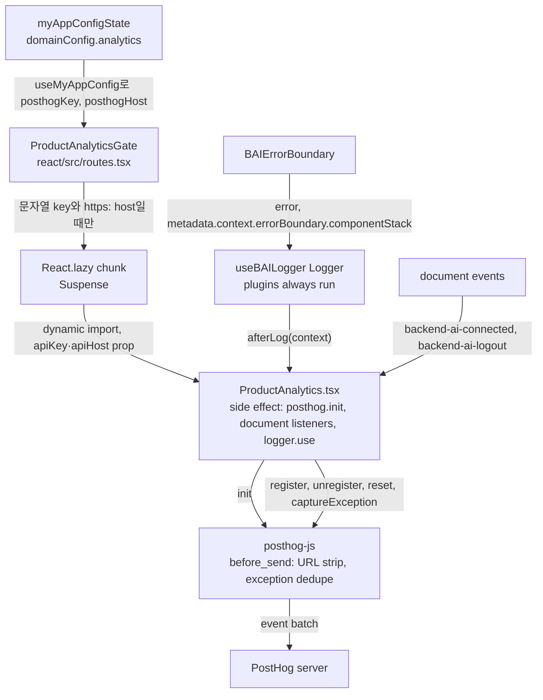

# 0039 — PostHog analytics behind the domain app config

## Summary

> 낯선 용어는 문서 맨 아래 [용어](#용어)에 모아 두었다.

- WebUI는 사용 흐름(화면별 체류, 클릭, 이탈)과 오류를 PostHog로 보낼 수 있다. 모든 build가 이 코드를 lazy chunk인 [analytics chunk](#용어)로 담고, build flag는 없다.
- 로그인한 domain의 app config `domainConfig.analytics`에 문자열 `posthogKey`와 `https:` `posthogHost`가 있을 때만 chunk를 받고 `posthog.init`을 부른다. 그 값이 없는 domain은 chunk를 받지 않고 아무것도 보내지 않는다. build는 key도 host도 담지 않는다.
- 새 runtime dependency는 `react/package.json`의 `posthog-js`이고, ESLint `no-restricted-imports`가 `react/src/components/ProductAnalytics.tsx` 밖에서의 import를 막는다.
- `useBAILogger`는 production build에서도 [logger plugin](#용어)을 부르고, `ProductAnalytics`의 plugin이 ERROR log를 PostHog error tracking으로 보낸다.

## Context

- **No usage data**: 지금 WebUI는 사용자가 session launcher에서 app 실행까지 가는지, 어느 단계에서 멈추는지 아무 데이터도 남기지 않는다. 오류도 사용자가 보고해야만 팀이 안다.
- **One build for every deployment**: 팀은 SaaS와 self-hosted·air-gapped 고객에게 같은 build를 배포한다. analytics용 build를 따로 두면 build, test, release할 것이 두 배가 된다.
- **Per-domain choice**: build 하나가 여러 배포와 domain을 맡을 수 있고, 각각이 수집 여부와 event를 보낼 곳을 따로 정한다. manager app config는 WebUI가 로그인할 때 읽는 domain별 문서를 가진다(ADR 0033).
- **Electron**: Electron app은 web bundle을 그대로 쓰고 page를 `file://app/index.html`에서 연다. 그 origin에서는 cookie가 동작하지 않는다.
- **Silent production logger**: `useBAILogger`의 `Logger`는 production에서 `enabled`가 `false`이고, 이전의 `logging()`은 plugin을 부르기 전에 return했다. 그래서 production에서는 `logger.use()`로 붙인 plugin이 아무 log도 받지 못했다.

## 설계도

## Decision

### 1. Lazy chunk behind the app config

- **Gate**: `react/src/routes.tsx`의 `ProductAnalyticsGate`가 `domainConfig.analytics`를 읽고, 값이 2절을 통과할 때만 `React.lazy(() => import('./components/ProductAnalytics'))`를 그리며 그 값을 `apiKey`·`apiHost` prop으로 넘긴다. 아니면 `null`을 그리고, browser는 chunk를 요청하지 않는다.
- **Mount point**: path `/` route의 element가 gate를 `ErrorBoundaryWithNullFallback` 안에 mount하고, gate는 lazy component를 `Suspense fallback={null}`로 감싼다. 로그인 전에는 app config가 비어 있으므로 로그인 화면을 포함해 로그인 전 화면은 수집하지 않는다.
- **Failure isolation**: `ProductAnalytics`는 `null`을 render한다. chunk load나 init이 실패하면 `ErrorBoundaryWithNullFallback`이 그 자리만 비운다.

### 2. Connection settings

| key                                  | 뜻                                                  |
| ------------------------------------ | --------------------------------------------------- |
| `domainConfig.analytics.posthogKey`  | PostHog project API key                             |
| `domainConfig.analytics.posthogHost` | PostHog API host, 예: `https://posthog.example.com` |

- **Read location**: `ProductAnalyticsGate`는 로그인이 `myAppConfigState`에 넣은 merged `domainConfig`를 `useMyAppConfig('domainConfig', 'analytics')`로 읽는다(ADR 0033). 따로 query를 보내지 않는다.
- **Missing value**: 둘 중 하나라도 없는 동안 gate는 아무것도 그리지 않으므로 chunk를 받지 않고, `posthog.init`을 부르지 않으며, 요청도 보내지 않는다. 로그인 전과 app config 읽기가 실패했을 때도 같다.
- **Act-as tab**: act-as 탭(`getActAsTarget()`이 있음)에서도 gate는 아무것도 그리지 않으므로 chunk를 받지 않고 SDK를 시작하지 않는다. ADR 0035에서 act-as 탭이 아무것도 저장하지 않는 것과 같아, super admin의 act-as 사용은 세지 않고 act-as를 나가도 다른 탭이 공유하는 distinct id를 reset하지 않는다.
- **Accepted values**: `posthogKey`는 문자열, `posthogHost`는 `https:` URL이어야 하고, 다른 값은 없는 것으로 본다.
- **Script execution**: `posthog-js`는 `posthogHost`에서 script를 받아 WebUI origin에서 실행하고, production CSP의 `'strict-dynamic'`은 어떤 host든 허용한다. 그래서 `domainConfig.analytics`를 쓸 수 있는 권한은 그 domain의 모든 session에서 script를 실행할 수 있는 권한과 같다.
- **Who sets it**: `analytics`를 고치는 WebUI 화면은 없다. superadmin이 manager의 app config API나 CLI로 domain의 `domainConfig`에 쓴다. `WebUISettingsPage`는 `domainConfig` 쓰기를 raw 문서 위에 만들므로 이 key를 지우지 않는다.
- **Readable by every user**: `myAppConfigs`는 모든 role에 `domainConfig`를 돌려주므로 domain의 모든 사용자가 key와 host를 읽을 수 있다. PostHog project API key는 쓰기 전용 공개 수집 key라 이를 받아들이고, `analytics`에는 다른 secret을 넣지 않는다.
- **No secrets in the repository**: 저장소는 공개이므로 어떤 tracked 파일도 실제 key나 host를 기본값·예시로 담지 않는다.
- **CSP**: `posthog-js`는 event를 `posthogHost`로 보내고, replay와 exception autocapture 확장 script를 같은 host에서 받는다. domain이 `analytics`를 설정한 server의 CSP는 `connect-src`에 그 host를 허용해야 하고, `'strict-dynamic'`을 쓰지 않으면 `script-src`에도 허용해야 한다.

### 3. Import guard

- **ESLint rule**: `react/eslint.config.js`의 `restrictedImportPatterns`가 `posthog-js`와 `posthog-js/*`를 막는다. `src/components/ProductAnalytics.tsx` 전용 block은 그 항목이 빠진 `baseRestrictedImportPatterns`와 `restrictedImportPaths`로 rule을 다시 선언한다.
- **Dependency**: `posthog-js`는 catalog가 아니라 `react/package.json`의 `dependencies`에 있고, `pnpm-workspace.yaml`의 `minimumReleaseAge`를 따른다.

### 4. SDK configuration

| option                            | 값                                              | 이유                                                |
| --------------------------------- | ----------------------------------------------- | --------------------------------------------------- |
| `persistence`                     | `'localStorage'`                                | Electron의 `file://`에서는 cookie가 동작하지 않는다 |
| `person_profiles`                 | `'never'`                                       | person profile을 만들지 않고 `identify`를 무시한다  |
| `capture_pageview`                | `'history_change'`                              | SPA route 전환마다 pageview를 남긴다                |
| `capture_pageleave`               | `true`                                          | 화면별 체류 시간을 계산한다                         |
| `autocapture`                     | `true`                                          | click을 수집한다                                    |
| `disable_capture_url_hashes`      | `true`                                          | URL fragment를 보내지 않는다                        |
| `capture_exceptions`              | unhandled error와 unhandled rejection만         | console error는 수집하지 않는다                     |
| `session_recording.maskAllInputs` | `true`                                          | replay에서 모든 input 값을 가린다                   |
| `session_recording.maskTextSelector` | `'*'`                                        | replay에서 모든 text를 가린다. 일부 화면은 secret을 text로 보여준다 |
| `session_recording.maskAllElementAttributes` | `true`                               | replay에서 element attribute(`title`, `href`, `aria-label`, `data-*`)를 가린다 |
| `session_recording.maskCapturedNetworkRequestFn` | `name`에서 `?`·`#` 뒤를 지움       | replay의 page 주소와 기록된 request URL에서 query와 fragment를 지운다 |
| `session_recording.recordBody`, `recordHeaders` | `false`                              | 직접 준 `maskCapturedNetworkRequestFn`은 posthog-js의 본문 정리를 건너뛰므로, project 설정과 상관없이 요청·응답 본문(비밀번호, 새 key, token)과 header를 녹화하지 않는다 |
| `enable_recording_console_log` | `false`                                         | replay가 console 출력을 녹화하지 않는다                |
| `before_send`                     | URL query·fragment 제거, `$exception` 중복 제거 | 5절과 7절                                           |

- **Platform property**: `ProductAnalytics`는 `globalThis.isElectron`으로 super property `platform`(`web` 또는 `electron`)을 등록한다.
- **Session replay**: `ProductAnalytics`는 replay를 켜거나 끄지 않는다. PostHog project 설정이 replay를 켤 때만 SDK가 녹화하고, 그때도 input 값과 모든 text가 가려지므로, replay는 화면이 무엇을 말하는지가 아니라 layout과 pointer 움직임을 보여준다.
- **Single start**: module 변수 `isStarted`가 StrictMode의 effect 두 번 실행에서도 init, `document` listener 등록, `logger.use()`를 한 번만 하게 한다. 이 셋은 page가 살아 있는 동안 해제하지 않는다. 로그아웃은 page를 다시 불러오므로 다음 로그인은 그 domain의 `analytics`를 새로 읽는다.

### 5. Privacy defaults

- **URL query and fragment**: `before_send`가 `properties`, `$set`, `$set_once`의 `$current_url`, `$referrer`, `$initial_current_url`, `$initial_referrer`, `$session_entry_url`, `$session_entry_referrer`, `$external_click_url`과 중첩된 `$web_vitals_*_event` 객체의 같은 key에서 `?`나 `#`부터 뒤를 지운다. replay의 page 주소는 대신 `maskCapturedNetworkRequestFn`을 거친다(4절). query에는 이름과 id가 실릴 수 있다.
- **Secrets**: SDK는 password input을 수집하지 않는다. autocapture는 input 값을 보내지 않고 replay는 input을 가리므로, access key·secret key·SSH key·token 입력 칸에 `ph-no-capture`를 따로 달지 않는다. text로 보이는 secret(새 keypair의 secret key, deployment access token)에는 `ph-no-capture` class를 달아 autocapture가 그 text도, copy control의 click도 보내지 않고, replay는 다른 text와 함께 가린다. secret을 text로 보여주는 새 화면은 이 class를 단다.
- **Anonymous identity**: account UUID와 domain은 browser 밖으로 나가면 안 된다. 그래서 `ProductAnalytics`는 `posthog.identify`를 부르지 않고 SDK가 만든 무작위 anonymous distinct id만 쓴다.
- **Role property**: `ProductAnalytics`가 등록하는 사용자 값은 super property `role` 하나다. `role`은 `globalThis.backendaiclient`의 `is_superadmin`과 `is_admin`으로 정한 `superadmin`·`admin`·`user` 중 하나다. `user_uuid`는 로그인 여부를 확인할 때만 읽고, `user_uuid`, `_config.domainName`, email, 이름은 property로 등록하지 않는다.
- **Role timing**: `ProductAnalytics`는 시작할 때와 `backend-ai-connected` event마다 `role`을 맞춘다. 로그인 전이면 이전 page에서 저장된 `role`을 `posthog.unregister('role')`로 지운다.
- **Logout**: `backend-ai-logout` event에서 `posthog.reset()`으로 distinct id와 `role`을 지워, 로그아웃 뒤 로그인한 다음 계정으로 넘기지 않는다. reset은 `platform`도 지우므로 바로 다시 등록한다. 이 event 없이 끝난 session(browser를 닫음, Electron 앱 종료 정리, 만료된 session의 재로그인 reload)은 저장된 distinct id를 남기고, 그 browser의 다음 계정이 그것을 이어받는다.

### 6. Logger plugin dispatch in production

- **Dispatch rule**: `packages/backend.ai-ui/src/hooks/useBAILogger.tsx`의 `logging()`은 `beforeLog`·`afterLog`·`onError`를 항상 부르고, console 호출만 `enabled`로 막는다. plugin이 없고 console이 꺼져 있으면 `logging()`은 바로 return한다. production console은 그대로 조용하다.
- **Render errors**: `react/src/components/BAIErrorBoundary.tsx`의 `onError`는 잡은 error를 `logger.withContext('errorBoundary', { componentStack }).error(error)`로 남긴다.

### 7. Error reporting

- **Allow-list**: `ProductAnalytics`의 plugin은 level이 ERROR인 log의 인자에서 첫 `Error`만 고르고, 그 `name`·`message`·`stack`만 새 `Error`로 옮겨 `posthog.captureException`에 넘긴다. `Error`가 없는 ERROR log와 나머지 인자는 보내지 않는다.
- **Logger context**: plugin은 `logger.withContext(key, value)`로 붙은 `metadata.context` 객체를 `logger_context` property로 함께 보낸다. 그래서 `withContext`의 값에는 secret을 넣지 않는다.
- **Deduplication**: `before_send`는 `$exception_list`의 type, value, stack frame 위치가 같은 `$exception` event를 page load마다 5분에 한 번만 보낸다. SDK의 exception rate limiter도 그대로 동작한다.

## 대안과 기각 사유

- **Build flag** (`VITE_ANALYTICS_BUILD`, 2026-11-25까지의 결정): flag를 준 build만 analytics code를 담아 기본 build에는 PostHog 흔적이 전혀 없었다. build를 하나 더 만들고 release해야 했고, app config가 이미 domain마다 무엇을 받을지 정하므로 flag를 없앴다.
- **Build-time key and host**: build 때 읽는 `VITE_POSTHOG_KEY`와 `VITE_POSTHOG_HOST`는 로그인 화면도 수집한다. 그러면 모든 배포와 domain이 build의 project 하나를 같이 쓰고 바꾸려면 다시 build해야 하므로, 2026-11-22에 domain app config로 바꿨다.
- **`publicConfigByDomain`**: public 문서는 로그인 전에도 읽을 수 있어 로그인 화면을 수집할 수 있다. 결정 단위가 domain이고 domain 자신의 설정은 domain 문서에 있으므로 public 문서는 고르지 않았다.
- **Static import behind the app config**: `ProductAnalytics`를 정적으로 import하고 render만 app config로 막는 방식은 코드가 짧다. 그러면 모든 배포의 초기 bundle에 `posthog-js`가 들어가므로 기각했다.
- **Identify by user UUID**: `posthog.identify(user_uuid, { role, domain })`는 기기를 넘나드는 사용자별 분석을 가능하게 한다. account UUID와 domain이 browser를 떠나므로 기각했다.
- **Bundled SDK extensions**: `posthog-js/dist/module.full.no-external`은 replay와 exception 확장을 bundle에 넣어 외부 script를 받지 않는다. 문서화된 entry가 아니고 chunk가 두 배 이상 커져 기각했다.

## Consequences

- **PostHog code in every build**: 모든 build output에 `posthog-js`를 담은 analytics chunk(약 333 KB)와 `posthog` 문자열이 있다. domain이 `analytics`를 설정하지 않은 배포는 이 chunk를 받지 않으므로 사용자가 더 받는 것은 없다.
- **No rebuild to configure**: key나 host를 바꾸는 것은 app config 쓰기이고, 다음 로그인이나 page load부터 적용된다. `analytics`가 없는 domain은 아무것도 받거나 보내지 않는다. 열린 page에서 이미 시작한 SDK는 page를 다시 불러올 때까지 그 key와 host를 그대로 쓴다.
- **Login screen not collected**: event는 로그인 뒤에 시작하므로 로그인 화면에서 시작하는 funnel은 측정할 수 없다.
- **Plugin cost in production**: plugin이 하나라도 붙으면 production에서도 모든 log 호출이 `LogContext`를 만든다. analytics chunk가 없는 session에는 plugin이 붙지 않으므로 `logging()`의 비용은 이전과 같다.
- **Duplicate dev console line**: 개발 환경에서는 `BAIErrorBoundary`가 잡은 render error를 React와 `useBAILogger`가 한 번씩 console에 찍는다.
- **Anonymous users only**: 같은 사람도 browser가 다르면 다른 user로 세고, 기기를 넘나드는 사용자별 funnel은 만들 수 없다. 로그아웃도 distinct id를 새로 만들므로 같은 browser에서 다시 로그인하면 다른 user로 센다. person property와 cohort는 쓸 수 없고, role별 분석은 event property로 한다.
- **Rendered values can still be captured**: autocapture의 `$el_text`와 `$elements_chain`(text, `href`, `data-row-key` 같은 attribute), error message에는 화면이나 서버 응답에 있는 email, domain, UUID가 실릴 수 있다. `identify`를 없앤 것만으로는 막지 못하므로 별도 조치가 필요하다.
- **Path segments stay**: `before_send`는 URL path를 건드리지 않으므로 project 이름과 deployment id 같은 path segment는 event에 남는다.
- **Minified stack traces**: `ProductAnalytics`는 source map을 PostHog에 올리지 않는다. PostHog가 build의 source map을 찾지 못하면 error의 stack trace는 minify된 위치를 가리킨다.

## 출처

- GitHub: #10567.
- PostHog [JavaScript library config](https://posthog.com/docs/libraries/js/config), [self-host](https://posthog.com/docs/self-host).
- 결정일: 2026-10-27. 익명 identity로 변경: 2026-11-01. key와 host를 domain app config로 옮김: 2026-11-22. build flag 제거: 2026-11-25.
- 관련: [ADR 0033](0033-scoped-and-merged-app-config-hooks.ko.md), [ADR 0035](0035-personal-settings-in-the-user-app-config.ko.md).

## 용어

| 용어            | 뜻                                                                                                                                              |
| --------------- | ----------------------------------------------------------------------------------------------------------------------------------------------- |
| analytics chunk | `react/src/components/ProductAnalytics.tsx`와 `posthog-js`를 담은 lazy chunk로, `ProductAnalyticsGate`만 요청한다. |
| logger plugin   | `useBAILogger`의 `LoggerPlugin` interface를 구현해 `logger.use()`로 붙이는 객체로, 모든 log 호출마다 `beforeLog`·`afterLog`·`onError`를 받는다. |
| super property  | `posthog.register()`로 등록해 이후 모든 event에 자동으로 붙는 property다.                                                                       |
| autocapture     | PostHog SDK가 click, form submit 같은 DOM event를 코드 없이 event로 남기는 기능이다.                                                            |
