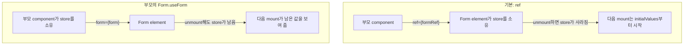

# 0040 — Form store ownership: a ref by default

## Summary

- form은 기본으로 ref(`<Form ref={formRef}>`)로 다룬다. 그러면 `<Form>` element가 자기 store를 소유하고, store의 수명은 element의 수명과 같다.
- `Form.useForm()`은 instance가 `<Form>`의 수명이나 context 밖에 있어야 할 때만 쓴다. 즉 `<Form>` 밖에서 render 중에 instance를 읽을 때(선언한 component의 `Form.useWatch(name, form)`, 또는 `<Form>` 밖의 child), 또는 `<Form>`이 잠깐 unmount되는 동안에도 입력이 남아야 할 때다.
- `<Form>` 안에서 render 중에 값을 읽는 데에는 부모의 instance가 필요 없다. `shouldUpdate` comparator를 둔 `Form.Item`, 또는 `<Form>` 안에서 render되며 `Form.useWatch(name)`이나 `Form.useFormInstance()`를 부르는 child를 쓴다.
- 남겨 둔 `Form.useForm()`의 `<Form>`이 새 record로 다시 mount되면, form을 여는 곳에서 `form.setFieldsValue(values)`로 그 record의 값을 넣거나 hook을 unmount되는 child로 옮긴다. 이 용도로 `clearOnDestroy`는 쓰지 않는다.
- 이 규칙은 `react/src`와 `packages/backend.ai-ui/src`에 똑같이 적용된다. `.claude/rules/form-store-ownership.md`에 쓰고 `AGENTS.md`에 요약한다. 기존 call site는 다른 이유로 그 파일을 고칠 때만 바꾼다.

> 낯선 용어는 문서 맨 아래 [용어](#용어)에 모아 두었다.

## Context

- **The engine**: `Form`, `Form.useForm`, `Form.useWatch`는 `form-engine` alias를 거쳐 `@lablup/ui-common/Form`에서 온다(ADR 0009). form의 값, error, touched 상태는 store에 있다.
- **Who creates the store owns it**: `form` prop이 없으면 `<Form>`이 자기 React state에 store를 만든다(`Form` 안의 `useForm(undefined)`). 그래서 element가 unmount되면 store도 사라지고, 다음 mount는 `initialValues`부터 시작한다. `Form.useForm()`이 만든 `form={form}`을 넘기면 store는 hook을 부른 component에 있고, `<Form>`이 unmount되어도 남는다.
- **The failure**: hook을 부른 component는 mount된 채로 그 아래의 `<Form>`만 unmount되었다가 다시 mount되면(modal body, drawer, wizard step), store가 이전 입력을 그대로 들고 있다. 다시 mount될 때 engine은 새 `initialValues`를 남아 있는 store 아래에 합치므로, store에 이미 있는 key는 모두 이전 값을 유지한다. 다시 연 modal이 이전 record의 입력을 보여 준다.
- **Why a decision is needed**: `Form.useForm()`을 부르는 component 파일은 34개, `useRef<FormInstance`를 쓰는 파일은 48개다(`react/src`와 `packages/backend.ai-ui/src`에서 test와 story를 뺀 `.tsx` 파일, 2026-11-26 기준). 그리고 `useForm`을 부르는 component 대부분은 instance를 event handler에서만 읽는다. review가 ref를 하나씩 요청해 왔고(#11311), 가리킬 수 있는 규칙이 문서로 없었다.

## 설계도

## Decision

### 1. A ref is the default

- **Shape**: `const formRef = useRef<FormInstance<Values>>(null)`와 `<Form ref={formRef}>`를 쓴다. `FormInstance`는 `Form`과 같은 `form-engine` specifier에서, 그 파일의 `../` 깊이에 맞춰 import한다.
- **Where the ref is used**: `<Form>`이 mount되어 있는 동안 실행되는 handler(submit, `onOk`, field의 `onChange`)에서 쓴다. `<Form>`이 mount되지 않은 동안 ref는 `null`이므로 그때 `formRef.current?.…`는 아무것도 하지 않는다.
- **Data that arrives later**: 나중에 오는 data는 `initialValues`로 넣거나, `<Form>` 안에서 render되는 component가 `Form.useFormInstance()`로 얻은 instance의 `setFieldsValue`로 넣는다. `<Form>`이 mount되기 전에 실행될 수 있는 부모의 effect에서 넣지 않는다.

### 2. `Form.useForm()` only where the instance must outlive or sit outside the Form

| 경우 | 예 |
|---|---|
| 선언한 component가 `<Form>`의 context 밖에서 render 중에 instance를 읽는다 | `VFolderDeployModal.tsx`에서 `Form.useWatch('resourceGroup', form)`이 Deploy 버튼의 `disabled`를 정한다 |
| `<Form>` 밖에서 render되는 child가 render 중에 instance를 읽는다 | instance를 prop으로 그 child에 넘긴다 |
| `<Form>`이 잠깐 unmount되는 동안에도 입력이 남아야 한다 | refetch 중 `loading`이 body를 `BAISkeleton`으로 바꾸는 `BAIModal`, 다시 suspend되는 Suspense boundary, step을 하나씩 render하는 wizard |

### 3. Render-time reads inside the Form need no parent instance

- **`shouldUpdate` comparator**: `<Form.Item noStyle shouldUpdate={(prev, cur) => prev.type !== cur.type}>{({ getFieldValue }) => …}</Form.Item>`를 쓴다. comparator 없는 `shouldUpdate`는 store가 바뀔 때마다 다시 render한다. `dependencies`만으로는 `Form.useWatch`를 대신하지 못한다. `dependencies`만 있는 이름 없는 item은 사용자 입력에는 다시 render하지만 `setFieldValue`나 `setFieldsValue`에는 다시 render하지 않는다.
- **A child inside the `<Form>`**: form 인자 없는 `Form.useWatch(name)`과 `Form.useFormInstance()`는 context에서 form을 읽는다.

### 4. A kept `Form.useForm()` owns its lifetime

- **Values for a new open**: store를 부모가 소유하므로, form을 여는 handler에서 부른 `form.setFieldsValue(values)`는 `<Form>`이 mount되기 전에도 동작한다. hook을 그 `<Form>`과 함께 unmount되는 child로 옮기면 mount마다 새 store를 받는다. 다만 2절의 잠깐 unmount되는 경우에는 맞지 않는다.
- **No `clearOnDestroy`**: engine은 unmount cleanup에서 store를 비운다. 개발 모드의 `React.StrictMode`(`react/src/index.tsx`)는 첫 mount 직후 이 cleanup을 한 번 실행하므로, field에는 값이 보이는데 store는 비어 있게 된다. 잠깐 unmount되는 경우에는 입력도 지운다.
- **No early reset**: `<Form>`이 mount되기 전에 부른 `form.resetFields()`는 이전 mount의 `initialValues`를 되돌린다. store는 `<Form>`이 render되는 동안에만 새 `initialValues`를 받기 때문이다.

### 5. Scope and enforcement

- **Where it is written**: `react/**`와 `packages/backend.ai-ui/**`에 path를 지정해 두 package 모두에서 읽히는 `.claude/rules/form-store-ownership.md`와, 모든 session이 읽는 `AGENTS.md`의 한 줄에 쓴다. `.github/instructions/react.instructions.md`에는 이 rule을 가리키는 짧은 안내와 review checklist 항목만 둔다.
- **No sweep**: 기존 `Form.useForm()` call site는 다른 이유로 그 파일을 고칠 때 바꾼다. 이 규칙을 강제하는 ESLint rule은 없고, review가 확인한다.

## 대안과 기각 사유

- **`Form.useForm()` everywhere**: 모든 form에 같은 pattern을 쓰면 가르치기 쉽다. 그러나 부모가 모든 store를 소유하게 되고, 다시 mount되는 form마다 reset code를 손으로 써야 하므로 기각한다. ref를 쓰면 그 reset이 필요 없다.
- **A ref everywhere**: 이것도 pattern이 하나다. 그러나 `<Form>` 밖에서 render 중에 값을 읽는 경우와 잠깐의 unmount 동안 입력이 남아야 하는 경우에는 element보다 오래 사는 store가 필요하므로 기각한다.
- **An ESLint rule**: lint rule이 render-time read 없는 새 `Form.useForm()`을 잡아낼 수 있다. 그러나 정당한 경우(2절)와 handler에서만 쓰는 경우를 구분하려면 기존 rule이 하지 않는 data flow 분석이 필요하므로 지금은 기각한다.

## Consequences

- 다시 mount되는 form은 reset code 없이 `initialValues`부터 시작하므로, 기본 경로에서 이전 입력이 남는 bug가 사라진다.
- handler는 `formRef.current?.…`로 form에 접근하는데, `<Form>`이 mount되지 않았으면 아무것도 하지 않는다. unmount된 form을 다뤄야 하는 code는 기본 pattern을 쓸 수 없다.
- `Form.useForm()`을 남기는 component는 2절의 경우 중 하나에 해당해야 하고, review가 이를 확인한다.
- 기존 call site는 그 파일을 고칠 때까지 두 방식이 섞여 있다.

## 출처

- GitHub issue #11431, 2026-11-26 결정. 같은 변경을 요청한 #11311의 review.
- engine 동작은 고정된 `0.2.0-alpha.21` canary의 `@lablup/ui-common/Form`(`Form`, `FormStore`, `Field`, `useWatch`)에서 읽었다.
- 관련: ADR 0009(`@lablup/ui-common/Form`의 form engine, `form-engine`이 re-export한다).

## 용어

| 용어 | 뜻 |
|---|---|
| form store | form의 값, error, touched 상태를 담는 object다. `Form.useForm()`이나 `<Form>` 자신이 만든다 |
| render-time read | event handler 안이 아니라 component가 render되는 동안 form 값을 읽는 code다 |
