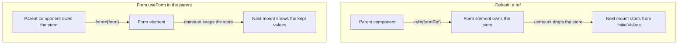

# 0040 — Form store ownership: a ref by default

## Summary

- A form is reached through a ref (`<Form ref={formRef}>`) by default, so the `<Form>` element owns its store and the store's lifetime is the element's.
- `Form.useForm()` is used only when the instance must exist outside the `<Form>`'s own lifetime or context: it is read during render outside the `<Form>` (`Form.useWatch(name, form)` in the declaring component, or a child outside the `<Form>`), or the input must survive the `<Form>` unmounting for a moment.
- A render-time read inside the `<Form>` needs no instance in the parent: a `Form.Item` with a `shouldUpdate` comparator, or a child rendered inside the `<Form>` that calls `Form.useWatch(name)`. `Form.useFormInstance()` does not subscribe, so it serves handlers and effects, not render-time reads.
- The rule applies to `react/src` and `packages/backend.ai-ui/src` alike. It is written in `.claude/rules/form-store-ownership.md` and summarised in `AGENTS.md`. Existing call sites change only when their file is edited for another reason.

> Unfamiliar terms are collected in the [Glossary](#glossary) at the end.

## Context

- **The engine**: `Form`, `Form.useForm` and `Form.useWatch` come from `@lablup/ui-common/Form` through the `form-engine` alias (ADR 0009). A form's values, errors and touched state live in a store.
- **Who creates the store owns it**: With no `form` prop, `<Form>` creates the store in its own React state (`useForm(undefined)` inside `Form`), so unmounting the element drops the store and the next mount starts from `initialValues`. With `form={form}` from `Form.useForm()`, the store lives in the component that called the hook and survives the `<Form>` unmounting.
- **The failure**: When the hook's component stays mounted while the `<Form>` below it unmounts and mounts again (a modal body, a drawer, a wizard step), the store keeps the previous input. On remount the engine merges the new `initialValues` under the kept store, so every key the store already holds keeps its old value. A reopened modal shows the last record's input.
- **Why a decision is needed**: both patterns are in use, and most `Form.useForm()` callers read the instance only in event handlers. Review comments asked for the ref case by case (#11311), with no written rule to point at.

## Diagram

## Decision

### 1. A ref is the default

- **Shape**: `const formRef = useRef<FormInstance<Values>>(null)` and `<Form ref={formRef}>`. `FormInstance` is imported from the same `form-engine` specifier as `Form`, at the file's `../` depth.

### 2. `Form.useForm()` only where the instance must outlive or sit outside the Form

| Case | Example |
|---|---|
| The declaring component reads the instance during render, outside the `<Form>`'s context | `Form.useWatch('resourceGroup', form)` feeding the Deploy button's `disabled` in `VFolderDeployModal.tsx` |
| A child rendered outside the `<Form>` reads the instance while rendering | the instance passed as a prop to that child |
| The input must survive the `<Form>` unmounting for a moment | a `BAIModal` whose `loading` swaps the body for `BAISkeleton` during a refetch; wizard steps rendered one at a time |

### 3. Render-time reads inside the Form need no parent instance

- **`shouldUpdate` comparator**: `<Form.Item noStyle shouldUpdate={(prev, cur) => prev.type !== cur.type}>{({ getFieldValue }) => …}</Form.Item>`. A bare `shouldUpdate` re-renders on every store change. `dependencies` alone is not a replacement for `Form.useWatch`: an unnamed item with only `dependencies` re-renders on user input but not on `setFieldValue` or `setFieldsValue`.
- **A child inside the `<Form>`**: `Form.useWatch(name)` with no form argument reads the form from context and re-renders when the value changes. `Form.useFormInstance()` returns the same instance from context without subscribing, so a value read through it during render stays at its first value; it serves the child's handlers and effects.

### 4. Scope and enforcement

- **Where it is written**: `.claude/rules/form-store-ownership.md`, path-scoped to `react/**` and `packages/backend.ai-ui/**` so it loads for both packages, and one line in `AGENTS.md`, which every session loads. `.github/instructions/react.instructions.md` keeps a short pointer to the rule and a review checklist item.
- **No sweep**: existing `Form.useForm()` call sites are converted when their file is edited for another reason. No ESLint rule enforces this; review does.

## Rejected alternatives

- **`Form.useForm()` everywhere**: One pattern for every form is simpler to teach. It is rejected because the parent then owns every store, and each remounting form needs a hand-written reset that the ref case gets for free.
- **A ref everywhere**: One pattern again. It is rejected because a render-time read outside the `<Form>` and input that must survive a brief unmount both need a store that outlives the element.
- **An ESLint rule**: A lint rule would catch a new `Form.useForm()` without a render-time read. It is rejected for now because telling a legitimate case (section 2) from a handler-only one needs data flow analysis no existing rule does.

## Consequences

- A form that remounts starts from its `initialValues` without reset code, which removes the stale-input bug class from the default path.
- `formRef.current` is `null` while the `<Form>` is not mounted, so code that must act on an unmounted form cannot use the default.
- A component that keeps `Form.useForm()` has to show one of the section 2 cases, and review checks it.
- Existing call sites stay mixed until their files are edited.

## Sources

- GitHub issue #11431, decided 2026-11-26; the review on #11311 that asked for the same change.
- Engine behaviour read from `@lablup/ui-common/Form` (`Form`, `FormStore`, `Field`, `useWatch`) at the pinned `0.2.0-alpha.21` canary.
- Related: ADR 0009 (the form engine in `@lablup/ui-common/Form`, re-exported by `form-engine`).

## Glossary

| Term | Meaning |
|---|---|
| form store | The object that holds a form's values, errors and touched state, created by `Form.useForm()` or by `<Form>` itself |
| render-time read | Code that reads a form value while the component renders, as opposed to inside an event handler |
