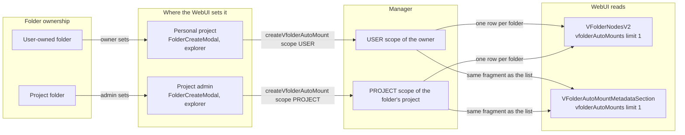

# 0040 — One auto-mount per folder

## Summary

> Unfamiliar terms are collected in the [Glossary](#glossary) at the end.

- The manager stores an [auto-mount](#glossary) as a setting on one [scope](#glossary), a user or a project. It refuses a second live auto-mount of the same folder in the same scope, but it accepts the same folder in several scopes.
- The WebUI sets an auto-mount only on the scope that owns the folder. A user-owned folder is auto-mounted for its owner from the personal project. A project folder is auto-mounted for its project by the project admin.
- Because of that rule, the WebUI treats a folder as having at most one auto-mount, and every read of a folder's auto-mount asks for one row.
- **Out of scope**: auto-mounts that another client sets on a scope that does not own the folder. The WebUI does not show or manage them.

## Context

- **Manager model**: Since 26.10 the manager keeps auto-mounts in the `vfolder_auto_mounts` table, one row per scope and folder. The unique index `uq_vfolder_auto_mounts_live_vfolder` covers `scope_type`, `scope_id` and `vfolder_id` for rows that are not deleted, and `uq_vfolder_auto_mounts_live_destination` covers `scope_type`, `scope_id` and `mount_destination`.
- **No owner check in the manager**: `createVfolderAutoMount` takes any scope and folder. Nothing in the manager checks that the scope owns the folder.
- **One read path**: The folder list and the folder explorer both read the folder's own `VFolder.vfolderAutoMounts` through `VFolderNodesV2AutoMountCellFragment`. The connection returns several rows when one folder is set on several scopes.

## Diagram

## Decision

### 1. The owning scope is the only scope

- **Scope choice**: Every WebUI path that creates an auto-mount derives the scope from the folder's owner. A folder whose `accessControl.ownershipType` is `USER` gets the `USER` scope of `ownership.userId`. A project-owned folder whose `ownership.project.basicInfo.type` is `PERSONAL` gets the `USER` scope of `ownership.creatorId`, that project's only user, whoever opens it. Any other folder gets the `PROJECT` scope of `ownership.projectId`.
- **Revision model folder**: `DeploymentAddRevisionModal` passes `USER` with the deployment's `creator` when the deployment's project (`metadata.projectV2.basicInfo.type`) is `PERSONAL`, and `PROJECT` otherwise, so a superadmin adding a revision to another user's personal deployment auto-mounts the new folder on that owner; `FolderCreateModal` shows the same other-user warning then.
- **Another user's scope**: When the `USER` scope is not the caller's own (a superadmin on another user's folder), `VFolderAutoMountSettingModal` shows a warning that the auto-mount is set on that user, named by `ownership.creatorEmail`.
- **Creation paths**: `FolderCreateModal` always creates a project folder with `createVFolderInProject`, in the personal project too. In the personal project it auto-mounts the folder for the user; in any other project it auto-mounts the folder for that project. Neither component decides the scope itself: the caller of `FolderCreateModal` passes `autoMountScopeType` (`USER` when the target is the caller's personal project, `PROJECT` by default), and `VFolderAutoMountMetadataSection` derives the scope from its own fragment of the folder.
- **Folder entry points**: An auto-mount is added only from a folder: `FolderCreateModal` and the folder explorer's `VFolderAutoMountMetadataSection`. `VFolderAutoMountSettingModal` always receives that folder and offers no folder picker.

### 2. One row per folder on read

| Component                         | Query                                                                                 | Limit      |
| --------------------------------- | ------------------------------------------------------------------------------------- | ---------- |
| `VFolderNodesV2`                  | `vfolderAutoMounts` on each `VFolder` row                                             | `limit: 1` |
| `VFolderAutoMountMetadataSection` | the same `VFolderNodesV2AutoMountCellFragment`, spread in the explorer's folder query | `limit: 1` |

- **Single value**: The folder list cell and the explorer section render the first row as the folder's auto-mount setting.
- **Explorer actions**: The explorer section offers Add when the row is absent and Edit or Remove when it is present. It never offers a second Add for the same folder.

### 3. Permissions gate the actions, not the display

- **Display**: `VFolderAutoMountMetadataSection` shows what `VFolderNodesV2AutoMountCellFragment` returns, the same as the folder list. A permission check never hides it.
- **Action permissions**: Edit and Remove check `UPDATE` and `SOFT_DELETE` on the existing row's own `scopeType`/`scopeId`; Add checks `CREATE` on the scope from section 1. Both read `myScopePermissions` with `entityType: "vfolder_auto_mount"`.
- **Missing permission**: An action the caller may not perform stays visible, disabled, with a tooltip that says the permission is missing (`BAINameActionCell`'s `disabled: { reason }`). When the scope cannot be derived because `ownership.project` cannot be read, Add is disabled the same way.
- **V2 fields only**: The project type comes from `vfolderV2.ownership.project`, caught with `@catch(to: NULL)` in the section's own fragment so a share recipient's project error does not fail the explorer's folder node (#10647). The legacy `group_node` is not used for this.

## Rejected alternatives

- **Several auto-mounts per folder**: The WebUI could list every scope a folder is set on and let the user add more. That shows the full manager state, but it is rejected because the WebUI never creates such a folder, and the extra list would add UI for a state only another client can produce.
- **Manager-side uniqueness per folder**: A unique index on `vfolder_id` alone would make the rule hold for every client. It is rejected for the WebUI because the index belongs to the manager; the WebUI follows the manager's per-scope model and enforces the rule in its own creation paths.

## Consequences

- **Fewer rows**: The folder list asks the manager for one auto-mount per row instead of the whole connection.
- **Hidden extra rows**: A folder that another client set on a second scope shows only one of its auto-mounts in the folder list, and the explorer shows only the owning scope's row.
- **Rule location**: The rule holds only while every WebUI creation path derives the scope from the owner. A new path that lets the user choose the scope must revisit this ADR.

## Sources

- #10529 — show and configure auto-mount folders.
- Manager migration `456a338e7c3a_add_vfolder_auto_mounts.py` (lablup/backend.ai, 26.10.0a9) — the two unique indexes.
- Manager change BA-8682 (lablup/backend.ai#16212) — `VFolder.vfolderAutoMounts`.
- Decided 2026-11-16.

## Glossary

| Term       | Meaning                                                                                                                         |
| ---------- | ------------------------------------------------------------------------------------------------------------------------------- |
| auto-mount | A setting that tells the manager to mount a folder, at a given destination and permission, into every session a scope creates.  |
| scope      | The user or the project an auto-mount is set on, written as `scopeType` (`USER` or `PROJECT`) and `scopeId` in the GraphQL API. |
