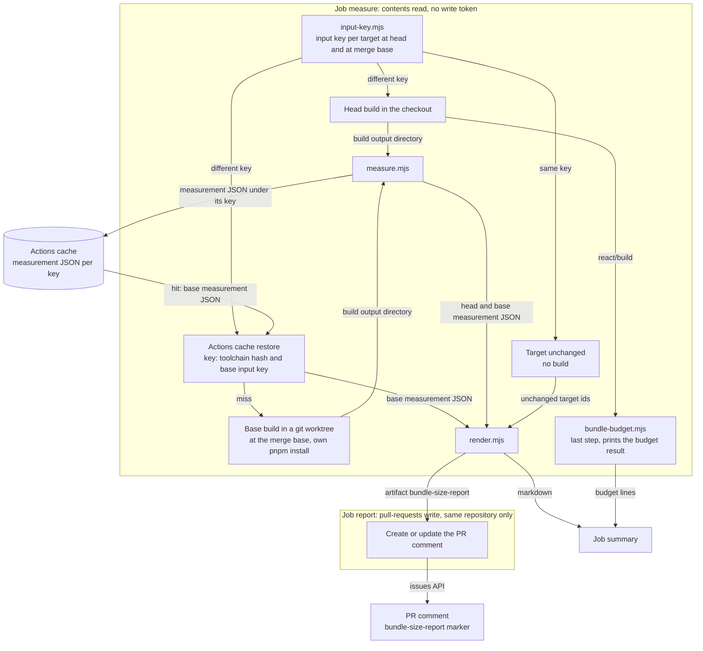

# 0040 — Per-PR bundle size comparison

## Summary

> Unfamiliar terms are collected in the [Glossary](#glossary) at the end.

- `.github/workflows/bundle-size.yml` builds each [bundle target](#glossary) that a PR affects twice, once at the PR head and once at the [merge base](#glossary), and reports the size of both and the difference.
- `.github/scripts/bundle-size/targets.mjs` lists the bundle targets: the WebUI app (`react/build`) and the `backend.ai-ui` library (`packages/backend.ai-ui/dist`). Each target names its build command, its output directory, and its [input paths](#glossary).
- A target is compared only when its [input key](#glossary) at the head differs from its input key at the merge base. The input key, together with the [toolchain hash](#glossary), also names the target's measurement in the Actions cache, so a base whose measurement is already cached is not built again.
- The workflow posts one PR comment, which it updates on every push, and writes the same report to the job summary. A fork PR gets the job summary only.
- The comparison never fails the workflow. The boot-path budget step of `scripts/bundle-budget.mjs` (#9948) keeps its current behaviour: it prints its result and does not fail the job either (#11368).
- This workflow becomes the only place that measures bundle size. The `📦 Bundle Size` section of the PR Analysis Report in `.github/workflows/pr-preview.yml` and its `measure-dist.mjs` are removed.
- **Out of scope**: `packages/backend.ai-client` is not a target of its own, because only the WebUI app ships it and the `webui` target measures it; the other workspace packages are not compared.

## Context

- **WebUI app today**: `bundle-size.yml` builds the app with `pnpm run build:react-only` and runs `scripts/bundle-budget.mjs`, which exits non-zero when the [eager chunks](#glossary) exceed 2.8 MB or a chunk exceeds the 5 MiB service-worker precache limit. The step pipes the script into `tee` under a shell without `pipefail`, so the job does not fail on that exit code; `main` measures 3.73 MB and passes. It prints the head's numbers to the job summary and has nothing to compare them with, so a reviewer cannot see what the PR added.
- **`backend.ai-ui` today**: The `build` job of `pr-preview.yml` builds the library at the head, then deletes `packages/backend.ai-ui/src`, checks out `src/` from the tip of the base branch, and builds again. The job skips the base build whenever the PR changes a dependency or a build config, because it reuses the head's `node_modules`. The job runs only when the PR changes `packages/backend.ai-ui/` or the preview's own workflow and scripts, so a lockfile change that changes the library's output gets no number.
- **Checkout ref**: For a `pull_request` event, `actions/checkout` without `ref` checks out `refs/pull/<N>/merge`, a merge of the PR into the tip of the base branch, not the PR head.
- **Cache scope**: A run can restore caches saved on its own ref, on the PR's base branch, and on the default branch. A cache saved by a PR run belongs to `refs/pull/<N>/merge`, so only later runs of the same PR can restore it.

## Diagram

## Decision

### 1. Bundle targets

`.github/scripts/bundle-size/targets.mjs` exports the target list below. A new target is a new row in that file, plus one cache restore step and two cache save steps in `bundle-size.yml`, because an `actions/cache` step takes a single key. The steps read the key and path from the plan by index, so no target id or build command is written into the workflow.

| id              | What it is                                      | Build command                       | Output directory              | Input paths                                                                                                                                                                                             |
| --------------- | ----------------------------------------------- | ----------------------------------- | ----------------------------- | ------------------------------------------------------------------------------------------------------------------------------------------------------------------------------------------------------- |
| `webui`         | The app the browser downloads                   | `pnpm run build:react-only`         | `react/build`                 | `react/`, `packages/backend.ai-ui/`, `packages/backend.ai-client/`, `resources/`, `data/`, `relay.config.js`, `relay-base.config.js`, `package.json`, `pnpm-lock.yaml`, `pnpm-workspace.yaml`, `.npmrc` |
| `backend.ai-ui` | The library published to npm as `backend.ai-ui` | `pnpm --filter backend.ai-ui build` | `packages/backend.ai-ui/dist` | `packages/backend.ai-ui/`, `relay.config.js`, `relay-base.config.js`, `package.json`, `pnpm-lock.yaml`, `pnpm-workspace.yaml`, `.npmrc`                                                                 |

- **Input paths**: A target's input paths are every repository path whose content can change its build output. A target whose input paths leave out a real input reports a false "unchanged", so the list errs toward including a path.
- **Workflow trigger**: `bundle-size.yml` runs on `pull_request` and on `push` to `main`. Both `paths:` filters are the union of every target's input paths and the toolchain hash paths of section 2.

### 2. Input key and toolchain hash

`.github/scripts/bundle-size/input-key.mjs` computes two values.

| Value          | Computed from                                                                                                                                                                                                  |
| -------------- | -------------------------------------------------------------------------------------------------------------------------------------------------------------------------------------------------------------- |
| Input key      | SHA-256 of the target `id` and, per input path in table order, `git rev-parse <commit>:<path>`, or the literal `missing` when the path does not exist at that commit                                           |
| Toolchain hash | SHA-256 of `git rev-parse HEAD:<path>` for `.nvmrc`, `.github/actions/setup-node-pnpm`, `.github/scripts/bundle-size`, `scripts/bundle-budget.mjs` and `.github/workflows/bundle-size.yml`, always at the head |

- **Comparison rule**: `bundle-size.yml` compares a target when the target's input key at the head differs from its input key at the merge base.
- **Toolchain change**: When the PR changes any toolchain hash path, `bundle-size.yml` compares every target, so a PR that changes the measurement code or the budget sees the report it produces. A target whose inputs did not change has equal keys, so its Δ is 0 and does not show the effect of the toolchain change.
- **Cache key**: A measurement is cached as `bundle-size-<toolchain hash>-<target id>-<input key>`, at the path `bundle-size-cache/<cache key>.json`. A measurement made with other measurement code or another Node version is therefore never reused.
- **Cache path**: The path depends on the key only, not on the side, because one measurement is the head of one run and the base of a later one.

### 3. Head and base builds

- **Head commit**: The `measure` job checks out `github.event.pull_request.head.sha` with `fetch-depth: 0`, so the head is the PR head and `git merge-base` always finds the base.
- **Base commit**: The base is `git merge-base origin/<base_ref> HEAD`. A PR stacked on another branch therefore compares against its parent branch and reports only its own layer.
- **Per-target loop**: `.github/scripts/bundle-size/run.mjs` runs the steps of this section for each target, between the cache restore steps and the cache save steps. It runs `pnpm install --frozen-lockfile` before its first head build, so a run that builds nothing installs nothing.
- **Cache first**: The job restores the base's cache key. A hit supplies the base measurement and no base build runs.
- **Equal keys**: When a target is compared only because the toolchain changed, its head and base cache keys are equal, and `run.mjs` uses the head measurement as the base, with `source: "head"`.
- **Separate worktree**: On a miss, the job runs `git worktree add "$RUNNER_TEMP/bundle-base" <merge base>`, runs `pnpm install --frozen-lockfile` inside it, and runs the target's build command there. The base thus builds with its own lockfile, config and `node_modules`.
- **Shared toolchain**: Both builds run on the Node and pnpm that `setup-node-pnpm` installed from the head, and they share its pnpm store.
- **Saving**: A push run saves the head measurements it made, and a PR run saves the base measurements it built, each under its cache key. A PR run does not save its head measurements, because a PR run always builds the head and no later run restores them. The cache holds only the measurement JSON, not the build output.
- **Push to `main`**: A push run measures each target at the pushed commit whose cache key is not cached yet and saves it. It renders the head values to the job summary and posts nothing. Its `concurrency` group is the commit SHA with `cancel-in-progress: false`, so every pushed commit keeps its measurement.
- **Base failure**: When a base build fails, `measure.mjs` writes a base file that carries only the error, and `render.mjs` shows that error in place of the base column. The job does not fail because of it.

### 4. Measurement

`.github/scripts/bundle-size/measure.mjs --target <id> --side head|base --dir <output directory>` writes `bundle-size/<target id>.<side>.json`.

| Field            | Content                                                                              |
| ---------------- | ------------------------------------------------------------------------------------ |
| `target`, `side` | The target id and `head` or `base`                                                   |
| `commit`         | The commit that was built                                                            |
| `source`         | `build`, `cache`, or `head` for a base that is the head measurement (equal keys)     |
| `error`          | The build error, present only when the build failed; no value fields follow it       |
| `totals`         | An object of named byte counts, listed per target below                              |
| `parts`          | An array of `{ name, bytes, gzipBytes, hash }`, one entry per chunk stem or per file |

| Target          | `totals`                                                                                                                           | `parts`                                                                                                                                                         |
| --------------- | ---------------------------------------------------------------------------------------------------------------------------------- | --------------------------------------------------------------------------------------------------------------------------------------------------------------- |
| `webui`         | Eager JS bytes and gzip bytes, eager chunk count, total JS bytes and gzip bytes, total CSS bytes and gzip bytes, total chunk count | One entry per [chunk stem](#glossary) of the `.js` chunks under `assets/`, the bytes of its chunks summed; CSS appears in the totals only                       |
| `backend.ai-ui` | Total JS bytes and gzip bytes, total CSS bytes and gzip bytes                                                                      | One entry per [file stem](#glossary) of the `.js` and `.css` files anywhere under `dist/`, the bytes of its files summed; `.map` and `.d.ts` files are left out |

- **One eager count**: The `webui` eager values come from `measure()` exported by `scripts/bundle-budget.mjs`, so the comment and the budget check count the same chunks.
- **Entry-point guard**: `scripts/bundle-budget.mjs` runs its check and calls `process.exit` only when it is the entry point (`process.argv[1] && existsSync(process.argv[1]) && import.meta.url === pathToFileURL(realpathSync(process.argv[1])).href`), so importing `measure()` runs nothing. `realpathSync` keeps the check running when the script is reached through a symlinked path, and `existsSync` keeps an argument that is not a file from throwing on import. `input-key.mjs`, `measure.mjs` and `render.mjs` use the same guard.
- **Gzip level**: Every gzip value uses `gzipSync` at its default level, the level `measure()` already uses.

### 5. Report

`.github/scripts/bundle-size/render.mjs` reads the measurement files and writes `bundle-size-report.md` and `bundle-size-report.json`.

- **Target section**: Each compared target gets a table of its `totals` with base, head, the difference in bytes and the difference in percent.
- **Changed parts**: Under the totals, each section lists the ten `parts` with the largest absolute gzip difference. A part present on one side only counts as zero on the other and is marked new or removed.
- **Unchanged targets**: One line lists the targets whose input key did not change.
- **Header**: The report names the head commit and the merge-base commit, and says per target whether the base came from the cache or from a build, or that the inputs are unchanged and the head measurement stands in for the base, so Δ is 0.
- **Marker**: The markdown starts with `<!-- bundle-size-report -->`, the string the `report` job uses to find its earlier comment.
- **Manifest**: `bundle-size-report.json` holds `{ "compared": <number of compared targets> }` for the `report` job.

### 6. Delivery

- **Job summary**: The `measure` job appends `bundle-size-report.md` to `$GITHUB_STEP_SUMMARY` on every run.
- **Artifact**: The `measure` job uploads both report files as the `bundle-size-report` artifact before the budget step runs.
- **Report job condition**: The `report` job runs for `pull_request` events from the same repository with `if: ${{ !cancelled() }}`, so a failure in a later step still leaves a comment.
- **Report job token**: The `report` job holds `pull-requests: write` and no other permission.
- **Report job content**: The `report` job checks out no code, runs no `pnpm install` and no package script. It downloads the artifact and calls the issues API from `actions/github-script`.
- **Comment rule**: When `compared` is above zero, the `report` job updates the comment that carries the marker, or creates one. When `compared` is zero, it updates an existing comment and creates none. When the artifact is missing and the `measure` job's result is `failure`, it replaces an existing comment with a note naming the unmeasured head commit and linking the run, and creates none.
- **Skipped workflow**: When the `paths:` filter skips the whole workflow, the earlier comment stays as it is. Its header names the commit it measured.

### 7. Failure policy

- **Advisory comparison**: No difference, however large, fails the workflow. `render.mjs` and the `report` job exit zero on every input.
- **Budget step**: `scripts/bundle-budget.mjs` runs on the head's `webui` build as the last step of the `measure` job, with the same `| tee` command as before, so it prints its result and does not fail the job. Making it fail is #11368.
- **Budget skip**: The budget step runs only when the run built `webui` at the head. On a PR that is when `webui` is compared; on a push to `main` it is when the commit's `webui` measurement was not cached yet.
- **Script tests**: The `measure` job runs `node --test .github/scripts/bundle-size/*.test.mjs` before any build.

### 8. Removal from the PR Analysis Report

- **Removed steps**: The two `Build and measure the package bundle` steps of `pr-preview.yml` and `.github/scripts/pr-preview/measure-dist.mjs` are removed.
- **Removed section**: `generate-pr-comment.mjs` drops its `📦 Bundle Size` section and its `--bundle-head` and `--bundle-base` options, and its test drops the matching cases.

## Rejected alternatives

- **Keep the `src/` swap of `pr-preview.yml`**: It reuses the head's `node_modules`, so it needs no second install. It is rejected because it cannot compare a PR that changes a dependency or a build config, which are the PRs most likely to change the size.
- **Always build the base**: It needs no cache and no input key. It is rejected because it doubles the build time of every run, while most merge bases are commits of `main` that a push run has already measured.
- **Compare against the tip of the base branch**: It needs no `git merge-base`. It is rejected because commits merged into the base branch after the PR branched would show up as the PR's own difference.
- **Select targets from the changed file list**: Matching the diff against each target's paths needs no tree hashes. It is rejected because the cache still needs a key that names the base's inputs, and the input key answers both questions with one value.
- **Post from a `workflow_run` workflow**: It gives fork PRs a comment. It is rejected for the reason in the header of `pr-preview.yml`: a run that a Copilot coding agent push holds for approval is followed by a second held run that no PR page lists.
- **Post from a `pull_request_target` workflow**: It also gives fork PRs a comment. It is rejected because building the PR there runs PR-authored code with a write token, which `label.yml` and `assign-linked-issue.yml` avoid by never checking out PR code.
- **Fail on a size increase over a threshold**: It turns the comparison into a gate. It is rejected because the boot-path budget is the gate (#9948, #11368), and a per-PR threshold would fail intended growth, such as a new page.
- **A third-party size action**: Actions such as `preactjs/compressed-size-action` compare sizes with no repository code. It is rejected because it cannot reuse `measure()` from `scripts/bundle-budget.mjs`, so the comment and the budget would count different chunks.

## Consequences

- **Visible size change**: A reviewer sees on the PR what each affected target gained or lost, and which chunks or files did it.
- **Dependency PRs compared**: A lockfile, catalog or Vite config change gets a difference, which the `src/` swap could not give.
- **Cost on a cache miss**: A run whose base is not cached runs a second `pnpm install` and a second build per compared target, which adds several minutes.
- **Stacked PRs uncached**: A stacked PR's merge base is a commit of its parent branch, which no push run measures, so its first run always builds the base. Later pushes of the same PR restore that base from the PR's own cache.
- **Broad input paths**: A PR that changes only tests or stories under `react/` or `packages/backend.ai-ui/` still builds the targets and reports a zero difference.
- **Node version not compared**: Both sides build on the head's Node, so a PR that changes `.nvmrc` compares every target but shows only what the new Node does to both.
- **Library build drift**: Two builds of `backend.ai-ui` at one commit differ by a few hundred bytes, so a cached base and a fresh head can show a small difference when nothing changed.
- **Runner image outside the key**: The cache key does not include the `ubuntu-latest` image, so a cached base measured before an image update meets a head measured after it.
- **Fork PRs**: A fork PR gets the report only in the job summary.

## Sources

- #11316 — Add CI workflow comparing bundle size between main and PR per modified package (2026-11-23).
- #9948 — Gate the initial bundle size in CI; `scripts/bundle-budget.mjs` and `.github/workflows/bundle-size.yml` on `main`.
- #11368 — Make the boot-path bundle budget check fail CI when it is exceeded.
- `.github/workflows/pr-preview.yml` — the `backend.ai-ui` head and base measurement this decision replaces.
- GitHub Docs, "Dependency caching reference", restrictions for accessing a cache: a run restores caches of its own ref, the base branch and the default branch, and a PR run saves to `refs/pull/<N>/merge`.

## Glossary

| Term           | Meaning                                                                                                                                                                                                                                                      |
| -------------- | ------------------------------------------------------------------------------------------------------------------------------------------------------------------------------------------------------------------------------------------------------------ |
| bundle target  | A bundle target is one build output that this workflow measures, defined by a row of `.github/scripts/bundle-size/targets.mjs`.                                                                                                                              |
| input paths    | The input paths of a bundle target are the repository paths whose content can change the target's build output.                                                                                                                                              |
| input key      | An input key is a SHA-256 over a target's id and the git object hashes of its input paths at one commit (Decision section 2).                                                                                                                                |
| toolchain hash | The toolchain hash is a SHA-256 over the head's `.nvmrc`, setup action, measurement scripts, budget script and workflow file; it is part of every cache key so a measurement is reused only under the same tools.                                            |
| merge base     | The merge base is the newest commit that the PR head and the base branch share, as `git merge-base` returns it.                                                                                                                                              |
| eager chunks   | The eager chunks are the entry script of `react/build/index.html`, every chunk it imports statically, and every chunk the page modulepreloads, as `scripts/bundle-budget.mjs` collects them.                                                                 |
| chunk stem     | A chunk stem is a `webui` chunk file name under `assets/` with the match of `/-[A-Za-z0-9_-]{8}\.js$/` removed, such as `index` for `assets/index-B3x9a2Qd.js`; chunks that share a stem are summed.                                                         |
| file stem      | A file stem is a `backend.ai-ui` `dist/` path with its build hash removed: the `-` and eight characters from `[A-Za-z0-9_-]` just before a final `.js` or `.css`, such as `dayjs.min.js` for `dayjs.min-DLOgbIIN.js`; a path without a hash is its own stem. |
