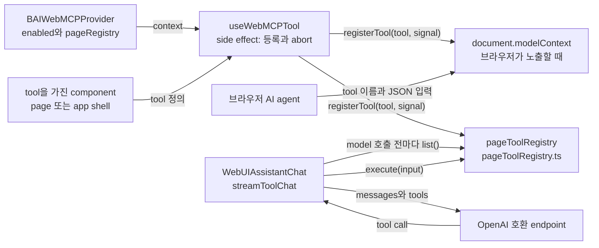

# 0041 — WebUI Assistant tool calls through the page's WebMCP tools

## Summary

> 낯선 용어는 문서 맨 아래 [용어](#용어)에 모아 두었다.

- WebUI Assistant는 endpoint가 `tools`를 받으면 [tool calling](#용어)으로 답한다. assistant가 model에 주는 tool은 page가 등록한 WebMCP tool(ADR 0025)과, 브라우저 안에서 매뉴얼을 찾는 `search_manual`이다.
- BUI의 `useWebMCPTool`은 모든 tool을 `document.modelContext`와 함께 두 번째 대상인 [page registry](#용어)에도 등록한다. page registry는 host가 `BAIWebMCPProvider`에 `pageRegistry`로 넘긴다. host는 사용자가 WebUI Assistant를 켰고 `[general] enableWebMCP`가 `false`가 아닐 때만 `pageToolRegistry`를 넘긴다.
- assistant는 정해 둔 page tool 목록(`ASSISTANT_PAGE_TOOLS`)만 model에 주고, model 호출 전마다 등록 상태로 목록을 다시 만든다.
- ADR 0025의 4절은 다른 agent와 똑같이 assistant에도 적용된다. tool은 읽기, 이동, 채우기만 하고, Apply, Launch, Submit은 사용자가 누른다.
- endpoint가 `tools`를 거부하면 assistant는 이전의 prompt 전용 경로로 답한다. system prompt에 매뉴얼 발췌를 넣고, dashboard에서는 dashboard agent prompt를 쓴다.

## Context

- **What the assistant is**: WebUI Assistant는 WebUI의 floating chat이다. 사용자마다 켜고(`experimental_webui_assistant`), 사용자가 고른 OpenAI 호환 endpoint(대개 Backend.AI deployment)에 연결한다. AI SDK(`ai`, `@ai-sdk/openai-compatible`)로 브라우저 안에서만 동작한다.
- **Before this decision**: 답 하나는 model 호출 하나였고, system prompt가 모든 것을 실었다. `searchManual`이 고른 매뉴얼 발췌, 또는 dashboard에서는 보드와 source와 예시(`buildDashboardChatPrompt`)를 넣고, 응답은 JSON으로 parse했다. model은 다른 page에서 아무것도 할 수 없었고, 기능을 하나 더할 때마다 prompt와 parser를 새로 써야 했다.
- **What WebMCP already gives**: page는 브라우저 agent를 위해 `bai_*` tool을 등록한다(ADR 0025). 입력 검사, 구조화된 error, 읽기·이동·채우기 경계가 이미 있다. assistant에 필요한 동작이 바로 이것이고, data를 가진 component가 이미 tool을 등록하고 있다.
- **Why a second target**: `document.modelContext`는 WebMCP origin trial이나 flag가 켜진 브라우저에만 있고, page는 거기에 등록한 tool을 나열하거나 부를 수 없다. assistant는 모든 브라우저에서 tool이 필요하고, 직접 불러야 한다.

## 설계도

## Decision

### 1. BUI는 page registry에도 등록한다

- **Prop**: `BAIWebMCPProvider`는 `pageRegistry?: WebMCPModelContext`를 받는다. `document.modelContext`와 같은 `registerTool(tool, { signal })` 모양이고, `BAIWebMCPContext`가 나른다.
- **Registration**: `enabled`인 동안 `useWebMCPTool`은 같은 descriptor를 같은 검사 wrapper와 signal로, 브라우저가 노출하면 `document.modelContext`에, host가 넘겼으면 `pageRegistry`에 등록한다. 둘 중 하나만 있어도 된다.
- **Re-registration**: `pageRegistry`가 있는지가 등록 key에 들어가므로, assistant를 켜거나 끄면 모든 tool이 두 대상에 다시 등록된다.
- **Active check**: `useBAIWebMCPActive()`는 `enabled`이고 대상이 하나라도 있으면 `true`다. 그래서 tool을 위해 query를 보내는 component는 assistant를 위해서도 보낸다.

### 2. host registry는 assistant를 위해서만 있다

- **File**: `react/src/components/WebUIAssistant/pageToolRegistry.ts`가 `createPageToolRegistry()`와 앱 하나에 하나인 `pageToolRegistry`를 내보낸다.
- **Type**: `PageToolRegistry extends WebMCPModelContext`이고 `list(): ReadonlyArray<WebMCPToolDescriptor>`, `get(name): WebMCPToolDescriptor | undefined`, `subscribe(listener): () => void`를 가진다. signal이 abort되면 tool을 지우되, 같은 이름을 더 새 등록이 차지했으면 지우지 않는다. 이미 abort된 signal로는 아무것도 등록하지 않는다.
- **Settling**: `waitForToolsToSettle(registry, { quietMs = 400, timeoutMs = 4000 })`는 `quietMs` 동안 등록이나 해제가 없거나 `timeoutMs`가 지나면 resolve한다.
- **Gate**: `DefaultProvidersForReactRoot`는 `experimental_webui_assistant`가 켜져 있을 때만 `pageRegistry={pageToolRegistry}`를 넘긴다. assistant가 꺼져 있으면 `pageToolRegistry`는 비어 있고, tool component는 브라우저 agent를 위해 보내는 query만 보낸다.

### 3. tool calling, 그리고 prompt 전용 경로를 fallback으로

- **Probe**: `probeToolCalling`(`assistantToolChat.ts`)은 `tools` 하나와 `tool_choice: "auto"`를 담은 `max_tokens: 1` completion을 보낸다. `WebUIAssistantChat`은 그 답을 base URL, key, model마다 cache한다. 지원한다는 답은 계속 두고, 거부는 1분 동안만 두었다가 다음 message에서 다시 묻는다. 2xx가 아니거나 network error면 chat은 prompt 전용 경로에 남고, page registry가 비어 있을 때(`[general] enableWebMCP = false`)도 그렇다. probe가 답하기 전에 보낸 message는 probe를 기다린다.
- **Loop**: `streamToolChat`(`assistantToolChat.ts`)은 model을 최대 `MAX_TOOL_STEPS`(8)번 부르고, tool call 없이 끝난 첫 호출에서 멈춘다. 한 호출의 tool call이 모두 앞서 한 호출(prefetch 포함)을 되풀이하거나 상한에 닿으면, tool 없이 한 번 더 불러 답을 쓰게 한다. 호출마다 `registry.list()`로 다시 만든 `toolSetOf(registry)`를 주고, tool 실행은 실행 시점에 `registry.get(name)`을 부른다. 더는 등록되어 있지 않은 tool은 `{ error: { code: 'tool_unavailable' } }`를 돌려준다. `bai_navigate`를 부른 뒤에는 다음 호출 전에 `waitForToolsToSettle`을 기다린다. 모든 호출은 UI message 하나로 stream된다.
- **Offered tools**: `ASSISTANT_PAGE_TOOLS`는 작은 model의 context에 들어가는 page tool을 나열한다. `bai_get_current_page`, `bai_navigate`, `bai_get_current_dashboard`, `bai_prepare_dashboard`, `bai_prepare_session`이다. `bai_prepare_session`은 등록되어 있지 않고 `bai_navigate`는 등록되어 있으면, launcher의 입력 schema를 가진 wrapper가 그 이름을 쓴다. wrapper는 `bai_navigate`로 `/session/start`를 열고, tool 등록이 멈추기를 기다린 뒤 launcher의 tool을 부른다.
- **`search_manual`**: 항상 준다. 입력은 `{ query: string }`이고, 출력은 결과 최대 3개, 각 최대 1500자의 `{ results: [{ title, url, text }] }`이거나, 매뉴얼이 load되지 않았으면 `{ error }`다(`searchManualResult`).
- **Prefetch**: assistant는 첫 model 호출 전에 tool 하나를 직접 실행하고, 그 호출과 결과를 model이 부른 tool call처럼 history에 넣는다(`streamToolChat`의 `prefetch`). `looksLikeQuestion`(`DashboardPanels/dashboardChat.ts`)이 질문으로 읽는 요청이면 `search_manual`을, 아니면 `bai_get_current_dashboard`가 등록되어 있고 요청이 card나 panel 제목, 또는 카드, 패널, 보드, 대시보드를 말할 때 그것을 실행한다.
- **History**: 이전 turn은 text만 model에 보낸다. 그 turn의 tool call과 결과는 context에 넣지 않는다.

### 4. ADR 0025의 경계는 assistant에도 적용된다

- **No submit tool**: assistant는 등록된 tool과 `search_manual`만 부를 수 있고, 닿을 수 있는 tool 중 저장, 실행, 삭제를 하는 것은 없다. assistant가 만든 dashboard 변경은 agent가 채웠다는 안내가 붙은 미리보기이고, 채운 launcher는 자체 안내를 보여 준다.
- **System prompt**: `WEBUI_ASSISTANT_TOOL_PROFILE`은 model에게 변경은 미리보기이거나 채우기일 뿐이고 Apply나 Launch는 사용자가 누른다고 알린다.

## 대안과 기각 사유

- **Keep prompt injection for every capability**: dashboard agent처럼 기능마다 prompt와 응답 parser를 쓴다. tool calling이 없는 server에서도 동작한다. 주 경로로는 기각한다. 같은 기능이 브라우저 agent용과 assistant용으로 두 번 생기고, assistant는 여전히 다른 page에서 아무것도 할 수 없다.
- **Call `document.modelContext` from the page**: assistant가 브라우저의 등록을 쓴다. 두 번째 대상이 필요 없다. 기각한다. 이 API는 origin trial이나 flag 뒤에만 있고, page는 거기에 등록한 tool을 나열하거나 부를 수 없다.
- **Offer every registered tool**: model이 모든 `bai_list_visible_*`와 filter tool까지 본다. model이 할 수 있는 일이 늘어난다. 기각한다. 모든 tool의 설명이 대화와 함께 작은 model의 context에 들어가지 않는다.

## Consequences

- **One tool surface**: 브라우저 agent용으로 만든 page tool은 이름을 `ASSISTANT_PAGE_TOOLS`에 더하기만 하면 assistant가 쓸 수 있다. 새 prompt나 parser가 필요 없다.
- **Small models**: 0.6B model은 사용법 질문에 검색 없이 답하거나, card id를 읽지 않고 dashboard tool을 부르는 일이 많다. 그래서 assistant가 먼저 tool을 실행한다. 그래도 tool을 부르는 대신 단계를 설명하는 경우가 있다.
- **Endpoint requirement**: tool calling에는 `tools`를 받는 server가 필요하다(llama.cpp server는 받고, vLLM은 `--enable-auto-tool-choice`와 tool parser가 필요하다). 다른 server는 prompt 전용 답을 받는다.
- **Two code paths**: 지원하는 모든 endpoint가 tool calling을 받을 때까지 prompt 전용 경로는 남는다.

## 출처

- GitHub: #11377(dashboard tool과 이 연결), #11298(assistant의 dashboard 편집).
- AI SDK 5의 `streamText`와 UI message stream(`ai` 5.0).
- 결정일: 2026-11-23.
- 관련: [ADR 0025](0025-webmcp-tool-surface.ko.md)는 tool surface와 읽기·이동·채우기 경계를 정한다. 이 ADR은 그 1절에 두 번째 등록 대상을 더하고, 2절의 등록 조건과 active check를 넓힌다. [ADR 0032](0032-user-manual-markdown-served-by-the-webui.ko.md)는 검색이 읽는 매뉴얼을 정한다.

## 용어

| 용어          | 뜻                                                                                                                                                             |
| ------------- | -------------------------------------------------------------------------------------------------------------------------------------------------------------- |
| tool calling  | chat completion 요청이 `tools`에 함수를 나열하면, model이 text 대신 그 함수 호출로 답한다. client가 각 호출을 실행해 결과를 돌려보내고, model이 이어서 답한다. |
| page registry | host가 `BAIWebMCPProvider`에 `pageRegistry`로 넘기는, page 안의 WebMCP tool 목록이다. WebUI에서는 `pageToolRegistry`이고, WebUI Assistant가 읽는다.            |
