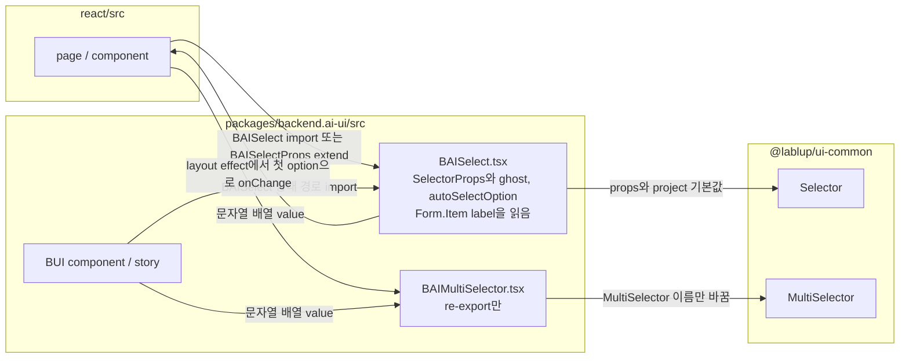

# 0042 — ui-common Selector props for BAISelect

> 이 ADR은 ADR 0017에서 다음을 대신한다. 2절("`BAISelect` props keep the antd vocabulary"), Consequences의 "Search default", "Clear value", "Controlled value", "Upstream props" 항목, "Naming exception" 가운데 `BAISelect`의 `mode="multiple"`이 `BAIMultiSelector`를 렌더한다는 문장, 그리고 Diagram의 `mode` 간선 두 개다. ADR 0017의 1절과 3절은 그대로 유효하다.
>
> 이 ADR은 유효한 결정을 뒤집는다. ADR 0017은 모든 call site를 Astryx 모양 props로 옮기는 비용이 크다는 이유로 antd props를 유지했다("Keep only BAISelector"). 이번 변경이 call site를 옮긴다.

## Summary

> 낯선 용어는 문서 맨 아래 [용어](#용어)에 모아 두었다.

- `BAISelect`는 antd prop 이름을 받아 ui-common `Selector`로 번역했다. 그래서 개발자가 `BAISelectProps`에 다시 선언하기 전에는 새 `Selector` prop을 call site에서 쓸 수 없었다.
- 이제 `BAISelectProps`는 ui-common `SelectorProps`를 그 [clearable branch](#용어)로 extend하고, BAI prop 두 개 `ghost`와 `autoSelectOption`을 더한다. 나머지 prop은 모두 `Selector`가 정한 이름과 type을 그대로 쓴다. `BAISelect`가 기본값이나 처리 방식을 바꾸는 prop은 2절에 있다.
- `BAISelect`는 `Selector`를 렌더하고 project 기본값만 정한다. 검색 켜짐, 번역된 검색 placeholder, 접근성 이름 대체값, `bai-select` class, 그리고 `''` 값일 때 clear 버튼을 숨기는 것이다.
- antd 모양의 surface는 없앤다. antd prop 이름, `BAISelect`가 받고 무시하던 props, children option API, `mode`, ReactNode option label, 문자열이 아닌 값, `BAISelectOption` type이 대상이다.
- 여러 값을 고르는 select는 `BAIMultiSelector`다. 값이 항상 `string[]`인 component는 `BAIMultiSelector`를 렌더하고, `ProjectSelect`는 `ProjectSelect`와 `ProjectMultiSelect`로 나뉜다.

## Context

- **Frozen vocabulary**: ADR 0017은 `BAISelect`에 antd v6 prop 이름(`allowClear`, `loading`, `showSearch`, `style.width`, `optionRender`, `labelRender`)을 유지했다. antd는 이제 webui의 의존성이 아니므로, 이 이름들은 project가 쓰지 않는 라이브러리의 이름이다.
- **Restated props**: `BAISelectProps`는 독립된 interface였으므로, 새 `Selector` prop마다 `BAISelectProps`와 `BAISelect.doc.ts`에 추가해야 call site가 넘길 수 있었다(ADR 0017, "Upstream props"). lablup/ui-common#175의 `showTooltipOnEllipsis`가 그런 prop이다.
- **Translation layer**: `BAISelect.tsx`는 antd 이름을 번역하고, ReactNode label을 text label과 node로 나누고, 문자열이 아닌 값을 문자열로 바꿨다가 되돌리고, `BAISelectOptionItem` / `BAISelectOptionGroup` children을 options로 펼치고, `mode="multiple"`을 `MultiSelector`로 보냈고, 받고 무시하는 props가 있었다(3절에 목록이 있다).

## 설계도

## Decision

### 1. `BAISelectProps`가 `SelectorProps`를 extend한다

- **Props type**: `packages/backend.ai-ui/src/components/BAISelect.tsx`는 `interface BAISelectProps<T extends SelectorOptionType = SelectorOptionType> extends Omit<SelectorClearableProps<T>, 'hasClear'>`를 선언하고, `SelectorClearableProps<T> = Extract<SelectorProps<T>, { hasClear: true }>`이며 `hasClear?: boolean`을 다시 선언한다. `value`와 `defaultValue`는 `string | null`이고 `onChange`는 `string | null`을 받는다.
- **Clearable branch base**: ui-common `SelectorProps`는 `hasClear`로 갈리는 union이고, TypeScript interface는 union을 extend할 수 없다. `BAISelect.tsx`는 branch 하나를 extend해서 `BAISelectProps`를 object type 하나로 만든다. 그래서 `interface XProps extends Omit<BAISelectProps, 'options'>`를 선언한 component도 `value`와 `onChange`를 `string | null`로 받는다.
- **Extending components**: options를 스스로 만드는 component는 `interface XProps extends Omit<BAISelectProps, 'options'>`로 선언한다. `SelectorProps`에서 `options`가 필수이기 때문이다.

BAI가 더하는 prop 두 개:

| Prop | Type | 동작 |
|---|---|---|
| `ghost` | `boolean` | `bai-select-ghost` class를 더한다. header의 brand band 위 select에 쓰는 on-dark 처리다(`BAISelect.css`). `Selector`의 `variant="ghost"`와는 관계없다. |
| `autoSelectOption` | `boolean` | `value`가 `undefined`, `null`, `''` 중 하나이고 `defaultValue`가 `undefined`나 `null`인 동안, `BAISelect`는 첫 option의 값(section 안 포함, divider 제외)을 `value`로 넘기고, 그 첫 값이 바뀔 때마다 layout effect에서 그 값으로 `onChange`를 호출한다. 그러면 감싼 Form.Item이나 부모 state가 그 값을 갖는다. |

### 2. `BAISelect`의 project 기본값

`BAISelect`는 `ghost`와 `autoSelectOption`을 직접 쓰고, 아래 props를 빼면 나머지를 바꾸지 않고 `Selector`에 넘긴다.

| Prop | `BAISelect`가 하는 일 |
|---|---|
| `hasSearch` | 기본값이 `true`다. `Selector` 자신의 기본값은 `false`다. |
| `searchPlaceholder` | 기본값은 번역된 `general.Search`다. |
| `aria-label` | 빈 값은 없는 것으로 본다. 값이 없으면 감싼 Form.Item label이 control의 이름이 된다. label 있는 Form.Item 밖에서는 `BAISelect`가 `placeholder`를, 그다음 번역된 `general.Select`를 쓴다. |
| `hasClear` | `value`가 `''`인 동안 `BAISelect`가 끈다. `Selector`는 null이 아닌 모든 값에 clear 버튼을 보여 주는데, call site들은 `''`를 "선택 없음"으로 쓰기 때문이다. |
| `controlClassName` | `BAISelect`가 호출자의 class 옆에 `bai-select`를 더한다. |
| `value` | `autoSelectOption`이 적용되는 동안 `BAISelect`가 첫 option으로 바꾼다(1절). |

### 3. 없어진 surface

없어진 prop이나 형식을 쓰던 call site는 아래 표대로 바꾼다.

| 없어진 것 | 대신 쓰는 것 |
|---|---|
| `showSearch`, `loading`, `allowClear` | `hasSearch`(기본 켜짐), `isLoading`, `hasClear` |
| `style`, `className` | `width`, `controlStyle`, `controlClassName` |
| `size="small"` / `"large"`, `variant="filled"` / `"borderless"` | `size="sm"` / `"lg"`, `variant="secondary"` / `"ghost"` |
| `label`(접근성 이름) | `aria-label` |
| ReactNode `placeholder` | 문자열 `placeholder` |
| `optionRender({ data })`, `labelRender(option)`, `optionLabelProp="children"` | `renderOption(option)`, `renderValue(option)`. call site가 option value로 추가 데이터를 찾는다 |
| antd option group `{ label, options }`, `header` | `{ type: 'section', title, options }` |
| `footer` | 끝에 붙인 `{ type: 'divider' }`와 비활성 option |
| option의 ReactNode `label` | 문자열 `label`(검색 key이자 trigger 텍스트)과, `renderOption` / `renderValue`가 그리는 node |
| 문자열이 아닌 option `value` | 문자열. 숫자를 저장하는 Form.Item은 `getValueProps`와 `getValueFromEvent`로 변환한다 |
| `onChange(value, option)`, `onSelect` | `onChange(value)`. call site가 자기 목록에서 option을 찾거나, component가 `onSelectProject` 같은 domain callback을 더한다 |
| 함수 형식의 `autoSelectOption` | boolean 형식, 또는 call site가 직접 `value`를 정한다 |
| `mode="multiple"` / `mode="tags"`, `triggerDisplay`, `maxBadges`, `showSelectedOptionsTooltip` | `BAIMultiSelector`와 그 자신의 props(4절) |
| `BAISelectOptionItem`, `BAISelectOptionGroup`, `BAISelectOptionProps`, `BAISelectOptionGroupProps` | `options` 배열 |
| `BAISelectOption` | `@lablup/ui-common/Selector`에서 type import하는 `SelectorOptionData` / `SelectorOptionType` |
| 무시되던 props: `open`, `popupRender`, `popupMatchSelectWidth`, `notFoundContent`, `suffixIcon`, `maxTagCount`, `maxTagPlaceholder`, `filterOption`, `defaultActiveFirstOption`, `title`, `tooltip`, `isLabelHidden`, `searchAction`, `endReached`, `atBottomStateChange`, `atBottomThreshold`, `bottomLoading`, 그리고 객체 형식의 `showSearch`(`searchValue`, `onSearch`, `optionFilterProp`) | call site가 그 prop을 지우고, 화면은 그대로다 |

### 4. 여러 값 component

- **Multi-value select**: `BAIMultiSelector`는 ADR 0014가 정한 단순 re-export로 남는다. `BAIMultiSelector` call site는 ui-common 기본값을 받는다. `bai-select` class가 없고, Astryx 자신의 검색 placeholder를 쓰고, 검색이 꺼져 있고, 접근성 이름은 `aria-label`이나 Form.Item label에서만 온다. `BAISelect`에 `mode="multiple"`을 쓰던 call site는 검색이 켜져 있던 곳에서 `hasSearch`를 직접 넘긴다.
- **List-only components**: `packages/backend.ai-ui/src/components/BAIAllowedHostNamesSelect.tsx`와 `packages/backend.ai-ui/src/components/fragments/BAIStorageProxySelect.tsx`는 `hasSearch`를 켠 `BAIMultiSelector`를 렌더하고, props는 `Omit<BAIMultiSelectorProps, 'options'>`를 extend한다.
- **Project selects**: `react/src/components/ProjectSelect.tsx`는 `ProjectSelect`(단일)와 `ProjectMultiSelect`(여러 값)를 export한다. 둘 다 같은 파일의 hook `useProjectOptions`로 options를 만든다. 잠긴 project를 값에 더하는 것은 `ProjectMultiSelect`뿐이다. `ProjectSelect`는 값이 지워지면 `onSelectProject`를 `undefined`로 호출한다.
- **Project resource groups**: `packages/backend.ai-ui/src/components/fragments/BAIProjectSettingModal.tsx`는 `<BAIResourceGroupSelect mode="tags">` 대신 `useResourceGroupNames` 위의 local `ResourceGroupMultiSelector`를 렌더한다.

## 대안과 기각 사유

- **Keep the antd vocabulary**: ADR 0017의 2절을 유지하는 안이다. 장점은 call site를 고치지 않아도 된다는 것이다. 새 `Selector` prop마다 여전히 다시 선언해야 하고, 그 이름들이 webui가 더는 의존하지 않는 라이브러리의 것이므로 기각한다.
- **Plain re-export of `Selector`**: ADR 0014가 다른 form control에 하듯 `BAISelect`를 re-export로 만드는 안이다. 장점은 `BAISelect`에 자체 코드가 없어진다는 것이다. call site들이 검색 기본값, 접근성 이름 대체값, `ghost`, `autoSelectOption`에 기대고 있어서, 이것 없이는 모든 call site가 `hasSearch`와 `aria-label`을 넘겨야 하므로 기각한다.
- **antd names beside ui-common names**: 이행 기간 동안 `allowClear`와 `hasClear`를 둘 다 받는 안이다. 장점은 call site를 하나씩 옮길 수 있다는 것이다. component 하나가 두 어휘를 갖게 되는데, 이것은 ADR 0017이 `BAISelector`를 없애면서 피한 비용이므로 기각한다.
- **`mode` on `BAISelect`**: `mode="multiple"`을 유지하고 `MultiSelector`로 보내는 안이다. 장점은 여러 값 call site도 component 이름 하나를 쓴다는 것이다. value가 `Selector`에서는 `string`, `MultiSelector`에서는 `string[]`이라 props interface 하나가 둘을 다 extend할 수 없으므로 기각한다.

## Consequences

- **Upstream props**: ui-common이 `Selector`에 더한 prop은 `BAISelect.tsx`를 고치지 않아도 `@lablup/ui-common` pin을 옮기는 즉시 `BAISelect`로 쓸 수 있다. `BAISelect.doc.ts`는 1절과 2절의 props만 적으므로, 새 `Selector` prop은 거기에 항목이 필요 없다.
- **Clear value**: 사용자가 값을 지우면 `onChange`는 `undefined`가 아니라 `null`을 받는다. state나 form이 `undefined`를 기대하는 call site는 `value ?? undefined`를 쓴다.
- **Uncontrolled value**: `BAISelect`가 더는 `Selector`에 `value`를 강제하지 않으므로, `defaultValue`만 주는 call site도 선택을 바꿀 수 있다.
- **Rich rows at the call site**: rich row를 그리는 call site는 option value에서 node로 가는 map을 두고, 같은 render 함수를 `renderOption`과 `renderValue`에 넘긴다.
- **Live ref**: `ref`는 `Selector`의 `React.Ref<HTMLButtonElement>`이고 trigger 버튼에 연결된다. 예전 `BAISelect`는 이 prop을 무시했다.
- **Documents that follow**: `.claude/rules/component-props-extension.md`와 `.github/instructions/react.instructions.md`는 frozen antd-v6 prop 어휘를 가진 wrapper 목록에서 `BAISelect`를 뺀다. `AGENTS.md`와 `react/AGENTS.md`의 FORM CONTROLS project line, `react/eslint.config.js`의 `formControlImportBans` 주석은 ADR 0017 옆에 ADR 0042를 적는다.

## 출처

- GitHub: #11440, lablup/ui-common#174, lablup/ui-common#175.
- 2026-11-26 결정.
- 관련: [ADR 0017](0017-single-select-for-client-held-option-lists.ko.md) (단일 select와 그 이름), [ADR 0014](0014-bai-names-for-ui-common-form-controls.ko.md) (form control의 `BAI<X>` 이름), [ADR 0009](0009-ui-common-as-the-single-entry-point-to-astryx.ko.md) (Astryx로 가는 유일한 경로인 ui-common).

## 용어

| 용어 | 뜻 |
|---|---|
| clearable branch | ui-common `SelectorProps`는 `hasClear`로 갈리는 두 object type의 union이고, clearable branch는 그중 `hasClear: true`인 쪽이다. 여기서는 `value`가 `string \| null`이고 `onChange`가 `string \| null`을 받는다. |
