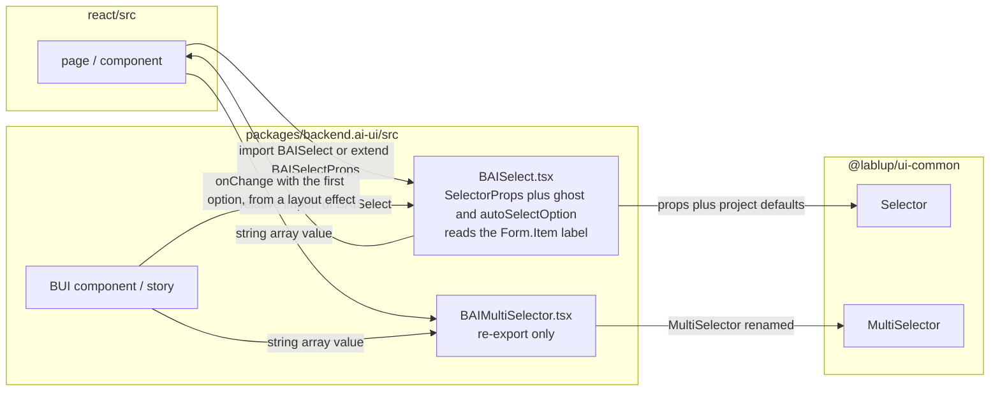

# 0042 — ui-common Selector props for BAISelect

> This ADR replaces, in ADR 0017: section 2 ("`BAISelect` props keep the antd vocabulary"); the Consequences items "Search default", "Clear value", "Controlled value", and "Upstream props"; the sentence of "Naming exception" that says `mode="multiple"` of `BAISelect` renders `BAIMultiSelector`; and the two `mode` edges of its Diagram. Sections 1 and 3 of ADR 0017 stay in force.
>
> It reverses a decision in force: ADR 0017 kept the antd props because moving every call site to Astryx-shaped props was too costly ("Keep only BAISelector"). This change moves the call sites.

## Summary

> Unfamiliar terms are collected in the [Glossary](#glossary) at the end.

- `BAISelect` carried antd prop names and translated them onto ui-common `Selector`, so a new `Selector` prop could not reach a call site until a developer restated it in `BAISelectProps`.
- `BAISelectProps` now extends ui-common `SelectorProps` through its [clearable branch](#glossary) and adds two BAI props, `ghost` and `autoSelectOption`. Every other prop keeps the name and type that `Selector` gives it; section 2 lists where `BAISelect` changes a default or the handling.
- `BAISelect` renders `Selector` and sets only the project defaults: search on, the translated search placeholder, an accessible-name fallback, the `bai-select` class, and no clear button for a `''` value.
- The antd-shaped surface is removed: the antd prop names, the props `BAISelect` accepted and ignored, the children option API, `mode`, ReactNode option labels, non-string values, and the `BAISelectOption` type.
- A multi-value select is `BAIMultiSelector`. A component whose value is always a `string[]` renders `BAIMultiSelector`, and `ProjectSelect` splits into `ProjectSelect` and `ProjectMultiSelect`.

## Context

- **Frozen vocabulary**: ADR 0017 kept the antd v6 prop names on `BAISelect` (`allowClear`, `loading`, `showSearch`, `style.width`, `optionRender`, `labelRender`). antd is no longer a dependency of webui, so these names belong to a library the project does not use.
- **Restated props**: `BAISelectProps` was a standalone interface, so each new `Selector` prop had to be added to `BAISelectProps` and `BAISelect.doc.ts` before a call site could pass it (ADR 0017, "Upstream props"). `showTooltipOnEllipsis` from lablup/ui-common#175 is such a prop.
- **Translation layer**: `BAISelect.tsx` translated the antd names, split ReactNode labels into a text label and a node, turned non-string values into strings and back, walked `BAISelectOptionItem` / `BAISelectOptionGroup` children into options, sent `mode="multiple"` to `MultiSelector`, and accepted props it ignored (section 3 lists them).

## Diagram

## Decision

### 1. `BAISelectProps` extends `SelectorProps`

- **Props type**: `packages/backend.ai-ui/src/components/BAISelect.tsx` declares `interface BAISelectProps<T extends SelectorOptionType = SelectorOptionType> extends Omit<SelectorClearableProps<T>, 'hasClear'>`, with `SelectorClearableProps<T> = Extract<SelectorProps<T>, { hasClear: true }>` and `hasClear?: boolean` declared again. `value` and `defaultValue` are `string | null`, and `onChange` receives `string | null`.
- **Clearable branch base**: ui-common `SelectorProps` is a union on `hasClear`, and a TypeScript interface cannot extend a union. `BAISelect.tsx` extends one branch so that `BAISelectProps` is one object type, and a component that declares `interface XProps extends Omit<BAISelectProps, 'options'>` still gets `value` and `onChange` typed as `string | null`.
- **Extending components**: A component that builds its own options declares `interface XProps extends Omit<BAISelectProps, 'options'>`, because `options` is required in `SelectorProps`.

The two BAI additions:

| Prop | Type | Behavior |
|---|---|---|
| `ghost` | `boolean` | Adds the `bai-select-ghost` class, the on-dark treatment of the select on the header's brand band (`BAISelect.css`). It is unrelated to `Selector`'s `variant="ghost"`. |
| `autoSelectOption` | `boolean` | Applies only to a controlled select, one that receives a `value` prop (an enclosing Form.Item with a `name` passes one). While that `value` is `undefined`, `null`, or `''` and `defaultValue` is `undefined` or `null`, `BAISelect` passes the first option's value (sections included, dividers skipped) as `value` and calls `onChange` with it from a layout effect whenever that first value changes. The enclosing Form.Item or the parent state then holds it. |

### 2. Project defaults in `BAISelect`

`BAISelect` consumes `ghost` and `autoSelectOption`, and passes every other prop to `Selector` unchanged except these:

| Prop | What `BAISelect` does |
|---|---|
| `hasSearch` | Defaults to `true`. `Selector`'s own default is `false`. |
| `searchPlaceholder` | Defaults to the translated `general.Search`. |
| `aria-label` | A blank value counts as absent. Without one, the enclosing Form.Item label names the control; outside a labelled Form.Item, `BAISelect` uses `placeholder`, then the translated `general.Select`. |
| `hasClear` | `BAISelect` turns it off while `value` is `''`, because `Selector` shows its clear button for every non-null value and call sites use `''` for "nothing selected". |
| `controlClassName` | `BAISelect` adds `bai-select` beside the caller's classes. |
| `value` | `BAISelect` replaces it with the first option while `autoSelectOption` applies (section 1). |

### 3. Removed surface

A call site that used a removed prop or form changes as the table shows.

| Removed | Replacement |
|---|---|
| `showSearch`, `loading`, `allowClear` | `hasSearch` (on by default), `isLoading`, `hasClear` |
| `style`, `className` | `width`, `controlStyle`, `controlClassName` |
| `size="small"` / `"large"`, `variant="filled"` / `"borderless"` | `size="sm"` / `"lg"`, `variant="secondary"` / `"ghost"` |
| `label` (accessible name) | `aria-label` |
| a ReactNode `placeholder` | a string `placeholder` |
| `optionRender({ data })`, `labelRender(option)`, `optionLabelProp="children"` | `renderOption(option)`, `renderValue(option)`; the call site looks extra data up by option value |
| antd option group `{ label, options }`, `header` | `{ type: 'section', title, options }` |
| `footer` | a trailing `{ type: 'divider' }` and a disabled option |
| a ReactNode `label` on an option | a string `label` (the search key and the trigger text) and the node drawn by `renderOption` / `renderValue` |
| a non-string option `value` | a string; a Form.Item that stores a number converts with `getValueProps` and `getValueFromEvent` |
| `onChange(value, option)`, `onSelect` | `onChange(value)`; the call site finds the option in its own list, or the component adds a domain callback such as `onSelectProject` |
| the function form of `autoSelectOption` | the boolean form, or the call site sets `value` itself |
| `mode="multiple"` / `mode="tags"`, `triggerDisplay`, `maxBadges`, `showSelectedOptionsTooltip` | `BAIMultiSelector` and its own props (section 4) |
| `BAISelectOptionItem`, `BAISelectOptionGroup`, `BAISelectOptionProps`, `BAISelectOptionGroupProps` | an `options` array |
| `BAISelectOption` | `SelectorOptionData` / `SelectorOptionType`, type imports from `@lablup/ui-common/Selector` |
| ignored props: `open`, `popupRender`, `popupMatchSelectWidth`, `notFoundContent`, `suffixIcon`, `maxTagCount`, `maxTagPlaceholder`, `filterOption`, `defaultActiveFirstOption`, `title`, `tooltip`, `isLabelHidden`, `searchAction`, `endReached`, `atBottomStateChange`, `atBottomThreshold`, `bottomLoading`, and the object form of `showSearch` (`searchValue`, `onSearch`, `optionFilterProp`) | the call site drops the prop, and the screen stays as it was |

### 4. Multi-value components

- **Multi-value select**: `BAIMultiSelector` stays the plain re-export that ADR 0014 defines. A `BAIMultiSelector` call site gets ui-common's defaults: no `bai-select` class, Astryx's own search placeholder, search off, and an accessible name from `aria-label` or the Form.Item label only. A call site that had `mode="multiple"` on `BAISelect` passes `hasSearch` itself where search was on.
- **List-only components**: `packages/backend.ai-ui/src/components/BAIAllowedHostNamesSelect.tsx` and `packages/backend.ai-ui/src/components/fragments/BAIStorageProxySelect.tsx` render `BAIMultiSelector` with `hasSearch`, and their props extend `Omit<BAIMultiSelectorProps, 'options'>`.
- **Project selects**: `react/src/components/ProjectSelect.tsx` exports `ProjectSelect` (single) and `ProjectMultiSelect` (multi). Both build their options with the hook `useProjectOptions` in the same file. Only `ProjectMultiSelect` adds the locked projects to the value. `ProjectSelect` calls `onSelectProject` with `undefined` after a clear.
- **Project resource groups**: `packages/backend.ai-ui/src/components/fragments/BAIProjectSettingModal.tsx` renders a local `ResourceGroupMultiSelector` over `useResourceGroupNames` in place of `<BAIResourceGroupSelect mode="tags">`.

## Rejected alternatives

- **Keep the antd vocabulary**: This alternative keeps ADR 0017 section 2. Its advantage is that no call site changes. It is rejected because every new `Selector` prop would still need restating, and the names belong to a library webui no longer depends on.
- **Plain re-export of `Selector`**: This alternative makes `BAISelect` a re-export, as ADR 0014 does for the other form controls. Its advantage is that `BAISelect` would have no code of its own. It is rejected because call sites rely on the search default, the accessible-name fallback, `ghost`, and `autoSelectOption`; without them every call site would pass `hasSearch` and an `aria-label`.
- **antd names beside ui-common names**: This alternative accepts both `allowClear` and `hasClear` during a migration period. Its advantage is that call sites could move one at a time. It is rejected because one component would then carry two vocabularies, which is the cost ADR 0017 removed `BAISelector` to avoid.
- **`mode` on `BAISelect`**: This alternative keeps `mode="multiple"` and routes it to `MultiSelector`. Its advantage is that multi-value call sites keep one component name. It is rejected because the value is `string` for `Selector` and `string[]` for `MultiSelector`, and one props interface cannot extend both.

## Consequences

- **Upstream props**: A prop that ui-common adds to `Selector` is usable through `BAISelect` as soon as the `@lablup/ui-common` pin moves, with no change in `BAISelect.tsx`. `BAISelect.doc.ts` lists only the props of sections 1 and 2, so a new `Selector` prop needs no entry there.
- **Clear value**: When the user clears the value, `onChange` receives `null`, not `undefined`. A call site whose state or form expects `undefined` writes `value ?? undefined`.
- **Uncontrolled value**: `BAISelect` no longer forces `value` onto `Selector`, so a call site that gives only `defaultValue` can change the selection.
- **Rich rows at the call site**: A call site that draws rich rows keeps a map from option value to node and passes the same render function to `renderOption` and `renderValue`.
- **Live ref**: `ref` is `Selector`'s `React.Ref<HTMLButtonElement>` and reaches the trigger button. The old `BAISelect` ignored it.
- **Documents that follow**: `.claude/rules/component-props-extension.md` and `.github/instructions/react.instructions.md` no longer list `BAISelect` among the wrappers with a frozen antd-v6 prop vocabulary. The FORM CONTROLS project line of `AGENTS.md` and `react/AGENTS.md`, and the `formControlImportBans` comment in `react/eslint.config.js`, name ADR 0042 next to ADR 0017.

## Sources

- GitHub: #11440, lablup/ui-common#174, lablup/ui-common#175.
- Decided 2026-11-26.
- Related: [ADR 0017](0017-single-select-for-client-held-option-lists.md) (the single select and its name), [ADR 0014](0014-bai-names-for-ui-common-form-controls.md) (the `BAI<X>` names of form controls), [ADR 0009](0009-ui-common-as-the-single-entry-point-to-astryx.md) (ui-common as the only path to Astryx).

## Glossary

| Term | Meaning |
|---|---|
| clearable branch | ui-common `SelectorProps` is a union of two object types on `hasClear`; the clearable branch is the one with `hasClear: true`, where `value` is `string \| null` and `onChange` receives `string \| null`. |
