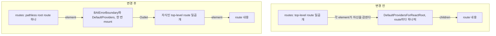

# 0043 — Root layout route for the app providers

## Summary

- `react/src/routes.tsx`는 [app providers](#용어)인 `DefaultProviders`를 route tree의 root에 있는 [pathless layout route](#용어) 하나에서 한 번만 mount한다.
- 모든 [top-level route](#용어)는 그 root route의 자식이고, root route의 `<Outlet />`을 통해 render된다.
- 개발자는 새 top-level route를 root route의 `children`에 추가하고, 새 route는 `DefaultProviders`를 render하지 않는다.

> 낯선 용어는 문서 맨 아래 [용어](#용어)에 모아 두었다.

## Context

- **Per-route providers**: top-level route 일곱 개가 각자 자기 element를 `DefaultProvidersForReactRoot`로 감쌌다. `routes.tsx`는 이 wrapper를 일곱 번 반복했고, 사용자가 한 top-level route에서 다른 top-level route로 이동하면 React Router가 providers를 새로 mount했다.
- **Provider contents**: `react/src/components/DefaultProviders.tsx`의 `DefaultProviders`는 Relay environment, query client, app-level `<Theme>`(ADR 0044), `BAIConfigProvider`, `FormConfigProvider`, `BAIAppProvider`, `NotificationHost`, `BAIWebMCPProvider`(ADR 0025)를 render한다.
- **Router dependency**: `DefaultProviders`는 `useRouteScope()`를 호출하고(ADR 0044), `NotificationHost`는 router hook으로 이동하는 notification item을 render한다. 둘 다 `RouterProvider` 안에서 render되어야 한다.

## 설계도

## Decision

### 1. root route

- **Route shape**: `react/src/routes.tsx`의 `routes` 배열에는 항목이 하나 있고, 그 항목에는 `path`가 없다. 그 항목의 `element`는 `<BAIErrorBoundary><DefaultProviders><Outlet /></DefaultProviders></BAIErrorBoundary>`이고 `errorElement`는 `<ErrorView />`다.
- **Child routes**: `/interactive-login`, `/cli-login`, `/verify-email`, `/change-password`, `/edu-applauncher`, `/applauncher`, `/`가 root route의 `children`이다.
- **New routes**: 개발자는 새 top-level route를 그 `children` 배열에 추가한다. 새 route의 element는 `DefaultProviders`를 render하지 않는다. 이것을 검사하는 lint rule은 없고, reviewer가 확인한다.

### 2. error boundary

- **Per-route boundaries**: 자식 route는 각자 자기 `errorElement`를 유지하고 자기 element를 자기 `BAIErrorBoundary`로 감싼다. React는 둘 다 `DefaultProviders` 안에서 render한다.
- **Root boundary**: root route의 `BAIErrorBoundary`와 `errorElement`는 `DefaultProviders` 바깥에 있다. 이 둘은 `DefaultProviders` 자신이 던진 error를 잡고, 그 fallback은 `<Theme>`과 `BAIConfigProvider` 없이 render된다.

### 3. component 이름

- **Name and file**: component는 `react/src/components/DefaultProviders.tsx`의 `DefaultProviders`다. 이전 이름 `DefaultProvidersForReactRoot`를 쓰는 코드는 없다.

## 대안과 기각 사유

- **Providers outside `RouterProvider`**: `react/src/App.tsx`가 `RouterProvider`를 `DefaultProviders`로 감싸면 `routes.tsx`를 바꾸지 않고 providers를 한 번만 mount할 수 있다. `DefaultProviders`가 `useRouteScope()`를 호출하고 `NotificationHost`가 router hook을 호출하는 item을 render하는데, 둘 다 `RouterProvider` 바깥에서는 동작하지 않으므로 기각한다.
- **Providers per route**: top-level route가 각자 자기 element를 계속 감싸면 route의 element 하나하나가 그 자체로 완결된다. `routes.tsx`가 route마다 wrapper를 반복하고, top-level route 사이를 이동할 때 React Router가 providers를 다시 mount하므로 기각한다.

## Consequences

- **Provider lifetime**: 사용자가 top-level route 사이를 이동하는 동안 providers는 mount된 채로 남는다.
- **Fallback location**: React는 자식 route의 `errorElement`와 `BAIErrorBoundary` fallback을 providers 안에서 render한다. 이 결정 전에는 React가 그것들을 providers 바깥에서 render했다.
- **Shape of `routes`**: `routes` export를 읽는 코드는 top-level route를 root 항목의 `children` 아래에서 찾는다. `react/scripts/build-search-index.mjs`는 `children`을 따라 내려가며, commit된 search index(ADR 0003)는 변경 후에도 바이트 단위로 같다.

## 출처

- GitHub issue #11437과 PR #11438, 2026-11-26 결정.
- 관련: ADR 0003(search index가 `routes.tsx`를 읽는다), ADR 0022(top-level route의 `STokenGuard`), ADR 0025(`DefaultProviders`가 WebMCP gate를 넘긴다), ADR 0044(`DefaultProviders` 안의 app-level theme).

## 용어

| 용어 | 뜻 |
|---|---|
| app providers | app providers는 모든 page에 필요한 React provider들이고, `DefaultProviders`가 그 전부를 render한다. |
| pathless layout route | pathless layout route는 `path`가 없고 element가 `<Outlet />`을 render하는 React Router route여서, URL segment를 더하지 않고 자식을 감싼다. |
| top-level route | top-level route는 `/`나 `/change-password`처럼 path가 URL의 root에서 시작하는 route다. |
