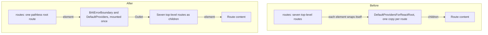

# 0043 — Root layout route for the app providers

## Summary

- `react/src/routes.tsx` mounts the [app providers](#glossary), `DefaultProviders`, once in a [pathless layout route](#glossary) at the root of the route tree.
- Every [top-level route](#glossary) is a child of that root route and renders through its `<Outlet />`.
- A developer adds a new top-level route to the root route's `children`, and the new route does not render `DefaultProviders`.

> Unfamiliar terms are collected in the [Glossary](#glossary) at the end.

## Context

- **Per-route providers**: Each of the seven top-level routes wrapped its own element in `DefaultProvidersForReactRoot`. `routes.tsx` repeated the wrapper seven times, and React Router mounted a new copy of the providers when a user moved from one top-level route to another.
- **Provider contents**: `DefaultProviders` in `react/src/components/DefaultProviders.tsx` renders the Relay environment, the query client, the app-level `<Theme>` (ADR 0044), `BAIConfigProvider`, `FormConfigProvider`, `BAIAppProvider`, `NotificationHost` and `BAIWebMCPProvider` (ADR 0025).
- **Router dependency**: `DefaultProviders` calls `useRouteScope()` (ADR 0044), and `NotificationHost` renders notification items that navigate with router hooks. Both must render inside `RouterProvider`.

## Diagram

## Decision

### 1. The root route

- **Route shape**: The `routes` array in `react/src/routes.tsx` has one entry, and that entry has no `path`. Its `element` is `<BAIErrorBoundary><DefaultProviders><Outlet /></DefaultProviders></BAIErrorBoundary>`, and its `errorElement` is `<ErrorView />`.
- **Child routes**: `/interactive-login`, `/cli-login`, `/verify-email`, `/change-password`, `/edu-applauncher`, `/applauncher` and `/` are the `children` of the root route.
- **New routes**: A developer adds a new top-level route to that `children` array. The new route's element does not render `DefaultProviders`. No lint rule checks this; a reviewer does.

### 2. Error boundaries

- **Per-route boundaries**: Each child route keeps its own `errorElement` and wraps its element in its own `BAIErrorBoundary`. React renders both inside `DefaultProviders`.
- **Root boundary**: The root route's `BAIErrorBoundary` and `errorElement` sit outside `DefaultProviders`. They catch an error that `DefaultProviders` itself throws, and their fallback renders without `<Theme>` and without `BAIConfigProvider`.

### 3. The component name

- **Name and file**: The component is `DefaultProviders` in `react/src/components/DefaultProviders.tsx`. No code uses the earlier name `DefaultProvidersForReactRoot`.

## Rejected alternatives

- **Providers outside `RouterProvider`**: `react/src/App.tsx` could wrap `RouterProvider` in `DefaultProviders`, which mounts the providers once without changing `routes.tsx`. This is rejected because `DefaultProviders` calls `useRouteScope()` and `NotificationHost` renders items that call router hooks, and neither works outside `RouterProvider`.
- **Providers per route**: Each top-level route could keep wrapping its own element, which keeps every route's element complete on its own. This is rejected because `routes.tsx` repeats the wrapper for every route, and React Router remounts the providers on navigation between top-level routes.

## Consequences

- **Provider lifetime**: The providers stay mounted while a user navigates between top-level routes.
- **Fallback location**: React renders the `errorElement` and the `BAIErrorBoundary` fallback of a child route inside the providers. Before this decision React rendered them outside.
- **Shape of `routes`**: Code that reads the `routes` export finds the top-level routes under the root entry's `children`. `react/scripts/build-search-index.mjs` walks `children`, and the committed search index (ADR 0003) is byte-identical after the change.

## Sources

- GitHub issue #11437 and PR #11438, decided 2026-11-26.
- Related: ADR 0003 (the search index reads `routes.tsx`), ADR 0022 (`STokenGuard` on the top-level routes), ADR 0025 (`DefaultProviders` passes the WebMCP gate), ADR 0044 (the app-level theme inside `DefaultProviders`).

## Glossary

| Term | Meaning |
|---|---|
| app providers | The app providers are the React providers that every page needs, and `DefaultProviders` renders all of them. |
| pathless layout route | A pathless layout route is a React Router route with no `path` whose element renders `<Outlet />`, so the route wraps its children without adding a URL segment. |
| top-level route | A top-level route is a route whose path starts at the root of the URL, such as `/` or `/change-password`. |
