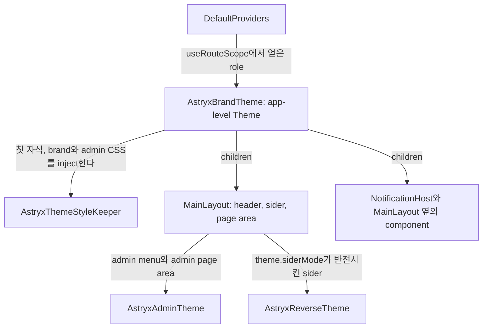

# 0044 — App-level theme role from the route scope

## Summary

- app에는 app-level `<Theme>`이 하나 있고, 그것은 `DefaultProviders` 안의 `AstryxBrandTheme`이다(ADR 0043). `DefaultProviders`는 `admin` [route scope](#용어)에서는 [theme role](#용어) `admin`을, 나머지 scope에서는 `brand`를 넘긴다.
- `MainLayout`은 [shell](#용어) 전체를 감싸는 theme provider를 render하지 않고, `SystemAdminScopeTheme`은 더 이상 없다.
- app-level `<Theme>`의 첫 자식인 `AstryxThemeStyleKeeper`는 다른 theme provider가 role을 바꾸거나 unmount되는 동안 brand와 admin [runtime theme](#용어)의 CSS를 document에 유지한다.
- 다른 role이나 mode가 필요한 영역은 `AstryxAdminTheme`이나 `AstryxReverseTheme`을 중첩한다.

> 낯선 용어는 문서 맨 아래 [용어](#용어)에 모아 두었다.

## Context

- **Two shell providers**: `AstryxBrandTheme`은 항상 brand theme을 넘겼다. `MainLayout` 안에서는 `SystemAdminScopeTheme`(#10552)이 shell 전체를 다시 감싸고 brand theme을, `admin` route scope에서는 admin theme을 넘겼다. 나머지 scope에서는 두 provider가 같은 theme을 넘겼다.
- **Separate family reads**: theme provider는 각자 `useCustomThemeConfig()`로 선택된 [theme family](#용어)를 읽는다. 두 provider가 서로 다른 family를 들고 있을 때 header는 한 family의 색을 썼고 shell의 나머지는 theme의 크기를 잃었다(#11437).
- **Runtime theme CSS**: Astryx는 runtime theme의 CSS를 그 theme을 처음 쓰는 `<Theme>`에서 inject한다. 그 `<Theme>`은 자기 `theme` prop이 바뀌거나 자신이 unmount될 때, 다른 `<Theme>` element가 같은 theme을 쓰고 있어도 그 CSS를 제거한다(`@astryxdesign/core`의 `theme/Theme.tsx`에 있는 `useThemeStyleInjection`).
- **Rule scope**: Astryx는 theme의 token rule과 component rule을 그 theme 자신의 `[data-astryx-theme="<name>"]` element에서 다음 `[data-astryx-theme]` element까지로 scope한다. 그래서 자기 theme의 CSS가 없는 영역은 바깥 theme의 rule도 받지 못한다.
- **Role change**: role을 바꾸는 app-level `<Theme>`은, 자신이 brand theme의 CSS를 처음 inject한 경우 그 CSS를 제거한다. 반전된 sider(`theme.siderMode`)는 여전히 brand theme을 쓰고, 그때 Astryx는 sider를 자기 기본 크기로 render한다.

## 설계도

## Decision

### 1. `AstryxBrandTheme`은 role을 prop으로 받는다

- **Role prop**: `react/src/astryx-theme/AstryxBrandTheme.tsx`의 `AstryxBrandTheme`은 `role?: 'brand' | 'admin'` prop을 가지며 기본값은 `brand`다. `AstryxBrandTheme`은 `resolveRoleTheme(rawThemeConfig?.theme, role, activeThemeFamily)`로 자기 theme을 정한다.
- **No router read**: `AstryxBrandTheme`은 router hook을 호출하지 않으므로, unit test는 router 없이 그것을 render한다.
- **Role source**: `DefaultProviders`가 `useRouteScope()`를 호출한다. `DefaultProviders`는 scope가 `admin`이면 `admin`을, scope가 `project`나 `projectAdmin`이면 `brand`를 넘긴다.

### 2. shell 전체를 감싸는 theme provider는 없다

- **`MainLayout`**: `MainLayout`은 app-level `<Theme>` 바로 아래에 `BAIAppShell`을 render한다. 개발자는 header, sider, page area를 함께 감싸는 `<Theme>`을 추가하지 않는다.
- **Scope change**: route scope가 바뀌어도 `BAIAppShell`은 다시 mount되지 않는다. app-level `<Theme>` element가 mount된 채로 남고 그 `theme` prop만 바뀌기 때문이다.

### 3. `AstryxThemeStyleKeeper`가 runtime theme CSS를 소유한다

- **Shape**: `react/src/astryx-theme/AstryxThemeStyleKeeper.tsx`의 `AstryxThemeStyleKeeper`는 `KEPT_ROLES`의 role마다 빈 `<Theme>`을 하나씩, theme의 이름을 key로 render한다. `<Theme>`의 wrapper element는 `display: contents`여서 빈 `<Theme>`은 아무것도 그리지 않는다.
- **Kept roles**: `KEPT_ROLES`에는 두 theme provider가 동시에 쓸 수 있는 role인 `brand`와 `admin`이 있다. `KEPT_ROLES`는 `secondary`를 담지 않는다. `AstryxStylexProbePage`의 provider 하나만 `secondary`를 쓰기 때문이다. 두 provider가 함께 쓰는 role을 추가하는 개발자는 그 role을 `KEPT_ROLES`에 추가한다.
- **Position**: `AstryxBrandTheme`은 keeper를 자기 `<Theme>`의 첫 자식으로 render한다. React는 자식의 insertion effect를 부모의 것보다 먼저, 앞선 sibling의 것을 뒤따르는 sibling의 것보다 먼저 실행한다. 그래서 keeper의 `<Theme>` element들이 같은 commit의 다른 어떤 theme provider보다 먼저 CSS를 inject한다.
- **Lifetime**: keeper의 `<Theme>`은 다른 theme을 받지 않는다. family나 [appearance document](#용어)가 바뀌면 React는 keeper의 `<Theme>`을 unmount하고 새 이름으로 하나를 mount하며, 그 commit은 다른 모든 theme provider가 바뀌는 commit이다.
- **Mode**: keeper는 `mode="light"`를 넘긴다. 중첩된 `<Theme>`의 mode는 자기 wrapper element에만 적용되고, keeper의 wrapper에는 내용이 없다.
- **Test**: `react/src/astryx-theme/themeStyleOwnership.test.tsx`는 element에 붙은 모든 theme 이름에 inject된 `<style>`이 있는지 확인한다. 이 test는 role 변경, theme provider의 unmount, family 변경을 다룬다.

### 4. 중첩 theme provider

| Provider | 감싸는 곳 | 넘기는 theme |
|---|---|---|
| `AstryxAdminTheme` | `WebUISiderNavigation`의 admin menu; `projectAdmin`과 `admin` scope에서 `MainLayout`의 page area; `AdminVFolderNodeListPage` | admin theme. `projectAdmin`에서는 app-level theme과 다르고 `admin`에서는 같다 |
| `AstryxReverseTheme` | `theme.siderMode`가 page와 반대인 mode를 요구할 때의 sider와 mobile navigation drawer | 반전된 mode의 brand theme |
| `AstryxBrandTheme`, `AstryxAdminTheme`, `AstryxSecondaryTheme` | 개발용 page인 `AstryxStylexProbePage`의 sample | 각 sample의 theme |

- **Family source**: 모든 theme provider는 `useCustomThemeConfig()`에서 family를 읽는다. 이 hook은 그 값을 storage key마다 하나인 Jotai atom에 둔다(`react/src/hooks/useLocalStorageGlobalState.tsx`의 `createGlobalStorageStateHook`). 그래서 모든 provider가 같은 family를 읽는다.

## 대안과 기각 사유

- **Two shell providers**: `SystemAdminScopeTheme`을 남겨 두면 app-level `<Theme>`이 brand theme에 머물러 brand theme의 CSS를 제거하지 않는다. `project`와 `projectAdmin` scope에서 두 provider가 같은 theme을 정하므로 기각한다.
- **Admin-only wrapper**: `MainLayout`이 `admin` scope에서만 shell을 `AstryxAdminTheme`으로 감싸면 role prop이 필요 없다. wrapper가 생기거나 사라질 때마다 React가 shell을 다시 mount하므로 기각한다(#10552).
- **Reference counting in Astryx**: Astryx가 theme을 쓰는 마지막 `<Theme>`이 unmount될 때만 그 theme의 CSS를 제거하면 원인을 library에서 고친다. webui는 Astryx를 patch하지 않으므로(ADR 0009) 기각한다.

## Consequences

- **Admin console overlays**: admin console에서는 `DefaultProviders`와 `routes.tsx`가 `MainLayout` 바깥에 render하는 component, 곧 notification stack, folder explorer, folder invitation modal, file upload manager가 admin theme을 받는다. 이 결정 전에는 이들이 brand theme을 받았다.
- **Document-level values**: admin console에서 Astryx는 `<html>`에 admin theme의 이름을 쓰고, `CSSTokenVariables`는 `:root`의 `--token-colorPrimary`에 admin accent를 쓴다.
- **Signed-out admin URL**: 로그아웃 상태의 사용자가 `/admin` URL을 열면 login form이 admin theme 아래에서 보인다.
- **Duplicate admin theme**: `admin` scope에서는 중첩된 `AstryxAdminTheme` 각각이 app-level `<Theme>`과 같은 theme을 넘긴다. admin menu와 page area는 app-level role이 `brand`인 `projectAdmin` scope에서 자기 provider가 필요하다.
- **Persistent admin CSS**: keeper는 admin theme을 쓰지 않는 page에서도 admin theme의 CSS를 document에 유지한다.
- **Keeper dependencies**: keeper는 React의 insertion effect 실행 순서와, Astryx가 첫 `<Theme>`에서 inject한다는 동작에 의존한다. `themeStyleOwnership.test.tsx`는 자신이 다루는 순서 중 하나가 theme을 CSS 없이 남기면 실패한다.

## 출처

- GitHub issue #11437과 PR #11438, 2026-11-26 결정. PR #11438에 keeper가 있을 때와 없을 때 반전된 sider를 측정한 결과가 있다.
- `SystemAdminScopeTheme`을 추가한 #10552.
- Astryx 0.7.11: `theme/Theme.tsx`의 `useThemeStyleInjection`, `theme/generateThemeRules.ts`의 `THEME_SCOPE_TO`.
- 관련: ADR 0009(`@lablup/ui-common`을 통한 Astryx, patch 없음), ADR 0043(root layout route가 한 번 mount하는 `DefaultProviders`).

## 용어

| 용어 | 뜻 |
|---|---|
| route scope | route scope는 `useRouteScope()`가 현재 URL에 대해 돌려주는 값으로, `project`, `projectAdmin`, 그리고 `/admin` 아래 system admin console인 `admin`이다. |
| theme role | theme role은 `resolveRoleTheme`의 `role` 인자로, `brand`, `admin`, `secondary` 중 하나다. role은 appearance document의 어느 색이 theme의 accent가 되는지를 고른다. |
| runtime theme | runtime theme은 `defineTheme()`이 브라우저에서 만들고 Astryx가 그 CSS를 `<head>`에 inject하는 theme이다. `astryx theme build`가 미리 만드는 기본 brand theme은 runtime theme이 아니다. |
| theme family | theme family는 appearance document의 `theme.families` 아래에 있는, 이름이 붙은 색 묶음이다. 사용자마다 family 하나를 고른다. |
| appearance document | appearance document는 theme과 branding을 기술하는 JSON으로, domain이 저장한 document이거나 domain이 저장한 것이 없을 때의 `resources/theme.json`이다. |
| shell | shell은 `MainLayout`에서 `BAIAppShell`이 render하는 것, 곧 header, sider, page area다. |
