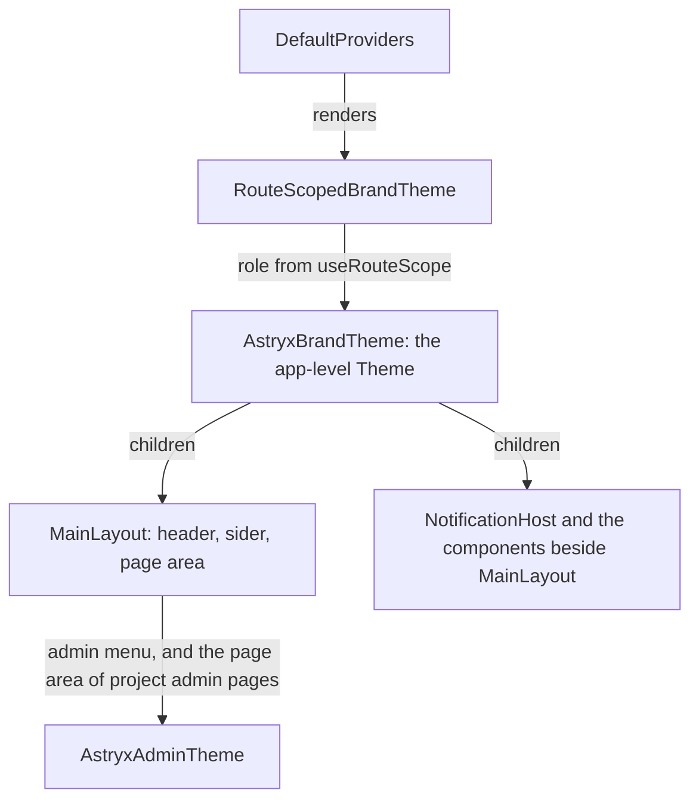

# 0044 — App-level theme role from the route scope

## Summary

- The app has one app-level `<Theme>`, `AstryxBrandTheme` inside `DefaultProviders` (ADR 0043). `RouteScopedBrandTheme` in `DefaultProviders.tsx` passes it the [theme role](#glossary) `admin` on the `admin` [route scope](#glossary) and `brand` on the other scopes.
- `MainLayout` renders no theme provider around the whole [shell](#glossary), and `SystemAdminScopeTheme` no longer exists.
- The [appearance document](#glossary) has no `theme.siderMode`, and `AstryxReverseTheme` no longer exists. The sider follows the page's light or dark mode.
- A region that needs the admin role under a brand app-level theme nests `AstryxAdminTheme`.

> Unfamiliar terms are collected in the [Glossary](#glossary) at the end.

## Context

- **Two shell providers**: `AstryxBrandTheme` always passed the brand theme. Inside `MainLayout`, `SystemAdminScopeTheme` (#10552) wrapped the whole shell again and passed the brand theme, or the admin theme on the `admin` route scope. On the other scopes the two providers passed the same theme.
- **Separate family reads**: Each theme provider reads the selected [theme family](#glossary) through `useCustomThemeConfig()`. When the two providers held different families, the header took one family's color and the rest of the shell lost the theme's sizes (#11437).
- **Runtime theme CSS**: Astryx injects a [runtime theme](#glossary)'s CSS from the first `<Theme>` that uses the theme. That `<Theme>` removes the CSS when its `theme` prop changes or when it unmounts, even while other `<Theme>` elements use the same theme (`useThemeStyleInjection` in `@astryxdesign/core`, `theme/Theme.tsx`).
- **Rule scope**: Astryx scopes a theme's token and component rules from the theme's own `[data-astryx-theme="<name>"]` element down to the next `[data-astryx-theme]` element. A region whose theme has no CSS therefore gets no rules from the theme around it.
- **Sider mode override**: `theme.siderMode` in the appearance document forced the sider to light or dark. When that mode differed from the page's, `AstryxReverseTheme` wrapped the sider in the brand theme with the opposite mode, on every route scope.
- **Role change**: An app-level `<Theme>` that changes role removes the brand theme's CSS when it was the first to inject that CSS. A sider under `AstryxReverseTheme` still used the brand theme, and Astryx then rendered it with its base sizes.

## Diagram

## Decision

### 1. `AstryxBrandTheme` takes the role as a prop

- **Role prop**: `AstryxBrandTheme` in `react/src/astryx-theme/AstryxBrandTheme.tsx` has the prop `role?: 'brand' | 'admin'`, which defaults to `brand`. It resolves its theme with `resolveRoleTheme(rawThemeConfig?.theme, role, activeThemeFamily)`.
- **No router read**: `AstryxBrandTheme` does not call a router hook, so a unit test renders it without a router.
- **Role source**: `RouteScopedBrandTheme` in `react/src/components/DefaultProviders.tsx` calls `useRouteScope()`. It passes `admin` when the scope is `admin`, and `brand` when the scope is `project` or `projectAdmin`.
- **Router subscription**: `RouteScopedBrandTheme` is a separate component with `'use memo'`. A URL change re-renders it, and does not re-render `DefaultProviders` or the providers that `DefaultProviders` renders.

### 2. No theme provider around the whole shell

- **`MainLayout`**: `MainLayout` renders `BAIAppShell` directly under the app-level `<Theme>`. A developer does not add a `<Theme>` that wraps the header, the sider and the page area together.
- **Scope change**: A change of route scope does not remount `BAIAppShell`, because the app-level `<Theme>` element stays mounted and only its `theme` prop changes.

### 3. The appearance document has no `theme.siderMode`

- **Document field**: `resources/theme.schema.json` and `BAIThemeConfig` in `react/src/helper/customThemeConfig.ts` declare no `siderMode`. The v1 converter in `react/src/helper/appearanceConfigV1.ts` drops the v1 `sider.theme` value.
- **Sider mode**: `WebUISider` and the mobile navigation drawer render under the app-level `<Theme>` with no theme provider of their own, so they follow the page's mode. `AstryxReverseTheme` and `useSiderThemeReversed` no longer exist.
- **Existing documents**: `pickValidAppearanceConfig` does not run the JSON schema, so a saved document that still carries `theme.siderMode` loads, and the app ignores the field. The JSON editor on the Branding page validates against the schema and marks the field as an error until an operator deletes it.

### 4. Nested theme providers

| Provider | Where it wraps | Theme it passes |
|---|---|---|
| `AstryxAdminTheme` | the admin menu in `WebUISiderNavigation`; the page area in `MainLayout` on the `projectAdmin` scope; `AdminVFolderNodeListPage` | the admin theme, which differs from the app-level theme on `projectAdmin`; on `admin`, the admin menu and `AdminVFolderNodeListPage` pass the same theme as the app-level `<Theme>` |
| `AstryxBrandTheme`, `AstryxAdminTheme`, `AstryxSecondaryTheme` | the samples on `AstryxStylexProbePage`, a development page | the theme of each sample |

- **Brand theme on the admin scope**: On the `admin` scope no provider nests the brand theme. A developer does not add one, because the app-level `<Theme>` can remove the brand theme's CSS when it takes the admin role.
- **Family source**: Every theme provider reads the family from `useCustomThemeConfig()`. That hook keeps the value in one Jotai atom per storage key (`createGlobalStorageStateHook` in `react/src/hooks/useLocalStorageGlobalState.tsx`), so every provider reads the same family.

## Rejected alternatives

- **Two shell providers**: `SystemAdminScopeTheme` could stay, which leaves the app-level `<Theme>` on the brand theme so that it never removes the brand theme's CSS. This is rejected because the two providers resolve the same theme on the `project` and `projectAdmin` scopes.
- **Admin-only wrapper**: `MainLayout` could wrap the shell in `AstryxAdminTheme` only on the `admin` scope, which needs no role prop. This is rejected because React remounts the shell each time the wrapper appears or disappears (#10552).
- **A provider that owns the theme CSS**: A component could render one empty `<Theme>` per role as the first child of the app-level `<Theme>`, which keeps both themes' CSS in the document and lets `theme.siderMode` stay. This is rejected because it adds two elements and the admin theme's CSS to every page for a setting the team decided to drop.
- **Reference counting in Astryx**: Astryx could remove a theme's CSS only when the last `<Theme>` that uses the theme unmounts, which fixes the cause in the library. This is rejected because webui does not patch Astryx (ADR 0009).

## Consequences

- **Admin console overlays**: In the admin console, the components that `DefaultProviders` and `routes.tsx` render outside `MainLayout` take the admin theme: the notification stack, the folder explorer, the folder invitation modal and the file upload manager. Before this decision they took the brand theme.
- **Document-level values**: In the admin console, Astryx writes the admin theme's name on `<html>`, and `CSSTokenVariables` writes the admin accent to `--token-colorPrimary` on `:root`.
- **Signed-out admin URL**: A signed-out user who opens an `/admin` URL sees the login form under the admin theme.
- **Sider mode**: A deployment whose document set `theme.siderMode` gets a sider in the page's mode.
- **Duplicate admin theme**: On the `admin` scope, the admin menu in `WebUISiderNavigation` and `AdminVFolderNodeListPage` nest an `AstryxAdminTheme` that passes the same theme as the app-level `<Theme>`. The admin menu needs its provider on the `projectAdmin` scope, where the app-level role is `brand`.
- **CSS ownership**: The admin theme's CSS still belongs to whichever `<Theme>` injects it first, the app-level one or a nested `AstryxAdminTheme`. A Playwright run across console switches, a project admin page and a narrow viewport found no theme without CSS (PR #11438).

## Sources

- GitHub issue #11437 and PR #11438, decided 2026-11-27. PR #11438 records the measurements.
- #10552, which added `SystemAdminScopeTheme`, and #9361, which carried the v1 `sider.theme` into `theme.siderMode`.
- Astryx 0.7.11: `useThemeStyleInjection` in `theme/Theme.tsx`, and `THEME_SCOPE_TO` in `theme/generateThemeRules.ts`.
- Related: ADR 0009 (Astryx through `@lablup/ui-common`, without patches), ADR 0043 (`DefaultProviders` mounted once by the root layout route).

## Glossary

| Term | Meaning |
|---|---|
| route scope | A route scope is the value that `useRouteScope()` returns for the current URL: `project`, `projectAdmin`, or `admin` for the system admin console under `/admin`. |
| theme role | A theme role is the `role` argument of `resolveRoleTheme`: `brand`, `admin` or `secondary`. The role selects which color of the appearance document becomes the theme's accent. |
| runtime theme | A runtime theme is a theme that `defineTheme()` builds in the browser and whose CSS Astryx injects into `<head>`. The default brand theme that `astryx theme build` prebuilds is not a runtime theme. |
| theme family | A theme family is a named set of colors under `theme.families` in the appearance document. Each user selects one family. |
| appearance document | The appearance document is the JSON that describes the theme and the branding: the domain's saved document, or `resources/theme.json` when the domain saved none. |
| shell | The shell is what `BAIAppShell` renders in `MainLayout`: the header, the sider and the page area. |
