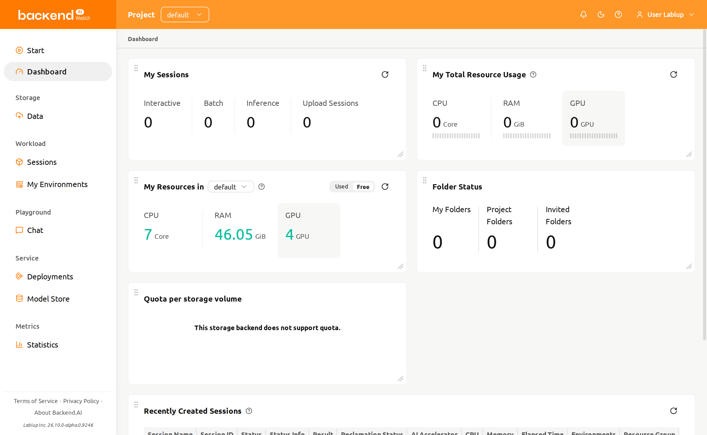
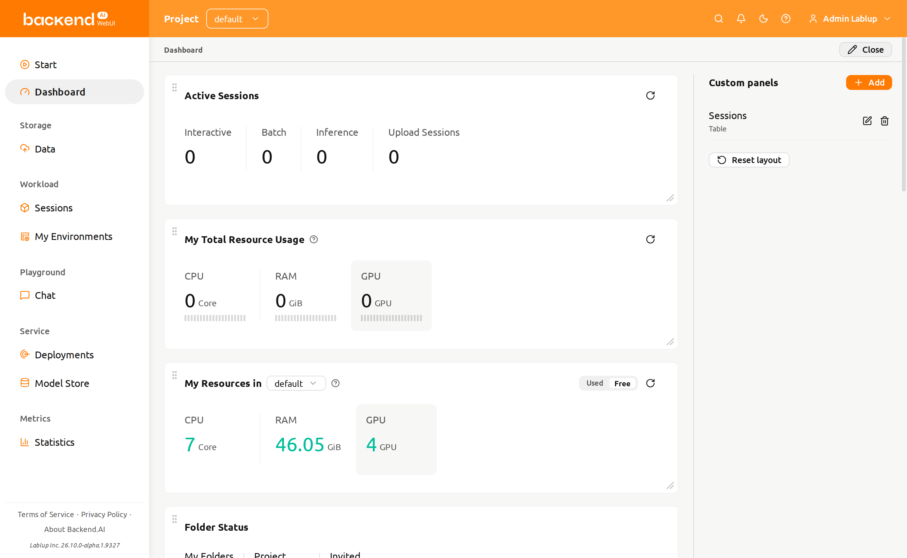
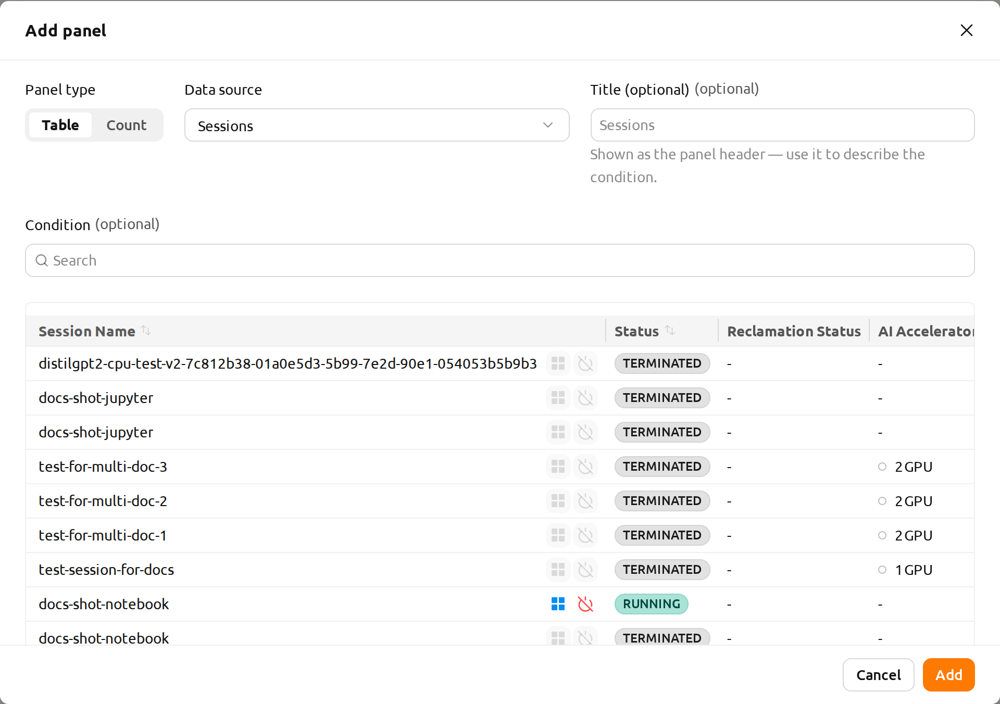

# Dashboard

The **Dashboard** is the first page you see after logging in. It summarizes your own
sessions, resources, folders, deployments, and recent activity in the current project,
and holds the actions that used to live on the Start page.
Every card counts only what you own in the current project. Cards that depend on a
resource group or a time range keep their own setting; see
[Card Settings](#card-settings).

A new dashboard shows the following cards:

- **Get started items**: **Start Interactive Session**, **Start Batch Session**,
    **Create New Storage Folder**, **Start Deployment**, and **Start From URL**.
    Each card runs the same action the Start page offered; see
    [Start Actions](#start-page) for details. A card whose menu is disabled by
    your administrator is not offered.

- **My Sessions**:
    A donut of your active sessions in the current project by type
    (*Interactive*, *Batch*, *Inference*, *Upload*), with a table of counts and shares.

- **My Recent Sessions**:
    Your most recently created sessions in the current project. Click a session name
    to open its detail drawer.

- **My Total Resource Usage**:
    For each resource group in the card's setting (by default, the resource group
    chosen in the header), how much of each resource your sessions use against the
    lowest of your keypair, project, and domain limits.

- **Resource Presets**:
    Whether each resource preset still fits in what you can allocate in each
    resource group in the card's setting (by default, the header's resource group).

- **Total Resources in Resource Group**:
    The used and free resources of the resource groups in the card's setting (by
    default, the header's resource group), aggregated from their agents.

:::note
The **Total Resources in Resource Group** card is not shown to regular users when
your administrator hides agent information.
:::

- **My Folders**:
    Three counts side by side: your folders (with your folder limit under it), the
    folders in the trash, and pending folder invitations. When invitations are
    pending, click the link under the count to review them.

- **Quota per storage volume**:
    Shows the quota available on each storage volume.
    When no storage host supports quota, the card shows a notice instead.

- **My Deployments**:
    Your deployments in the current project that have not been destroyed, with
    their replica health.

- **My Activity**:
    The audit log of actions you performed in the card's time range (by default,
    the last 24 hours). Turn on
    **Show failures only** in the card header, or click the failure count, to list
    only failed actions; the choice is saved with your board.

Cluster-wide cards such as **Agent Statistics**, **Active Agents**, and
**Active Sessions** are on the admin dashboard, the first item of the
**Admin Settings** menu, for superadmins and project admins.

## Customizing the Dashboard Layout

You can rearrange the board at any time — there is no mode to enter first:

- **Move panels**: Drag a panel by its header to reposition it on the board.
- **Resize panels**: Drag the bottom-right corner of a panel to adjust its
  size. Each panel has a minimum size to ensure its content remains readable.

Your customized layout is automatically saved and persists across browser
sessions. The layout is stored per user, so each user can have their own
preferred arrangement. To discard your arrangement and restore the default
one, click the **Reset layout** button at the bottom of the edit sidebar and
confirm. Resetting the layout also puts back the default cards you removed,
and does not remove your custom panels.

:::tip
When the WebUI is updated with new dashboard panels, those panels will
automatically appear on your dashboard even if you have a saved custom layout.
:::

### Adding and Removing Cards

Click the **Edit** button at the top right of the page to open the edit
sidebar beside the board, and **Close** to hide it again. Its **Cards** list
shows every card you can place on this dashboard, grouped by kind, with a
search box above it. Check a card to add it to the board and uncheck it to
remove it; you can add it back at any time. A card that cannot be used in
this environment is listed but disabled.

### Card Settings

Some cards read a resource group or a time range. In the edit sidebar, such a
card shows its current setting under its name and a settings (sliders) button.
Click it to choose:

- **Resource groups** for **My Total Resource Usage**, **Resource Presets**, and
  **Total Resources in Resource Group**: the card shows one block per selected
  resource group. With none selected, it follows the resource group chosen in
  the header.
- **Time range** for **My Activity**: the last hour, 24 hours, or 7 days.
- **Resource groups** for **Sessions** and **Deployments** custom panels: the
  panel lists only rows in those resource groups. With none selected, it lists
  every resource group.

The setting is saved with your board. Cards that do not depend on a resource
group or a time range have no settings button.

### Custom Panels

The **Custom panels** section of the edit sidebar lists your custom panels. A
custom panel shows a data source you select, narrowed by a condition you define.
The panel itself shows only a title and its data, so
give the panel a title that describes its condition.

To add a panel, click the **Add** button in the sidebar. The panel dialog
contains the following fields. **Panel type** and **Data source** are
required — the dialog will not submit until both are chosen.

- **Data source**: The data source the panel lists. Choose **Sessions**,
  **Deployments**, or **Data & Storage**.
- **Panel type**: How the panel displays the data source. Choose **Table** or
  **Count**. For the **Sessions** data source, **Grid** is also offered.
- **Title**: An optional panel title. When omitted, the data source name is
  used.
- **Condition**: A property filter that narrows the rows shown in the panel.

A live preview below the fields shows the rows matching the current condition.
Sorting a column in the preview sets the panel's sort order. Click **Add** to
place the panel on the board.

**Deployments** panels list the project's model deployments, using the same
table as the Deployments page: name, status, replica summary, model, and
created at. Clicking a deployment's name opens its detail page.

**Grid** shows the session resource grid: each matching session's allocated
resources as unit cells, colored by utilization. Clicking a session opens its
detail drawer, the same as clicking a row in the table. The grid shows at most
the first 100 matching sessions; a notice appears when there are more.

The grid's display settings — resource or kernel mode, which resource or
metric to show, memory unit, and layout — are chosen in the Add/Edit panel
dialog's live preview and saved with the panel. The panel itself shows no
controls for these settings, so create a second panel if you want a different
view.

:::note
**Grid** is an experimental feature. It is offered in the **Panel type**
selector only when **Session resource grid view** is turned on under
[Experimental features](#experimental-features). If it is turned off later,
existing Grid panels keep their saved configuration but display as the
session table until the setting is turned back on.
:::

To change a panel's data source, panel type, condition, or title later, click
the pencil (**Edit**) icon next to the panel in the sidebar — or in the
panel's header on the board — and save your changes. To remove a panel, click
the trash (**Delete**) icon and confirm in the popup.

:::note
**Sessions** and **Deployments** panels list data for the current project and
are available to every project member. **Data & Storage** panels are
available to superadmins only. A panel whose data source your role cannot
query remains listed in the sidebar but is not shown on the board.
:::

## Automatic Refresh

The refresh button at the top right of the dashboard is the only refresh control
on the page: click it to reload every card at once. The arrow next to it sets
how often the dashboard refreshes by itself (off, or every 5 seconds to
10 minutes; 30 seconds by default), and the choice is saved with your board.
Cards whose data changes slowly, such as folder counts, refresh less often than
the interval you choose.
