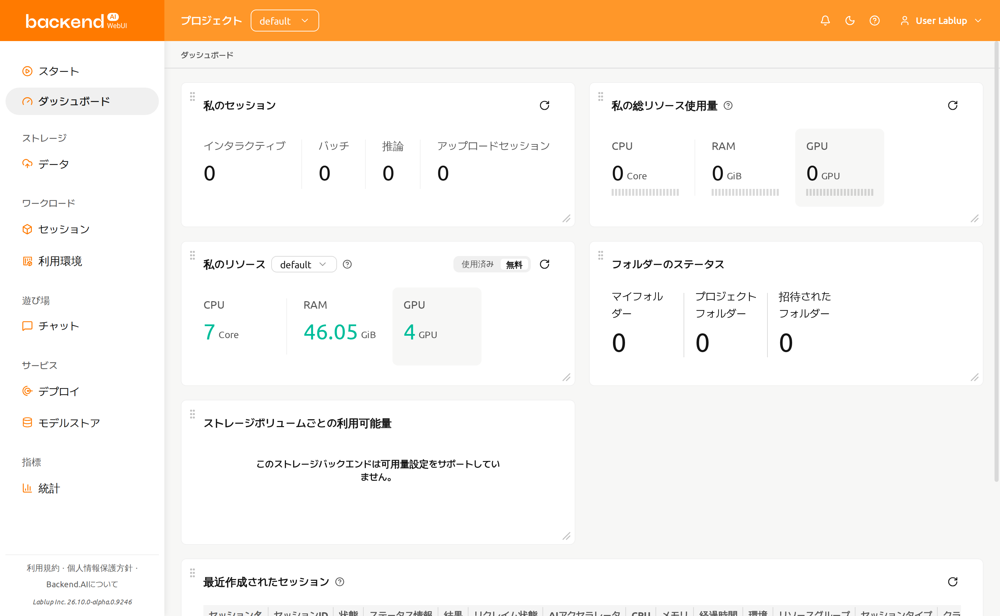
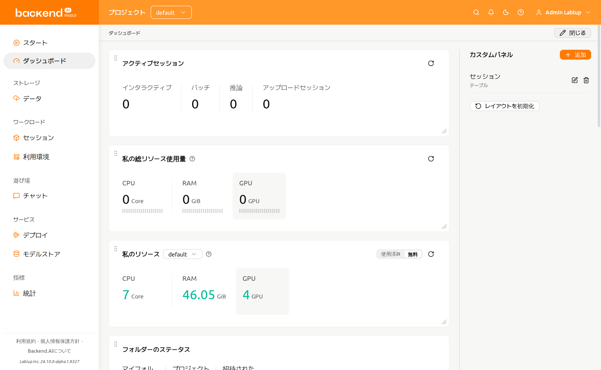
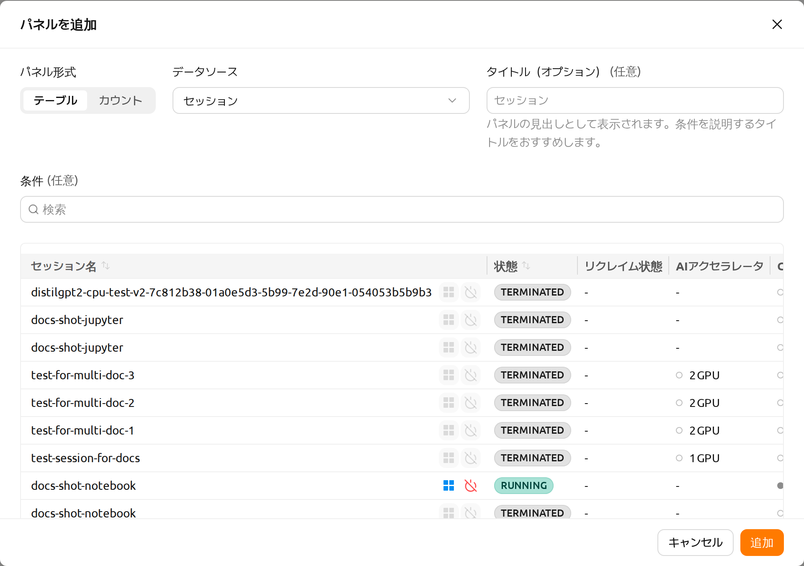

# ダッシュボード

**ダッシュボード**はログイン後に最初に表示されるページです。現在のプロジェクトで自分が作成、所有しているセッション、リソース、フォルダー、デプロイ、最近のアクティビティをまとめて表示し、以前のスタートページにあった操作もここから始めます。すべてのカードは現在のプロジェクトで自分のものだけを集計します。リソースグループや期間によって内容が変わるカードは、カードごとに設定を持ちます。詳しくは[カード設定](#card-settings)を参照してください。

新しいダッシュボードには次のカードが表示されます。

- **はじめにのアイテム:**
    **インタラクティブセッション開始**、**バッチセッション開始**、**保存フォルダー作成**、**デプロイ開始**、**URLから開始**のカードです。各カードは以前のスタートページと同じ操作を実行します。詳しくは[スタートアクション](#start-page)を参照してください。管理者がメニューを無効にした機能のカードは表示されません。

- **私のセッション:**
    現在のプロジェクトで実行中の自分のセッションを種類別(*Interactive*、*Batch*、*Inference*、*Upload*)のドーナツグラフと件数、割合の表で表示します。

- **最近の自分のセッション:**
    現在のプロジェクトで最近作成した自分のセッションの一覧です。セッション名をクリックすると詳細ドロワーが開きます。

- **私の総リソース使用量:**
    カード設定のリソースグループ(既定ではヘッダーで選択したリソースグループ)で、自分のセッションが使用しているリソースを、キーペア、プロジェクト、ドメインの上限のうち最も低い上限とあわせて表示します。

- **リソースグループの総リソース:**
    カード設定のリソースグループ(既定ではヘッダーで選択したリソースグループ)の使用量と空き容量を、グループ内のエージェントのデータを合算して表示します。

:::note
管理者がエージェント情報を非表示に設定している場合、一般ユーザーには**リソースグループの総リソース**カードが表示されません。
:::

- **ストレージボリュームごとの利用可能量:**
    各ストレージボリュームで利用できるクォータを表示します。クォータに対応したストレージホストがない場合は、代わりに案内が表示されます。

- **自分のデプロイ:**
    現在のプロジェクトで削除されていない自分のデプロイとレプリカの状態を表示します。

- **自分のアクティビティ:**
    カード設定の期間(既定では過去24時間)に自分が行った操作の監査ログです。カードのヘッダーで**失敗のみ表示**をオンにするか、失敗件数をクリックすると、失敗した操作だけが表示されます。この選択はボードに保存されます。

**エージェントの統計**、**アクティブなエージェント**、**アクティブセッション**のようにクラスターやプロジェクト全体を集計するカードは、スーパー管理者とプロジェクト管理者向けの管理者ダッシュボード(**管理者設定**メニューの最初の項目)にあります。

## ダッシュボードレイアウトのカスタマイズ

ボードは特別なモードに切り替えなくても、いつでも並べ替えられます：

- **パネルの移動**: パネルのヘッダーをドラッグして、ボード上の位置を変更できます。
- **パネルのサイズ変更**: パネルの右下隅をドラッグしてサイズを調整できます。各パネルにはコンテンツの可読性を確保するための最小サイズが設定されています。

カスタマイズされたレイアウトは自動的に保存され、ブラウザセッション間で保持されます。レイアウトはユーザーごとに保存されるため、各ユーザーが独自の配置を設定できます。配置をデフォルトに戻すには、編集サイドバー下部の**レイアウトを初期化**ボタンをクリックして確認します。レイアウトを初期化すると外したデフォルトのカードも元に戻り、カスタムパネルは削除されません。

:::tip
WebUIの更新で新しいダッシュボードパネルが追加された場合、保存済みのカスタムレイアウトが
あっても、新しいパネルは自動的にダッシュボードに表示されます。
:::

### カードの追加と削除

ダッシュボード右上の更新ボタンの横にある**編集**ボタンをクリックすると、ボードの右側に編集サイドバーが開き、**閉じる**をクリックすると再び非表示になります。サイドバーの**カード**一覧には、このダッシュボードに配置できるカードが種類ごとにまとめて表示され、上部の検索欄で絞り込めます。カードにチェックを入れるとボードに追加され、チェックを外すとボードから外れます。外したカードはいつでも再び追加できます。この環境で利用できないカードは、一覧に無効の状態で表示されます。

**リソースプリセット**カードは、カード設定のリソースグループ(既定ではヘッダーで選択したリソースグループ)で、各リソースプリセットがまだ割り当て可能な範囲に収まるかを表示します。新しいダッシュボードには配置されないため、**カード**一覧でチェックを入れて追加します。

### カード設定

一部のカードは、リソースグループや期間によって内容が変わります。編集サイドバーでは、このようなカードの名前の下に現在の設定と設定(スライダー)ボタンが表示されます。ボタンをクリックして次の項目を指定します。

- **私の総リソース使用量**、**リソースプリセット**、**リソースグループの総リソース**の**リソースグループ**: 選択した1つのリソースグループを表示します。何も選択しない場合は、ヘッダーで選択したリソースグループに従います。
- **自分のアクティビティ**の**期間**: **過去1時間**、**過去24時間**、**過去7日間**から選びます。
- **セッション**および**デプロイ**カスタムパネルの**リソースグループ**: 選択した1つのリソースグループの行だけを表示します。何も選択しない場合は、すべてのリソースグループを表示します。

設定はボードとともに保存されます。リソースグループや期間によって内容が変わらないカードには設定ボタンがありません。

### カスタムパネル

編集サイドバーの**カスタムパネル**セクションには、カスタムパネルの一覧が表示されます。カスタムパネルは、選択したデータソースを指定した条件で絞り込んで表示します。パネルにはタイトルとデータのみが表示されるため、条件がわかるタイトルを付けることをおすすめします。

パネルを追加するには、サイドバーの**追加**ボタンをクリックします。パネルのダイアログには以下の項目があります。**パネル形式**と**データソース**は必須項目で、両方を選択しないとダイアログを送信できません。

- **データソース**: パネルに表示するデータソースです。**セッション**、**デプロイ**、**データストレージ選択**から選択します。
- **パネル形式**: データソースの表示方法です。**テーブル**または**カウント**から選択します。**セッション**データソースの場合は **グリッド** も選択できます。
- **タイトル**: パネルのタイトル（オプション）です。省略した場合はデータソース名が使用されます。
- **条件**: パネルに表示する項目を絞り込むプロパティフィルターです。

入力項目の下のライブプレビューには、現在の条件に一致する行が表示されます。プレビューで列をソートすると、そのソート順がパネルに適用されます。**追加**ボタンをクリックすると、パネルがボードに配置されます。

**デプロイ**パネルは、デプロイページと同じテーブル（名前、状態、レプリカ概要、モデル、作成日時）を使用して、プロジェクトのモデルデプロイを一覧表示します。デプロイの名前をクリックすると、その詳細ページが開きます。

**グリッド**を選択すると、セッションリソースグリッドが表示されます。条件に一致する各セッションに割り当てられたリソースを、使用率に応じて色分けされたユニットセルとして表示します。セッションをクリックすると、テーブルで行をクリックしたときと同様に詳細ドロワーが開きます。グリッドは条件に一致するセッションのうち最大100件までを表示し、それを超える場合は件数の通知が表示されます。

グリッドの表示設定（リソース／カーネルモード、表示するリソースまたはメトリック、メモリ単位、レイアウト）は、パネルの追加／編集ダイアログのライブプレビューで指定し、パネルとともに保存されます。パネル自体にはこれらの設定を変更するコントロールがないため、別の表示にしたい場合はパネルをもう一つ追加してください。

:::note
**グリッド**は実験的機能です。**パネル形式**の選択肢に表示されるのは、[実験的特徴](#experimental-features)で**Session resource grid view** がオンになっている場合のみです。後でこの設定をオフにしても、作成済みのグリッドパネルは保存された設定を維持したまま、設定を再度オンにするまでセッションテーブルとして表示されます。
:::

パネルのデータソース、パネル形式、条件、タイトルを後から変更するには、サイドバーの該当パネルの横、またはボード上のパネルヘッダーにある鉛筆（**編集**）アイコンをクリックし、変更内容を保存します。パネルを削除するには、ゴミ箱（**削除**）アイコンをクリックし、確認ポップアップで承認します。

:::note
**セッション**および**デプロイ**パネルは現在のプロジェクトのデータを表示し、すべてのプロジェクトメンバーが利用できます。**データストレージ選択**パネルはスーパー管理者のみ利用できます。現在の権限で照会できないデータソースのパネルは、サイドバーの一覧には残りますが、ボードには表示されません。
:::

## 自動更新

ダッシュボード右上の更新ボタンが、このページで唯一の更新コントロールです。クリックするとすべてのカードを一度に再読み込みします。隣の矢印で自動更新の間隔(オフ、または5秒から10分、既定は1分)を設定でき、この選択はボードとともに保存されます。自動更新では、画面に表示されているすべてのカードをまとめて再読み込みします。画面外にスクロールしたカードはスキップされ、再び表示されたときに選んだ間隔内に更新されていなければ、すぐに再読み込みします。
