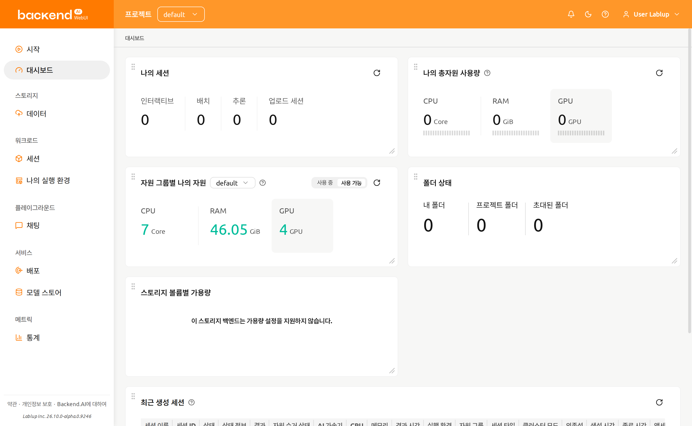
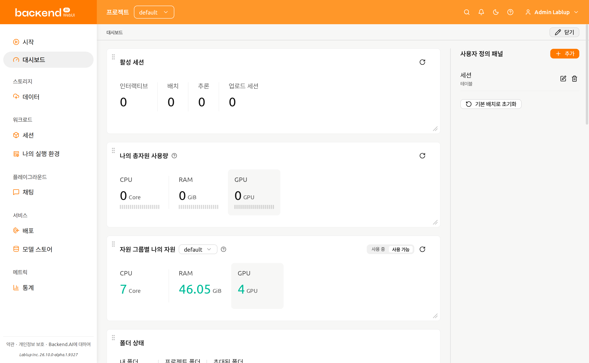
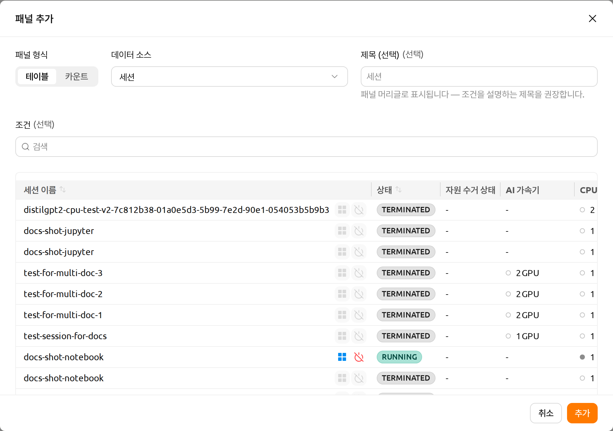

# 대시보드

**대시보드**는 로그인하면 가장 먼저 보이는 페이지입니다. 현재 프로젝트에서 내가 만들고 가진 세션, 자원, 폴더, 배포, 최근 활동을 한눈에 보여 주며, 예전 시작 페이지에 있던 작업도 이곳에서 시작합니다. 모든 카드는 내 것만 집계하고, 보드 위의 필터 바에서 고른 자원 그룹과 기간을 따릅니다.

새 대시보드에는 다음 카드가 표시됩니다.

- **시작하기 아이템:**
    **인터랙티브 세션 생성**, **배치 세션 생성**, **새 스토리지 폴더 생성하기**, **배포 시작**, **URL 로 시작** 카드입니다. 각 카드는 예전 시작 페이지와 같은 작업을 실행하며, 자세한 내용은 [시작하기](#start-page)를 참고하세요. 관리자가 메뉴를 끈 기능의 카드는 표시되지 않습니다.

- **나의 세션:**
    현재 프로젝트에서 실행 중인 내 세션을 유형별(*Interactive*, *Batch*, *Inference*, *Upload*) 도넛 차트와 개수, 비율 표로 보여 줍니다.

- **세션 성공/실패:**
    선택한 기간에 끝난 내 세션 중 성공과 실패 개수, 같은 길이의 직전 기간 대비 증감, 작은 추이선을 보여 줍니다. 세션은 끝난 시각을 기준으로 셉니다.

- **내 최근 세션:**
    현재 프로젝트에서 최근에 만든 내 세션 목록입니다. 세션 이름을 클릭하면 상세 드로어가 열립니다.

- **나의 총자원 사용량:**
    선택한 자원 그룹마다(전체를 고른 경우 헤더에서 선택한 자원 그룹) 내 세션이 쓰는 자원을 키페어, 프로젝트, 도메인 한도 중 가장 낮은 한도와 함께 보여 줍니다.

- **리소스 프리셋:**
    선택한 자원 그룹마다 각 리소스 프리셋이 아직 할당할 수 있는 자원 안에 들어가는지 보여 줍니다.

- **자원 그룹 내 총자원:**
    선택한 자원 그룹의 사용량과 가용량을 그룹 내 에이전트 데이터를 합산해 보여 줍니다.

:::note
**자원 그룹 내 총자원** 카드는 시스템 구성에 따라 표시되지 않을 수 있습니다.
:::

- **내 폴더:**
    폴더 한도 대비 내 폴더 개수, 휴지통에 있는 폴더 개수, 대기 중인 폴더 초대 개수를 보여 줍니다. 초대 개수를 클릭하면 초대 내역을 확인할 수 있습니다.

- **스토리지 볼륨별 가용량:**
    각 스토리지 볼륨에서 사용할 수 있는 가용량을 표시합니다. 가용량 설정을 지원하는 스토리지 호스트가 없는 경우에는 대신 안내 문구가 표시됩니다.

- **내 배포:**
    현재 프로젝트의 내 배포와 복제본 상태를 보여 줍니다.

- **내 활동 이력:**
    선택한 기간에 내가 한 작업의 감사 로그입니다. 카드 머리글의 **실패만 보기**를 켜거나 실패 개수를 클릭하면 실패한 작업만 표시되며, 이 선택은 보드에 저장됩니다.

**에이전트 통계**, **활성 에이전트**, **활성 세션**처럼 클러스터나 프로젝트 전체를 집계하는 카드는 슈퍼 관리자와 프로젝트 관리자용 어드민 대시보드(**관리자 설정** 메뉴의 첫 항목)에 있습니다.

## 대시보드 레이아웃 사용자화

보드는 별도의 모드로 전환하지 않아도 언제든지 재배치할 수 있습니다.

- **패널 이동**: 패널의 헤더를 드래그하여 보드 내에서 위치를 변경할 수 있습니다.
- **패널 크기 조정**: 패널의 우측 하단 모서리를 드래그하여 크기를 조정할 수 있습니다. 각 패널은 콘텐츠의 가독성을 보장하기 위한 최소 크기가 설정되어 있습니다.

사용자화된 레이아웃은 자동으로 저장되어 브라우저 세션 간에 유지됩니다. 레이아웃은 사용자별로 저장되므로, 각 사용자가 자신만의 배치를 설정할 수 있습니다. 배치를 기본 상태로 되돌리려면 편집 사이드바 하단의 **기본 배치로 초기화** 버튼을 클릭한 뒤 확인합니다. 배치를 초기화하면 뺐던 기본 카드도 다시 놓이며, 사용자 정의 패널은 삭제되지 않습니다.

:::tip
WebUI 업데이트로 새로운 대시보드 패널이 추가되면, 저장된 사용자화 레이아웃이 있더라도
새 패널이 대시보드에 자동으로 표시됩니다.
:::

### 카드 추가와 제거

페이지 우측 상단의 **편집** 버튼을 클릭하면 보드 오른쪽에 편집 사이드바가 열리고, **닫기**를 클릭하면 다시 숨겨집니다. 사이드바의 **카드** 목록에는 이 대시보드에 놓을 수 있는 카드가 종류별로 묶여 표시되며, 위쪽의 검색 칸으로 찾을 수 있습니다. 카드를 체크하면 보드에 추가되고, 체크를 해제하면 보드에서 빠집니다. 뺀 카드는 언제든지 다시 추가할 수 있습니다. 이 환경에서 사용할 수 없는 카드는 목록에 비활성 상태로 표시됩니다.

### 사용자 정의 패널

편집 사이드바의 **사용자 정의 패널** 섹션에는 사용자 정의 패널 목록이 표시됩니다. 사용자 정의 패널은 선택한 데이터 소스를 지정한 조건으로 좁혀 보여 줍니다. 패널에는 제목과 데이터만 표시되므로, 조건을 설명하는 제목을 지정하는 것이 좋습니다.

패널을 추가하려면 사이드바의 **추가** 버튼을 클릭합니다. 패널 대화 상자는 다음 항목으로 구성됩니다. **패널 형식**과 **데이터 소스**는 필수 항목이며, 둘 다 선택해야 대화 상자를 제출할 수 있습니다.

- **데이터 소스**: 패널에 표시할 데이터 소스입니다. **세션**, **배포**, **데이터 & 폴더** 중에서 선택합니다.
- **패널 형식**: 데이터 소스를 표시하는 방식입니다. **테이블** 또는 **카운트** 중에서 선택하며, **세션** 데이터 소스인 경우 **그리드**도 선택할 수 있습니다.
- **제목**: 패널 제목(선택 사항)입니다. 입력하지 않으면 데이터 소스 이름이 사용됩니다.
- **조건**: 패널에 표시할 항목을 좁히는 속성 필터입니다.

입력 항목 아래의 실시간 미리 보기에는 현재 조건과 일치하는 행이 표시됩니다. 미리 보기에서 열을 정렬하면 해당 정렬 순서가 패널에 적용됩니다. **추가** 버튼을 클릭하면 패널이 보드에 추가됩니다.

**배포** 패널은 배포 페이지와 동일한 테이블(이름, 상태, 복제본 요약, 모델, 생성일)을 사용해 현재 프로젝트의 모델 배포를 나열합니다. 배포 이름을 클릭하면 해당 배포의 상세 페이지가 열립니다.

**그리드**를 선택하면 세션 리소스 그리드가 표시됩니다. 조건에 일치하는 각 세션에 할당된 자원을 사용률에 따라 색이 다른 유닛 셀로 보여 줍니다. 세션을 클릭하면 테이블에서 행을 클릭했을 때와 마찬가지로 세부 정보 드로어가 열립니다. 그리드는 조건에 일치하는 세션 중 최대 100개까지만 표시하며, 그보다 많은 경우 안내 문구가 표시됩니다.

그리드의 표시 설정(리소스/커널 모드, 표시할 자원 또는 메트릭, 메모리 단위, 배치 방식)은 패널 추가/수정 대화 상자의 실시간 미리 보기에서 지정하며 패널과 함께 저장됩니다. 패널 자체에는 이 설정을 바꿀 수 있는 컨트롤이 없으므로, 다른 보기가 필요하면 패널을 하나 더 추가하세요.

:::note
**그리드**는 실험적 기능입니다. **패널 형식** 선택 목록에는 [실험적 기능](#experimental-features)에서 **세션 리소스 그리드 뷰**가 켜져 있을 때만 표시됩니다. 이후 이 설정을 끄더라도 이미 만든 그리드 패널은 저장된 설정을 유지한 채, 설정을 다시 켤 때까지 세션 테이블로 표시됩니다.
:::

패널의 데이터 소스, 패널 형식, 조건, 제목을 나중에 변경하려면 사이드바에서 해당 패널 옆의 연필(**수정**) 아이콘 또는 보드에 표시된 패널 헤더의 아이콘을 클릭한 뒤 변경 내용을 저장합니다. 패널을 제거하려면 휴지통(**삭제**) 아이콘을 클릭하고 확인 팝업에서 승인합니다.

:::note
**세션** 및 **배포** 패널은 현재 프로젝트의 데이터를 보여 주며 모든 프로젝트 구성원이 사용할 수 있습니다. **데이터 & 폴더** 패널은 슈퍼 관리자만 사용할 수 있습니다. 현재 권한으로 조회할 수 없는 데이터 소스의 패널은 사이드바 목록에는 남아 있지만 보드에는 표시되지 않습니다.
:::

## 자동 새로고침

대시보드 데이터는 15초마다 자동으로 새로고침되므로, 페이지를 다시 로드하지 않아도 패널이 항상 최근 활동을 반영합니다. 사용자 정의 패널도 기본 패널과 동일한 주기로 새로고침됩니다.
