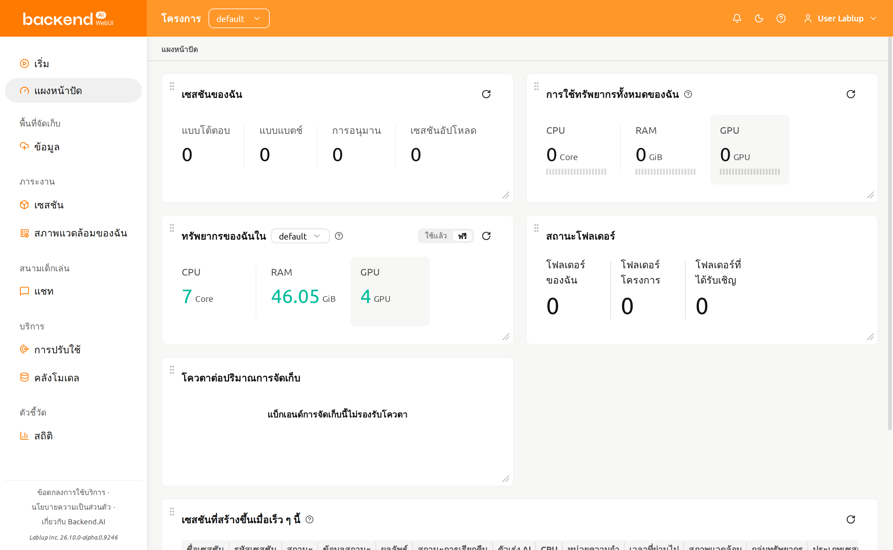
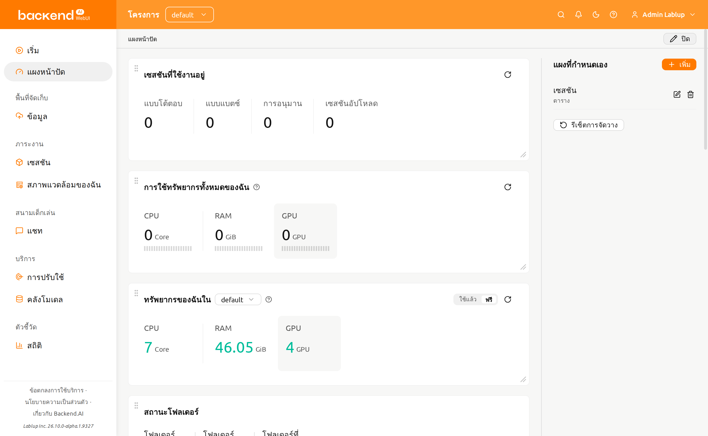
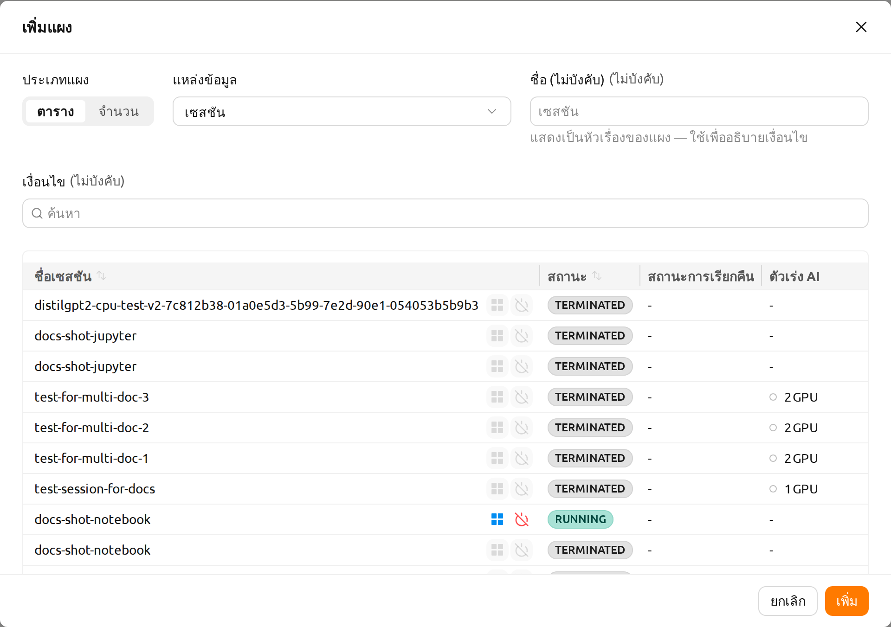

# แดชบอร์ด

**แดชบอร์ด** เป็นหน้าแรกที่คุณเห็นหลังจากเข้าสู่ระบบ โดยสรุปเซสชัน ทรัพยากร โฟลเดอร์ การปรับใช้ และกิจกรรมล่าสุดที่เป็นของคุณในโปรเจกต์ปัจจุบัน และรวมการดำเนินการที่เคยอยู่ในหน้าเริ่มต้น การ์ดทุกใบนับเฉพาะสิ่งที่เป็นของคุณ และใช้กลุ่มทรัพยากรและช่วงเวลาที่เลือกในแถบตัวกรองเหนือบอร์ด

แดชบอร์ดใหม่จะแสดงการ์ดต่อไปนี้:

- **รายการเริ่มต้นใช้งาน:**
    การ์ด **เริ่มเซสชันแบบโต้ตอบ**, **เริ่มเซสชันแบทช์**, **สร้างโฟลเดอร์จัดเก็บข้อมูลใหม่**, **เริ่มการปรับใช้** และ **เริ่มจาก URL** การ์ดแต่ละใบทำงานเดียวกับที่หน้าเริ่มต้นเคยมี ดูรายละเอียดที่ [การดำเนินการเริ่มต้น](#start-page) การ์ดของฟีเจอร์ที่ผู้ดูแลระบบปิดเมนูไว้จะไม่แสดง

- **เซสชันของฉัน:**
    แผนภูมิโดนัทของเซสชันที่ทำงานอยู่ของคุณในโปรเจกต์ปัจจุบันแยกตามประเภท (*Interactive*, *Batch*, *Inference*, *Upload*) พร้อมตารางจำนวนและสัดส่วน

- **ผลลัพธ์เซสชัน:**
    จำนวนเซสชันของคุณที่สิ้นสุดสำเร็จหรือล้มเหลวในช่วงเวลาที่เลือก การเปลี่ยนแปลงเทียบกับช่วงก่อนหน้าที่ยาวเท่ากัน และเส้นแนวโน้มขนาดเล็ก โดยนับตามเวลาที่เซสชันสิ้นสุด

- **เซสชันล่าสุดของฉัน:**
    รายการเซสชันที่คุณสร้างล่าสุดในโปรเจกต์ปัจจุบัน คลิกชื่อเซสชันเพื่อเปิดลิ้นชักรายละเอียด

- **การใช้ทรัพยากรทั้งหมดของฉัน:**
    สำหรับแต่ละกลุ่มทรัพยากรที่เลือก (หรือกลุ่มทรัพยากรที่เลือกในส่วนหัวเมื่อเลือกทั้งหมด) แสดงทรัพยากรที่เซสชันของคุณใช้ เทียบกับขีดจำกัดที่ต่ำที่สุดของคีย์แพร์ โปรเจกต์ และโดเมน

- **พรีเซ็ตทรัพยากร:**
    แสดงว่าแต่ละพรีเซ็ตทรัพยากรยังพอดีกับทรัพยากรที่คุณจัดสรรได้ในแต่ละกลุ่มทรัพยากรที่เลือกหรือไม่

- **ทรัพยากรทั้งหมดในกลุ่มทรัพยากร:**
    ทรัพยากรที่ใช้และว่างของกลุ่มทรัพยากรที่เลือก รวมจากข้อมูลของตัวแทนในกลุ่ม

:::note
การ์ด **ทรัพยากรทั้งหมดในกลุ่มทรัพยากร** อาจไม่แสดง ขึ้นอยู่กับการกำหนดค่าระบบ
:::

- **โฟลเดอร์ของฉัน:**
    จำนวนโฟลเดอร์ของคุณเทียบกับขีดจำกัดโฟลเดอร์ จำนวนโฟลเดอร์ในถังขยะ และคำเชิญโฟลเดอร์ที่รออยู่ คลิกจำนวนคำเชิญเพื่อตรวจสอบ

- **โควตาต่อปริมาณการจัดเก็บ:**
    แสดงโควตาที่ใช้ได้ในแต่ละวอลุ่มจัดเก็บ หากไม่มีโฮสต์จัดเก็บใดรองรับโควตา การ์ดจะแสดงข้อความแจ้งแทน

- **การปรับใช้ของฉัน:**
    การปรับใช้ของคุณในโปรเจกต์ปัจจุบันพร้อมสถานะเรพลิกา

- **กิจกรรมของฉัน:**
    บันทึกการตรวจสอบของการดำเนินการที่คุณทำในช่วงเวลาที่เลือก เปิด **แสดงเฉพาะที่ล้มเหลว** ในส่วนหัวของการ์ด หรือคลิกจำนวนความล้มเหลว เพื่อแสดงเฉพาะการดำเนินการที่ล้มเหลว ตัวเลือกนี้จะบันทึกไว้กับบอร์ดของคุณ

การ์ดที่รวมข้อมูลทั้งคลัสเตอร์หรือทั้งโปรเจกต์ เช่น **สถิติตัวแทน**, **ตัวแทนที่ใช้งานอยู่** และ **เซสชันที่ใช้งานอยู่** อยู่ในแดชบอร์ดผู้ดูแล (รายการแรกของเมนู **การตั้งค่าผู้ดูแลระบบ**) สำหรับผู้ดูแลระบบสูงสุดและผู้ดูแลโปรเจกต์

## การปรับแต่งเลย์เอาท์แดชบอร์ด

คุณสามารถจัดเรียงบอร์ดใหม่ได้ตลอดเวลา โดยไม่ต้องเข้าสู่โหมดใดก่อน:

- **ย้ายแผง**: ลากส่วนหัวของแผงเพื่อเปลี่ยนตำแหน่งบนบอร์ด
- **ปรับขนาดแผง**: ลากมุมขวาล่างของแผงเพื่อปรับขนาด แต่ละแผงมีขนาดขั้นต่ำเพื่อให้เนื้อหาอ่านได้ง่าย

เลย์เอาท์ที่ปรับแต่งแล้วจะถูกบันทึกอัตโนมัติและคงอยู่ระหว่างเซสชันของเบราว์เซอร์ เลย์เอาท์จะถูกจัดเก็บตามผู้ใช้ ดังนั้นผู้ใช้แต่ละคนสามารถมีการจัดเรียงที่ต้องการของตนเองได้ หากต้องการกลับไปใช้การจัดเรียงเริ่มต้น ให้คลิกปุ่ม **รีเซ็ตการจัดวาง** ที่ด้านล่างของแถบด้านข้างในโหมดแก้ไข แล้วยืนยัน การรีเซ็ตการจัดวางจะนำการ์ดเริ่มต้นที่คุณนำออกกลับมาด้วย และจะไม่ลบแผงที่กำหนดเองของคุณ

:::tip
เมื่อ WebUI ได้รับการอัปเดตพร้อมแผงแดชบอร์ดใหม่ แผงเหล่านั้นจะปรากฏบนแดชบอร์ด
ของคุณโดยอัตโนมัติ แม้ว่าคุณจะมีเลย์เอาท์ที่บันทึกไว้แล้วก็ตาม
:::

### การเพิ่มและนำการ์ดออก

คลิกปุ่ม **แก้ไข** ที่มุมขวาบนของหน้าเพื่อเปิดแถบด้านข้างสำหรับแก้ไขทางขวาของบอร์ด และคลิก **ปิด** เพื่อซ่อนอีกครั้ง รายการ **การ์ด** ในแถบด้านข้างจะแสดงการ์ดทั้งหมดที่วางบนแดชบอร์ดนี้ได้ โดยจัดกลุ่มตามประเภท และมีช่องค้นหาอยู่ด้านบน ทำเครื่องหมายที่การ์ดเพื่อเพิ่มลงในบอร์ด และยกเลิกเครื่องหมายเพื่อนำออก คุณสามารถเพิ่มการ์ดที่นำออกกลับมาได้ทุกเมื่อ การ์ดที่ใช้งานไม่ได้ในสภาพแวดล้อมนี้จะแสดงในรายการแต่ถูกปิดใช้งาน

### แผงที่กำหนดเอง

ส่วน **แผงที่กำหนดเอง** ในแถบด้านข้างสำหรับแก้ไขจะแสดงรายการแผงที่กำหนดเองของคุณ แผงที่กำหนดเองจะแสดงแหล่งข้อมูลที่คุณเลือก ซึ่งถูกกรองด้วยเงื่อนไขที่คุณกำหนด ตัวแผงจะแสดงเฉพาะชื่อและข้อมูลเท่านั้น จึงควรตั้งชื่อแผงให้สื่อถึงเงื่อนไขที่ใช้

หากต้องการเพิ่มแผง ให้คลิกปุ่ม **เพิ่ม** ในแถบด้านข้าง กล่องโต้ตอบของแผงประกอบด้วยฟิลด์ต่อไปนี้ **ประเภทแผง** และ **แหล่งข้อมูล** เป็นฟิลด์ที่จำเป็น ต้องเลือกทั้งสองอย่างจึงจะส่งกล่องโต้ตอบได้:

- **แหล่งข้อมูล**: แหล่งข้อมูลที่จะแสดงในแผง เลือกได้จาก **เซสชัน**, **การปรับใช้** หรือ **ข้อมูลและการจัดเก็บ**
- **ประเภทแผง**: วิธีแสดงผลแหล่งข้อมูลของแผง เลือกได้จาก **ตาราง** หรือ **จำนวน** และหากเลือกแหล่งข้อมูล **เซสชัน** จะมีตัวเลือก **กริด** เพิ่มขึ้นมาด้วย
- **ชื่อ**: ชื่อของแผง (ไม่บังคับ) หากไม่ระบุ ระบบจะใช้ชื่อแหล่งข้อมูลแทน
- **เงื่อนไข**: ตัวกรองคุณสมบัติที่ใช้จำกัดรายการที่แสดงในแผง

ตัวอย่างแบบเรียลไทม์ด้านล่างฟิลด์จะแสดงแถวที่ตรงกับเงื่อนไขปัจจุบัน การเรียงลำดับคอลัมน์ในตัวอย่างจะกำหนดลำดับการเรียงของแผง คลิก **เพิ่ม** เพื่อวางแผงบนบอร์ด

แผง **การปรับใช้** จะแสดงรายการการปรับใช้โมเดลของโปรเจกต์ โดยใช้ตารางเดียวกับหน้าการปรับใช้ ได้แก่ ชื่อ สถานะ สรุปเรพลิกา โมเดล และวันที่สร้าง การคลิกชื่อการปรับใช้จะเปิดหน้ารายละเอียดของการปรับใช้นั้น

เมื่อเลือก **กริด** จะแสดงกริดทรัพยากรของเซสชัน โดยแสดงทรัพยากรที่จัดสรรให้แต่ละเซสชันที่ตรงกับเงื่อนไขเป็นหน่วยเซลล์ ซึ่งมีสีตามระดับการใช้งาน การคลิกที่เซสชันจะเปิดแผงรายละเอียดของเซสชันนั้น เช่นเดียวกับการคลิกแถวในตาราง กริดจะแสดงเซสชันที่ตรงกับเงื่อนไขสูงสุด 100 รายการแรกเท่านั้น และจะมีข้อความแจ้งเตือนเมื่อมีมากกว่านั้น

การตั้งค่าการแสดงผลของกริด (โหมดทรัพยากร/เคอร์เนล ทรัพยากรหรือเมตริกที่จะแสดง หน่วยหน่วยความจำ และรูปแบบการจัดวาง) จะกำหนดในตัวอย่างแบบเรียลไทม์ของกล่องโต้ตอบเพิ่ม/แก้ไขแผง และจะถูกบันทึกไว้พร้อมกับแผง ตัวแผงเองไม่มีตัวควบคุมสำหรับการตั้งค่าเหล่านี้ ดังนั้นหากต้องการมุมมองอื่น ให้สร้างแผงเพิ่มอีกหนึ่งแผง

:::note
**กริด** เป็นฟีเจอร์ทดลอง โดยจะปรากฏในตัวเลือก **ประเภทแผง** ก็ต่อเมื่อเปิดใช้งาน **Session resource grid view** ใน[คุณสมบัติการทดลอง](#experimental-features) หากปิดการตั้งค่านี้ในภายหลัง แผง กริด ที่มีอยู่แล้วจะยังคงการตั้งค่าที่บันทึกไว้ แต่จะแสดงผลเป็นตารางเซสชันจนกว่าจะเปิดการตั้งค่านี้อีกครั้ง
:::

หากต้องการเปลี่ยนแหล่งข้อมูล ประเภทแผง เงื่อนไข หรือชื่อของแผงในภายหลัง ให้คลิกไอคอนดินสอ (**แก้ไข**) ข้างแผงในแถบด้านข้าง หรือที่ส่วนหัวของแผงบนบอร์ด แล้วบันทึกการเปลี่ยนแปลง หากต้องการลบแผง ให้คลิกไอคอนถังขยะ (**ลบ**) แล้วยืนยันในป๊อปอัป

:::note
แผง **เซสชัน** และ **การปรับใช้** แสดงข้อมูลของโปรเจกต์ปัจจุบันและใช้งานได้กับสมาชิกโปรเจกต์ทุกคน แผง **ข้อมูลและการจัดเก็บ** ใช้งานได้เฉพาะผู้ดูแลระบบระดับสูงเท่านั้น แผงของแหล่งข้อมูลที่สิทธิ์ปัจจุบันของคุณไม่สามารถเข้าถึงได้จะยังคงอยู่ในรายการของแถบด้านข้าง แต่จะไม่แสดงบนบอร์ด
:::

## การรีเฟรชอัตโนมัติ

ข้อมูลของแดชบอร์ดจะรีเฟรชอัตโนมัติทุก 15 วินาที แผงต่าง ๆ จึงแสดงกิจกรรมล่าสุดอยู่เสมอโดยไม่ต้องโหลดหน้าใหม่ แผงที่กำหนดเองจะรีเฟรชตามรอบเดียวกันกับแผงมาตรฐาน
