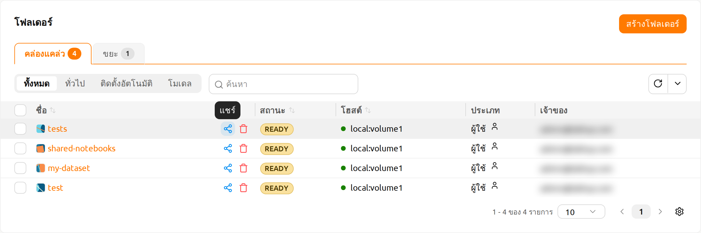
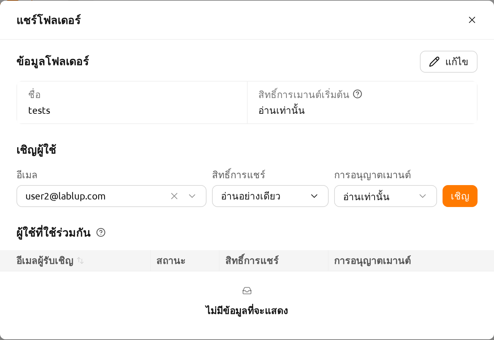
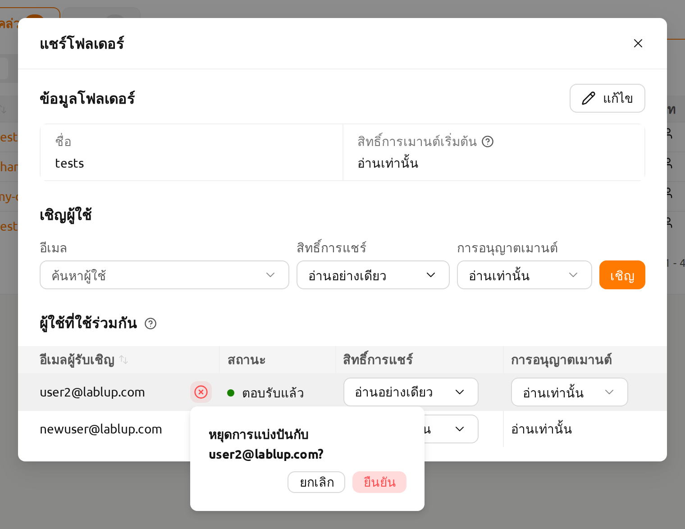

# การแชร์โฟลเดอร์จัดเก็บข้อมูลและการควบคุมการเข้าถึง

คุณอาจต้องการแชร์เนื้อหาของโฟลเดอร์จัดเก็บกับผู้ใช้หรือสมาชิกในโปรเจกต์คนอื่นเพื่อการทำงานร่วมกัน สำหรับวัตถุประสงค์นี้ Backend.AI จึงมีฟีเจอร์การแชร์โฟลเดอร์ที่ยืดหยุ่น

## แชร์โฟลเดอร์จัดเก็บกับผู้ใช้อื่น

มาเรียนรู้วิธีแชร์โฟลเดอร์จัดเก็บส่วนตัวกับผู้ใช้อื่น ขั้นแรก ให้เข้าสู่ระบบด้วยบัญชีของผู้ใช้ A แล้วไปที่หน้า Data จะพบโฟลเดอร์หลายรายการ และเราต้องการแชร์โฟลเดอร์ชื่อ `tests` ให้กับผู้ใช้ B

ภายในโฟลเดอร์ `tests` จะเห็นไฟล์และไดเรกทอรี เช่น `hello.txt` และ `myfolder`

ยืนยันว่าโฟลเดอร์ `tests` ไม่ปรากฏในรายการเมื่อเข้าสู่ระบบด้วยบัญชีผู้ใช้ B

:::note
หากมีโฟลเดอร์ชื่อ `tests` อยู่แล้วในบัญชีของผู้ใช้ B จะไม่สามารถแชร์โฟลเดอร์ `tests` ของผู้ใช้ A ให้กับผู้ใช้ B ได้
:::

กลับไปที่บัญชีผู้ใช้ A คลิกปุ่มแชร์ที่อยู่ข้างชื่อโฟลเดอร์ `tests` ในรายการ

โมดัลแชร์โฟลเดอร์จะเปิดขึ้น ในส่วน **เชิญผู้ใช้** ให้เลือกผู้ใช้ B จากตัวเลือกผู้ใช้ กำหนด **สิทธิ์การแชร์** และ **การอนุญาตเมานต์** แล้วคลิก **เชิญ** โดย **สิทธิ์การแชร์** คือสิ่งที่การแชร์อนุญาตให้ผู้ใช้ทำกับโฟลเดอร์ ส่วน **การอนุญาตเมานต์** คือวิธีที่โฟลเดอร์ถูกเมานต์เข้ากับเซสชันของผู้ใช้ สำหรับที่อยู่ที่ยังไม่มีบัญชี ให้ใช้ **เชิญทางอีเมล**

สลับกลับไปที่บัญชีผู้ใช้ B แล้วไปที่หน้า Data หากมีคำเชิญที่รอการตอบกลับ ลิงก์ **คำเชิญที่รอดำเนินการ** จะปรากฏที่ด้านขวาบนของรายการโฟลเดอร์ และแสดงจำนวนคำเชิญที่รอดำเนินการ

การคลิกที่ลิงก์จะเปิดโมดัล **โฟลเดอร์ที่ได้รับเชิญ** ซึ่งสามารถยอมรับหรือปฏิเสธคำเชิญโฟลเดอร์ที่รอดำเนินการได้

ไปที่หน้า Data และตรวจสอบว่าโฟลเดอร์ `tests` แสดงในรายการ หากไม่เห็นในรายการ ให้ลองรีเฟรชหน้าเบราว์เซอร์ เนื่องจากคุณได้ยอมรับคำเชิญแล้ว จึงสามารถดูเนื้อหาของโฟลเดอร์ `tests` ของผู้ใช้ A ในบัญชีผู้ใช้ B ได้ ต่างจากโฟลเดอร์ที่ผู้ใช้ B สร้างเอง โฟลเดอร์ที่แชร์จะแสดงที่อยู่อีเมลของผู้ใช้ A ในคอลัมน์เจ้าของ

<!-- TODO(screenshot): User B's /data after accepting - the folder list as the invitee, with User A in the Owner column and no Mount Permission column. Not captured: the capture backend admits no second (non-admin) account, so this image still shows the retired Mount Permission column. -->

คลิกชื่อโฟลเดอร์ `tests` ในรายการ เพื่อไปยังภายในโฟลเดอร์ `tests` คุณจะเห็น `hello.txt` และ `myfolder` ที่ตรวจสอบไว้ในบัญชีผู้ใช้ A อีกครั้ง เนื่องจากผู้ใช้ A แชร์โฟลเดอร์นี้แบบ `อ่านเท่านั้น` การดำเนินการที่ต้องใช้สิทธิ์เขียนในโฟลเดอร์เอ็กซ์พลอเรอร์จะถูกปิดใช้งาน ได้แก่ ปุ่ม **อัพโหลด** **สร้างโฟลเดอร์** **ลบ** และปุ่ม **Rename** ที่อยู่ข้างแต่ละรายการ ผู้ใช้ B จึงทำได้เพียงเรียกดูและดาวน์โหลดเนื้อหาของโฟลเดอร์เท่านั้น

มาสร้างเซสชันการคำนวณโดยเมาท์โฟลเดอร์จัดเก็บนี้ด้วยบัญชีผู้ใช้ B

หลังจากสร้างเซสชัน ให้เปิดเว็บเทอร์มินัลและตรวจสอบว่าโฟลเดอร์ `tests` ถูกเมาท์ในโฟลเดอร์โฮม เนื้อหาของโฟลเดอร์ `tests` จะถูกแสดง แต่การพยายามสร้างหรือลบไฟล์จะไม่ได้รับอนุญาต เนื่องจากผู้ใช้ A แชร์เป็นแบบอ่านเท่านั้น หากแชร์โดยรวมสิทธิ์การเขียน ผู้ใช้ B จะสามารถสร้างไฟล์ในโฟลเดอร์ `tests` ได้

วิธีนี้ คุณสามารถแชร์โฟลเดอร์จัดเก็บส่วนตัวกับผู้ใช้อื่นได้ตามบัญชีอีเมลของ Backend.AI ของคุณ

:::note
Backend.AI ยังมีฟีเจอร์แชร์โฟลเดอร์โปรเจกต์ให้กับสมาชิกในโปรเจกต์อีกด้วย สำหรับรายละเอียด โปรดดู[การแชร์โฟลเดอร์จัดเก็บโปรเจกต์กับสมาชิกในโปรเจกต์](#share-project-storage-folders-with-project-members)
:::

## ปรับแต่งสิทธิ์สำหรับโฟลเดอร์ที่แชร์

คุณสามารถแก้ไขสิทธิ์ของผู้ใช้ที่แชร์ได้จากโมดัลแชร์โฟลเดอร์ ตาราง **ผู้ใช้ที่ใช้ร่วมกัน** จะแสดงทั้งผู้ใช้ที่ยอมรับคำเชิญแล้วและคำเชิญที่ยังรอการตอบกลับ ให้เปลี่ยน **สิทธิ์การแชร์** หรือ **การอนุญาตเมานต์** ในแถวของผู้ใช้

ส่วน **ข้อมูลโฟลเดอร์** ของโมดัลจะแสดง **สิทธิ์การเมานต์เริ่มต้น** ของโฟลเดอร์ คลิก **แก้ไข** เพื่อเปลี่ยนค่า

:::note
แม้ว่าผู้ใช้จะได้รับสิทธิ์อ่านและเขียน การเปลี่ยนชื่อโฟลเดอร์สามารถทำได้เฉพาะเจ้าของเท่านั้น โปรดทราบว่าสิทธิ์อ่านและเขียนไม่รวมถึงการเปลี่ยนชื่อโฟลเดอร์
:::

## หยุดการแชร์โฟลเดอร์

หากต้องการหยุดแชร์โฟลเดอร์ในฐานะผู้เชิญ ให้คลิกปุ่มแชร์ที่อยู่ข้างชื่อโฟลเดอร์ในรายการโฟลเดอร์เพื่อเปิดโมดัลแชร์โฟลเดอร์ ในตาราง **ผู้ใช้ที่ใช้ร่วมกัน** ให้คลิก **หยุดการแบ่งปัน** ในแถวของผู้ใช้ที่ต้องการลบออก กล่องโต้ตอบยืนยันจะปรากฏขึ้นเพื่อขอการยืนยัน คลิก `ยืนยัน` เพื่อเพิกถอนสิทธิ์การเข้าถึงของผู้ใช้ สำหรับคำเชิญที่ยังรอการตอบกลับ ให้ใช้ **ยกเลิกคำเชิญ** เพื่อถอนคำเชิญแทน

หากผู้ได้รับเชิญไม่ต้องการเข้าถึงโฟลเดอร์ที่แชร์อีกต่อไป ให้คลิกปุ่มแชร์ข้างโฟลเดอร์ในรายการโฟลเดอร์เพื่อเปิดโมดัลสิทธิ์โฟลเดอร์ที่แชร์ ในตารางสิทธิ์ ให้คลิกไอคอนออกในคอลัมน์**ควบคุม**เพื่อออกจากโฟลเดอร์ที่แชร์ กล่องโต้ตอบยืนยันจะปรากฏก่อนดำเนินการ

